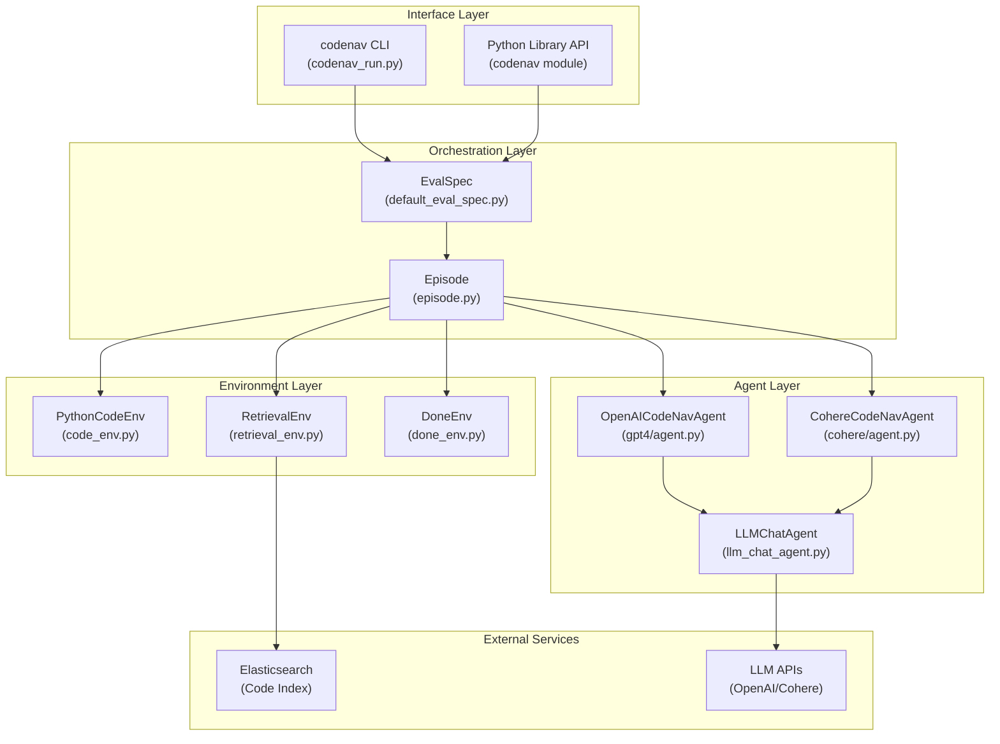
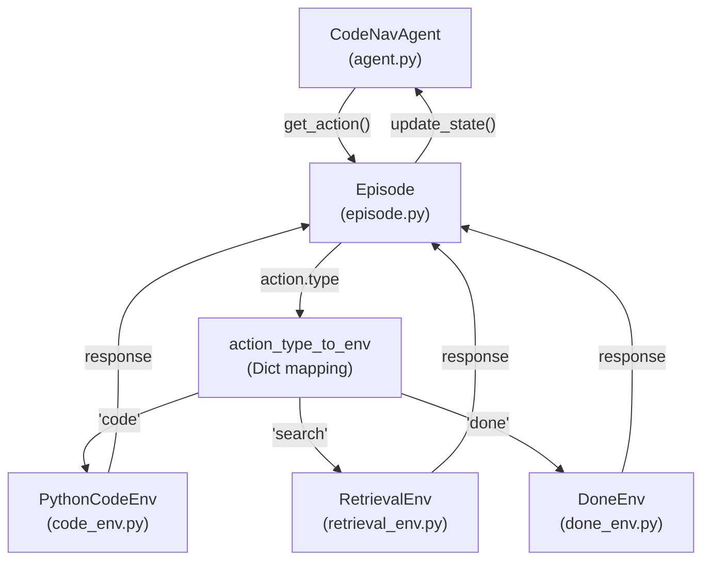
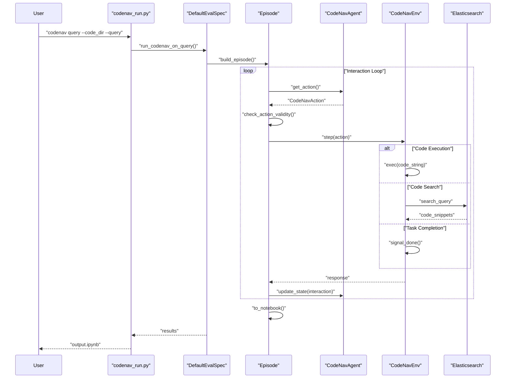

<!-- source: DeepWiki mcp.deepwiki.com · repo allenai/codenav · page 3 Core Architecture · fetched 2026-10-26 -->

# Core Architecture

Relevant source files

The following files were used as context for generating this wiki page:

- [README.md](README.md)
- [codenav/interaction/episode.py](codenav/interaction/episode.py)

This document provides a comprehensive overview of CodeNav's core architectural components and their interactions. It covers the main system layers, data flow patterns, and how the various subsystems coordinate to enable LLM-powered code navigation. For detailed information about specific components, see [CLI Interface](#3.1), [Agent System](#3.2), [Environment System](#3.3), and [Episode Management](#3.4).

## System Overview

CodeNav implements a layered architecture that separates concerns between user interfaces, agent orchestration, environment management, and external services. The system is designed around the concept of `Episodes` that manage interactions between LLM `Agents` and specialized `Environments`.

### Primary Architecture Layers

**Sources:** [codenav/codenav_run.py](), [codenav/interaction/episode.py](), [codenav/agents/gpt4/agent.py](), [codenav/environments/code_env.py](), [codenav/environments/retrieval_env.py]()

## Core Components

### Episode Management
The `Episode` class serves as the central orchestrator, managing the interaction lifecycle between agents and environments. Each episode maintains:

- An `agent` instance implementing the `CodeNavAgent` interface
- An `action_type_to_env` mapping that routes actions to appropriate environments
- A `user_query_str` that defines the task to be solved

### Agent System
The agent layer provides an abstraction for different LLM providers through the `CodeNavAgent` interface. Key implementations include:

- `OpenAICodeNavAgent` - Uses OpenAI's GPT models
- `CohereCodeNavAgent` - Uses Cohere's language models
- `LLMChatAgent` - Base class providing common chat functionality

### Environment System
Environments handle specific types of actions through the `CodeNavEnv` interface:

- `PythonCodeEnv` - Executes Python code and tracks execution state
- `RetrievalEnv` - Searches the codebase using Elasticsearch
- `DoneEnv` - Handles task completion signals

## Component Interaction Patterns

### Action-Environment Routing

**Sources:** [codenav/interaction/episode.py:22-26](), [codenav/interaction/episode.py:55-68](), [codenav/environments/abstractions.py]()

### Episode Lifecycle Management

The episode execution follows a standardized pattern implemented in the `step()` method:

1. **Initialization**: Add user query message to agent state
2. **Action Generation**: Agent produces `CodeNavAction` based on current state  
3. **Action Validation**: Episode validates action against environment constraints
4. **Environment Execution**: Route action to appropriate environment for processing
5. **State Update**: Incorporate environment response into agent state
6. **Iteration**: Repeat until maximum steps or `done` action

| Component | Responsibility | Key Methods |
|-----------|----------------|-------------|
| `Episode` | Orchestration, validation, routing | `step()`, `check_action_validity()` |
| `CodeNavAgent` | Action generation, state management | `get_action()`, `update_state()` |
| `CodeNavEnv` | Action execution, response generation | `step()`, `check_action_validity()` |

**Sources:** [codenav/interaction/episode.py:70-115](), [codenav/agents/agent.py](), [codenav/environments/abstractions.py]()

## Data Flow Architecture

### Message Flow Between Components

**Sources:** [codenav/codenav_run.py](), [codenav/interaction/episode.py:70-115](), [codenav/environments/code_env.py](), [codenav/environments/retrieval_env.py]()

### State Management

The system maintains state through several key data structures:

- **Episode State**: Managed by `Episode.agent.episode_state.interactions`
- **Code Environment State**: Tracked in `PythonCodeEnv` execution context
- **Retrieval State**: Cached search results in `RetrievalEnv`  
- **Agent State**: Conversation history and context in `CodeNavAgent`

The `Episode` class provides methods to export this state for analysis:

- `tabulate_interactions()` - DataFrame of all agent-environment interactions
- `tabulate_exec_trace()` - DataFrame of code execution history  
- `to_notebook()` - Jupyter notebook representation of the episode

**Sources:** [codenav/interaction/episode.py:162-184](), [codenav/interaction/episode.py:185-244](), [codenav/environments/code_env.py]()

## Configuration and Extensibility

The architecture supports extensibility through well-defined interfaces:

- **New LLM Providers**: Implement `CodeNavAgent` interface
- **New Environment Types**: Implement `CodeNavEnv` interface  
- **Custom Evaluation Logic**: Extend `EvalSpec` abstract base class
- **Custom Interaction Formatting**: Implement `InteractionFormatter` interface

The system uses dependency injection patterns where the `Episode` constructor accepts agent and environment instances, enabling flexible configuration and testing.

**Sources:** [codenav/agents/agent.py](), [codenav/environments/abstractions.py](), [codenav/evaluation/eval_types.py](), [codenav/agents/interaction_formatters.py]()

---

