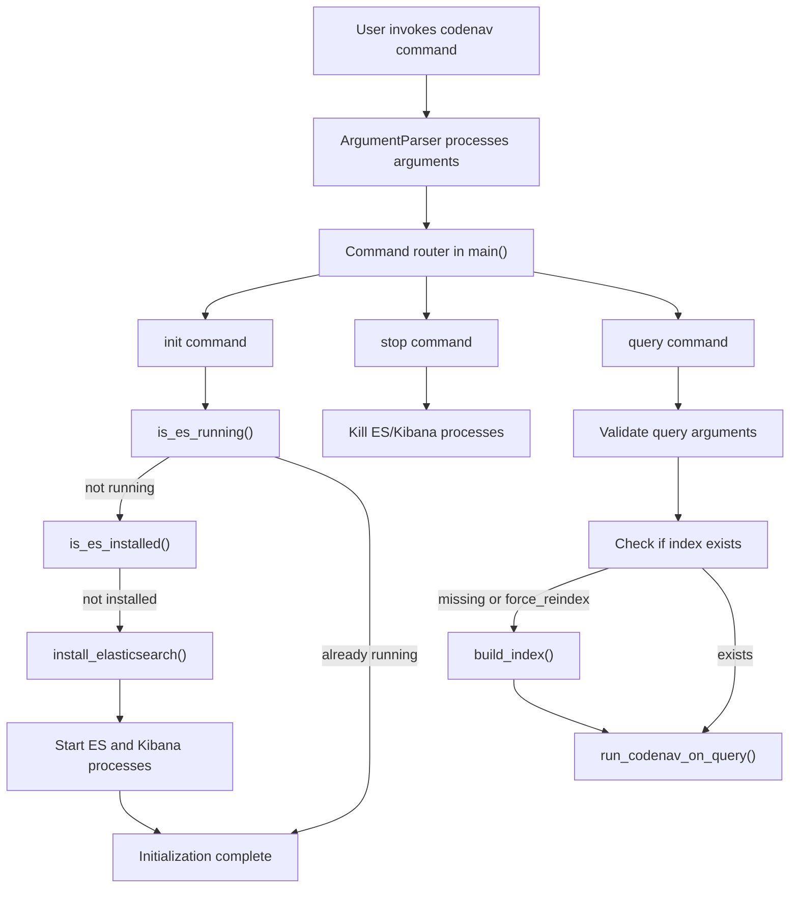
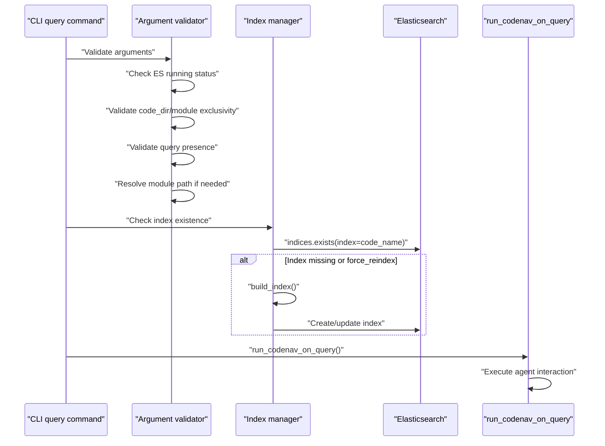
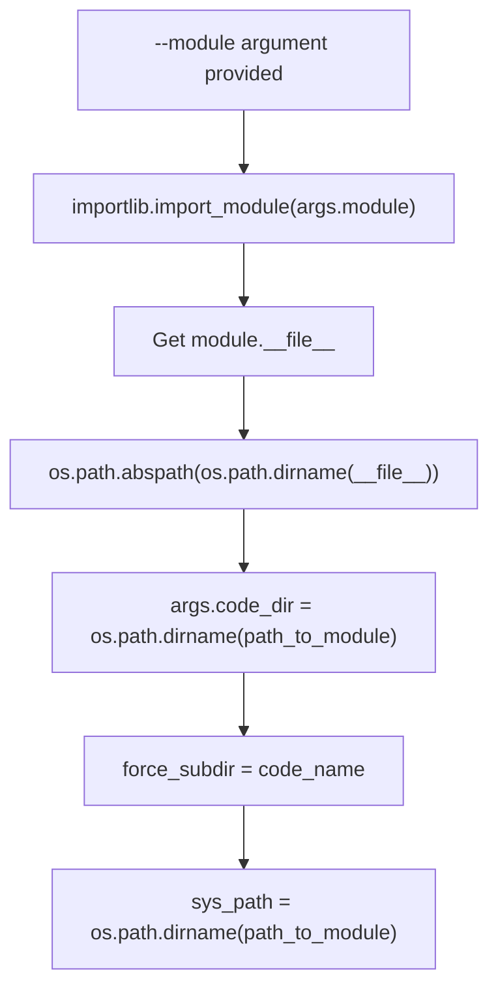

<!-- source: DeepWiki mcp.deepwiki.com · repo allenai/codenav · page 3.1 CLI Interface · fetched 2026-10-26 -->

# CLI Interface

<details>
<summary>Relevant source files</summary>

The following files were used as context for generating this wiki page:

- [codenav/codenav_run.py](codenav/codenav_run.py)

</details>


This document covers the command-line interface (CLI) for CodeNav, which provides the primary user entry point for interacting with the system. The CLI handles Elasticsearch server management, code indexing, and query execution through three main commands.

For information about the underlying evaluation framework that the CLI invokes, see [Evaluation Framework](#4). For details about Elasticsearch integration and indexing, see [Elasticsearch Integration](#6).

## Overview

The CLI is implemented in `codenav_run.py` and provides three primary commands through the `main()` function:

- **`init`**: Sets up and starts Elasticsearch and Kibana servers
- **`stop`**: Terminates running Elasticsearch and Kibana processes  
- **`query`**: Executes code navigation queries against an indexed codebase

### CLI Command Flow



Sources: [codenav/codenav_run.py:109-255]()

## Commands

### init Command

The `init` command initializes the CodeNav environment by setting up Elasticsearch and Kibana servers.

#### Functionality

The `run_init()` function performs the following operations:

1. **Server Status Check**: Uses `is_es_running()` to ping Elasticsearch at the default host
2. **Installation Verification**: Calls `is_es_installed()` to check for existing installation
3. **Automatic Installation**: Downloads and installs Elasticsearch if not present via `install_elasticsearch()`
4. **Port Availability**: Validates that ports 9200 (Elasticsearch) and 5601 (Kibana) are available
5. **Process Startup**: Launches both servers as background processes
6. **Health Monitoring**: Polls server status for up to 100 seconds with 10-second intervals

```bash
codenav init
```

The command outputs process IDs and access URLs upon successful initialization.

Sources: [codenav/codenav_run.py:40-107]()

### stop Command

The `stop` command terminates running Elasticsearch and Kibana processes by killing all processes that match the installation paths.

```bash
codenav stop
```

The implementation uses shell commands to identify and terminate processes:

```bash
ps aux | grep {ES_PATH} | grep -v grep | awk '{print $2}' | xargs kill
ps aux | grep {KIBANA_PATH} | grep -v grep | awk '{print $2}' | xargs kill
```

Sources: [codenav/codenav_run.py:179-183]()

### query Command

The `query` command executes code navigation queries against an indexed codebase. This is the primary functional command for CodeNav.

#### Prerequisites

- Elasticsearch must be running (verified by `is_es_running()`)
- Either `--code_dir` or `--module` must be specified
- Query must be provided via `--query` or `--query_file`
- `--playground_dir` must be specified for agent workspace

#### Execution Flow



Sources: [codenav/codenav_run.py:184-248]()

## Command-Line Arguments

### Global Arguments

| Argument | Type | Description | Commands |
|----------|------|-------------|----------|
| `command` | str | Command to execute: `init`, `stop`, `query` | All |

### Code Source Arguments

| Argument | Type | Default | Description |
|----------|------|---------|-------------|
| `--code_dir` | str | None | Path to codebase directory |
| `--module` | str | None | Python module name to analyze |

These arguments are mutually exclusive - exactly one must be provided for `query` command.

### Query Arguments

| Argument | Type | Default | Description |
|----------|------|---------|-------------|
| `--query`, `-q` | str | None | Natural language query description |
| `--query_file`, `-f` | str | None | File path containing query text |

These arguments are mutually exclusive - exactly one must be provided for `query` command.

### Execution Control Arguments

| Argument | Type | Default | Description |
|----------|------|---------|-------------|
| `--playground_dir` | str | None | Agent working directory (required) |
| `--max_steps` | int | 20 | Maximum interaction rounds |

### Indexing Control Arguments

| Argument | Type | Default | Description |
|----------|------|---------|-------------|
| `--force_reindex` | bool | False | Delete existing index and rebuild |
| `--force_subdir` | str | None | Index only specified subdirectory |
| `--repo_description_path` | str | None | Path to codebase description file |

Sources: [codenav/codenav_run.py:111-174]()

## Argument Processing Logic

### Module Resolution

When `--module` is specified instead of `--code_dir`, the CLI performs module resolution:



This logic automatically determines the appropriate directory structure for Python modules.

Sources: [codenav/codenav_run.py:211-218]()

### Index Name Generation

The system generates index names from the codebase:

- For `--code_dir`: Uses `os.path.basename(args.code_dir)`
- For `--module`: Uses the module's directory name

The index name is used both for Elasticsearch index identification and as the `index_uid` parameter in `build_index()`.

Sources: [codenav/codenav_run.py:216, 223, 228-236]()

## Integration with Core Systems

### Elasticsearch Integration

The CLI manages Elasticsearch through several integration points:

- **Server Management**: Direct process control via `subprocess.Popen`
- **Index Operations**: Uses `Elasticsearch` client for index existence checks
- **Index Building**: Delegates to `build_index()` function from the retrieval module

### Evaluation Framework Integration

The `query` command culminates in a call to `run_codenav_on_query()` with processed arguments:

```python
run_codenav_on_query(
    exp_name=sanitized_query_name,
    out_dir=args.playground_dir,
    query=args.q,
    code_dir=resolved_code_path,
    sys_paths=[sys_path],
    index_name=code_name,
    working_dir=args.playground_dir,
    max_steps=args.max_steps,
    repo_description_path=args.repo_description_path,
)
```

This bridges the CLI interface to the core evaluation and episode management systems.

Sources: [codenav/codenav_run.py:238-248]()

---

