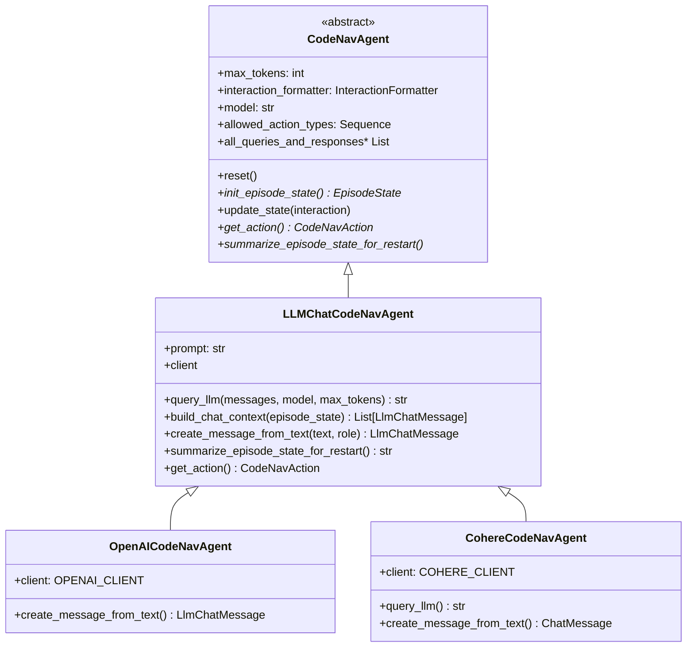
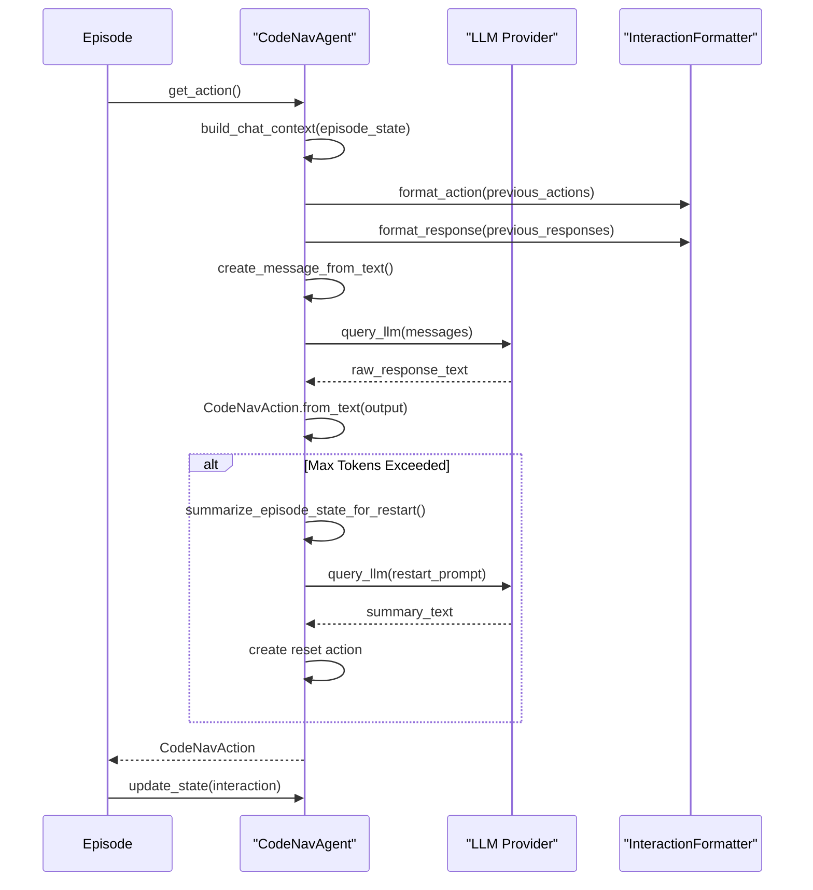
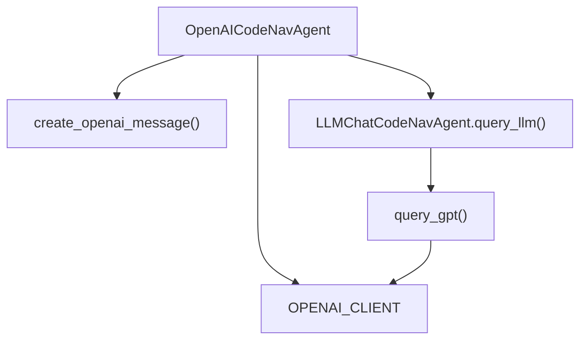
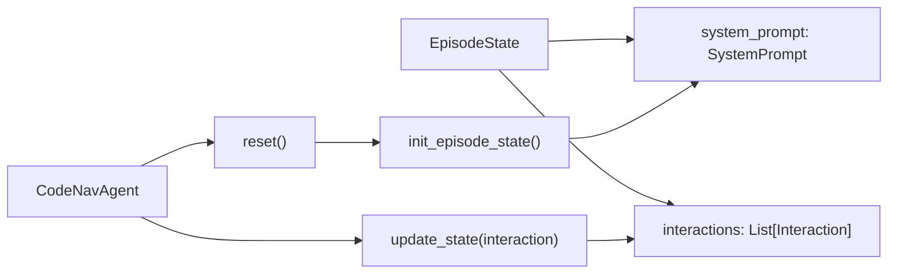
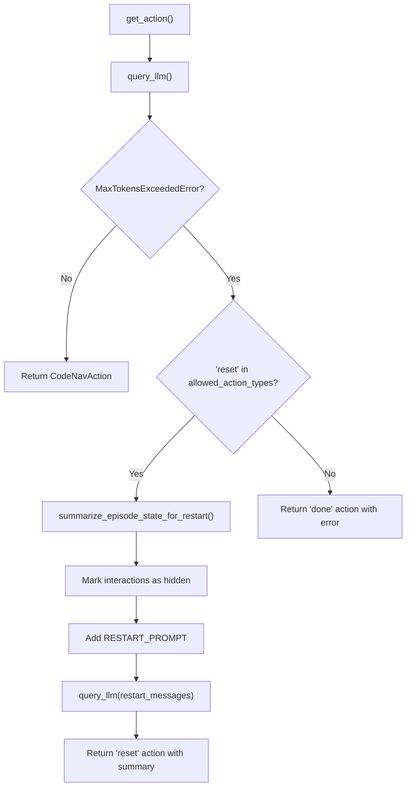
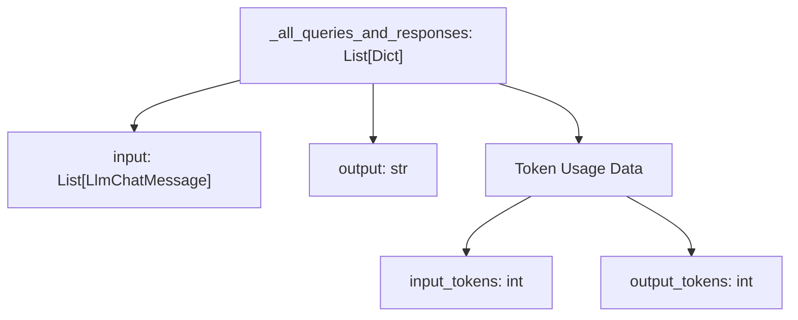

<!-- source: DeepWiki mcp.deepwiki.com · repo allenai/codenav · page 3.2 Agent System · fetched 2026-10-26 -->

# Agent System

Relevant source files

The following files were used as context for generating this wiki page:

- [codenav/agents/agent.py](codenav/agents/agent.py)
- [codenav/agents/cohere/agent.py](codenav/agents/cohere/agent.py)
- [codenav/agents/gpt4/agent.py](codenav/agents/gpt4/agent.py)
- [codenav/agents/llm_chat_agent.py](codenav/agents/llm_chat_agent.py)

## Purpose and Scope

The Agent System provides the core LLM-powered intelligence layer of CodeNav, responsible for interpreting user queries, maintaining conversation state, and generating actions to navigate codebases. This page covers the abstract agent interface, concrete implementations for different LLM providers, and the interaction patterns between agents and the episode management system.

For information about how agents interact with different execution environments, see [Environment System](#3.3). For details on how agents are orchestrated within episodes, see [Episode Management](#3.4).

## Agent Architecture Overview

The agent system follows a layered architecture with an abstract base class defining the interface and concrete implementations for specific LLM providers.

### Agent Class Hierarchy

**Sources:** [codenav/agents/agent.py:8-57](), [codenav/agents/llm_chat_agent.py:30-181](), [codenav/agents/gpt4/agent.py:10-38](), [codenav/agents/cohere/agent.py:13-92]()

### Core Agent Components

| Component | Class | Purpose |
|-----------|-------|---------|
| Abstract Interface | `CodeNavAgent` | Defines the contract for all agent implementations |
| Chat Foundation | `LLMChatCodeNavAgent` | Provides chat-based interaction patterns and common LLM functionality |
| OpenAI Provider | `OpenAICodeNavAgent` | Integrates with OpenAI's GPT models |
| Cohere Provider | `CohereCodeNavAgent` | Integrates with Cohere's Command models |

**Sources:** [codenav/agents/agent.py:8](), [codenav/agents/llm_chat_agent.py:30](), [codenav/agents/gpt4/agent.py:10](), [codenav/agents/cohere/agent.py:13]()

## Agent Lifecycle and Action Generation

The following diagram illustrates how agents generate actions during episode execution:

### Agent Action Generation Flow

**Sources:** [codenav/agents/llm_chat_agent.py:155-181](), [codenav/agents/llm_chat_agent.py:94-127](), [codenav/agents/agent.py:26-27]()

## LLM Provider Integration

### Provider-Specific Implementations

Each LLM provider implements the abstract methods with provider-specific client configurations and message formats.

#### OpenAI Integration

The `OpenAICodeNavAgent` leverages the OpenAI client with standardized chat completion message formats:

**Sources:** [codenav/agents/gpt4/agent.py:33-37](), [codenav/constants.py](), [codenav/utils/llm_utils.py]()

#### Cohere Integration

The `CohereCodeNavAgent` implements custom retry logic and Cohere-specific message formatting:

- **Retry Logic**: Up to 50 retries with 5-second delays for rate limiting [codenav/agents/cohere/agent.py:54-72]()
- **Message Format**: Custom role mapping (`USER`, `CHATBOT`, `SYSTEM`) [codenav/agents/cohere/agent.py:84-91]()
- **Token Tracking**: Detailed input/output token billing information [codenav/agents/cohere/agent.py:74-82]()

**Sources:** [codenav/agents/cohere/agent.py:40-92]()

### Default Configuration

| Provider | Model | Max Tokens | Allowed Actions |
|----------|-------|------------|-----------------|
| OpenAI | `DEFAULT_OPENAI_MODEL` | 50,000 | `code`, `done`, `search`, `reset` |
| Cohere | `command-r` | 50,000 | `code`, `done`, `search`, `reset` |

**Sources:** [codenav/agents/gpt4/agent.py:14-21](), [codenav/agents/cohere/agent.py:14-24]()

## Episode State Management

Agents maintain conversation state through the `EpisodeState` object, which contains the system prompt and interaction history.

### State Update Process

**Sources:** [codenav/agents/agent.py:17-27](), [codenav/agents/llm_chat_agent.py:88-89]()

### Chat Context Building

The `build_chat_context()` method converts episode state into LLM-compatible message format:

1. **System Message**: Added from `episode_state.system_prompt.content` [codenav/agents/llm_chat_agent.py:98-102]()
2. **Action Formatting**: Previous actions formatted using `interaction_formatter.format_action()` [codenav/agents/llm_chat_agent.py:107-116]()
3. **Response Formatting**: Environment responses formatted using `interaction_formatter.format_response()` [codenav/agents/llm_chat_agent.py:117-126]()
4. **Hidden Interactions**: Interactions marked as `hidden` are excluded from context [codenav/agents/llm_chat_agent.py:104-105]()

**Sources:** [codenav/agents/llm_chat_agent.py:94-127]()

## Token Management and Restart Mechanism

When token limits are exceeded, agents implement an automatic restart mechanism to maintain conversation continuity.

### Restart Process

**Sources:** [codenav/agents/llm_chat_agent.py:155-181](), [codenav/agents/llm_chat_agent.py:129-153]()

### Hidden Interaction Management

During restart, previous interactions are marked as hidden to reduce context size while preserving variable state information:

- **Hidden Flag**: `interaction.hidden = True` [codenav/agents/llm_chat_agent.py:171]()
- **Hidden Index**: `interaction.hidden_at_index` tracks when hiding occurred [codenav/agents/llm_chat_agent.py:167-170]()
- **Variable Preservation**: Current environment variables are extracted and included in restart prompt [codenav/agents/llm_chat_agent.py:137-148]()

**Sources:** [codenav/agents/llm_chat_agent.py:165-172](), [codenav/prompts/restart_prompt.py]()

## Query and Response Tracking

All agents maintain detailed logs of LLM interactions for debugging and analysis:

### Tracking Structure

Each query-response pair is stored with complete input context and token usage information for cost tracking and performance analysis.

**Sources:** [codenav/agents/llm_chat_agent.py:79-86](), [codenav/agents/cohere/agent.py:74-82]()

---

