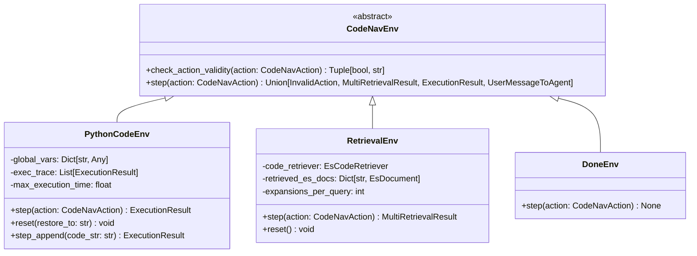
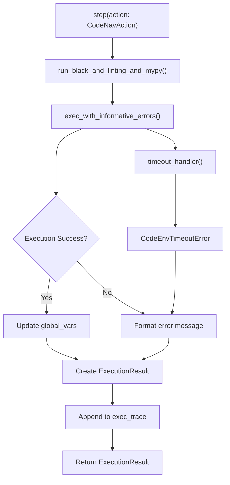
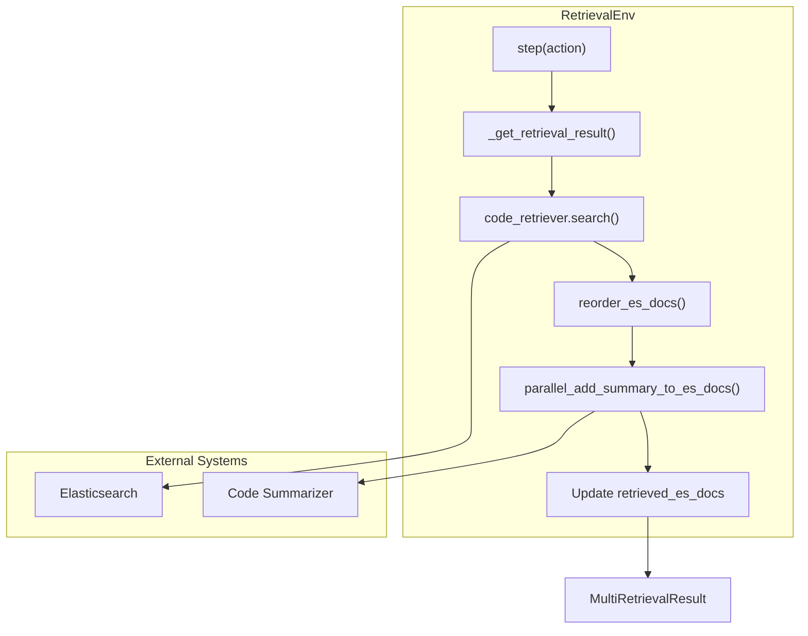
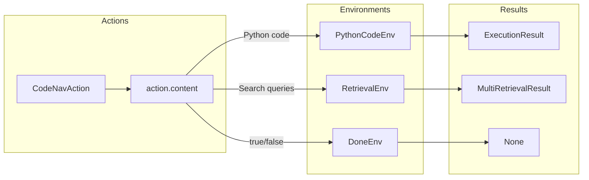

<!-- source: DeepWiki mcp.deepwiki.com · repo allenai/codenav · page 3.3 Environment System · fetched 2026-10-26 -->

# Environment System

<details>
<summary>Relevant source files</summary>

The following files were used as context for generating this wiki page:

- [codenav/environments/abstractions.py](codenav/environments/abstractions.py)
- [codenav/environments/code_env.py](codenav/environments/code_env.py)
- [codenav/environments/done_env.py](codenav/environments/done_env.py)
- [codenav/environments/retrieval_env.py](codenav/environments/retrieval_env.py)

</details>


## Purpose and Scope

The Environment System provides the execution contexts and interfaces for different types of actions that LLM agents can perform within CodeNav. This system abstracts three primary environment types: code execution, code retrieval, and task completion. Each environment implements a common interface while providing specialized functionality for handling different action types.

For information about how environments are orchestrated within episodes, see [Episode Management](#3.4). For details about the agents that interact with these environments, see [Agent System](#3.2).

## Environment Abstraction

The environment system is built around the `CodeNavEnv` abstract base class, which defines the contract that all environments must implement.



All environments implement two core methods:
- `check_action_validity()` - Validates whether an action can be executed
- `step()` - Executes the action and returns appropriate results

**Sources:** [codenav/environments/abstractions.py:13-24]()

## Code Execution Environment

The `PythonCodeEnv` class provides a sandboxed Python execution environment with comprehensive state management and error handling.

### Core Functionality

The environment maintains persistent state across code executions through several key components:

| Component | Purpose | Type |
|-----------|---------|------|
| `global_vars` | Runtime variable state | `Dict[str, Any]` |
| `exec_trace` | Execution history | `List[ExecutionResult]` |
| `working_dir` | File system context | `str` |
| `max_execution_time` | Timeout protection | `float` |

### Execution Flow



The `exec_with_informative_errors()` function provides enhanced error reporting by extracting line numbers and context from execution failures [codenav/environments/code_env.py:50-131]().

### State Management

The environment tracks variable changes by comparing string representations before and after execution:

```python
# Variables considered "updated" if representation changed
updated_vars: Dict[str, Any] = {
    k: v for k, v in self.global_vars.items()
    if (k in code_str or (k not in var_name_to_repr and not is_double_underscore_format(k)))
    and str(v) != var_name_to_repr.get(k, "")
}
```

**Sources:** [codenav/environments/code_env.py:134-350](), [codenav/environments/code_env.py:274-283]()

## Retrieval Environment

The `RetrievalEnv` class interfaces with Elasticsearch to provide code search and retrieval capabilities.

### Architecture



### Query Processing

The environment processes search queries through multiple stages:

1. **Query Parsing** - Handles multi-line queries by splitting on newlines
2. **Elasticsearch Search** - Uses `EsCodeRetriever.search()` with configurable limits
3. **Deduplication** - Filters previously retrieved documents using `es_doc_to_hash()`
4. **Reordering** - Prioritizes code blocks by type and excludes test files
5. **Summarization** - Optionally adds AI-generated summaries to code blocks

### Document Prioritization

The `reorder_es_docs()` function assigns scores based on code block types:

| Code Block Type | Base Score | Test File Penalty |
|----------------|------------|-------------------|
| `FUNCTION`, `CLASS`, `DOCUMENTATION` | 0.0 | +2.0 |
| `IMPORT`, `ASSIGNMENT` | 1.0 | +2.0 |
| Other types | 2.0 | +2.0 |

**Sources:** [codenav/environments/retrieval_env.py:47-149](), [codenav/environments/retrieval_env.py:16-44]()

## Done Environment

The `DoneEnv` class handles task completion signals with minimal validation logic.

### Validation Logic

The environment accepts only boolean string values:

```python
def check_action_validity(self, action: CodeNavAction) -> Tuple[bool, str]:
    if action.content.strip().lower() in ["true", "false"]:
        return True, ""
    else:
        return (False, "When executing the done action, the content must be either 'True' or 'False'")
```

The `step()` method returns `None`, signaling episode termination to the orchestrating system.

**Sources:** [codenav/environments/done_env.py:7-21]()

## Environment Interaction Patterns

### Action-Result Mapping



### State Persistence

Each environment manages state differently:

- **PythonCodeEnv**: Maintains persistent `global_vars` and `exec_trace` across actions
- **RetrievalEnv**: Tracks `retrieved_es_docs` to prevent duplicate results
- **DoneEnv**: Stateless operation

### Error Handling

Environments implement different error handling strategies:

| Environment | Error Type | Handling Strategy |
|-------------|------------|-------------------|
| `PythonCodeEnv` | Execution errors | Enhanced traceback with line context |
| `PythonCodeEnv` | Timeout | `CodeEnvTimeoutError` with timeout duration |
| `RetrievalEnv` | Query parsing | Graceful degradation with error message |
| `DoneEnv` | Invalid content | Validation rejection with specific message |

**Sources:** [codenav/environments/abstractions.py:13-24](), [codenav/environments/code_env.py:46-131](), [codenav/environments/retrieval_env.py:75-92]()

---

