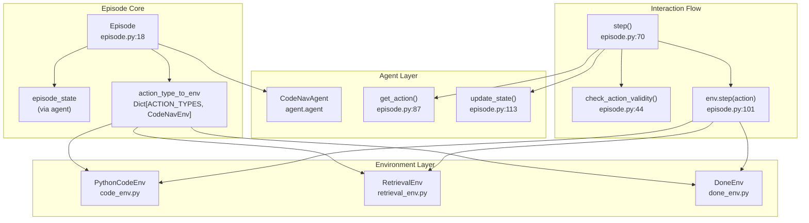
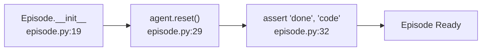
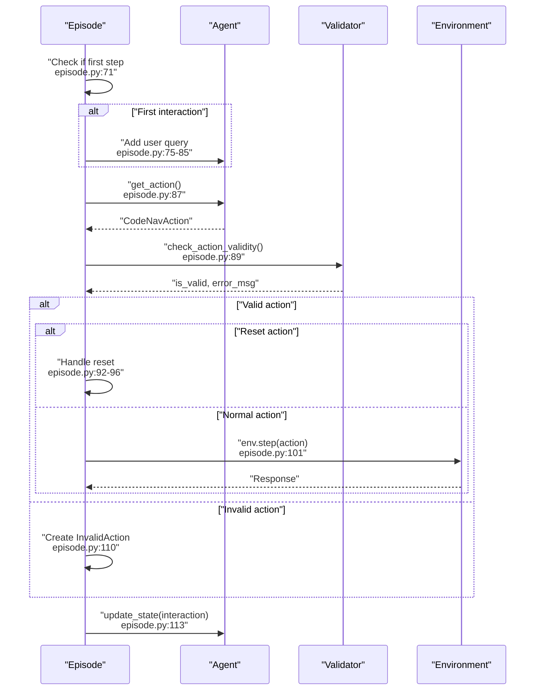
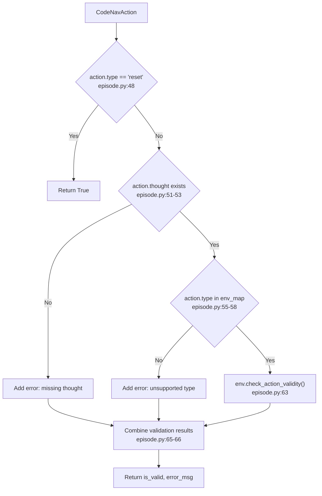
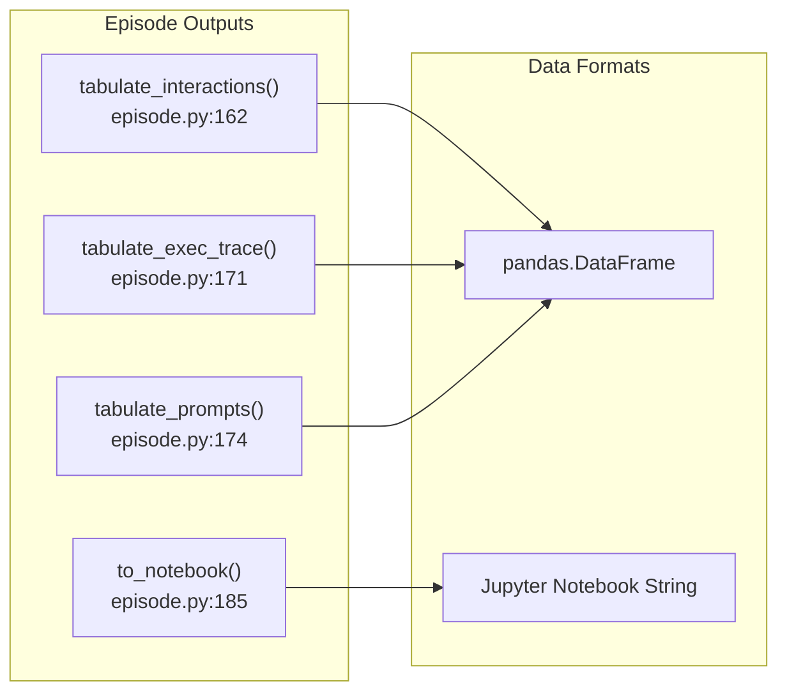
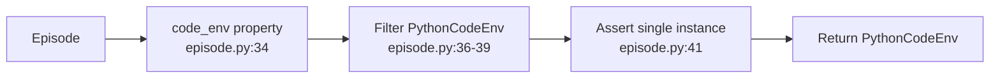

<!-- source: DeepWiki mcp.deepwiki.com · repo allenai/codenav · page 3.4 Episode Management · fetched 2026-10-26 -->

# Episode Management

Relevant source files

The following files were used as context for generating this wiki page:

- [codenav/interaction/episode.py](codenav/interaction/episode.py)

This document covers the Episode Management system in CodeNav, which orchestrates the interaction lifecycle between LLM agents and environments. The Episode class serves as the central coordinator that manages state, validates actions, executes interaction steps, and formats outputs.

For information about the specific agent implementations, see [Agent System](#3.2). For details about the different environment types, see [Environment System](#3.3). For prompt creation and formatting, see [Prompt System](#5).

## Purpose and Scope

The Episode Management system is responsible for:

- Orchestrating multi-step interactions between agents and environments
- Validating agent actions before execution
- Managing episode state and interaction history
- Converting episodes to various output formats (notebooks, DataFrames)
- Handling errors and invalid actions gracefully
- Coordinating environment resets and state management

## Core Episode Architecture

The `Episode` class acts as the central orchestrator in CodeNav's interaction system:

Sources: [codenav/interaction/episode.py:18-33]()

## Episode Initialization

Episodes are initialized with three core components that define their operational context:

| Component | Type | Purpose |
|-----------|------|---------|
| `agent` | `CodeNavAgent` | LLM agent that generates actions |
| `action_type_to_env` | `Dict[ACTION_TYPES, CodeNavEnv]` | Maps action types to their execution environments |
| `user_query_str` | `str` | The user's query that initiates the episode |

The initialization process includes validation to ensure required action types are available:

The episode requires at minimum `done` and `code` action types to be present in the environment mapping.

Sources: [codenav/interaction/episode.py:18-33]()

## Interaction Lifecycle

The core interaction loop is managed through the `step()` method, which coordinates action generation, validation, and execution:

Sources: [codenav/interaction/episode.py:70-115]()

## Action Validation System

The episode validates agent actions before execution using a two-tier validation approach:

Sources: [codenav/interaction/episode.py:44-68]()

## Multi-Step Execution

Episodes can run until completion or a maximum step limit using `step_until_max_steps_or_success()`:

| Parameter | Purpose |
|-----------|---------|
| `max_steps` | Maximum number of interaction steps to execute |
| `verbose` | Whether to print step-by-step progress |

The execution loop terminates when:
- Maximum steps are reached
- Agent issues a valid `done` action
- Keyboard interrupt occurs

Sources: [codenav/interaction/episode.py:117-135]()

## Output Generation System

Episodes provide multiple output formats for analysis and debugging:

### Interaction Records

Each interaction is converted to a standardized record format containing:

| Field | Content |
|-------|---------|
| `action/thought` | Agent's reasoning |
| `action/type` | Action type (code, search, done) |
| `action/content` | Action content/payload |
| `response` | Environment response |
| `hidden` | Whether interaction is hidden |

Sources: [codenav/interaction/episode.py:137-169]()

## Code Environment Integration

Episodes provide direct access to the Python code execution environment through a property:

This integration allows episodes to access execution traces and working directory information for output generation.

Sources: [codenav/interaction/episode.py:34-42]()

## Error Handling and Recovery

The episode system includes robust error handling for various failure scenarios:

### Keyboard Interrupt Handling
When code execution is interrupted, the episode captures the current state and generates a notebook before re-raising the exception.

### Invalid Action Handling
Invalid actions are wrapped in `InvalidAction` response objects that provide detailed error messages to the agent.

### Reset Action Support
Episodes support a special `reset` action that:
- Sends a pickup prompt to the agent
- Resets retrieval environment state
- Allows episodes to recover from problematic states

Sources: [codenav/interaction/episode.py:92-111]()

---

