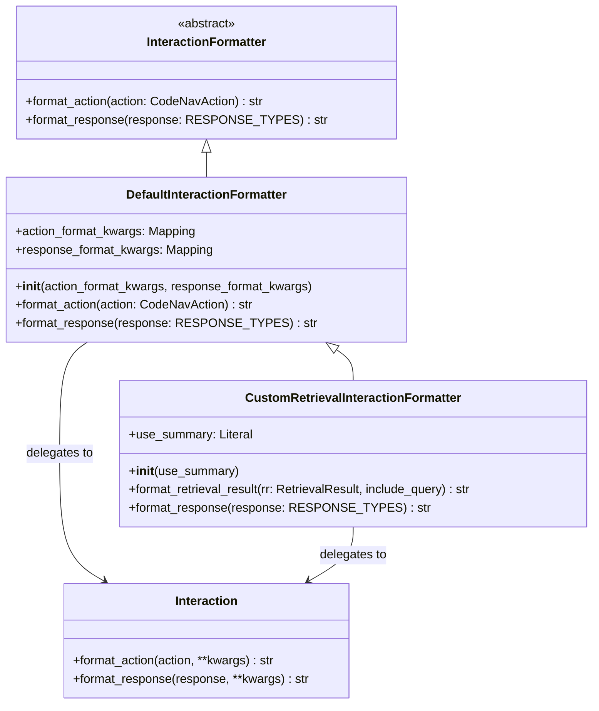
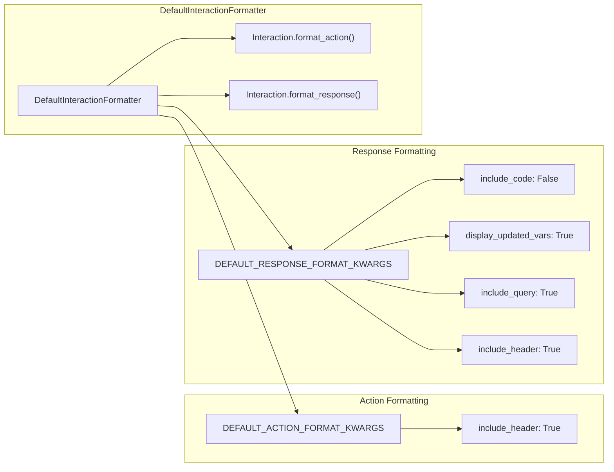
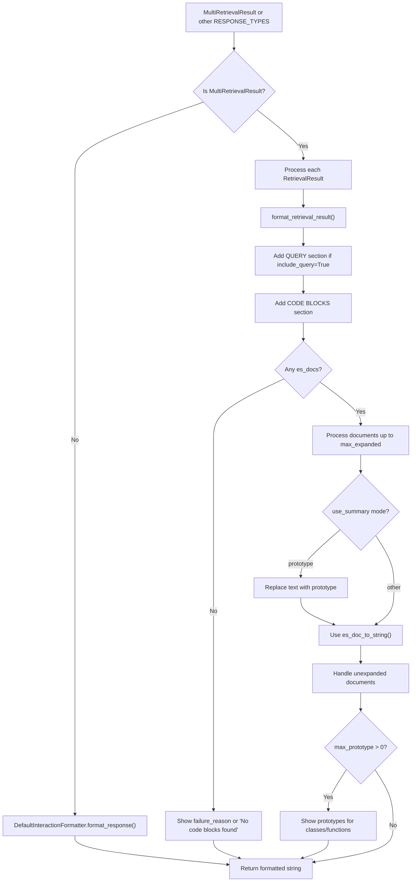
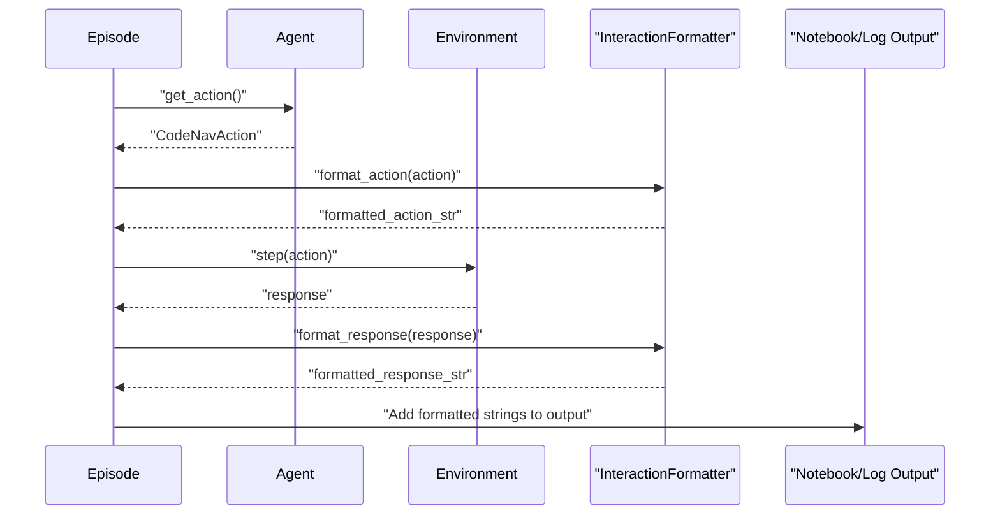

<!-- source: DeepWiki mcp.deepwiki.com · repo allenai/codenav · page 3.5 Interaction Formatting · fetched 2026-10-26 -->

# Interaction Formatting

<details>
<summary>Relevant source files</summary>

The following files were used as context for generating this wiki page:

- [codenav/agents/interaction_formatters.py](codenav/agents/interaction_formatters.py)

</details>


## Purpose and Scope

This document covers how CodeNav formats interactions between agents and environments for display and logging. Interaction formatting controls how agent actions and environment responses are converted to human-readable text that can be displayed in notebooks, logs, or passed back to LLM agents as context.

For information about the overall interaction lifecycle, see [Episode Management](#3.4). For details about the specific message types being formatted, see [Agent System](#3.2) and [Environment System](#3.3).

## Overview

The interaction formatting system provides a pluggable way to customize how `CodeNavAction` objects and environment responses are converted to text. This is essential because different use cases may require different levels of detail, different formatting styles, or specialized handling for specific response types.

The system is built around the `InteractionFormatter` abstract base class, which defines the interface for all formatters. The most common implementation is `DefaultInteractionFormatter`, with specialized variants like `CustomRetrievalInteractionFormatter` for handling search results.

**Interaction Formatting Architecture**



Sources: [codenav/agents/interaction_formatters.py:1-131]()

## Base Formatter Interface

The `InteractionFormatter` abstract base class defines the core interface that all formatters must implement:

```python
class InteractionFormatter(abc.ABC):
    def format_action(self, action: CodeNavAction):
        raise NotImplementedError

    def format_response(self, response: RESPONSE_TYPES):
        raise NotImplementedError
```

This interface ensures that any formatter can handle both:
- **Actions**: What the agent wants to do (code execution, search queries, completion signals)  
- **Responses**: Results from environments (execution output, search results, status messages)

Sources: [codenav/agents/interaction_formatters.py:28-34]()

## Default Formatter Implementation

The `DefaultInteractionFormatter` provides the standard formatting behavior used in most scenarios. It delegates the actual formatting work to static methods on the `Interaction` class, but allows configuration through keyword arguments.

**Default Configuration Constants**



The default formatter accepts two configuration mappings:
- `action_format_kwargs`: Controls how actions are formatted
- `response_format_kwargs`: Controls how responses are formatted

Key formatting options include:
- `include_header`: Whether to include action/response type headers
- `include_code`: Whether to show full code content in responses
- `display_updated_vars`: Whether to show variable changes after code execution
- `include_query`: Whether to show the original search query with results

Sources: [codenav/agents/interaction_formatters.py:14-25](), [codenav/agents/interaction_formatters.py:36-56]()

## Custom Retrieval Formatter

The `CustomRetrievalInteractionFormatter` extends the default formatter with specialized handling for search results. It provides fine-grained control over how code blocks are displayed when retrieved from Elasticsearch.

**Retrieval Formatting Flow**



The custom formatter supports several summary modes:
- `"always"`: Always use summary instead of full code
- `"never"`: Never use summary, show full code
- `"ifshorter"`: Use summary only if it's shorter than full code
- `"prototype"`: Replace text with prototype for classes/functions

Sources: [codenav/agents/interaction_formatters.py:58-131]()

## Retrieval Result Formatting Details

When formatting retrieval results, the `CustomRetrievalInteractionFormatter` implements a sophisticated display strategy:

| Element | Description | Configuration |
|---------|-------------|---------------|
| Query Section | Shows the original search query | `include_query` parameter |
| Expanded Results | Full code blocks up to `max_expanded` limit | `use_summary` mode controls detail level |
| Unexpanded Summary | Count of additional results not shown | Always shown if results exceed `max_expanded` |
| Prototype Preview | Function/class signatures for unexpanded results | Controlled by `max_prototype` limit |

**Example formatting structure:**
```
QUERY:
search for authentication functions

CODE BLOCKS:
---
[Full code block 1]
---
[Full code block 2]  
---
(15 additional code blocks not shown. Search again with the same query to see additional results.)

Prototypes for the next 5 out of 12 classes/functions found in unexpanded results:
def authenticate_user(username: str, password: str) -> bool:
class AuthenticationManager:
```

The formatter uses `es_doc_to_string()` from the Elasticsearch integration to convert individual documents to text, allowing it to leverage the same formatting logic used throughout the retrieval system.

Sources: [codenav/agents/interaction_formatters.py:65-131]()

## Integration with Episode System

Interaction formatters are used throughout the episode lifecycle to ensure consistent formatting across different output formats:

**Formatter Usage in Episode Flow**



The formatted strings are used in multiple contexts:
- Jupyter notebook cell outputs for interactive exploration
- Conversation history passed back to LLM agents
- Evaluation logs and traces
- Debug output and monitoring

This ensures that whether a user is viewing results in a notebook or an agent is processing conversation history, the formatting remains consistent and appropriately configured for the use case.

Sources: [codenav/agents/interaction_formatters.py:1-131]()

---

