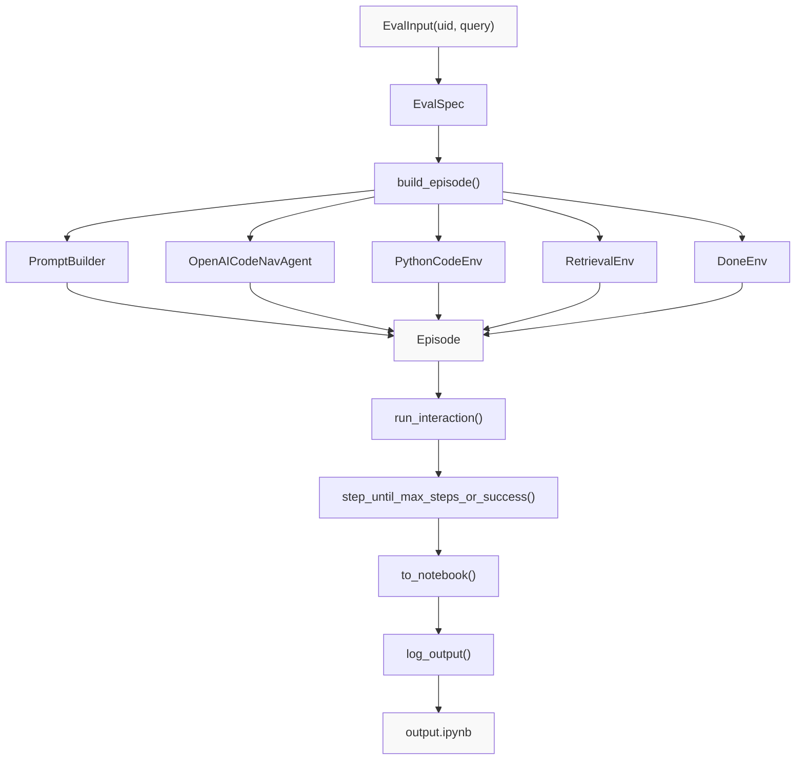
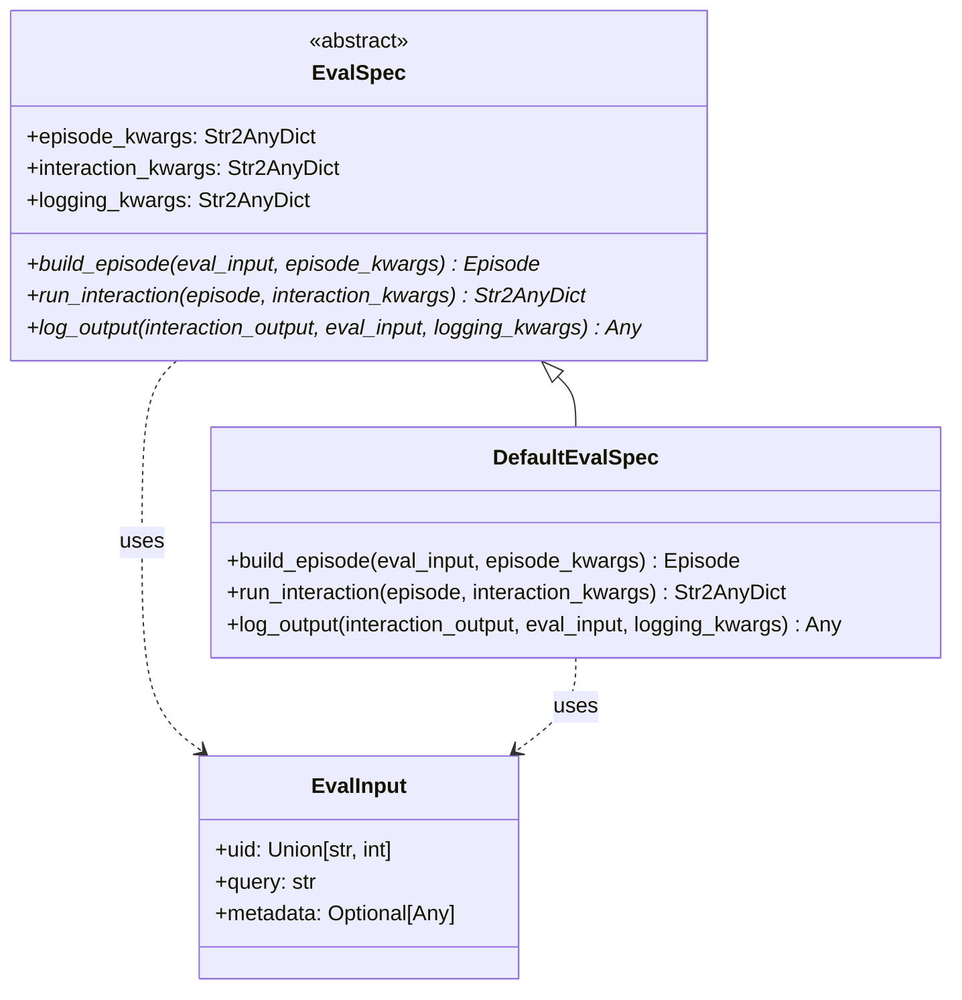
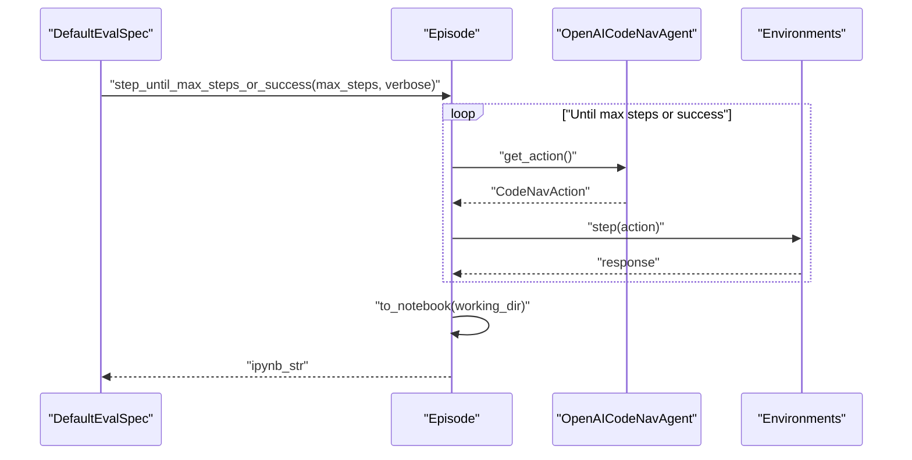
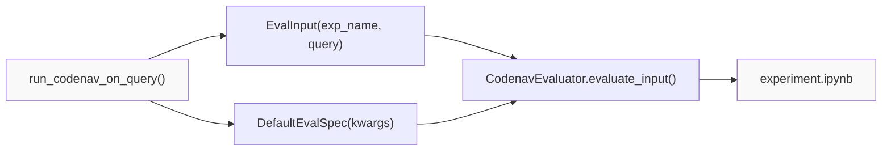

<!-- source: DeepWiki mcp.deepwiki.com · repo allenai/codenav · page 4 Evaluation Framework · fetched 2026-10-26 -->

# Evaluation Framework

Relevant source files

The following files were used as context for generating this wiki page:

- [codenav/default_eval_spec.py](codenav/default_eval_spec.py)
- [codenav/utils/eval_types.py](codenav/utils/eval_types.py)

The Evaluation Framework provides a standardized system for running experiments and evaluations with CodeNav's LLM-powered code navigation capabilities. This framework defines abstractions for configuring, executing, and logging evaluation runs in a consistent and reproducible manner.

The framework handles the complete lifecycle of an evaluation: building episodes with specific configurations, running agent-environment interactions, and logging outputs in structured formats. For details about the specific evaluation implementations, see [Evaluation Specifications](#4.1). For information about running evaluations at scale, see [Parallel Evaluation](#4.2).

## Core Evaluation Concepts

The evaluation system is built around three key abstractions that work together to provide a flexible framework for experimentation:

| Component | Purpose | Key Responsibility |
|-----------|---------|-------------------|
| `EvalInput` | Input specification | Contains query and unique identifier for each evaluation |
| `EvalSpec` | Evaluation definition | Defines how to build episodes, run interactions, and log outputs |
| `CodenavEvaluator` | Execution engine | Orchestrates the evaluation process using the provided specification |

## Evaluation Workflow

Sources: [codenav/utils/eval_types.py:9-53](), [codenav/default_eval_spec.py:26-96]()

## Abstract Evaluation Interface

The `EvalSpec` abstract base class defines the contract that all evaluation specifications must implement:

Sources: [codenav/utils/eval_types.py:19-53](), [codenav/default_eval_spec.py:17-97]()

### EvalInput Specification

The `EvalInput` class encapsulates the input parameters for a single evaluation run:

- **uid**: Unique identifier for the evaluation (used for output file naming)
- **query**: Natural language query to be processed by the system
- **metadata**: Optional additional data for the evaluation

Sources: [codenav/utils/eval_types.py:9-14]()

### Three-Phase Evaluation Process

Each evaluation follows a standardized three-phase process:

1. **Episode Building** (`build_episode`): Creates an `Episode` instance with configured agents and environments
2. **Interaction Execution** (`run_interaction`): Runs the agent-environment interaction loop and generates outputs
3. **Output Logging** (`log_output`): Persists results to files or storage systems

Sources: [codenav/utils/eval_types.py:30-53]()

## Default Evaluation Implementation

The `DefaultEvalSpec` provides a complete implementation of the evaluation framework, configuring CodeNav with standard settings for most use cases:

### Episode Configuration

The `build_episode` method constructs a fully configured `Episode` with:

| Component | Configuration | Purpose |
|-----------|--------------|---------|
| Agent | `OpenAICodeNavAgent` with specified model | LLM-powered decision making |
| Code Environment | `PythonCodeEnv` with code directory and sys paths | Python code execution |
| Retrieval Environment | `RetrievalEnv` with `EsCodeRetriever` | Elasticsearch-based code search |
| Done Environment | `DoneEnv` | Task completion signaling |

Sources: [codenav/default_eval_spec.py:26-69]()

### Interaction Execution

The `run_interaction` method manages the episode lifecycle:

Sources: [codenav/default_eval_spec.py:71-82]()

### Output Management

The `log_output` method saves interaction results as Jupyter notebooks, enabling:
- Visual inspection of the complete interaction trace
- Code execution results preservation
- Reproducible experiment documentation

Sources: [codenav/default_eval_spec.py:84-96]()

## Main Evaluation Entry Point

The `run_codenav_on_query` function provides a high-level interface for single-query evaluations:

### Configuration Parameters

| Parameter | Type | Purpose |
|-----------|------|---------|
| `exp_name` | str | Experiment identifier (becomes output filename) |
| `query` | str | Natural language query to process |
| `code_dir` | str | Target codebase directory |
| `index_name` | str | Elasticsearch index name |
| `working_dir` | str | Code execution workspace |
| `max_steps` | int | Maximum interaction steps (default: 20) |

### Default Configuration

The function establishes standard settings for most CodeNav operations:

- **Allowed Actions**: `["done", "code", "search"]`
- **Retrievals per Keyword**: 3 code snippets
- **Prototypes per Keyword**: 7 function signatures
- **LLM Model**: Configured via `DEFAULT_OPENAI_MODEL`
- **Prompt System**: Uses default prompts with optional repository description

Sources: [codenav/default_eval_spec.py:99-152]()

### Integration with CodenavEvaluator

The function demonstrates the standard pattern for using the evaluation framework:

Sources: [codenav/default_eval_spec.py:143-150]()

## Integration with Core Systems

The evaluation framework serves as the primary orchestration layer that connects all major CodeNav components:

- **Agent System**: Configures and initializes LLM agents (see [Agent System](#3.2))
- **Environment System**: Sets up code execution and retrieval environments (see [Environment System](#3.3))  
- **Episode Management**: Creates and manages interaction episodes (see [Episode Management](#3.4))
- **Prompt System**: Builds prompts with repository context (see [Prompt System](#5))
- **Elasticsearch Integration**: Configures code retrieval and indexing (see [Elasticsearch Integration](#6))

The framework's abstractions enable experimentation with different configurations while maintaining consistent evaluation methodology across all CodeNav use cases.

Sources: [codenav/default_eval_spec.py:1-152](), [codenav/utils/eval_types.py:1-54]()

---

