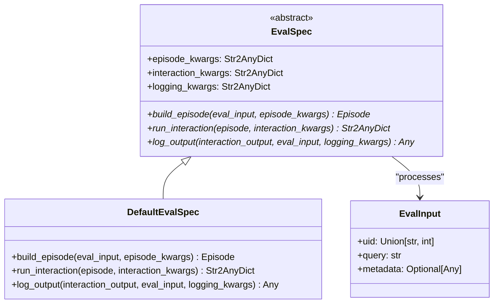
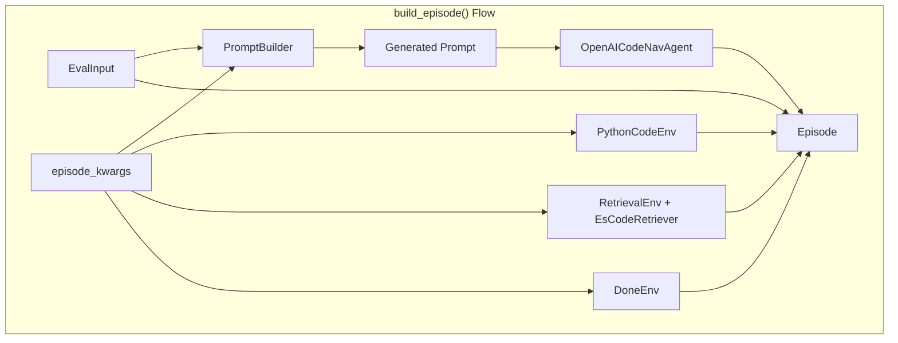
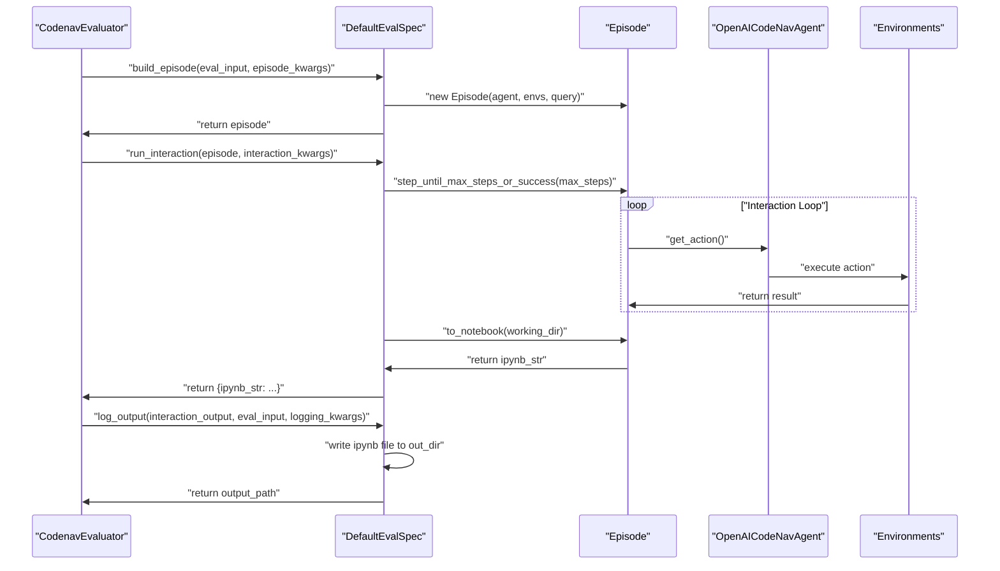

<!-- source: DeepWiki mcp.deepwiki.com · repo allenai/codenav · page 4.1 Evaluation Specifications · fetched 2026-10-26 -->

# Evaluation Specifications

<details>
<summary>Relevant source files</summary>

The following files were used as context for generating this wiki page:

- [codenav/default_eval_spec.py](codenav/default_eval_spec.py)
- [codenav/utils/eval_types.py](codenav/utils/eval_types.py)

</details>


## Purpose and Scope

This document covers the evaluation specification framework that defines how CodeNav experiments are structured and executed. The evaluation specifications provide an abstract interface for configuring episodes, running interactions, and logging outputs. For information about parallel execution of evaluations, see [Parallel Evaluation](#4.2). For details about the broader evaluation framework concepts, see [Evaluation Framework](#4).

The evaluation specification system consists of an abstract `EvalSpec` class that defines the evaluation lifecycle and a concrete `DefaultEvalSpec` implementation that provides the standard CodeNav evaluation behavior.

## Abstract EvalSpec Framework

The evaluation specification framework is built around the abstract `EvalSpec` class in [codenav/utils/eval_types.py:19-53](), which defines a three-phase evaluation lifecycle:

| Phase | Method | Purpose |
|-------|--------|---------|
| Episode Building | `build_episode()` | Creates and configures an `Episode` instance |
| Interaction Execution | `run_interaction()` | Runs the agent-environment interaction loop |
| Output Logging | `log_output()` | Processes and saves evaluation results |

### EvalSpec Class Structure



**Sources:** [codenav/utils/eval_types.py:19-53](), [codenav/default_eval_spec.py:17-96]()

## EvalInput Data Structure

The `EvalInput` class in [codenav/utils/eval_types.py:9-14]() serves as the standardized input format for evaluations:

```python
@attrs.define
class EvalInput:
    uid: Union[str, int]        # Unique identifier for the evaluation
    query: str                  # Natural language query to process
    metadata: Optional[Any]     # Additional context or configuration
```

The `uid` field is used for output file naming and tracking, while the `query` contains the natural language question that the agent will attempt to answer through code navigation.

**Sources:** [codenav/utils/eval_types.py:9-14]()

## DefaultEvalSpec Implementation

The `DefaultEvalSpec` class in [codenav/default_eval_spec.py:17-96]() provides the concrete implementation of the evaluation specification interface, configured for OpenAI GPT-based agents with Elasticsearch retrieval.

### Episode Building Phase

The `build_episode()` method [codenav/default_eval_spec.py:26-69]() constructs a complete episode with:

- **OpenAI Agent**: `OpenAICodeNavAgent` with configured prompts and allowed actions
- **Environment Mapping**: Three environments mapped to action types:
  - `code` → `PythonCodeEnv` for code execution
  - `search` → `RetrievalEnv` with `EsCodeRetriever` for code search
  - `done` → `DoneEnv` for task completion
- **Prompt Configuration**: Uses `PromptBuilder` to create contextual prompts



**Sources:** [codenav/default_eval_spec.py:26-69]()

### Interaction Execution Phase

The `run_interaction()` method [codenav/default_eval_spec.py:71-82]() executes the agent-environment interaction:

1. Calls `episode.step_until_max_steps_or_success()` with configured maximum steps
2. Converts the episode to a Jupyter notebook format using `episode.to_notebook()`
3. Returns the notebook string for logging

**Sources:** [codenav/default_eval_spec.py:71-82]()

### Output Logging Phase

The `log_output()` method [codenav/default_eval_spec.py:84-96]() handles result persistence:

1. Creates output filename using `eval_input.uid` and `.ipynb` extension
2. Writes the interaction notebook to the specified output directory
3. Returns the output file path

**Sources:** [codenav/default_eval_spec.py:84-96]()

## Evaluation Phases Flow

The complete evaluation specification workflow demonstrates how the three phases work together:



**Sources:** [codenav/default_eval_spec.py:17-96](), [codenav/utils/eval_types.py:19-53]()

## Configuration and Usage

### The run_codenav_on_query Function

The `run_codenav_on_query()` function [codenav/default_eval_spec.py:99-152]() provides a high-level interface that encapsulates the entire evaluation specification workflow:

| Parameter | Purpose | Default |
|-----------|---------|---------|
| `exp_name` | Unique experiment identifier | Required |
| `query` | Natural language query | Required |
| `code_dir` | Path to codebase to analyze | Required |
| `index_name` | Elasticsearch index name | Required |
| `max_steps` | Maximum interaction steps | 20 |
| `working_dir` | Code execution directory | `playground/` |
| `repo_description_path` | Custom repository description | None |

### Configuration Structure

The function creates three configuration dictionaries that correspond to the evaluation phases:

```python
episode_kwargs = dict(
    allowed_actions=["done", "code", "search"],
    repo_description=repo_description,
    retrievals_per_keyword=3,
    prototypes_per_keyword=7,
    llm=DEFAULT_OPENAI_MODEL,
    # ... additional configuration
)

interaction_kwargs = dict(max_steps=max_steps, verbose=True)
logging_kwargs = dict(out_dir=out_dir)
```

**Sources:** [codenav/default_eval_spec.py:99-152](), [codenav/default_eval_spec.py:126-140]()

---

