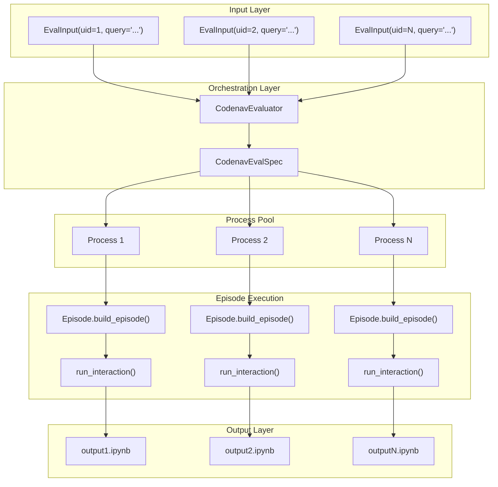
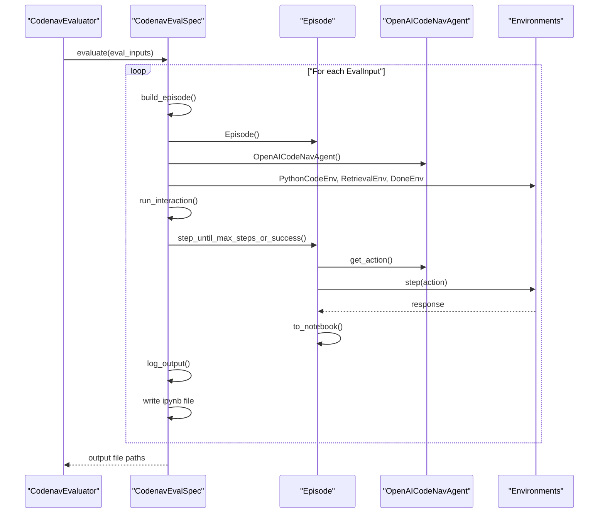
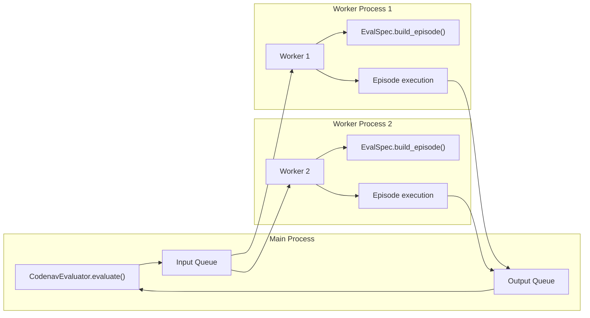
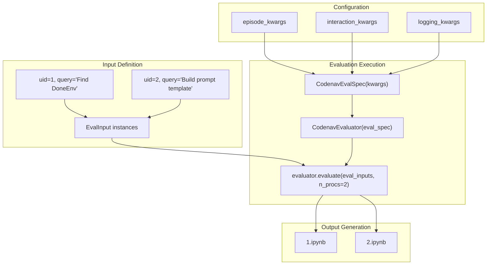

<!-- source: DeepWiki mcp.deepwiki.com · repo allenai/codenav · page 4.2 Parallel Evaluation · fetched 2026-10-26 -->

# Parallel Evaluation

<details>
<summary>Relevant source files</summary>

The following files were used as context for generating this wiki page:

- [codenav_examples/parallel_evaluation.py](codenav_examples/parallel_evaluation.py)

</details>


This document explains how to run CodeNav evaluations in parallel for scalable experimentation and batch processing. It covers the `CodenavEvaluator` class, the `EvalSpec` pattern, and how to configure and execute multiple evaluations concurrently.

For information about the underlying evaluation specifications and framework abstractions, see [Evaluation Specifications](#4.1). For details about the core agent and environment system that parallel evaluation orchestrates, see [Agent System](#3.2) and [Environment System](#3.3).

## Overview

Parallel evaluation in CodeNav enables running multiple code navigation queries simultaneously across different processes. This is essential for large-scale experimentation, benchmarking, and research workflows where you need to evaluate the system's performance across many different code queries efficiently.

The parallel evaluation system is built around two key abstractions:
- `EvalSpec`: Defines how to build episodes, run interactions, and log outputs
- `CodenavEvaluator`: Orchestrates parallel execution of evaluations using multiprocessing

**Parallel Evaluation Architecture**



Sources: [codenav_examples/parallel_evaluation.py:99-122]()

## EvalSpec Implementation

The `CodenavEvalSpec` class implements the `EvalSpec` interface to define how parallel evaluations should be executed. It requires three core methods that define the evaluation lifecycle:

| Method | Purpose | Input | Output |
|--------|---------|-------|--------|
| `build_episode` | Creates an Episode with agent and environments | `EvalInput`, `episode_kwargs` | `Episode` |
| `run_interaction` | Executes the episode interaction loop | `Episode`, `interaction_kwargs` | `Str2AnyDict` |
| `log_output` | Saves evaluation results to files | `interaction_output`, `EvalInput`, `logging_kwargs` | File path |

**EvalSpec Workflow**



Sources: [codenav_examples/parallel_evaluation.py:20-96]()

## CodenavEvaluator Process Management

The `CodenavEvaluator` class handles the multiprocessing orchestration. It takes an `EvalSpec` instance and distributes `EvalInput` objects across multiple worker processes.

**Process Distribution Pattern**



Sources: [codenav_examples/parallel_evaluation.py:106-122]()

## Configuration Parameters

Parallel evaluation requires three sets of configuration parameters:

### Episode Configuration (`episode_kwargs`)

Defines how episodes are constructed with agents and environments:

```python
episode_kwargs = {
    "allowed_actions": ["done", "code", "search"],
    "repo_description": "codenav/repo_description.txt", 
    "retrievals_per_keyword": 3,
    "prototypes_per_keyword": 7,
    "llm": "gpt-4-0125-preview",
    "code_dir": "/path/to/codebase",
    "sys_paths": ["/path/to/parent"],
    "working_dir": "/path/to/playground",
    "index_name": "codenav",
    "host": "localhost:9200"
}
```

### Interaction Configuration (`interaction_kwargs`)

Controls episode execution behavior:

```python
interaction_kwargs = {
    "max_steps": 10,
    "verbose": True
}
```

### Logging Configuration (`logging_kwargs`)

Specifies output handling:

```python
logging_kwargs = {
    "out_dir": "/path/to/outputs"
}
```

Sources: [codenav_examples/parallel_evaluation.py:125-140]()

## Example Usage

The typical workflow for running parallel evaluations:

**Complete Parallel Evaluation Setup**



The `run_parallel_evaluation` function demonstrates the complete setup:

1. Create `EvalInput` objects with unique IDs and queries
2. Configure episode, interaction, and logging parameters  
3. Instantiate `CodenavEvalSpec` with configurations
4. Create `CodenavEvaluator` with the eval spec
5. Execute `evaluator.evaluate()` with desired number of processes
6. Process outputs as they complete

Sources: [codenav_examples/parallel_evaluation.py:99-157]()

## Output Processing

Each evaluation produces a Jupyter notebook file named with the `EvalInput.uid`. The `CodenavEvaluator.evaluate()` method returns a generator that yields output file paths as evaluations complete, enabling real-time progress monitoring:

```python
for i, output in enumerate(evaluator.evaluate(eval_inputs, n_procs=2)):
    print(f"Evaluated {i+1}/{num_inputs} | Input uid: {eval_inputs[i].uid} | Output saved to {output}")
```

The generated notebooks contain the complete interaction history between the agent and environments, formatted for analysis and debugging.

Sources: [codenav_examples/parallel_evaluation.py:115-121]()

---

