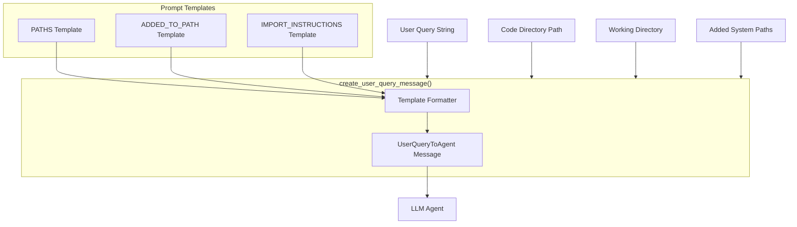
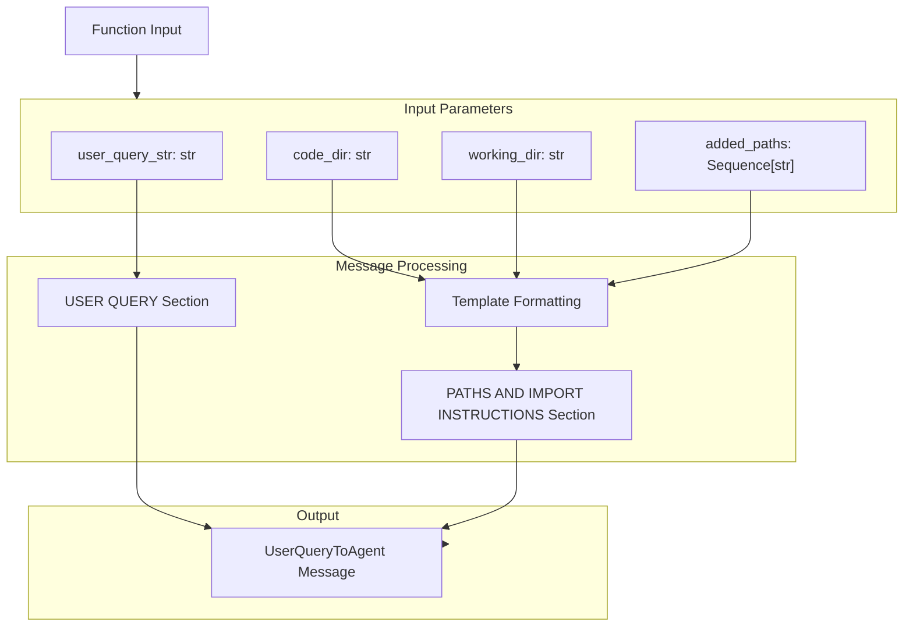
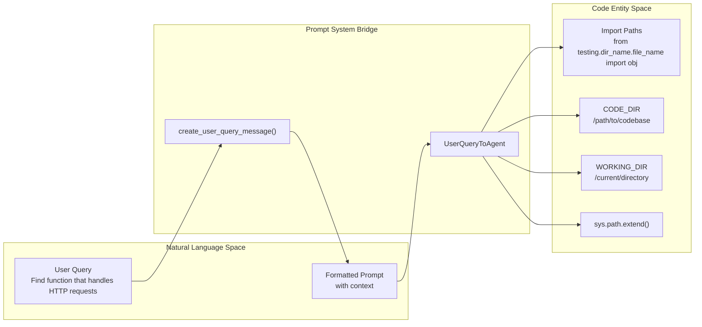

<!-- source: DeepWiki mcp.deepwiki.com · repo allenai/codenav · page 5 Prompt System · fetched 2026-10-26 -->

# Prompt System

<details>
<summary>Relevant source files</summary>

The following files were used as context for generating this wiki page:

- [codenav/prompts/query_prompt.py](codenav/prompts/query_prompt.py)

</details>


The Prompt System is responsible for formatting user queries and providing contextual information to LLM agents to enable effective code navigation. This system transforms raw user queries into structured prompts that include essential path information, import instructions, and directory context that agents need to understand and navigate codebases correctly.

For information about how agents use these prompts, see [Agent System](#3.2). For details about the interaction lifecycle, see [Episode Management](#3.4).

## Overview

The Prompt System consists of template strings and formatting functions that prepare user queries for LLM consumption. The system ensures agents receive consistent, well-structured prompts containing both the user's question and the necessary technical context to operate within a specific codebase.

**Prompt System Architecture**



Sources: [codenav/prompts/query_prompt.py:1-35]()

## Core Prompt Templates

The system defines three core template constants that provide essential context to agents:

### Path Context Template

The `PATHS` template [codenav/prompts/query_prompt.py:5-7]() informs the agent about the target codebase location and current working directory:

```
Use the code base located at `{CODE_DIR}` to solve this query. Your current directory is `{WORKING_DIR}`.
```

### System Path Template

The `ADDED_TO_PATH` template [codenav/prompts/query_prompt.py:9-15]() explains how the codebase has been made available to Python's import system:

```
The code base path has either been installed via pip or has been already been added to the system path via
```
import sys
sys.path.extend({ADDED_PATH})
```
```

### Import Instructions Template

The `IMPORT_INSTRUCTIONS` template [codenav/prompts/query_prompt.py:18-20]() provides specific guidance on how to import from retrieved code blocks:

```
If the import path in retrieved code block says `testing/dir_name/file_name.py` and you want to import variable, function or class called `obj` from this file, then import using `from testing.dir_name.file_name import obj`.
```

Sources: [codenav/prompts/query_prompt.py:5-20]()

## Message Creation Process

The `create_user_query_message` function [codenav/prompts/query_prompt.py:23-34]() is the primary interface for creating formatted prompts. It takes user queries and context information and produces structured `UserQueryToAgent` messages.

**Message Creation Flow**



Sources: [codenav/prompts/query_prompt.py:23-34]()

## Prompt Structure

The generated prompts follow a consistent two-section structure that separates user intent from technical context:

| Section | Content | Purpose |
|---------|---------|---------|
| `USER QUERY` | Raw user query string | Contains the actual question or task |
| `PATHS AND IMPORT INSTRUCTIONS` | Formatted templates with directory and import context | Provides technical context for code navigation |

The final message format combines these sections:
```
USER QUERY:

{user_query_str}

PATHS AND IMPORT INSTRUCTIONS:

{PATHS}

{IMPORT_INSTRUCTIONS}

{ADDED_TO_PATH}
```

Sources: [codenav/prompts/query_prompt.py:30-33]()

## Integration with Agent System

The Prompt System produces `UserQueryToAgent` messages that are consumed by the agent system. These messages provide the initial context that agents use to begin code navigation tasks.

**Natural Language to Code Entity Bridge**



Sources: [codenav/prompts/query_prompt.py:1-35](), [codenav/interaction/messages.py]()

The Prompt System serves as a critical bridge between human-readable queries and the structured information that LLM agents need to effectively navigate and understand codebases within the CodeNav framework.

---

