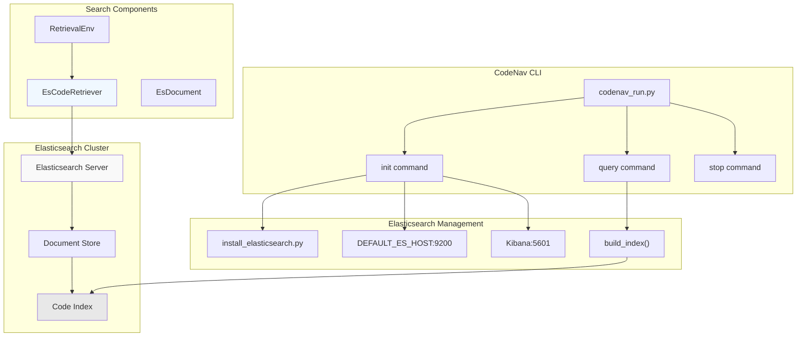
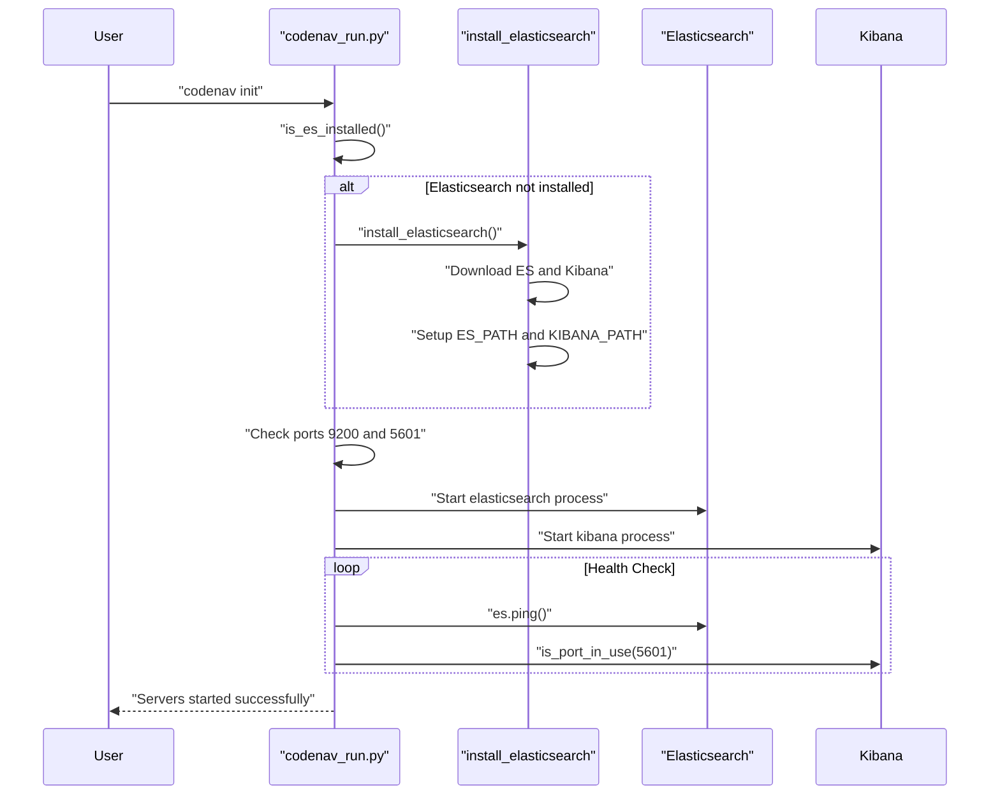
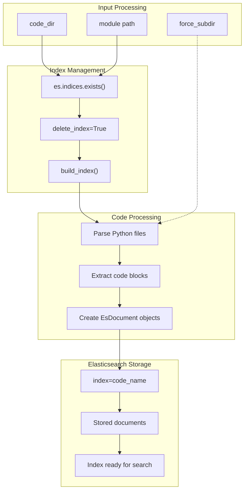
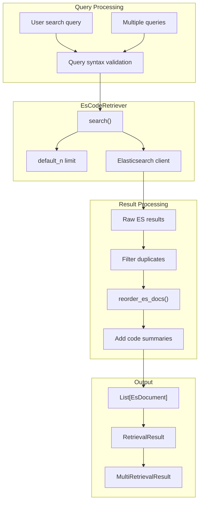
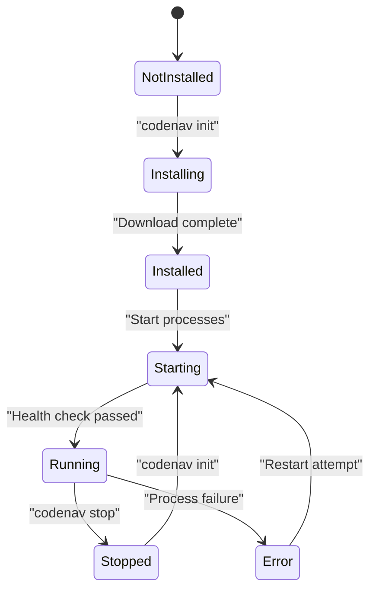

<!-- source: DeepWiki mcp.deepwiki.com · repo allenai/codenav · page 6 Elasticsearch Integration · fetched 2026-10-26 -->

# Elasticsearch Integration

<details>
<summary>Relevant source files</summary>

The following files were used as context for generating this wiki page:

- [README.md](README.md)
- [codenav/codenav_run.py](codenav/codenav_run.py)
- [codenav/environments/retrieval_env.py](codenav/environments/retrieval_env.py)

</details>


## Purpose and Scope

This document covers CodeNav's integration with Elasticsearch for code indexing, search, and retrieval. The Elasticsearch integration serves as the foundation for CodeNav's ability to search through large codebases and find relevant code snippets for LLM agents.

For information about how search results are used by agents, see [Agent System](#3.2). For details about the retrieval environment that interfaces with Elasticsearch, see [Environment System](#3.3).

## Overview

CodeNav uses Elasticsearch as its primary search backend to enable semantic and keyword-based search over code repositories. The system automatically downloads, installs, and manages Elasticsearch instances, while providing a seamless interface for code indexing and retrieval operations.

**Core Components:**
- **Installation Management**: Automatic Elasticsearch and Kibana installation
- **Index Management**: Code parsing and document creation for search
- **Search Interface**: Query processing and result retrieval via `EsCodeRetriever`
- **Document Processing**: Code block extraction and metadata management

**Elasticsearch Architecture Overview**


Sources: [codenav/codenav_run.py:1-256](), [codenav/environments/retrieval_env.py:1-149](), [README.md:123-131]()

## Elasticsearch Lifecycle Management

### Installation and Setup

The `install_elasticsearch` module handles automatic installation of Elasticsearch and Kibana when they are not present on the system. The installation process downloads the appropriate versions and sets up the necessary directory structure.

**Installation Process Flow**


Sources: [codenav/codenav_run.py:40-107]()

### Server Management

The CLI provides commands for managing the Elasticsearch lifecycle:

| Command | Function | Description |
|---------|----------|-------------|
| `codenav init` | `run_init()` | Downloads, installs, and starts Elasticsearch and Kibana |
| `codenav stop` | Process termination | Kills all Elasticsearch and Kibana processes |
| `codenav query` | Index validation | Checks if Elasticsearch is running before processing queries |

**Key Configuration Constants:**
- `DEFAULT_ES_HOST`: Elasticsearch connection endpoint
- `DEFAULT_ES_PORT`: Port 9200 for Elasticsearch HTTP API  
- `DEFAULT_KIBANA_PORT`: Port 5601 for Kibana web interface
- `ES_PATH`: Local installation path for Elasticsearch binaries
- `KIBANA_PATH`: Local installation path for Kibana binaries

Sources: [codenav/codenav_run.py:14-26](), [codenav/codenav_run.py:177-249]()

## Code Indexing Process

### Index Creation and Management

The `build_index` function orchestrates the process of parsing code repositories and creating searchable Elasticsearch documents. Each codebase gets its own index named after the directory or module name.

**Index Building Flow**


The indexing process occurs automatically when:
1. `--force_reindex` flag is provided
2. No existing index exists for the codebase
3. A new codebase is processed for the first time

Sources: [codenav/codenav_run.py:227-237]()

### Document Structure

Code repositories are broken down into `EsDocument` objects that represent searchable code blocks. The `RetrievalEnv` implements document filtering and reordering logic to prioritize relevant results.

**Document Prioritization Logic:**
```python
# From reorder_es_docs function
if t in [FUNCTION, CLASS, DOCUMENTATION]:
    score = 0.0  # Highest priority
elif t in [IMPORT, ASSIGNMENT]:
    score = 1.0  # Medium priority  
else:
    score = 2.0  # Lowest priority

# Test files get deprioritized
if file_path contains "test_":
    score += 2.0
```

Sources: [codenav/environments/retrieval_env.py:16-44]()

## Search and Retrieval Interface

### EsCodeRetriever

The `EsCodeRetriever` class provides the primary interface for searching Elasticsearch indices. It handles query processing, result formatting, and integration with code summarization features.

**Search Process Architecture**


Sources: [codenav/environments/retrieval_env.py:72-128]()

### RetrievalEnv Integration

The `RetrievalEnv` class wraps the `EsCodeRetriever` and provides the environment interface for CodeNav agents. It manages:

- **Duplicate Prevention**: Tracks `retrieved_es_docs` to avoid returning the same code blocks
- **Result Limitation**: Controls `expansions_per_query` and `prototypes_per_query` limits
- **Error Handling**: Gracefully handles Elasticsearch query parsing errors
- **Code Summarization**: Optional integration with LLM-based code summarization

**RetrievalEnv Configuration:**
```python
def __init__(
    self,
    code_retriever: EsCodeRetriever,
    expansions_per_query: int,        # Full code blocks returned
    prototypes_per_query: int,        # Function signatures returned  
    max_per_query: int = 100,         # Maximum ES results to process
    summarize_code: bool = True,      # Enable LLM summarization
    overwrite_existing_summary: bool = False
):
```

Sources: [codenav/environments/retrieval_env.py:47-63]()

## Kibana Integration and Monitoring

### Index Inspection

Kibana provides a web-based interface for inspecting and debugging Elasticsearch indices created by CodeNav. The system automatically starts Kibana alongside Elasticsearch during the `init` process.

**Kibana Access Points:**
- **Main Dashboard**: `http://localhost:5601/`
- **Index Management**: `http://localhost:5601/app/management/data/index_management`
- **Index Discovery**: Click "Discover Index" to browse documents

**Debugging Workflow:**
1. Navigate to Index Management to view all CodeNav indices
2. Select the target index (named after codebase directory)
3. Use "Discover Index" to browse stored code blocks
4. Verify file paths and content are correctly indexed
5. Test search queries against the index

Sources: [README.md:123-131](), [codenav/codenav_run.py:68-71](), [codenav/codenav_run.py:104-105]()

### Process Management

The CLI handles Elasticsearch and Kibana as separate system processes with PID tracking for lifecycle management:

**Process Lifecycle**


**Process Management Commands:**
```bash
# Start servers with PID tracking
es_process = subprocess.Popen([elasticsearch_cmd])
kibana_process = subprocess.Popen([kibana_cmd])

# Health check loop
for _ in range(10):
    es_started = es.ping()
    kibana_started = is_port_in_use(5601)

# Terminate processes
ps aux | grep {ES_PATH} | xargs kill
ps aux | grep {KIBANA_PATH} | xargs kill
```

Sources: [codenav/codenav_run.py:63-98](), [codenav/codenav_run.py:180-183]()

---

