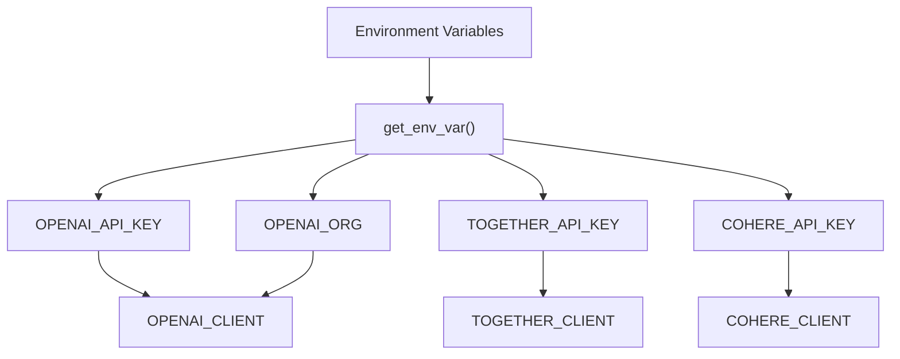
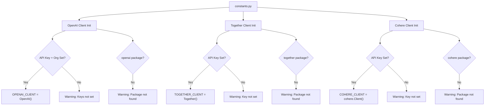
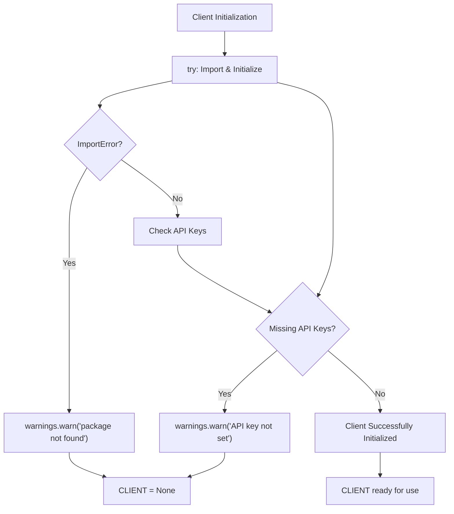
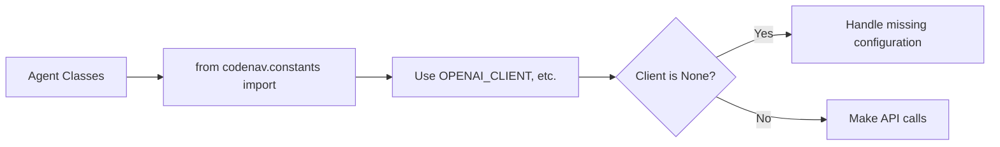

<!-- source: DeepWiki mcp.deepwiki.com · repo allenai/codenav · page 7 Configuration and Constants · fetched 2026-10-26 -->

# Configuration and Constants

<details>
<summary>Relevant source files</summary>

The following files were used as context for generating this wiki page:

- [codenav/constants.py](codenav/constants.py)

</details>


This document covers the configuration system and constants used throughout CodeNav. The configuration system manages API keys, default values, file paths, and client initialization for various LLM providers. 

For information about how these configurations are used by agents, see [Agent System](#3.2). For details on how environment variables affect evaluation behavior, see [Evaluation Framework](#4).

## Purpose and Scope

The configuration system in CodeNav centralizes:
- System constants and default values
- Environment variable handling
- API client initialization for LLM providers
- Path resolution for internal resources
- Error handling for missing dependencies

All configuration logic is contained in the `constants.py` module, which other components import to access configured clients and values.

## System Constants and Defaults

CodeNav defines several key constants that control system behavior:

| Constant | Value | Purpose |
|----------|-------|---------|
| `DEFAULT_OPENAI_MODEL` | `"gpt-4o-2024-05-13"` | Default model for OpenAI agent |
| `DEFAULT_RETRIEVAL_PER_QUERY` | `3` | Number of code snippets retrieved per search |
| `ABS_PATH_OF_CODENAV_DIR` | Absolute path to codenav module | Base directory for internal resources |
| `PROMPTS_DIR` | `{codenav_dir}/prompts` | Directory containing prompt templates |

The path constants ensure that CodeNav can locate its internal resources regardless of the working directory:

```
ABS_PATH_OF_CODENAV_DIR = os.path.abspath(os.path.dirname(Path(__file__)))
PROMPTS_DIR = os.path.join(ABS_PATH_OF_CODENAV_DIR, "prompts")
```

Sources: [codenav/constants.py:6-7](), [codenav/constants.py:9-10]()

## Environment Variable Configuration

CodeNav uses a centralized environment variable handling approach through the `get_env_var` function:



**Environment Variable Configuration Flow**

The system checks for the following environment variables:

| Variable | Required | Purpose |
|----------|----------|---------|
| `OPENAI_API_KEY` | Yes (for OpenAI) | Authentication for OpenAI API |
| `OPENAI_ORG` | Yes (for OpenAI) | Organization ID for OpenAI API |
| `TOGETHER_API_KEY` | Yes (for Together) | Authentication for Together API |
| `COHERE_API_KEY` | Yes (for Cohere) | Authentication for Cohere API |

Sources: [codenav/constants.py:13-17](), [codenav/constants.py:20-22](), [codenav/constants.py:39](), [codenav/constants.py:52]()

## API Client Initialization

CodeNav initializes API clients for multiple LLM providers with consistent error handling patterns:



**API Client Initialization Flow**

### OpenAI Client

The OpenAI client requires both an API key and organization ID:

```python
if OPENAI_API_KEY is not None and OPENAI_ORG is not None:
    OPENAI_CLIENT = OpenAI(api_key=OPENAI_API_KEY, organization=OPENAI_ORG)
```

Sources: [codenav/constants.py:23-30]()

### Together Client

The Together client requires only an API key:

```python
if TOGETHER_API_KEY is not None:
    TOGETHER_CLIENT = Together(api_key=TOGETHER_API_KEY)
```

Sources: [codenav/constants.py:42-45]()

### Cohere Client

The Cohere client also requires only an API key:

```python
if COHERE_API_KEY is not None:
    COHERE_CLIENT = cohere.Client(api_key=COHERE_API_KEY)
```

Sources: [codenav/constants.py:54-58]()

## Error Handling and Warnings

CodeNav implements comprehensive error handling for configuration issues:



**Error Handling Flow for API Clients**

The system handles two types of configuration errors:

1. **Missing Dependencies**: When required packages are not installed
   - Issues warning: `"{package} package not found. {Provider} API will not work."`
   - Sets client to `None`

2. **Missing API Keys**: When required environment variables are not set
   - Issues warning: `"{API_KEY} not set. {Provider} API will not work."`
   - Sets client to `None`

This graceful degradation allows CodeNav to run even when not all LLM providers are configured, providing clear feedback about what functionality is unavailable.

Sources: [codenav/constants.py:32-36](), [codenav/constants.py:47-49](), [codenav/constants.py:59-62]()

## Configuration Usage Pattern

The configuration system follows a simple import pattern used throughout CodeNav:



**Configuration Import and Usage Pattern**

Components that need LLM clients import the pre-configured clients from `constants.py` and check for `None` values before use, ensuring robust handling of configuration issues.

Sources: [codenav/constants.py:1-63]()

---

