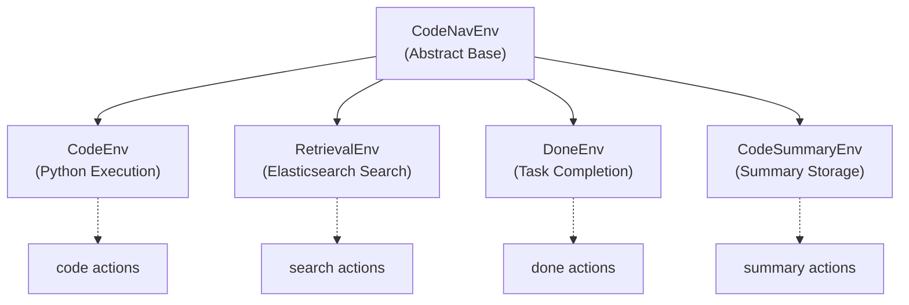
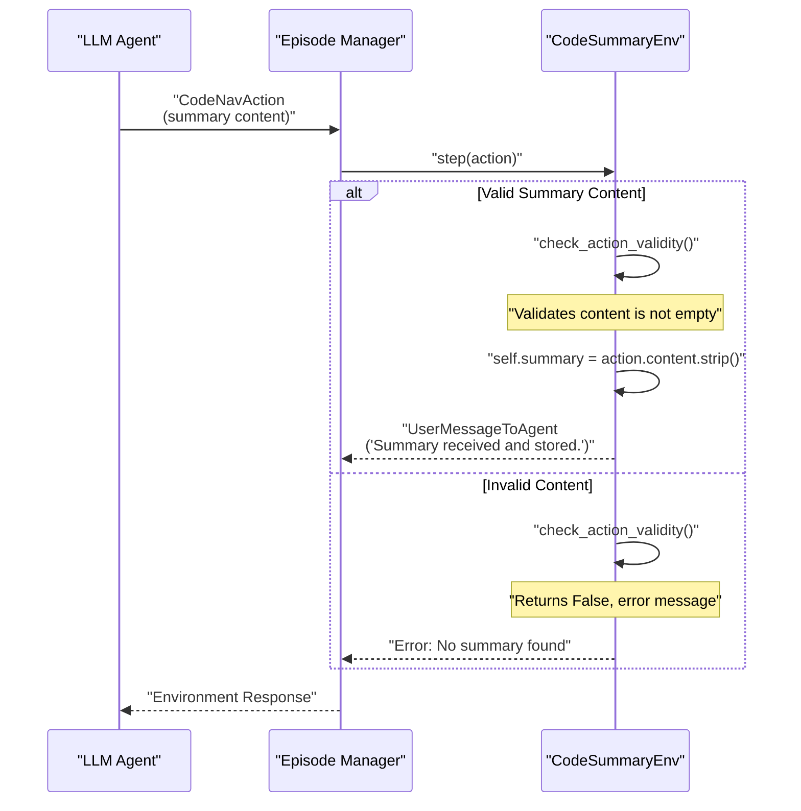
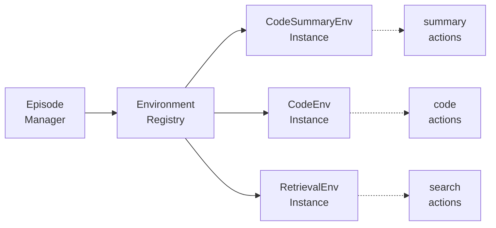

<!-- source: DeepWiki mcp.deepwiki.com · repo allenai/codenav · page 8 Additional Environments · fetched 2026-10-26 -->

# Additional Environments

Relevant source files

The following files were used as context for generating this wiki page:

- [codenav/environments/code_summary_env.py](codenav/environments/code_summary_env.py)

This document covers specialized environments in CodeNav beyond the core environments documented in the main Environment System ([3.3](#3.3)). These environments provide additional capabilities for specific use cases and extend the base environment abstractions.

For information about the core environment system and base abstractions, see [Environment System](#3.3). For overall system architecture, see [Core Architecture](#3).

## Code Summary Environment

The `CodeSummaryEnv` class provides a specialized environment for receiving, validating, and storing code summaries generated by LLM agents. This environment enables agents to provide structured summaries of their analysis or findings during code navigation tasks.

### Purpose and Implementation

The `CodeSummaryEnv` implements the standard `CodeNavEnv` interface but with specific logic for handling summary content. Unlike execution or retrieval environments, this environment focuses on capturing and storing textual summaries.

**Core Implementation**

The environment maintains a simple state model with a single `summary` field:

[codenav/environments/code_summary_env.py:8-9]()

The environment validates that incoming actions contain non-empty content:

[codenav/environments/code_summary_env.py:11-15]()

When a valid summary action is received, the environment stores the content and provides confirmation:

[codenav/environments/code_summary_env.py:17-20]()

### Environment Architecture Integration

The following diagram shows how `CodeSummaryEnv` integrates with the existing environment hierarchy:

**Environment Class Hierarchy**

Sources: [codenav/environments/code_summary_env.py:3](), [codenav/environments/code_summary_env.py:7]()

### Interaction Flow

The following diagram illustrates how the `CodeSummaryEnv` processes actions within an episode:

**Code Summary Environment Interaction Flow**

Sources: [codenav/environments/code_summary_env.py:11-20]()

### Usage Patterns

The `CodeSummaryEnv` is designed for scenarios where agents need to provide structured summaries of their analysis. Common use cases include:

| Use Case | Description | Implementation |
|----------|-------------|----------------|
| **Code Analysis Summary** | Agent provides high-level summary of codebase structure | Store in `self.summary` field |
| **Finding Documentation** | Agent summarizes key findings from code exploration | Validate content exists via `check_action_validity` |
| **Result Aggregation** | Agent consolidates multiple search results into summary | Return confirmation via `UserMessageToAgent` |

The environment follows the standard environment contract by implementing:

- `check_action_validity()`: Ensures action contains meaningful content
- `step()`: Processes the action and updates internal state
- State management: Maintains summary content for later retrieval

### Integration with Episode Management

The `CodeSummaryEnv` integrates seamlessly with the episode management system documented in [Episode Management](#3.4). Episodes can include this environment alongside other environments, allowing agents to perform summary actions as part of their broader interaction patterns.

The environment returns standard `UserMessageToAgent` responses, ensuring compatibility with the interaction formatting system documented in [Interaction Formatting](#3.5).

**Environment Registration Pattern**

Sources: [codenav/environments/code_summary_env.py:1-21]()

---

