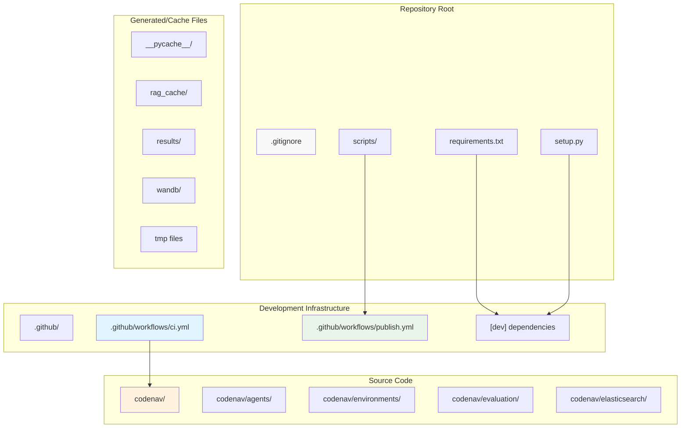
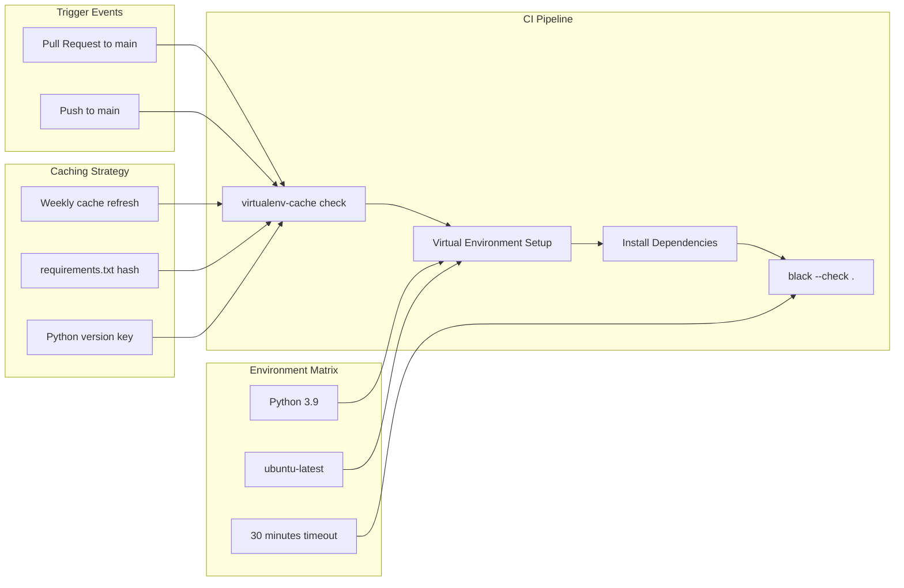
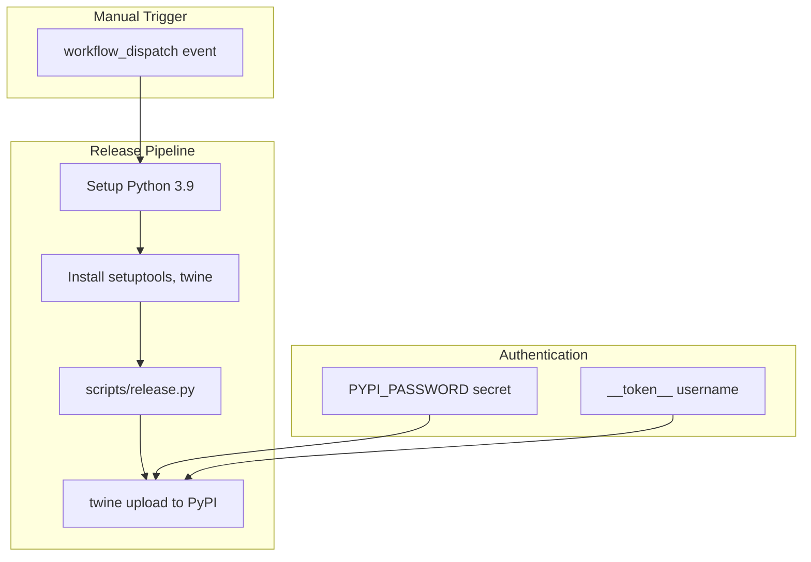

<!-- source: DeepWiki mcp.deepwiki.com · repo allenai/codenav · page 9 Development and Contributing · fetched 2026-10-26 -->

# Development and Contributing

<details>
<summary>Relevant source files</summary>

The following files were used as context for generating this wiki page:

- [.github/workflows/ci.yml](.github/workflows/ci.yml)
- [.github/workflows/publish.yml](.github/workflows/publish.yml)
- [.gitignore](.gitignore)

</details>


This document provides comprehensive information for developers who want to contribute to the CodeNav project. It covers project structure, development workflows, coding standards, and the CI/CD pipeline. 

For information about using CodeNav as an end user, see [Getting Started](#2). For details about the core system architecture, see [Core Architecture](#3).

## Project Structure and Organization

CodeNav follows standard Python project conventions with additional structure for its multi-component architecture.

### Development Structure Diagram



**Sources:** [.gitignore:1-175](), [.github/workflows/ci.yml:1-98](), [.github/workflows/publish.yml:1-29]()

### Ignored Files and Directories

The project maintains a comprehensive `.gitignore` that excludes several categories of files:

| Category | Examples | Purpose |
|----------|----------|---------|
| Python artifacts | `__pycache__/`, `*.pyc`, `*.egg-info/` | Compiled Python files |
| Development tools | `.vscode/`, `.pytest_cache/`, `htmlcov/` | IDE and testing artifacts |
| Virtual environments | `.venv/`, `venv/`, `ENV/` | Isolated Python environments |
| Project-specific cache | `rag_cache/`, `wandb/`, `results/` | CodeNav runtime artifacts |
| Temporary files | `__tmp*`, `tmp.py`, `*_out/` | Development scratch files |

**Sources:** [.gitignore:1-175]()

## CI/CD Pipeline

CodeNav uses GitHub Actions for continuous integration and deployment with a two-workflow approach.

### CI Workflow Architecture



**Sources:** [.github/workflows/ci.yml:1-98]()

### CI Configuration Details

The CI pipeline is configured with the following characteristics:

- **Concurrency Control**: Uses `${{ github.workflow }}-${{ github.ref }}` group with `cancel-in-progress: true` [.github/workflows/ci.yml:3-5]()
- **Python Version**: Fixed to Python 3.9 [.github/workflows/ci.yml:28]()
- **Cache Strategy**: Weekly refresh using `$(date +%V)` for cache keys [.github/workflows/ci.yml:58]()
- **Dependencies**: Installs with `pip install -e .[dev]` for development extras [.github/workflows/ci.yml:73]()

### Current CI Limitations

The CI pipeline currently has tests disabled with a TODO comment:

```
# TODO: Add testing back in after fixing the tests for use with GH actions.
#          - name: Test
#            run: |
#              pytest -v --color=yes tests/
```

**Sources:** [.github/workflows/ci.yml:34-37]()

## Code Quality Standards

### Formatting and Style

CodeNav enforces code formatting using `black` as part of the CI pipeline:

- **Formatter**: `black --check .` runs on all Python files [.github/workflows/ci.yml:32]()
- **Enforcement**: Style checks must pass before merging [.github/workflows/ci.yml:30]()
- **Configuration**: Uses black's default configuration

### Development Dependencies

The project uses development-specific dependencies installed via setuptools extras:

```bash
pip install -e .[dev]
```

**Sources:** [.github/workflows/ci.yml:73]()

## Release and Publishing Process

CodeNav uses a manual release workflow for publishing to PyPI.

### Publishing Workflow



**Sources:** [.github/workflows/publish.yml:1-29]()

### Release Process Steps

1. **Manual Trigger**: Publishing requires manual workflow dispatch [.github/workflows/publish.yml:7]()
2. **Custom Release Script**: Uses `python scripts/release.py` for build preparation [.github/workflows/publish.yml:28]()
3. **PyPI Authentication**: Uses token-based authentication with `PYPI_PASSWORD` secret [.github/workflows/publish.yml:26]()
4. **Distribution Upload**: Uses `twine upload -u __token__ dist/*` [.github/workflows/publish.yml:29]()

## Development Environment Setup

### Virtual Environment Configuration

The CI pipeline provides a reference for local development setup:

1. **Prerequisites**: Install `pip`, `setuptools`, `wheel`, `virtualenv` [.github/workflows/ci.yml:49]()
2. **Virtual Environment**: Create with `virtualenv -p $(which python) --copies --reset-app-data .venv` [.github/workflows/ci.yml:71]()
3. **Development Installation**: Install with `pip install -e .[dev]` [.github/workflows/ci.yml:73]()

### Environment Validation

The CI pipeline includes environment validation steps:

```bash
which python
python --version  
pip freeze
```

**Sources:** [.github/workflows/ci.yml:82-86]()

## Contributing Workflow

### Development Cycle

```mermaid
graph LR
    subgraph "Local Development"
        Fork["Fork Repository"]
        Clone["Clone Fork"]
        Branch["Create Feature Branch"]
        Develop["Make Changes"]
        Test["Run Tests Locally"]
        Format["Run black formatter"]
    end
    
    subgraph "Integration"
        PR["Create Pull Request"]
        CIRun["CI Pipeline Runs"]
        StylePass["Style Checks Pass"]
        Review["Code Review"]
        Merge["Merge to main"]
    end
    
    Fork --> Clone
    Clone --> Branch
    Branch --> Develop
    Develop --> Test
    Test --> Format
    Format --> PR
    
    PR --> CIRun
    CIRun --> StylePass
    StylePass --> Review
    Review --> Merge
```



### Pre-commit Requirements

Before submitting a pull request:

1. **Code Formatting**: Run `black .` to format all Python files
2. **Style Compliance**: Ensure `black --check .` passes
3. **Manual Testing**: Test changes manually since automated tests are currently disabled

### CI Integration Points

- **Trigger Events**: PRs to `main` and pushes to `main` trigger CI [.github/workflows/ci.yml:8-13]()
- **Concurrency**: In-progress runs are cancelled when new commits are pushed [.github/workflows/ci.yml:5]()
- **Failure Handling**: `fail-fast: false` allows all checks to complete [.github/workflows/ci.yml:26]()

**Sources:** [.github/workflows/ci.yml:1-98](), [.github/workflows/publish.yml:1-29]()

---

