# Page: Overview

# Overview

<details>
<summary>Relevant source files</summary>

The following files were used as context for generating this wiki page:

- [README.md](README.md)

</details>


## Purpose and Scope

This document provides a comprehensive overview of CodeNav, an LLM-powered code navigation system that enables users to interact with and leverage unfamiliar codebases through natural language queries. This page covers the system's architecture, core components, and high-level workflow.

For specific usage instructions, see [Getting Started](#2). For detailed component documentation, see [Core Architecture](#3). For evaluation and experimentation capabilities, see [Evaluation Framework](#4).

## What is CodeNav?

CodeNav is an LLM agent system that automatically navigates and leverages previously unseen code repositories to solve user queries. Unlike traditional tool-use LLM agents that require manual registration of tools, CodeNav automatically indexes code repositories, searches for relevant code snippets, imports them, and uses them to iteratively generate solutions with execution feedback.

The system operates through three main interaction patterns:
- **Code execution**: Running Python code in a controlled environment
- **Code retrieval**: Searching indexed codebases for relevant snippets
- **Task completion**: Signaling when a query has been resolved

**Sources:** [README.md:14-14]()

## System Architecture Overview

CodeNav follows a layered architecture with clear separation between user interfaces, orchestration logic, agent implementations, and execution environments.

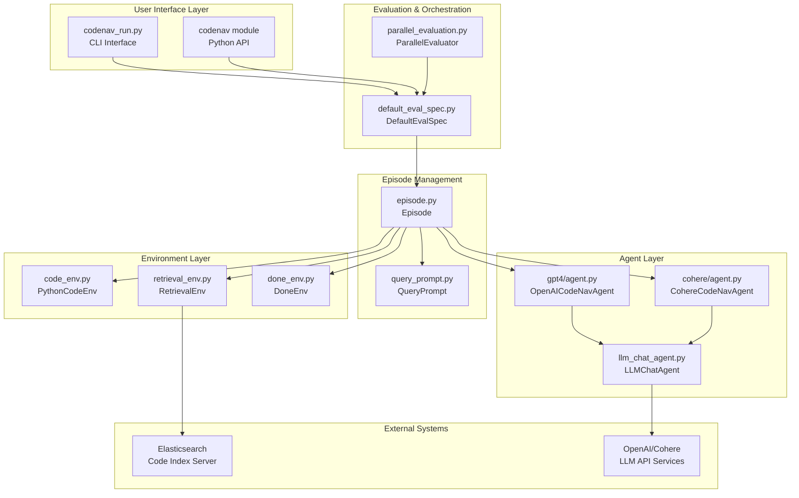

**Sources:** [README.md:24-36](), diagrams from system analysis

## Core Workflow

The following sequence illustrates how a user query flows through the system from CLI invocation to final output generation:

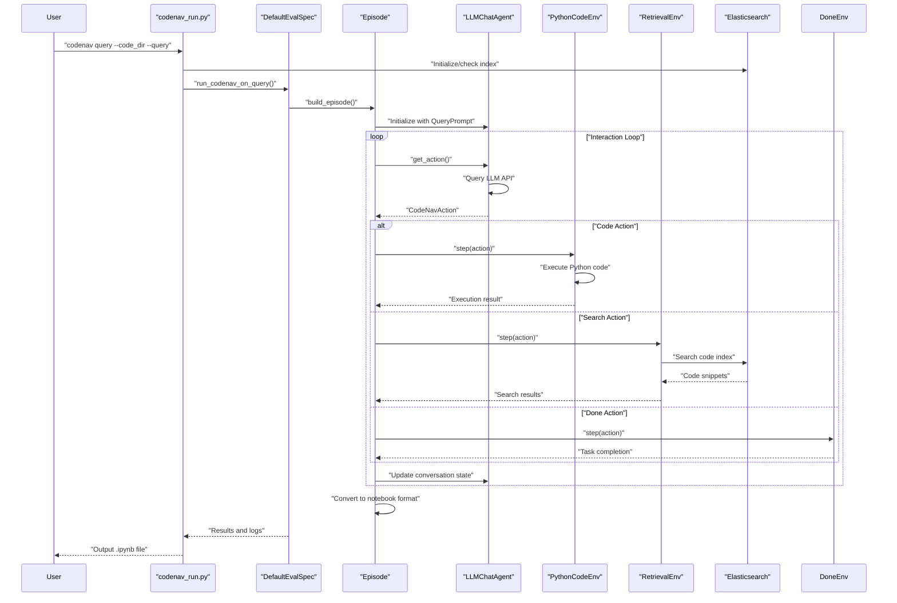

**Sources:** [README.md:31-36](), system architecture diagrams

## Key Components and Code Entities

The following diagram maps the main conceptual components to their concrete implementations in the codebase:

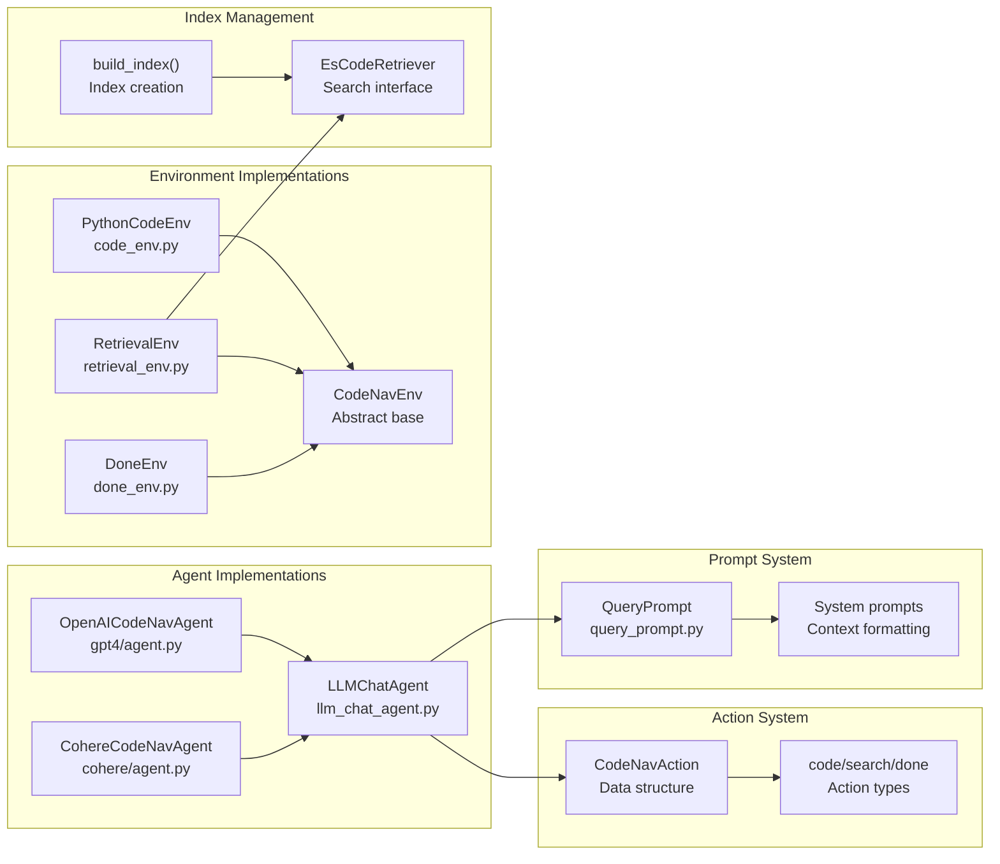

**Sources:** File structure analysis, component relationships from diagrams

## Data Flow Architecture

CodeNav processes user queries through a structured data flow that transforms natural language into executable actions:

| **Stage** | **Input** | **Component** | **Output** |
|-----------|-----------|---------------|------------|
| **Query Processing** | Natural language query | `QueryPrompt` | Formatted system prompt |
| **Action Generation** | System prompt + conversation | `LLMChatAgent` | `CodeNavAction` object |
| **Environment Routing** | `CodeNavAction` | `Episode` | Environment-specific execution |
| **Code Execution** | Python code string | `PythonCodeEnv` | Execution results/errors |
| **Code Retrieval** | Search query | `RetrievalEnv` → `EsCodeRetriever` | Relevant code snippets |
| **Task Completion** | Done signal | `DoneEnv` | Episode termination |
| **Output Generation** | Interaction history | `Episode` | Jupyter notebook |

The system maintains state through the `Episode` class, which orchestrates the conversation between agents and environments while logging all interactions for later analysis and reproduction.

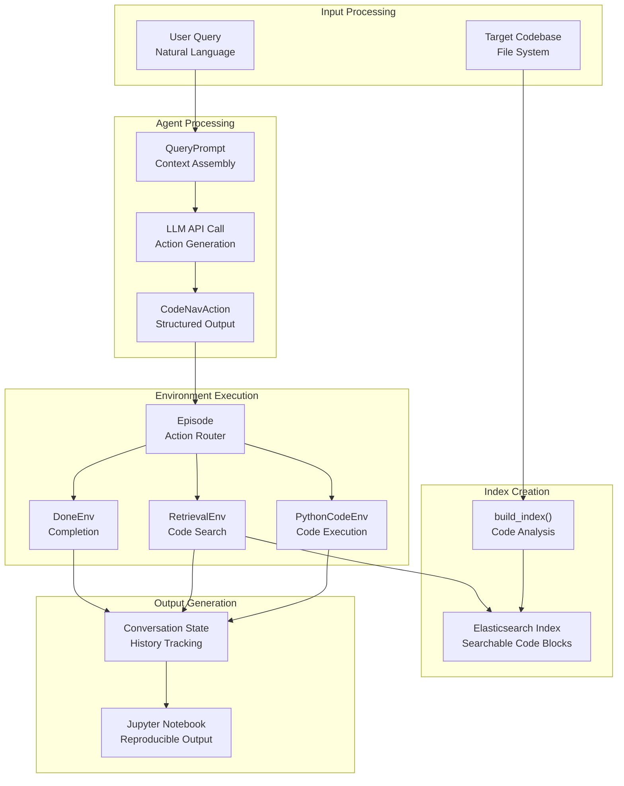

**Sources:** [README.md:44-87](), workflow analysis from system diagrams

---

# Page: Getting Started

# Getting Started

<details>
<summary>Relevant source files</summary>

The following files were used as context for generating this wiki page:

- [README.md](README.md)
- [codenav/codenav_run.py](codenav/codenav_run.py)

</details>


This document provides installation instructions and basic usage examples for CodeNav, covering both command-line interface and Python library usage. For detailed information about the core architecture and system components, see [Core Architecture](#3). For advanced evaluation workflows, see [Evaluation Framework](#4).

## Installation

CodeNav can be installed directly from the GitHub repository:

```bash
pip install git+https://github.com/allenai/codenav
```

After installation, CodeNav provides both a command-line interface and a Python library for programmatic access.

Sources: [README.md:20-22]()

## Prerequisites: Elasticsearch Setup

CodeNav requires Elasticsearch for code indexing and retrieval. The system automatically manages Elasticsearch installation and startup through the CLI.

### Initialize Elasticsearch

Before using CodeNav, you must start the Elasticsearch service:

```bash
codenav init
```

This command performs the following operations via the `run_init()` function:
- Downloads and installs Elasticsearch if not present
- Starts Elasticsearch server on port 9200
- Starts Kibana dashboard on port 5601
- Validates that both services are running correctly

### Stop Elasticsearch

When finished with CodeNav, stop the Elasticsearch services:

```bash
codenav stop
```

This command terminates all processes associated with `ES_PATH` and `KIBANA_PATH`.

**Elasticsearch Management Workflow**
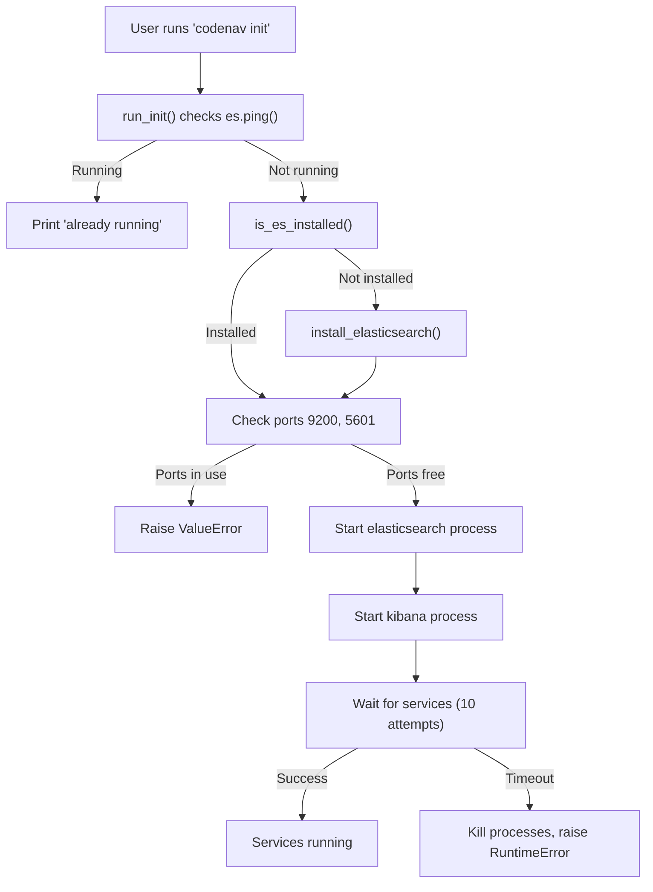

Sources: [codenav/codenav_run.py:40-107](), [codenav/codenav_run.py:179-183]()

## Command-Line Interface

The CLI is implemented in `codenav_run.py` and provides three main commands accessed through the `main()` function.

### Basic Query Command

```bash
codenav query \
  --code_dir /path/to/codebase \
  --playground_dir /working/directory \
  --query "Your query here"
```

### CLI Command Arguments

| Argument | Type | Description |
|----------|------|-------------|
| `--code_dir` | str | Path to codebase for indexing (mutually exclusive with `--module`) |
| `--module` | str | Installed Python module to use (mutually exclusive with `--code_dir`) |
| `--playground_dir` | str | Working directory for agent execution |
| `--query` | str | Query string for the agent to solve |
| `--query_file` | str | Path to file containing query text |
| `--max_steps` | int | Maximum interaction rounds (default: 20) |
| `--force_reindex` | bool | Force recreation of Elasticsearch index |
| `--force_subdir` | str | Index only specified subdirectory |
| `--repo_description_path` | str | Path to repository description file |

### CLI Command Processing Flow

**CLI Argument Processing and Execution**
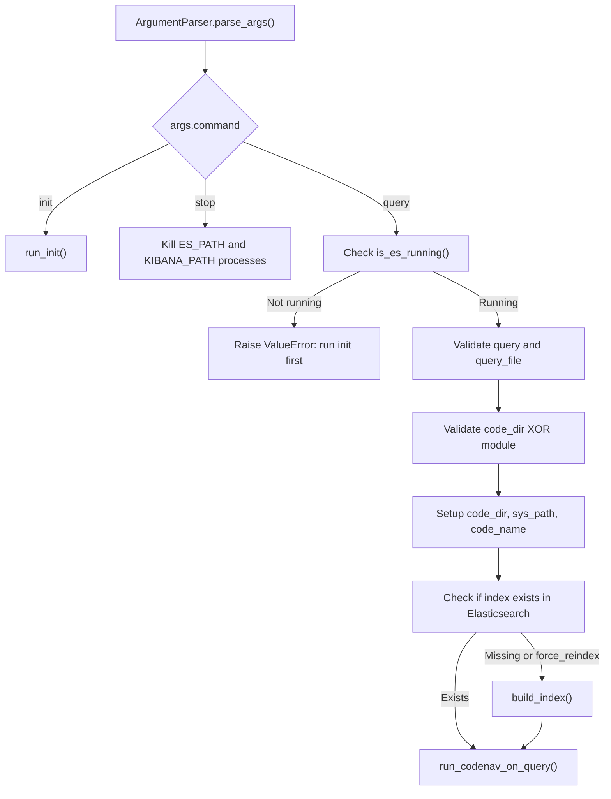

Sources: [codenav/codenav_run.py:109-252]()

## Python Library Usage

CodeNav can be used programmatically by importing the `codenav` module. The system provides several example scripts demonstrating different usage patterns.

### Core Example Scripts

The `codenav_examples` directory contains demonstrations of key functionality:

| Script | Purpose | Key Classes/Functions |
|--------|---------|----------------------|
| `create_index.py` | Index creation and search | `build_index()`, `RetrievalEnv` |
| `create_episode.py` | Agent instantiation and execution | `OpenAICodeNavAgent`, `Episode` |
| `create_code_env.py` | Code execution environment | `PythonCodeEnv` |
| `create_prompt.py` | Custom prompt creation | Prompt system classes |
| `parallel_evaluation.py` | Multi-process evaluation | `EvalSpec` abstraction |

### Basic Programmatic Usage Pattern

The typical programmatic workflow follows this sequence:

1. Initialize Elasticsearch (same as CLI: `python -m codenav.codenav_run init`)
2. Create index for target codebase
3. Instantiate agent and environments
4. Execute episode with query
5. Process results

**Programmatic Usage Flow**
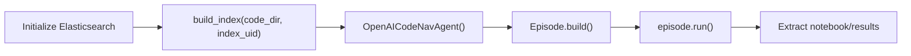

### Integration with Core Functions

The library usage ultimately calls the same core function as the CLI:

- CLI calls `run_codenav_on_query()` from `default_eval_spec.py`
- Library usage can directly call `run_codenav_on_query()` or build components manually
- Both approaches use the same underlying `Episode`, agent, and environment classes

Sources: [README.md:107-121](), [codenav/codenav_run.py:12]()

## Basic System Workflow

The following diagram shows how user inputs flow through the system components:

**End-to-End CodeNav Execution Flow**
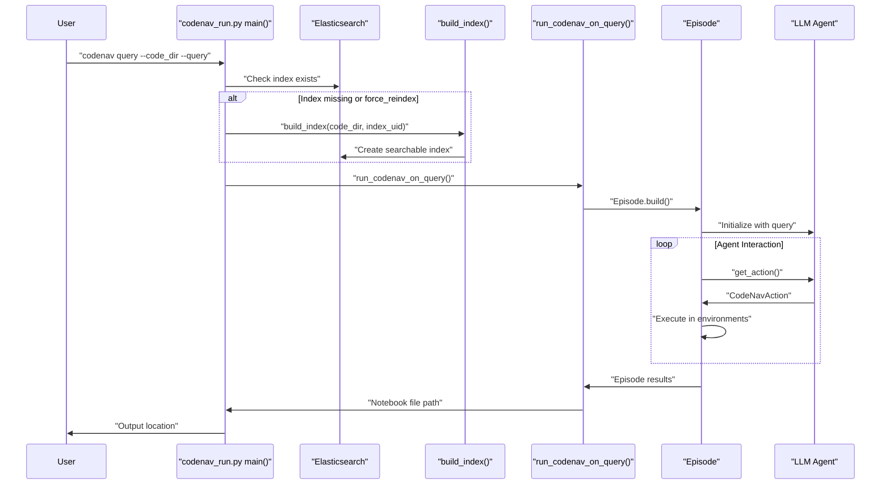

This workflow demonstrates how the CLI command `codenav query` triggers the creation of an Elasticsearch index (if needed), then executes the core evaluation logic through `run_codenav_on_query()`, which orchestrates the agent-environment interaction loop.

Sources: [codenav/codenav_run.py:227-248](), [codenav/default_eval_spec.py:12]()

## Important Considerations

### Index Management
- CodeNav indexes each codebase exactly once
- Use `--force_reindex` flag when codebase changes
- Monitor indexed content via Kibana at `http://localhost:5601/`

### Security Warning
CodeNav can execute arbitrary code and is not suitable for security-sensitive environments. Always run in sandboxed environments where data loss or security breaches are not a concern.

Sources: [README.md:123-136]()

---

# Page: Core Architecture

# Core Architecture

<details>
<summary>Relevant source files</summary>

The following files were used as context for generating this wiki page:

- [README.md](README.md)
- [codenav/interaction/episode.py](codenav/interaction/episode.py)

</details>


This document provides a comprehensive overview of CodeNav's core architectural components and their interactions. It covers the main system layers, data flow patterns, and how the various subsystems coordinate to enable LLM-powered code navigation. For detailed information about specific components, see [CLI Interface](#3.1), [Agent System](#3.2), [Environment System](#3.3), and [Episode Management](#3.4).

## System Overview

CodeNav implements a layered architecture that separates concerns between user interfaces, agent orchestration, environment management, and external services. The system is designed around the concept of `Episodes` that manage interactions between LLM `Agents` and specialized `Environments`.

### Primary Architecture Layers

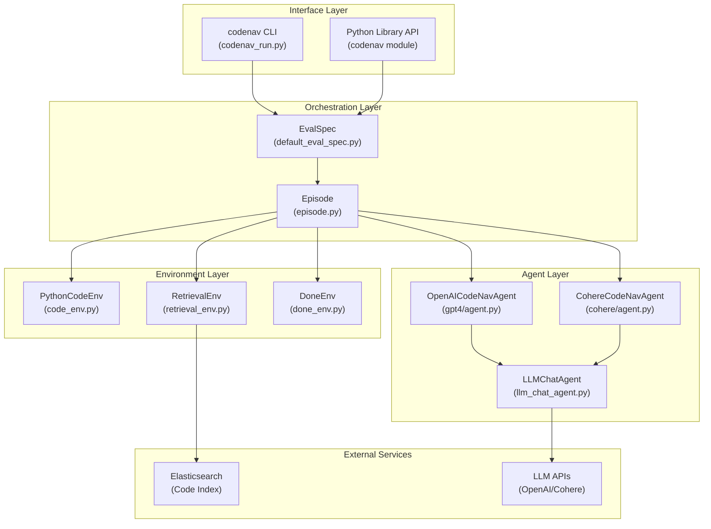

**Sources:** [codenav/codenav_run.py](), [codenav/interaction/episode.py](), [codenav/agents/gpt4/agent.py](), [codenav/environments/code_env.py](), [codenav/environments/retrieval_env.py]()

## Core Components

### Episode Management
The `Episode` class serves as the central orchestrator, managing the interaction lifecycle between agents and environments. Each episode maintains:

- An `agent` instance implementing the `CodeNavAgent` interface
- An `action_type_to_env` mapping that routes actions to appropriate environments
- A `user_query_str` that defines the task to be solved

### Agent System
The agent layer provides an abstraction for different LLM providers through the `CodeNavAgent` interface. Key implementations include:

- `OpenAICodeNavAgent` - Uses OpenAI's GPT models
- `CohereCodeNavAgent` - Uses Cohere's language models
- `LLMChatAgent` - Base class providing common chat functionality

### Environment System
Environments handle specific types of actions through the `CodeNavEnv` interface:

- `PythonCodeEnv` - Executes Python code and tracks execution state
- `RetrievalEnv` - Searches the codebase using Elasticsearch
- `DoneEnv` - Handles task completion signals

## Component Interaction Patterns

### Action-Environment Routing

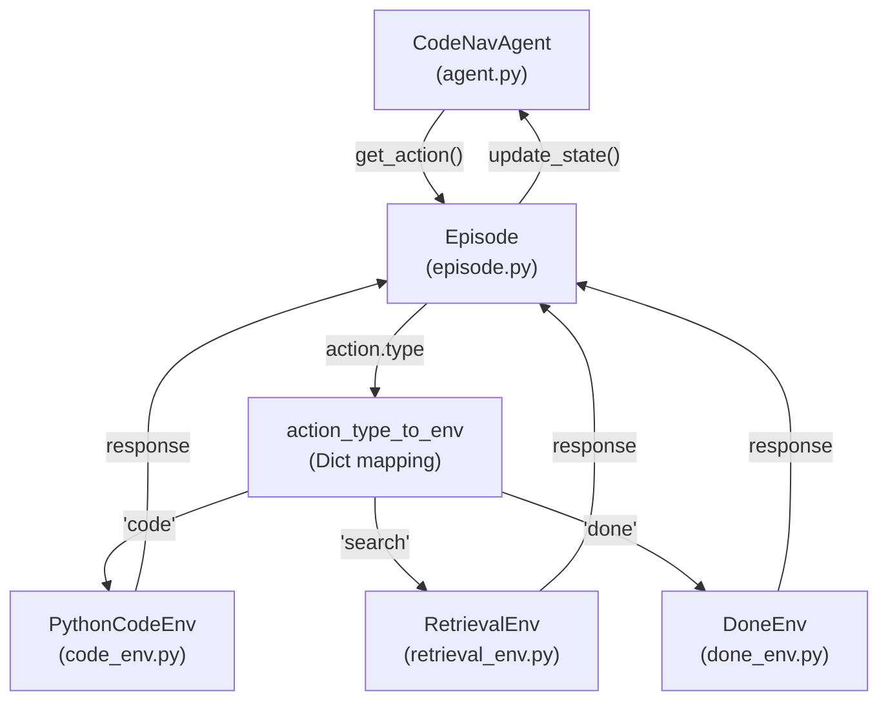

**Sources:** [codenav/interaction/episode.py:22-26](), [codenav/interaction/episode.py:55-68](), [codenav/environments/abstractions.py]()

### Episode Lifecycle Management

The episode execution follows a standardized pattern implemented in the `step()` method:

1. **Initialization**: Add user query message to agent state
2. **Action Generation**: Agent produces `CodeNavAction` based on current state  
3. **Action Validation**: Episode validates action against environment constraints
4. **Environment Execution**: Route action to appropriate environment for processing
5. **State Update**: Incorporate environment response into agent state
6. **Iteration**: Repeat until maximum steps or `done` action

| Component | Responsibility | Key Methods |
|-----------|----------------|-------------|
| `Episode` | Orchestration, validation, routing | `step()`, `check_action_validity()` |
| `CodeNavAgent` | Action generation, state management | `get_action()`, `update_state()` |
| `CodeNavEnv` | Action execution, response generation | `step()`, `check_action_validity()` |

**Sources:** [codenav/interaction/episode.py:70-115](), [codenav/agents/agent.py](), [codenav/environments/abstractions.py]()

## Data Flow Architecture

### Message Flow Between Components

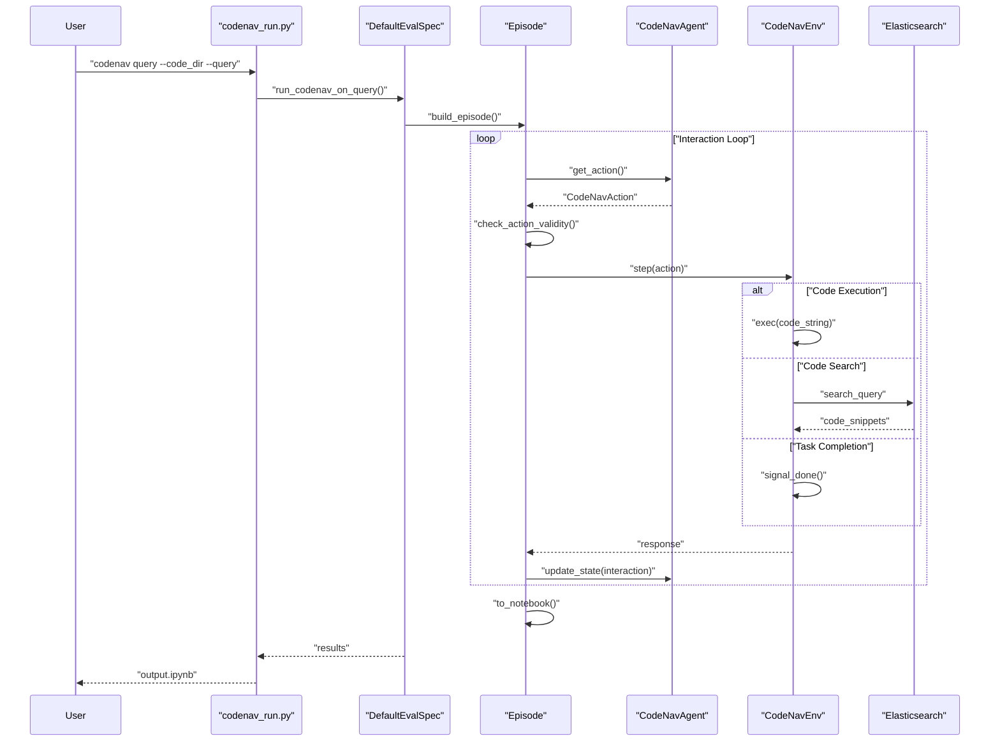

**Sources:** [codenav/codenav_run.py](), [codenav/interaction/episode.py:70-115](), [codenav/environments/code_env.py](), [codenav/environments/retrieval_env.py]()

### State Management

The system maintains state through several key data structures:

- **Episode State**: Managed by `Episode.agent.episode_state.interactions`
- **Code Environment State**: Tracked in `PythonCodeEnv` execution context
- **Retrieval State**: Cached search results in `RetrievalEnv`  
- **Agent State**: Conversation history and context in `CodeNavAgent`

The `Episode` class provides methods to export this state for analysis:

- `tabulate_interactions()` - DataFrame of all agent-environment interactions
- `tabulate_exec_trace()` - DataFrame of code execution history  
- `to_notebook()` - Jupyter notebook representation of the episode

**Sources:** [codenav/interaction/episode.py:162-184](), [codenav/interaction/episode.py:185-244](), [codenav/environments/code_env.py]()

## Configuration and Extensibility

The architecture supports extensibility through well-defined interfaces:

- **New LLM Providers**: Implement `CodeNavAgent` interface
- **New Environment Types**: Implement `CodeNavEnv` interface  
- **Custom Evaluation Logic**: Extend `EvalSpec` abstract base class
- **Custom Interaction Formatting**: Implement `InteractionFormatter` interface

The system uses dependency injection patterns where the `Episode` constructor accepts agent and environment instances, enabling flexible configuration and testing.

**Sources:** [codenav/agents/agent.py](), [codenav/environments/abstractions.py](), [codenav/evaluation/eval_types.py](), [codenav/agents/interaction_formatters.py]()

---

# Page: CLI Interface

# CLI Interface

<details>
<summary>Relevant source files</summary>

The following files were used as context for generating this wiki page:

- [codenav/codenav_run.py](codenav/codenav_run.py)

</details>


This document covers the command-line interface (CLI) for CodeNav, which provides the primary user entry point for interacting with the system. The CLI handles Elasticsearch server management, code indexing, and query execution through three main commands.

For information about the underlying evaluation framework that the CLI invokes, see [Evaluation Framework](#4). For details about Elasticsearch integration and indexing, see [Elasticsearch Integration](#6).

## Overview

The CLI is implemented in `codenav_run.py` and provides three primary commands through the `main()` function:

- **`init`**: Sets up and starts Elasticsearch and Kibana servers
- **`stop`**: Terminates running Elasticsearch and Kibana processes  
- **`query`**: Executes code navigation queries against an indexed codebase

### CLI Command Flow

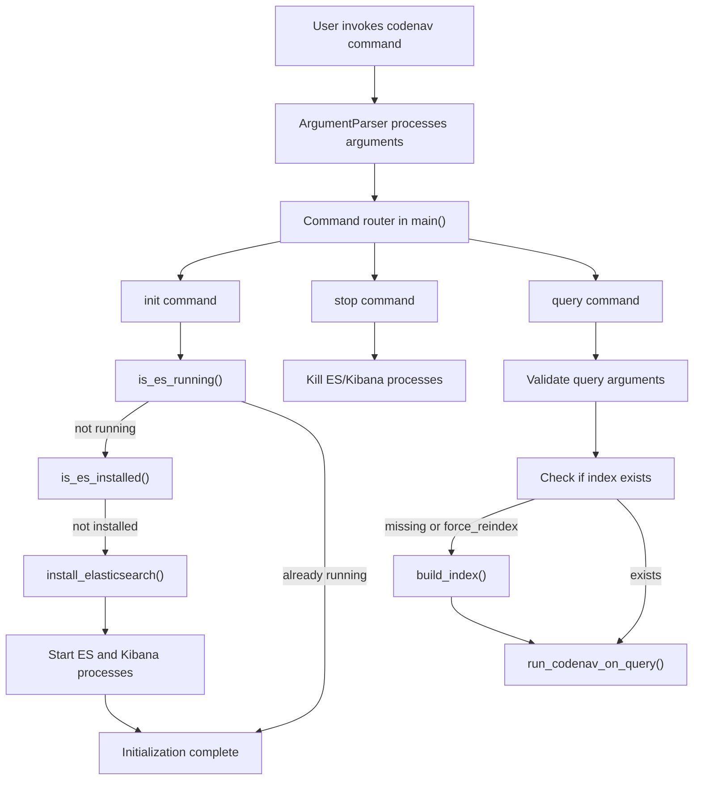

Sources: [codenav/codenav_run.py:109-255]()

## Commands

### init Command

The `init` command initializes the CodeNav environment by setting up Elasticsearch and Kibana servers.

#### Functionality

The `run_init()` function performs the following operations:

1. **Server Status Check**: Uses `is_es_running()` to ping Elasticsearch at the default host
2. **Installation Verification**: Calls `is_es_installed()` to check for existing installation
3. **Automatic Installation**: Downloads and installs Elasticsearch if not present via `install_elasticsearch()`
4. **Port Availability**: Validates that ports 9200 (Elasticsearch) and 5601 (Kibana) are available
5. **Process Startup**: Launches both servers as background processes
6. **Health Monitoring**: Polls server status for up to 100 seconds with 10-second intervals

```bash
codenav init
```

The command outputs process IDs and access URLs upon successful initialization.

Sources: [codenav/codenav_run.py:40-107]()

### stop Command

The `stop` command terminates running Elasticsearch and Kibana processes by killing all processes that match the installation paths.

```bash
codenav stop
```

The implementation uses shell commands to identify and terminate processes:

```bash
ps aux | grep {ES_PATH} | grep -v grep | awk '{print $2}' | xargs kill
ps aux | grep {KIBANA_PATH} | grep -v grep | awk '{print $2}' | xargs kill
```

Sources: [codenav/codenav_run.py:179-183]()

### query Command

The `query` command executes code navigation queries against an indexed codebase. This is the primary functional command for CodeNav.

#### Prerequisites

- Elasticsearch must be running (verified by `is_es_running()`)
- Either `--code_dir` or `--module` must be specified
- Query must be provided via `--query` or `--query_file`
- `--playground_dir` must be specified for agent workspace

#### Execution Flow

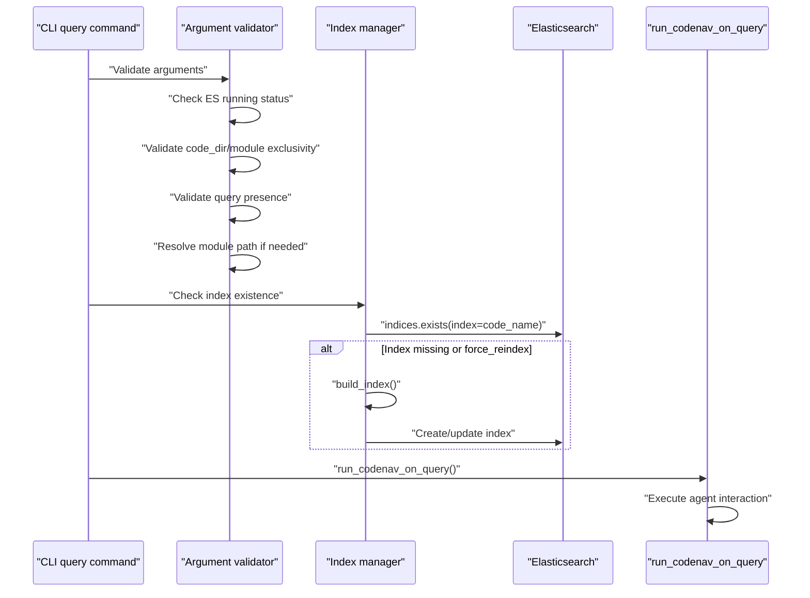

Sources: [codenav/codenav_run.py:184-248]()

## Command-Line Arguments

### Global Arguments

| Argument | Type | Description | Commands |
|----------|------|-------------|----------|
| `command` | str | Command to execute: `init`, `stop`, `query` | All |

### Code Source Arguments

| Argument | Type | Default | Description |
|----------|------|---------|-------------|
| `--code_dir` | str | None | Path to codebase directory |
| `--module` | str | None | Python module name to analyze |

These arguments are mutually exclusive - exactly one must be provided for `query` command.

### Query Arguments

| Argument | Type | Default | Description |
|----------|------|---------|-------------|
| `--query`, `-q` | str | None | Natural language query description |
| `--query_file`, `-f` | str | None | File path containing query text |

These arguments are mutually exclusive - exactly one must be provided for `query` command.

### Execution Control Arguments

| Argument | Type | Default | Description |
|----------|------|---------|-------------|
| `--playground_dir` | str | None | Agent working directory (required) |
| `--max_steps` | int | 20 | Maximum interaction rounds |

### Indexing Control Arguments

| Argument | Type | Default | Description |
|----------|------|---------|-------------|
| `--force_reindex` | bool | False | Delete existing index and rebuild |
| `--force_subdir` | str | None | Index only specified subdirectory |
| `--repo_description_path` | str | None | Path to codebase description file |

Sources: [codenav/codenav_run.py:111-174]()

## Argument Processing Logic

### Module Resolution

When `--module` is specified instead of `--code_dir`, the CLI performs module resolution:

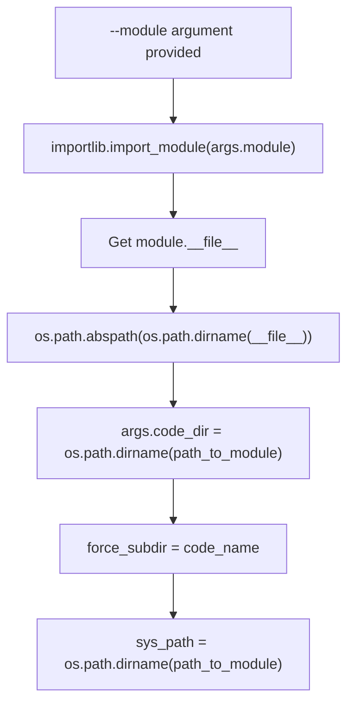

This logic automatically determines the appropriate directory structure for Python modules.

Sources: [codenav/codenav_run.py:211-218]()

### Index Name Generation

The system generates index names from the codebase:

- For `--code_dir`: Uses `os.path.basename(args.code_dir)`
- For `--module`: Uses the module's directory name

The index name is used both for Elasticsearch index identification and as the `index_uid` parameter in `build_index()`.

Sources: [codenav/codenav_run.py:216, 223, 228-236]()

## Integration with Core Systems

### Elasticsearch Integration

The CLI manages Elasticsearch through several integration points:

- **Server Management**: Direct process control via `subprocess.Popen`
- **Index Operations**: Uses `Elasticsearch` client for index existence checks
- **Index Building**: Delegates to `build_index()` function from the retrieval module

### Evaluation Framework Integration

The `query` command culminates in a call to `run_codenav_on_query()` with processed arguments:

```python
run_codenav_on_query(
    exp_name=sanitized_query_name,
    out_dir=args.playground_dir,
    query=args.q,
    code_dir=resolved_code_path,
    sys_paths=[sys_path],
    index_name=code_name,
    working_dir=args.playground_dir,
    max_steps=args.max_steps,
    repo_description_path=args.repo_description_path,
)
```

This bridges the CLI interface to the core evaluation and episode management systems.

Sources: [codenav/codenav_run.py:238-248]()

---

# Page: Agent System

# Agent System

<details>
<summary>Relevant source files</summary>

The following files were used as context for generating this wiki page:

- [codenav/agents/agent.py](codenav/agents/agent.py)
- [codenav/agents/cohere/agent.py](codenav/agents/cohere/agent.py)
- [codenav/agents/gpt4/agent.py](codenav/agents/gpt4/agent.py)
- [codenav/agents/llm_chat_agent.py](codenav/agents/llm_chat_agent.py)

</details>


## Purpose and Scope

The Agent System provides the core LLM-powered intelligence layer of CodeNav, responsible for interpreting user queries, maintaining conversation state, and generating actions to navigate codebases. This page covers the abstract agent interface, concrete implementations for different LLM providers, and the interaction patterns between agents and the episode management system.

For information about how agents interact with different execution environments, see [Environment System](#3.3). For details on how agents are orchestrated within episodes, see [Episode Management](#3.4).

## Agent Architecture Overview

The agent system follows a layered architecture with an abstract base class defining the interface and concrete implementations for specific LLM providers.

### Agent Class Hierarchy

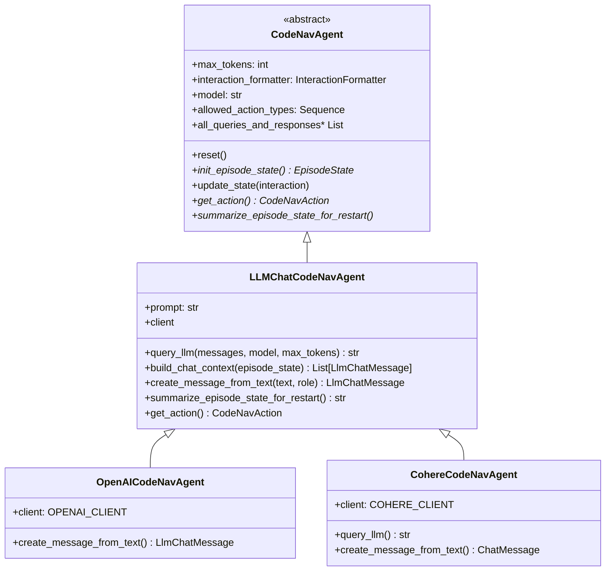

**Sources:** [codenav/agents/agent.py:8-57](), [codenav/agents/llm_chat_agent.py:30-181](), [codenav/agents/gpt4/agent.py:10-38](), [codenav/agents/cohere/agent.py:13-92]()

### Core Agent Components

| Component | Class | Purpose |
|-----------|-------|---------|
| Abstract Interface | `CodeNavAgent` | Defines the contract for all agent implementations |
| Chat Foundation | `LLMChatCodeNavAgent` | Provides chat-based interaction patterns and common LLM functionality |
| OpenAI Provider | `OpenAICodeNavAgent` | Integrates with OpenAI's GPT models |
| Cohere Provider | `CohereCodeNavAgent` | Integrates with Cohere's Command models |

**Sources:** [codenav/agents/agent.py:8](), [codenav/agents/llm_chat_agent.py:30](), [codenav/agents/gpt4/agent.py:10](), [codenav/agents/cohere/agent.py:13]()

## Agent Lifecycle and Action Generation

The following diagram illustrates how agents generate actions during episode execution:

### Agent Action Generation Flow

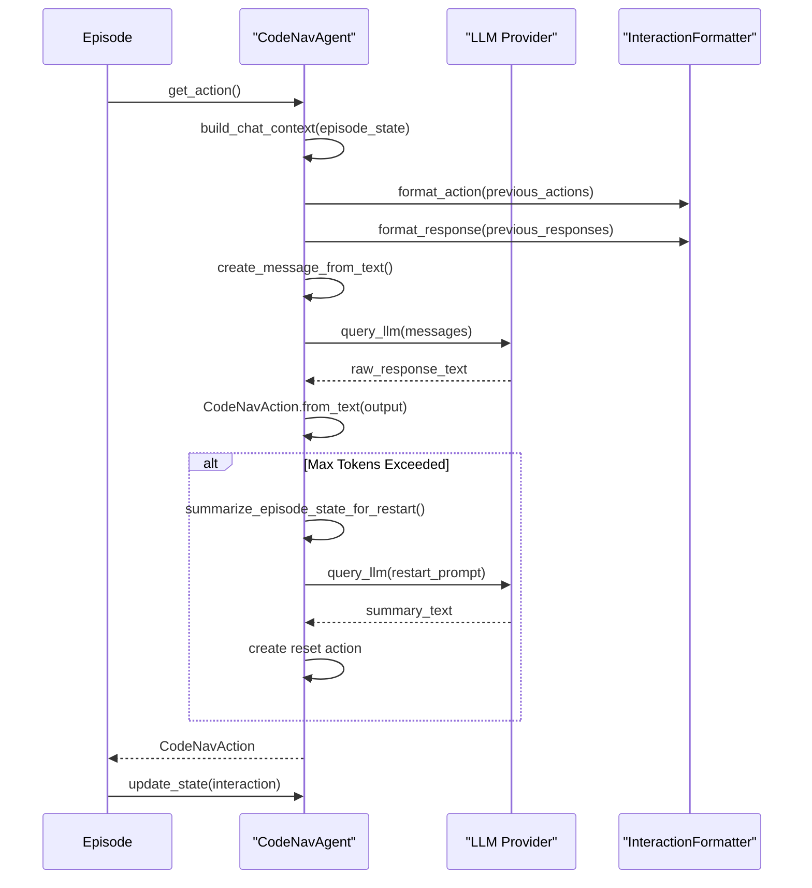

**Sources:** [codenav/agents/llm_chat_agent.py:155-181](), [codenav/agents/llm_chat_agent.py:94-127](), [codenav/agents/agent.py:26-27]()

## LLM Provider Integration

### Provider-Specific Implementations

Each LLM provider implements the abstract methods with provider-specific client configurations and message formats.

#### OpenAI Integration

The `OpenAICodeNavAgent` leverages the OpenAI client with standardized chat completion message formats:

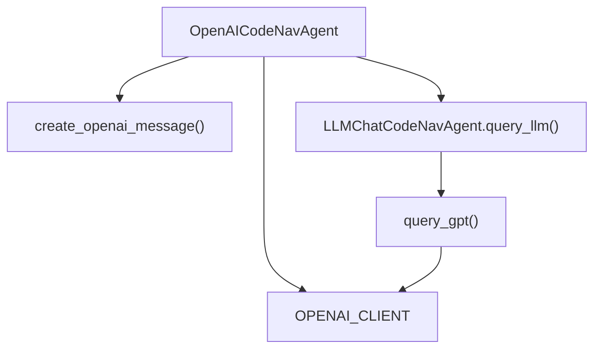

**Sources:** [codenav/agents/gpt4/agent.py:33-37](), [codenav/constants.py](), [codenav/utils/llm_utils.py]()

#### Cohere Integration

The `CohereCodeNavAgent` implements custom retry logic and Cohere-specific message formatting:

- **Retry Logic**: Up to 50 retries with 5-second delays for rate limiting [codenav/agents/cohere/agent.py:54-72]()
- **Message Format**: Custom role mapping (`USER`, `CHATBOT`, `SYSTEM`) [codenav/agents/cohere/agent.py:84-91]()
- **Token Tracking**: Detailed input/output token billing information [codenav/agents/cohere/agent.py:74-82]()

**Sources:** [codenav/agents/cohere/agent.py:40-92]()

### Default Configuration

| Provider | Model | Max Tokens | Allowed Actions |
|----------|-------|------------|-----------------|
| OpenAI | `DEFAULT_OPENAI_MODEL` | 50,000 | `code`, `done`, `search`, `reset` |
| Cohere | `command-r` | 50,000 | `code`, `done`, `search`, `reset` |

**Sources:** [codenav/agents/gpt4/agent.py:14-21](), [codenav/agents/cohere/agent.py:14-24]()

## Episode State Management

Agents maintain conversation state through the `EpisodeState` object, which contains the system prompt and interaction history.

### State Update Process

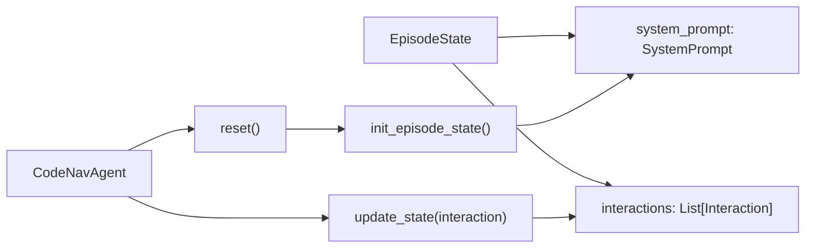

**Sources:** [codenav/agents/agent.py:17-27](), [codenav/agents/llm_chat_agent.py:88-89]()

### Chat Context Building

The `build_chat_context()` method converts episode state into LLM-compatible message format:

1. **System Message**: Added from `episode_state.system_prompt.content` [codenav/agents/llm_chat_agent.py:98-102]()
2. **Action Formatting**: Previous actions formatted using `interaction_formatter.format_action()` [codenav/agents/llm_chat_agent.py:107-116]()
3. **Response Formatting**: Environment responses formatted using `interaction_formatter.format_response()` [codenav/agents/llm_chat_agent.py:117-126]()
4. **Hidden Interactions**: Interactions marked as `hidden` are excluded from context [codenav/agents/llm_chat_agent.py:104-105]()

**Sources:** [codenav/agents/llm_chat_agent.py:94-127]()

## Token Management and Restart Mechanism

When token limits are exceeded, agents implement an automatic restart mechanism to maintain conversation continuity.

### Restart Process

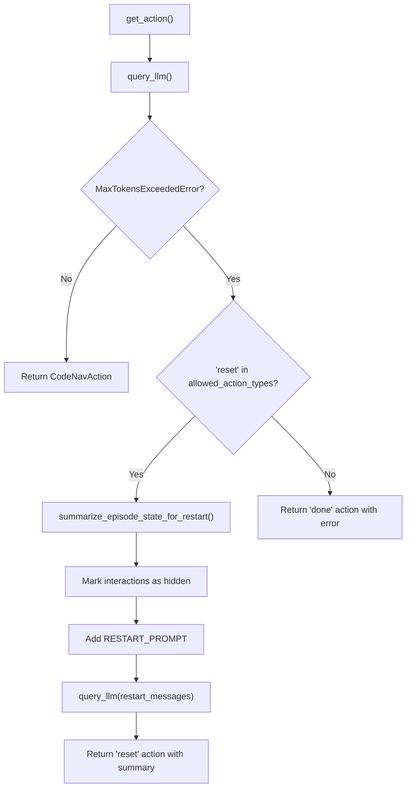

**Sources:** [codenav/agents/llm_chat_agent.py:155-181](), [codenav/agents/llm_chat_agent.py:129-153]()

### Hidden Interaction Management

During restart, previous interactions are marked as hidden to reduce context size while preserving variable state information:

- **Hidden Flag**: `interaction.hidden = True` [codenav/agents/llm_chat_agent.py:171]()
- **Hidden Index**: `interaction.hidden_at_index` tracks when hiding occurred [codenav/agents/llm_chat_agent.py:167-170]()
- **Variable Preservation**: Current environment variables are extracted and included in restart prompt [codenav/agents/llm_chat_agent.py:137-148]()

**Sources:** [codenav/agents/llm_chat_agent.py:165-172](), [codenav/prompts/restart_prompt.py]()

## Query and Response Tracking

All agents maintain detailed logs of LLM interactions for debugging and analysis:

### Tracking Structure

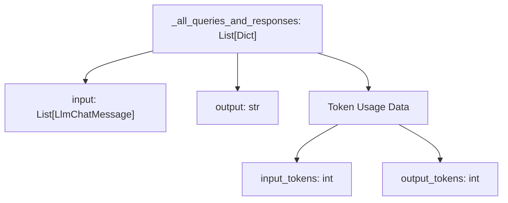

Each query-response pair is stored with complete input context and token usage information for cost tracking and performance analysis.

**Sources:** [codenav/agents/llm_chat_agent.py:79-86](), [codenav/agents/cohere/agent.py:74-82]()

---

# Page: Environment System

# Environment System

<details>
<summary>Relevant source files</summary>

The following files were used as context for generating this wiki page:

- [codenav/environments/abstractions.py](codenav/environments/abstractions.py)
- [codenav/environments/code_env.py](codenav/environments/code_env.py)
- [codenav/environments/done_env.py](codenav/environments/done_env.py)
- [codenav/environments/retrieval_env.py](codenav/environments/retrieval_env.py)

</details>


## Purpose and Scope

The Environment System provides the execution contexts and interfaces for different types of actions that LLM agents can perform within CodeNav. This system abstracts three primary environment types: code execution, code retrieval, and task completion. Each environment implements a common interface while providing specialized functionality for handling different action types.

For information about how environments are orchestrated within episodes, see [Episode Management](#3.4). For details about the agents that interact with these environments, see [Agent System](#3.2).

## Environment Abstraction

The environment system is built around the `CodeNavEnv` abstract base class, which defines the contract that all environments must implement.

```mermaid
classDiagram
    class CodeNavEnv {
        <<abstract>>
        +check_action_validity(action: CodeNavAction) Tuple[bool, str]
        +step(action: CodeNavAction) Union[InvalidAction, MultiRetrievalResult, ExecutionResult, UserMessageToAgent]
    }
    
    class PythonCodeEnv {
        -global_vars: Dict[str, Any]
        -exec_trace: List[ExecutionResult]
        -max_execution_time: float
        +step(action: CodeNavAction) ExecutionResult
        +reset(restore_to: str) void
        +step_append(code_str: str) ExecutionResult
    }
    
    class RetrievalEnv {
        -code_retriever: EsCodeRetriever
        -retrieved_es_docs: Dict[str, EsDocument]
        -expansions_per_query: int
        +step(action: CodeNavAction) MultiRetrievalResult
        +reset() void
    }
    
    class DoneEnv {
        +step(action: CodeNavAction) None
    }
    
    CodeNavEnv <|-- PythonCodeEnv
    CodeNavEnv <|-- RetrievalEnv
    CodeNavEnv <|-- DoneEnv
```

All environments implement two core methods:
- `check_action_validity()` - Validates whether an action can be executed
- `step()` - Executes the action and returns appropriate results

**Sources:** [codenav/environments/abstractions.py:13-24]()

## Code Execution Environment

The `PythonCodeEnv` class provides a sandboxed Python execution environment with comprehensive state management and error handling.

### Core Functionality

The environment maintains persistent state across code executions through several key components:

| Component | Purpose | Type |
|-----------|---------|------|
| `global_vars` | Runtime variable state | `Dict[str, Any]` |
| `exec_trace` | Execution history | `List[ExecutionResult]` |
| `working_dir` | File system context | `str` |
| `max_execution_time` | Timeout protection | `float` |

### Execution Flow

```mermaid
flowchart TD
    A["step(action: CodeNavAction)"] --> B["run_black_and_linting_and_mypy()"]
    B --> C["exec_with_informative_errors()"]
    C --> D{"Execution Success?"}
    D -->|Yes| E["Update global_vars"]
    D -->|No| F["Format error message"]
    E --> G["Create ExecutionResult"]
    F --> G
    G --> H["Append to exec_trace"]
    H --> I["Return ExecutionResult"]
    
    C --> J["timeout_handler()"]
    J --> K["CodeEnvTimeoutError"]
    K --> F
```

The `exec_with_informative_errors()` function provides enhanced error reporting by extracting line numbers and context from execution failures [codenav/environments/code_env.py:50-131]().

### State Management

The environment tracks variable changes by comparing string representations before and after execution:

```python
# Variables considered "updated" if representation changed
updated_vars: Dict[str, Any] = {
    k: v for k, v in self.global_vars.items()
    if (k in code_str or (k not in var_name_to_repr and not is_double_underscore_format(k)))
    and str(v) != var_name_to_repr.get(k, "")
}
```

**Sources:** [codenav/environments/code_env.py:134-350](), [codenav/environments/code_env.py:274-283]()

## Retrieval Environment

The `RetrievalEnv` class interfaces with Elasticsearch to provide code search and retrieval capabilities.

### Architecture

```mermaid
graph TB
    subgraph "RetrievalEnv"
        A["step(action)"] --> B["_get_retrieval_result()"]
        B --> C["code_retriever.search()"]
        C --> D["reorder_es_docs()"]
        D --> E["parallel_add_summary_to_es_docs()"]
        E --> F["Update retrieved_es_docs"]
    end
    
    subgraph "External Systems"
        ES["Elasticsearch"]
        CodeSummarizer["Code Summarizer"]
    end
    
    C --> ES
    E --> CodeSummarizer
    
    F --> G["MultiRetrievalResult"]
```

### Query Processing

The environment processes search queries through multiple stages:

1. **Query Parsing** - Handles multi-line queries by splitting on newlines
2. **Elasticsearch Search** - Uses `EsCodeRetriever.search()` with configurable limits
3. **Deduplication** - Filters previously retrieved documents using `es_doc_to_hash()`
4. **Reordering** - Prioritizes code blocks by type and excludes test files
5. **Summarization** - Optionally adds AI-generated summaries to code blocks

### Document Prioritization

The `reorder_es_docs()` function assigns scores based on code block types:

| Code Block Type | Base Score | Test File Penalty |
|----------------|------------|-------------------|
| `FUNCTION`, `CLASS`, `DOCUMENTATION` | 0.0 | +2.0 |
| `IMPORT`, `ASSIGNMENT` | 1.0 | +2.0 |
| Other types | 2.0 | +2.0 |

**Sources:** [codenav/environments/retrieval_env.py:47-149](), [codenav/environments/retrieval_env.py:16-44]()

## Done Environment

The `DoneEnv` class handles task completion signals with minimal validation logic.

### Validation Logic

The environment accepts only boolean string values:

```python
def check_action_validity(self, action: CodeNavAction) -> Tuple[bool, str]:
    if action.content.strip().lower() in ["true", "false"]:
        return True, ""
    else:
        return (False, "When executing the done action, the content must be either 'True' or 'False'")
```

The `step()` method returns `None`, signaling episode termination to the orchestrating system.

**Sources:** [codenav/environments/done_env.py:7-21]()

## Environment Interaction Patterns

### Action-Result Mapping

```mermaid
graph LR
    subgraph "Actions"
        CA["CodeNavAction"] --> CT["action.content"]
    end
    
    subgraph "Environments"
        PCE["PythonCodeEnv"]
        RE["RetrievalEnv"] 
        DE["DoneEnv"]
    end
    
    subgraph "Results"
        ER["ExecutionResult"]
        MRR["MultiRetrievalResult"]
        N["None"]
    end
    
    CT -->|"Python code"| PCE
    CT -->|"Search queries"| RE
    CT -->|"true/false"| DE
    
    PCE --> ER
    RE --> MRR
    DE --> N
```

### State Persistence

Each environment manages state differently:

- **PythonCodeEnv**: Maintains persistent `global_vars` and `exec_trace` across actions
- **RetrievalEnv**: Tracks `retrieved_es_docs` to prevent duplicate results
- **DoneEnv**: Stateless operation

### Error Handling

Environments implement different error handling strategies:

| Environment | Error Type | Handling Strategy |
|-------------|------------|-------------------|
| `PythonCodeEnv` | Execution errors | Enhanced traceback with line context |
| `PythonCodeEnv` | Timeout | `CodeEnvTimeoutError` with timeout duration |
| `RetrievalEnv` | Query parsing | Graceful degradation with error message |
| `DoneEnv` | Invalid content | Validation rejection with specific message |

**Sources:** [codenav/environments/abstractions.py:13-24](), [codenav/environments/code_env.py:46-131](), [codenav/environments/retrieval_env.py:75-92]()

---

# Page: Episode Management

# Episode Management

<details>
<summary>Relevant source files</summary>

The following files were used as context for generating this wiki page:

- [codenav/interaction/episode.py](codenav/interaction/episode.py)

</details>


This document covers the Episode Management system in CodeNav, which orchestrates the interaction lifecycle between LLM agents and environments. The Episode class serves as the central coordinator that manages state, validates actions, executes interaction steps, and formats outputs.

For information about the specific agent implementations, see [Agent System](#3.2). For details about the different environment types, see [Environment System](#3.3). For prompt creation and formatting, see [Prompt System](#5).

## Purpose and Scope

The Episode Management system is responsible for:

- Orchestrating multi-step interactions between agents and environments
- Validating agent actions before execution
- Managing episode state and interaction history
- Converting episodes to various output formats (notebooks, DataFrames)
- Handling errors and invalid actions gracefully
- Coordinating environment resets and state management

## Core Episode Architecture

The `Episode` class acts as the central orchestrator in CodeNav's interaction system:

```mermaid
graph TB
    subgraph "Episode Core"
        Episode["Episode<br/>episode.py:18"]
        State["episode_state<br/>(via agent)"]
        ActionMap["action_type_to_env<br/>Dict[ACTION_TYPES, CodeNavEnv]"]
    end
    
    subgraph "Agent Layer"
        Agent["CodeNavAgent<br/>agent.agent"]
        GetAction["get_action()<br/>episode.py:87"]
        UpdateState["update_state()<br/>episode.py:113"]
    end
    
    subgraph "Environment Layer"
        CodeEnv["PythonCodeEnv<br/>code_env.py"]
        RetrievalEnv["RetrievalEnv<br/>retrieval_env.py"]
        DoneEnv["DoneEnv<br/>done_env.py"]
    end
    
    subgraph "Interaction Flow"
        Step["step()<br/>episode.py:70"]
        Validate["check_action_validity()<br/>episode.py:44"]
        Execute["env.step(action)<br/>episode.py:101"]
    end
    
    Episode --> State
    Episode --> ActionMap
    Episode --> Agent
    
    Step --> GetAction
    Step --> Validate
    Step --> Execute
    Step --> UpdateState
    
    ActionMap --> CodeEnv
    ActionMap --> RetrievalEnv
    ActionMap --> DoneEnv
    
    Execute --> CodeEnv
    Execute --> RetrievalEnv
    Execute --> DoneEnv
```

Sources: [codenav/interaction/episode.py:18-33]()

## Episode Initialization

Episodes are initialized with three core components that define their operational context:

| Component | Type | Purpose |
|-----------|------|---------|
| `agent` | `CodeNavAgent` | LLM agent that generates actions |
| `action_type_to_env` | `Dict[ACTION_TYPES, CodeNavEnv]` | Maps action types to their execution environments |
| `user_query_str` | `str` | The user's query that initiates the episode |

The initialization process includes validation to ensure required action types are available:

```mermaid
graph LR
    Init["Episode.__init__<br/>episode.py:19"] --> Reset["agent.reset()<br/>episode.py:29"]
    Reset --> Validate["assert 'done', 'code'<br/>episode.py:32"]
    Validate --> Ready["Episode Ready"]
```

The episode requires at minimum `done` and `code` action types to be present in the environment mapping.

Sources: [codenav/interaction/episode.py:18-33]()

## Interaction Lifecycle

The core interaction loop is managed through the `step()` method, which coordinates action generation, validation, and execution:

```mermaid
sequenceDiagram
    participant E as "Episode"
    participant A as "Agent"
    participant V as "Validator"
    participant Env as "Environment"
    
    E->>E: "Check if first step<br/>episode.py:71"
    alt "First interaction"
        E->>A: "Add user query<br/>episode.py:75-85"
    end
    
    E->>A: "get_action()<br/>episode.py:87"
    A-->>E: "CodeNavAction"
    
    E->>V: "check_action_validity()<br/>episode.py:89"
    V-->>E: "is_valid, error_msg"
    
    alt "Valid action"
        alt "Reset action"
            E->>E: "Handle reset<br/>episode.py:92-96"
        else "Normal action"
            E->>Env: "env.step(action)<br/>episode.py:101"
            Env-->>E: "Response"
        end
    else "Invalid action"
        E->>E: "Create InvalidAction<br/>episode.py:110"
    end
    
    E->>A: "update_state(interaction)<br/>episode.py:113"
```

Sources: [codenav/interaction/episode.py:70-115]()

## Action Validation System

The episode validates agent actions before execution using a two-tier validation approach:

```mermaid
graph TD
    Action["CodeNavAction"] --> CheckReset{"action.type == 'reset'<br/>episode.py:48"}
    CheckReset -->|"Yes"| Valid["Return True"]
    CheckReset -->|"No"| CheckThought{"action.thought exists<br/>episode.py:51-53"}
    
    CheckThought -->|"No"| Invalid1["Add error: missing thought"]
    CheckThought -->|"Yes"| CheckType{"action.type in env_map<br/>episode.py:55-58"}
    
    CheckType -->|"No"| Invalid2["Add error: unsupported type"]
    CheckType -->|"Yes"| EnvValidate["env.check_action_validity()<br/>episode.py:63"]
    
    EnvValidate --> Combine["Combine validation results<br/>episode.py:65-66"]
    Invalid1 --> Combine
    Invalid2 --> Combine
    Combine --> Result["Return is_valid, error_msg"]
```

Sources: [codenav/interaction/episode.py:44-68]()

## Multi-Step Execution

Episodes can run until completion or a maximum step limit using `step_until_max_steps_or_success()`:

| Parameter | Purpose |
|-----------|---------|
| `max_steps` | Maximum number of interaction steps to execute |
| `verbose` | Whether to print step-by-step progress |

The execution loop terminates when:
- Maximum steps are reached
- Agent issues a valid `done` action
- Keyboard interrupt occurs

Sources: [codenav/interaction/episode.py:117-135]()

## Output Generation System

Episodes provide multiple output formats for analysis and debugging:

```mermaid
graph LR
    subgraph "Episode Outputs"
        Interactions["tabulate_interactions()<br/>episode.py:162"]
        ExecTrace["tabulate_exec_trace()<br/>episode.py:171"]
        Prompts["tabulate_prompts()<br/>episode.py:174"]
        Notebook["to_notebook()<br/>episode.py:185"]
    end
    
    subgraph "Data Formats"
        DataFrame["pandas.DataFrame"]
        NotebookStr["Jupyter Notebook String"]
    end
    
    Interactions --> DataFrame
    ExecTrace --> DataFrame
    Prompts --> DataFrame
    Notebook --> NotebookStr
```

### Interaction Records

Each interaction is converted to a standardized record format containing:

| Field | Content |
|-------|---------|
| `action/thought` | Agent's reasoning |
| `action/type` | Action type (code, search, done) |
| `action/content` | Action content/payload |
| `response` | Environment response |
| `hidden` | Whether interaction is hidden |

Sources: [codenav/interaction/episode.py:137-169]()

## Code Environment Integration

Episodes provide direct access to the Python code execution environment through a property:

```mermaid
graph LR
    Episode --> CodeEnvProperty["code_env property<br/>episode.py:34"]
    CodeEnvProperty --> Filter["Filter PythonCodeEnv<br/>episode.py:36-39"]
    Filter --> Assert["Assert single instance<br/>episode.py:41"]
    Assert --> Return["Return PythonCodeEnv"]
```

This integration allows episodes to access execution traces and working directory information for output generation.

Sources: [codenav/interaction/episode.py:34-42]()

## Error Handling and Recovery

The episode system includes robust error handling for various failure scenarios:

### Keyboard Interrupt Handling
When code execution is interrupted, the episode captures the current state and generates a notebook before re-raising the exception.

### Invalid Action Handling
Invalid actions are wrapped in `InvalidAction` response objects that provide detailed error messages to the agent.

### Reset Action Support
Episodes support a special `reset` action that:
- Sends a pickup prompt to the agent
- Resets retrieval environment state
- Allows episodes to recover from problematic states

Sources: [codenav/interaction/episode.py:92-111]()

---

# Page: Interaction Formatting

# Interaction Formatting

<details>
<summary>Relevant source files</summary>

The following files were used as context for generating this wiki page:

- [codenav/agents/interaction_formatters.py](codenav/agents/interaction_formatters.py)

</details>


## Purpose and Scope

This document covers how CodeNav formats interactions between agents and environments for display and logging. Interaction formatting controls how agent actions and environment responses are converted to human-readable text that can be displayed in notebooks, logs, or passed back to LLM agents as context.

For information about the overall interaction lifecycle, see [Episode Management](#3.4). For details about the specific message types being formatted, see [Agent System](#3.2) and [Environment System](#3.3).

## Overview

The interaction formatting system provides a pluggable way to customize how `CodeNavAction` objects and environment responses are converted to text. This is essential because different use cases may require different levels of detail, different formatting styles, or specialized handling for specific response types.

The system is built around the `InteractionFormatter` abstract base class, which defines the interface for all formatters. The most common implementation is `DefaultInteractionFormatter`, with specialized variants like `CustomRetrievalInteractionFormatter` for handling search results.

**Interaction Formatting Architecture**

```mermaid
classDiagram
    class InteractionFormatter {
        <<abstract>>
        +format_action(action: CodeNavAction) str
        +format_response(response: RESPONSE_TYPES) str
    }
    
    class DefaultInteractionFormatter {
        +action_format_kwargs: Mapping
        +response_format_kwargs: Mapping
        +__init__(action_format_kwargs, response_format_kwargs)
        +format_action(action: CodeNavAction) str
        +format_response(response: RESPONSE_TYPES) str
    }
    
    class CustomRetrievalInteractionFormatter {
        +use_summary: Literal
        +__init__(use_summary)
        +format_retrieval_result(rr: RetrievalResult, include_query) str
        +format_response(response: RESPONSE_TYPES) str
    }
    
    class Interaction {
        +format_action(action, **kwargs) str
        +format_response(response, **kwargs) str
    }
    
    InteractionFormatter <|-- DefaultInteractionFormatter
    DefaultInteractionFormatter <|-- CustomRetrievalInteractionFormatter
    DefaultInteractionFormatter --> Interaction : delegates to
    CustomRetrievalInteractionFormatter --> Interaction : delegates to
```

Sources: [codenav/agents/interaction_formatters.py:1-131]()

## Base Formatter Interface

The `InteractionFormatter` abstract base class defines the core interface that all formatters must implement:

```python
class InteractionFormatter(abc.ABC):
    def format_action(self, action: CodeNavAction):
        raise NotImplementedError

    def format_response(self, response: RESPONSE_TYPES):
        raise NotImplementedError
```

This interface ensures that any formatter can handle both:
- **Actions**: What the agent wants to do (code execution, search queries, completion signals)  
- **Responses**: Results from environments (execution output, search results, status messages)

Sources: [codenav/agents/interaction_formatters.py:28-34]()

## Default Formatter Implementation

The `DefaultInteractionFormatter` provides the standard formatting behavior used in most scenarios. It delegates the actual formatting work to static methods on the `Interaction` class, but allows configuration through keyword arguments.

**Default Configuration Constants**

```mermaid
graph LR
    subgraph "Action Formatting"
        AAF["DEFAULT_ACTION_FORMAT_KWARGS"] --> AFK["include_header: True"]
    end
    
    subgraph "Response Formatting"
        ARF["DEFAULT_RESPONSE_FORMAT_KWARGS"] --> RFK1["include_code: False"]
        ARF --> RFK2["display_updated_vars: True"] 
        ARF --> RFK3["include_query: True"]
        ARF --> RFK4["include_header: True"]
    end
    
    subgraph "DefaultInteractionFormatter"
        DIF["DefaultInteractionFormatter"] --> AAF
        DIF --> ARF
        DIF --> IA["Interaction.format_action()"]
        DIF --> IR["Interaction.format_response()"]
    end
```

The default formatter accepts two configuration mappings:
- `action_format_kwargs`: Controls how actions are formatted
- `response_format_kwargs`: Controls how responses are formatted

Key formatting options include:
- `include_header`: Whether to include action/response type headers
- `include_code`: Whether to show full code content in responses
- `display_updated_vars`: Whether to show variable changes after code execution
- `include_query`: Whether to show the original search query with results

Sources: [codenav/agents/interaction_formatters.py:14-25](), [codenav/agents/interaction_formatters.py:36-56]()

## Custom Retrieval Formatter

The `CustomRetrievalInteractionFormatter` extends the default formatter with specialized handling for search results. It provides fine-grained control over how code blocks are displayed when retrieved from Elasticsearch.

**Retrieval Formatting Flow**

```mermaid
flowchart TD
    Input["MultiRetrievalResult or other RESPONSE_TYPES"] --> Check{"Is MultiRetrievalResult?"}
    
    Check -->|No| Default["DefaultInteractionFormatter.format_response()"]
    Check -->|Yes| Multi["Process each RetrievalResult"]
    
    Multi --> FormatRR["format_retrieval_result()"]
    
    FormatRR --> Query["Add QUERY section if include_query=True"]
    Query --> Blocks["Add CODE BLOCKS section"]
    
    Blocks --> CheckDocs{"Any es_docs?"}
    CheckDocs -->|No| Failure["Show failure_reason or 'No code blocks found'"]
    CheckDocs -->|Yes| ProcessDocs["Process documents up to max_expanded"]
    
    ProcessDocs --> Summary{"use_summary mode?"}
    Summary -->|prototype| Prototype["Replace text with prototype"]
    Summary -->|other| Direct["Use es_doc_to_string()"]
    
    Prototype --> Direct
    Direct --> Unexpanded["Handle unexpanded documents"]
    
    Unexpanded --> ShowProtos{"max_prototype > 0?"}
    ShowProtos -->|Yes| Protos["Show prototypes for classes/functions"]
    ShowProtos -->|No| Done["Return formatted string"]
    Protos --> Done
    
    Default --> Done
    Failure --> Done
```

The custom formatter supports several summary modes:
- `"always"`: Always use summary instead of full code
- `"never"`: Never use summary, show full code
- `"ifshorter"`: Use summary only if it's shorter than full code
- `"prototype"`: Replace text with prototype for classes/functions

Sources: [codenav/agents/interaction_formatters.py:58-131]()

## Retrieval Result Formatting Details

When formatting retrieval results, the `CustomRetrievalInteractionFormatter` implements a sophisticated display strategy:

| Element | Description | Configuration |
|---------|-------------|---------------|
| Query Section | Shows the original search query | `include_query` parameter |
| Expanded Results | Full code blocks up to `max_expanded` limit | `use_summary` mode controls detail level |
| Unexpanded Summary | Count of additional results not shown | Always shown if results exceed `max_expanded` |
| Prototype Preview | Function/class signatures for unexpanded results | Controlled by `max_prototype` limit |

**Example formatting structure:**
```
QUERY:
search for authentication functions

CODE BLOCKS:
---
[Full code block 1]
---
[Full code block 2]  
---
(15 additional code blocks not shown. Search again with the same query to see additional results.)

Prototypes for the next 5 out of 12 classes/functions found in unexpanded results:
def authenticate_user(username: str, password: str) -> bool:
class AuthenticationManager:
```

The formatter uses `es_doc_to_string()` from the Elasticsearch integration to convert individual documents to text, allowing it to leverage the same formatting logic used throughout the retrieval system.

Sources: [codenav/agents/interaction_formatters.py:65-131]()

## Integration with Episode System

Interaction formatters are used throughout the episode lifecycle to ensure consistent formatting across different output formats:

**Formatter Usage in Episode Flow**

```mermaid
sequenceDiagram
    participant Episode
    participant Agent
    participant Environment  
    participant Formatter as "InteractionFormatter"
    participant Output as "Notebook/Log Output"
    
    Episode->>Agent: "get_action()"
    Agent-->>Episode: "CodeNavAction"
    
    Episode->>Formatter: "format_action(action)"
    Formatter-->>Episode: "formatted_action_str"
    
    Episode->>Environment: "step(action)"
    Environment-->>Episode: "response"
    
    Episode->>Formatter: "format_response(response)"
    Formatter-->>Episode: "formatted_response_str"
    
    Episode->>Output: "Add formatted strings to output"
```

The formatted strings are used in multiple contexts:
- Jupyter notebook cell outputs for interactive exploration
- Conversation history passed back to LLM agents
- Evaluation logs and traces
- Debug output and monitoring

This ensures that whether a user is viewing results in a notebook or an agent is processing conversation history, the formatting remains consistent and appropriately configured for the use case.

Sources: [codenav/agents/interaction_formatters.py:1-131]()

---

# Page: Evaluation Framework

# Evaluation Framework

<details>
<summary>Relevant source files</summary>

The following files were used as context for generating this wiki page:

- [codenav/default_eval_spec.py](codenav/default_eval_spec.py)
- [codenav/utils/eval_types.py](codenav/utils/eval_types.py)

</details>


The Evaluation Framework provides a standardized system for running experiments and evaluations with CodeNav's LLM-powered code navigation capabilities. This framework defines abstractions for configuring, executing, and logging evaluation runs in a consistent and reproducible manner.

The framework handles the complete lifecycle of an evaluation: building episodes with specific configurations, running agent-environment interactions, and logging outputs in structured formats. For details about the specific evaluation implementations, see [Evaluation Specifications](#4.1). For information about running evaluations at scale, see [Parallel Evaluation](#4.2).

## Core Evaluation Concepts

The evaluation system is built around three key abstractions that work together to provide a flexible framework for experimentation:

| Component | Purpose | Key Responsibility |
|-----------|---------|-------------------|
| `EvalInput` | Input specification | Contains query and unique identifier for each evaluation |
| `EvalSpec` | Evaluation definition | Defines how to build episodes, run interactions, and log outputs |
| `CodenavEvaluator` | Execution engine | Orchestrates the evaluation process using the provided specification |

## Evaluation Workflow

```mermaid
flowchart TD
    EvalInput["EvalInput(uid, query)"] --> EvalSpec["EvalSpec"]
    EvalSpec --> BuildEpisode["build_episode()"]
    
    BuildEpisode --> PromptBuilder["PromptBuilder"]
    BuildEpisode --> OpenAICodeNavAgent["OpenAICodeNavAgent"] 
    BuildEpisode --> PythonCodeEnv["PythonCodeEnv"]
    BuildEpisode --> RetrievalEnv["RetrievalEnv"]
    BuildEpisode --> DoneEnv["DoneEnv"]
    
    PromptBuilder --> Episode["Episode"]
    OpenAICodeNavAgent --> Episode
    PythonCodeEnv --> Episode
    RetrievalEnv --> Episode
    DoneEnv --> Episode
    
    Episode --> RunInteraction["run_interaction()"]
    RunInteraction --> StepUntilMaxSteps["step_until_max_steps_or_success()"]
    StepUntilMaxSteps --> ToNotebook["to_notebook()"]
    
    ToNotebook --> LogOutput["log_output()"]
    LogOutput --> OutputFile["output.ipynb"]
    
    style EvalInput fill:#f9f9f9
    style Episode fill:#f9f9f9
    style OutputFile fill:#f9f9f9
```

Sources: [codenav/utils/eval_types.py:9-53](), [codenav/default_eval_spec.py:26-96]()

## Abstract Evaluation Interface

The `EvalSpec` abstract base class defines the contract that all evaluation specifications must implement:

```mermaid
classDiagram
    class EvalSpec {
        <<abstract>>
        +episode_kwargs: Str2AnyDict
        +interaction_kwargs: Str2AnyDict  
        +logging_kwargs: Str2AnyDict
        +build_episode(eval_input, episode_kwargs)* Episode
        +run_interaction(episode, interaction_kwargs)* Str2AnyDict
        +log_output(interaction_output, eval_input, logging_kwargs)* Any
    }
    
    class DefaultEvalSpec {
        +build_episode(eval_input, episode_kwargs) Episode
        +run_interaction(episode, interaction_kwargs) Str2AnyDict
        +log_output(interaction_output, eval_input, logging_kwargs) Any
    }
    
    class EvalInput {
        +uid: Union[str, int]
        +query: str
        +metadata: Optional[Any]
    }
    
    EvalSpec <|-- DefaultEvalSpec
    EvalSpec ..> EvalInput : uses
    DefaultEvalSpec ..> EvalInput : uses
```

Sources: [codenav/utils/eval_types.py:19-53](), [codenav/default_eval_spec.py:17-97]()

### EvalInput Specification

The `EvalInput` class encapsulates the input parameters for a single evaluation run:

- **uid**: Unique identifier for the evaluation (used for output file naming)
- **query**: Natural language query to be processed by the system
- **metadata**: Optional additional data for the evaluation

Sources: [codenav/utils/eval_types.py:9-14]()

### Three-Phase Evaluation Process

Each evaluation follows a standardized three-phase process:

1. **Episode Building** (`build_episode`): Creates an `Episode` instance with configured agents and environments
2. **Interaction Execution** (`run_interaction`): Runs the agent-environment interaction loop and generates outputs
3. **Output Logging** (`log_output`): Persists results to files or storage systems

Sources: [codenav/utils/eval_types.py:30-53]()

## Default Evaluation Implementation

The `DefaultEvalSpec` provides a complete implementation of the evaluation framework, configuring CodeNav with standard settings for most use cases:

### Episode Configuration

The `build_episode` method constructs a fully configured `Episode` with:

| Component | Configuration | Purpose |
|-----------|--------------|---------|
| Agent | `OpenAICodeNavAgent` with specified model | LLM-powered decision making |
| Code Environment | `PythonCodeEnv` with code directory and sys paths | Python code execution |
| Retrieval Environment | `RetrievalEnv` with `EsCodeRetriever` | Elasticsearch-based code search |
| Done Environment | `DoneEnv` | Task completion signaling |

Sources: [codenav/default_eval_spec.py:26-69]()

### Interaction Execution

The `run_interaction` method manages the episode lifecycle:

```mermaid
sequenceDiagram
    participant ES as "DefaultEvalSpec"
    participant Ep as "Episode"
    participant Ag as "OpenAICodeNavAgent"
    participant Env as "Environments"
    
    ES->>Ep: "step_until_max_steps_or_success(max_steps, verbose)"
    
    loop "Until max steps or success"
        Ep->>Ag: "get_action()"
        Ag-->>Ep: "CodeNavAction"
        Ep->>Env: "step(action)"
        Env-->>Ep: "response"
    end
    
    Ep->>Ep: "to_notebook(working_dir)"
    Ep-->>ES: "ipynb_str"
```

Sources: [codenav/default_eval_spec.py:71-82]()

### Output Management

The `log_output` method saves interaction results as Jupyter notebooks, enabling:
- Visual inspection of the complete interaction trace
- Code execution results preservation
- Reproducible experiment documentation

Sources: [codenav/default_eval_spec.py:84-96]()

## Main Evaluation Entry Point

The `run_codenav_on_query` function provides a high-level interface for single-query evaluations:

### Configuration Parameters

| Parameter | Type | Purpose |
|-----------|------|---------|
| `exp_name` | str | Experiment identifier (becomes output filename) |
| `query` | str | Natural language query to process |
| `code_dir` | str | Target codebase directory |
| `index_name` | str | Elasticsearch index name |
| `working_dir` | str | Code execution workspace |
| `max_steps` | int | Maximum interaction steps (default: 20) |

### Default Configuration

The function establishes standard settings for most CodeNav operations:

- **Allowed Actions**: `["done", "code", "search"]`
- **Retrievals per Keyword**: 3 code snippets
- **Prototypes per Keyword**: 7 function signatures
- **LLM Model**: Configured via `DEFAULT_OPENAI_MODEL`
- **Prompt System**: Uses default prompts with optional repository description

Sources: [codenav/default_eval_spec.py:99-152]()

### Integration with CodenavEvaluator

The function demonstrates the standard pattern for using the evaluation framework:

```mermaid
flowchart LR
    Function["run_codenav_on_query()"] --> EvalInput["EvalInput(exp_name, query)"]
    Function --> DefaultEvalSpec["DefaultEvalSpec(kwargs)"]
    
    EvalInput --> Evaluator["CodenavEvaluator.evaluate_input()"]
    DefaultEvalSpec --> Evaluator
    
    Evaluator --> OutputFile["experiment.ipynb"]
    
    style Function fill:#f9f9f9
    style OutputFile fill:#f9f9f9
```

Sources: [codenav/default_eval_spec.py:143-150]()

## Integration with Core Systems

The evaluation framework serves as the primary orchestration layer that connects all major CodeNav components:

- **Agent System**: Configures and initializes LLM agents (see [Agent System](#3.2))
- **Environment System**: Sets up code execution and retrieval environments (see [Environment System](#3.3))  
- **Episode Management**: Creates and manages interaction episodes (see [Episode Management](#3.4))
- **Prompt System**: Builds prompts with repository context (see [Prompt System](#5))
- **Elasticsearch Integration**: Configures code retrieval and indexing (see [Elasticsearch Integration](#6))

The framework's abstractions enable experimentation with different configurations while maintaining consistent evaluation methodology across all CodeNav use cases.

Sources: [codenav/default_eval_spec.py:1-152](), [codenav/utils/eval_types.py:1-54]()

---

# Page: Evaluation Specifications

# Evaluation Specifications

<details>
<summary>Relevant source files</summary>

The following files were used as context for generating this wiki page:

- [codenav/default_eval_spec.py](codenav/default_eval_spec.py)
- [codenav/utils/eval_types.py](codenav/utils/eval_types.py)

</details>


## Purpose and Scope

This document covers the evaluation specification framework that defines how CodeNav experiments are structured and executed. The evaluation specifications provide an abstract interface for configuring episodes, running interactions, and logging outputs. For information about parallel execution of evaluations, see [Parallel Evaluation](#4.2). For details about the broader evaluation framework concepts, see [Evaluation Framework](#4).

The evaluation specification system consists of an abstract `EvalSpec` class that defines the evaluation lifecycle and a concrete `DefaultEvalSpec` implementation that provides the standard CodeNav evaluation behavior.

## Abstract EvalSpec Framework

The evaluation specification framework is built around the abstract `EvalSpec` class in [codenav/utils/eval_types.py:19-53](), which defines a three-phase evaluation lifecycle:

| Phase | Method | Purpose |
|-------|--------|---------|
| Episode Building | `build_episode()` | Creates and configures an `Episode` instance |
| Interaction Execution | `run_interaction()` | Runs the agent-environment interaction loop |
| Output Logging | `log_output()` | Processes and saves evaluation results |

### EvalSpec Class Structure

```mermaid
classDiagram
    class EvalSpec {
        <<abstract>>
        +episode_kwargs: Str2AnyDict
        +interaction_kwargs: Str2AnyDict  
        +logging_kwargs: Str2AnyDict
        +build_episode(eval_input, episode_kwargs)* Episode
        +run_interaction(episode, interaction_kwargs)* Str2AnyDict
        +log_output(interaction_output, eval_input, logging_kwargs)* Any
    }
    
    class DefaultEvalSpec {
        +build_episode(eval_input, episode_kwargs) Episode
        +run_interaction(episode, interaction_kwargs) Str2AnyDict
        +log_output(interaction_output, eval_input, logging_kwargs) Any
    }
    
    class EvalInput {
        +uid: Union[str, int]
        +query: str
        +metadata: Optional[Any]
    }
    
    EvalSpec <|-- DefaultEvalSpec
    EvalSpec --> EvalInput : "processes"
```

**Sources:** [codenav/utils/eval_types.py:19-53](), [codenav/default_eval_spec.py:17-96]()

## EvalInput Data Structure

The `EvalInput` class in [codenav/utils/eval_types.py:9-14]() serves as the standardized input format for evaluations:

```python
@attrs.define
class EvalInput:
    uid: Union[str, int]        # Unique identifier for the evaluation
    query: str                  # Natural language query to process
    metadata: Optional[Any]     # Additional context or configuration
```

The `uid` field is used for output file naming and tracking, while the `query` contains the natural language question that the agent will attempt to answer through code navigation.

**Sources:** [codenav/utils/eval_types.py:9-14]()

## DefaultEvalSpec Implementation

The `DefaultEvalSpec` class in [codenav/default_eval_spec.py:17-96]() provides the concrete implementation of the evaluation specification interface, configured for OpenAI GPT-based agents with Elasticsearch retrieval.

### Episode Building Phase

The `build_episode()` method [codenav/default_eval_spec.py:26-69]() constructs a complete episode with:

- **OpenAI Agent**: `OpenAICodeNavAgent` with configured prompts and allowed actions
- **Environment Mapping**: Three environments mapped to action types:
  - `code` → `PythonCodeEnv` for code execution
  - `search` → `RetrievalEnv` with `EsCodeRetriever` for code search
  - `done` → `DoneEnv` for task completion
- **Prompt Configuration**: Uses `PromptBuilder` to create contextual prompts

```mermaid
flowchart TD
    subgraph "build_episode() Flow"
        EI["EvalInput"] --> PB["PromptBuilder"]
        EK["episode_kwargs"] --> PB
        PB --> P["Generated Prompt"]
        
        P --> OA["OpenAICodeNavAgent"]
        EK --> PCE["PythonCodeEnv"]
        EK --> RE["RetrievalEnv + EsCodeRetriever"]
        EK --> DE["DoneEnv"]
        
        OA --> EP["Episode"]
        PCE --> EP
        RE --> EP  
        DE --> EP
        EI --> EP
    end
```

**Sources:** [codenav/default_eval_spec.py:26-69]()

### Interaction Execution Phase

The `run_interaction()` method [codenav/default_eval_spec.py:71-82]() executes the agent-environment interaction:

1. Calls `episode.step_until_max_steps_or_success()` with configured maximum steps
2. Converts the episode to a Jupyter notebook format using `episode.to_notebook()`
3. Returns the notebook string for logging

**Sources:** [codenav/default_eval_spec.py:71-82]()

### Output Logging Phase

The `log_output()` method [codenav/default_eval_spec.py:84-96]() handles result persistence:

1. Creates output filename using `eval_input.uid` and `.ipynb` extension
2. Writes the interaction notebook to the specified output directory
3. Returns the output file path

**Sources:** [codenav/default_eval_spec.py:84-96]()

## Evaluation Phases Flow

The complete evaluation specification workflow demonstrates how the three phases work together:

```mermaid
sequenceDiagram
    participant C as "CodenavEvaluator"
    participant ES as "DefaultEvalSpec"
    participant EP as "Episode"
    participant AG as "OpenAICodeNavAgent"
    participant ENV as "Environments"
    
    C->>ES: "build_episode(eval_input, episode_kwargs)"
    ES->>EP: "new Episode(agent, envs, query)"
    ES->>C: "return episode"
    
    C->>ES: "run_interaction(episode, interaction_kwargs)"
    ES->>EP: "step_until_max_steps_or_success(max_steps)"
    
    loop "Interaction Loop"
        EP->>AG: "get_action()"
        AG->>ENV: "execute action"
        ENV->>EP: "return result"
    end
    
    ES->>EP: "to_notebook(working_dir)"
    EP->>ES: "return ipynb_str"
    ES->>C: "return {ipynb_str: ...}"
    
    C->>ES: "log_output(interaction_output, eval_input, logging_kwargs)"
    ES->>ES: "write ipynb file to out_dir"
    ES->>C: "return output_path"
```

**Sources:** [codenav/default_eval_spec.py:17-96](), [codenav/utils/eval_types.py:19-53]()

## Configuration and Usage

### The run_codenav_on_query Function

The `run_codenav_on_query()` function [codenav/default_eval_spec.py:99-152]() provides a high-level interface that encapsulates the entire evaluation specification workflow:

| Parameter | Purpose | Default |
|-----------|---------|---------|
| `exp_name` | Unique experiment identifier | Required |
| `query` | Natural language query | Required |
| `code_dir` | Path to codebase to analyze | Required |
| `index_name` | Elasticsearch index name | Required |
| `max_steps` | Maximum interaction steps | 20 |
| `working_dir` | Code execution directory | `playground/` |
| `repo_description_path` | Custom repository description | None |

### Configuration Structure

The function creates three configuration dictionaries that correspond to the evaluation phases:

```python
episode_kwargs = dict(
    allowed_actions=["done", "code", "search"],
    repo_description=repo_description,
    retrievals_per_keyword=3,
    prototypes_per_keyword=7,
    llm=DEFAULT_OPENAI_MODEL,
    # ... additional configuration
)

interaction_kwargs = dict(max_steps=max_steps, verbose=True)
logging_kwargs = dict(out_dir=out_dir)
```

**Sources:** [codenav/default_eval_spec.py:99-152](), [codenav/default_eval_spec.py:126-140]()

---

# Page: Parallel Evaluation

# Parallel Evaluation

<details>
<summary>Relevant source files</summary>

The following files were used as context for generating this wiki page:

- [codenav_examples/parallel_evaluation.py](codenav_examples/parallel_evaluation.py)

</details>


This document explains how to run CodeNav evaluations in parallel for scalable experimentation and batch processing. It covers the `CodenavEvaluator` class, the `EvalSpec` pattern, and how to configure and execute multiple evaluations concurrently.

For information about the underlying evaluation specifications and framework abstractions, see [Evaluation Specifications](#4.1). For details about the core agent and environment system that parallel evaluation orchestrates, see [Agent System](#3.2) and [Environment System](#3.3).

## Overview

Parallel evaluation in CodeNav enables running multiple code navigation queries simultaneously across different processes. This is essential for large-scale experimentation, benchmarking, and research workflows where you need to evaluate the system's performance across many different code queries efficiently.

The parallel evaluation system is built around two key abstractions:
- `EvalSpec`: Defines how to build episodes, run interactions, and log outputs
- `CodenavEvaluator`: Orchestrates parallel execution of evaluations using multiprocessing

**Parallel Evaluation Architecture**

```mermaid
graph TB
    subgraph "Input Layer"
        EI1["EvalInput(uid=1, query='...')"]
        EI2["EvalInput(uid=2, query='...')"] 
        EI3["EvalInput(uid=N, query='...')"]
    end
    
    subgraph "Orchestration Layer"
        CE["CodenavEvaluator"]
        ES["CodenavEvalSpec"]
    end
    
    subgraph "Process Pool"
        P1["Process 1"]
        P2["Process 2"]
        PN["Process N"]
    end
    
    subgraph "Episode Execution"
        EP1["Episode.build_episode()"]
        EP2["Episode.build_episode()"]
        EPN["Episode.build_episode()"]
        
        RI1["run_interaction()"]
        RI2["run_interaction()"]
        RIN["run_interaction()"]
    end
    
    subgraph "Output Layer"
        NB1["output1.ipynb"]
        NB2["output2.ipynb"]
        NBN["outputN.ipynb"]
    end
    
    EI1 --> CE
    EI2 --> CE
    EI3 --> CE
    
    CE --> ES
    ES --> P1
    ES --> P2
    ES --> PN
    
    P1 --> EP1
    P2 --> EP2
    PN --> EPN
    
    EP1 --> RI1
    EP2 --> RI2
    EPN --> RIN
    
    RI1 --> NB1
    RI2 --> NB2
    RIN --> NBN
```

Sources: [codenav_examples/parallel_evaluation.py:99-122]()

## EvalSpec Implementation

The `CodenavEvalSpec` class implements the `EvalSpec` interface to define how parallel evaluations should be executed. It requires three core methods that define the evaluation lifecycle:

| Method | Purpose | Input | Output |
|--------|---------|-------|--------|
| `build_episode` | Creates an Episode with agent and environments | `EvalInput`, `episode_kwargs` | `Episode` |
| `run_interaction` | Executes the episode interaction loop | `Episode`, `interaction_kwargs` | `Str2AnyDict` |
| `log_output` | Saves evaluation results to files | `interaction_output`, `EvalInput`, `logging_kwargs` | File path |

**EvalSpec Workflow**

```mermaid
sequenceDiagram
    participant CE as "CodenavEvaluator"
    participant ES as "CodenavEvalSpec"
    participant EP as "Episode"
    participant AG as "OpenAICodeNavAgent"
    participant ENV as "Environments"
    
    CE->>ES: evaluate(eval_inputs)
    
    loop "For each EvalInput"
        ES->>ES: build_episode()
        ES->>EP: Episode()
        ES->>AG: OpenAICodeNavAgent()
        ES->>ENV: PythonCodeEnv, RetrievalEnv, DoneEnv
        
        ES->>ES: run_interaction()
        ES->>EP: step_until_max_steps_or_success()
        EP->>AG: get_action()
        EP->>ENV: step(action)
        ENV-->>EP: response
        EP->>EP: to_notebook()
        
        ES->>ES: log_output()
        ES->>ES: write ipynb file
    end
    
    ES-->>CE: output file paths
```

Sources: [codenav_examples/parallel_evaluation.py:20-96]()

## CodenavEvaluator Process Management

The `CodenavEvaluator` class handles the multiprocessing orchestration. It takes an `EvalSpec` instance and distributes `EvalInput` objects across multiple worker processes.

**Process Distribution Pattern**

```mermaid
graph LR
    subgraph "Main Process"
        ME["CodenavEvaluator.evaluate()"]
        IQ["Input Queue"]
        OQ["Output Queue"]
    end
    
    subgraph "Worker Process 1"
        W1["Worker 1"]
        ES1["EvalSpec.build_episode()"]
        EP1["Episode execution"]
    end
    
    subgraph "Worker Process 2" 
        W2["Worker 2"]
        ES2["EvalSpec.build_episode()"]
        EP2["Episode execution"]
    end
    
    ME --> IQ
    IQ --> W1
    IQ --> W2
    
    W1 --> ES1
    W1 --> EP1
    W2 --> ES2
    W2 --> EP2
    
    EP1 --> OQ
    EP2 --> OQ
    OQ --> ME
```

Sources: [codenav_examples/parallel_evaluation.py:106-122]()

## Configuration Parameters

Parallel evaluation requires three sets of configuration parameters:

### Episode Configuration (`episode_kwargs`)

Defines how episodes are constructed with agents and environments:

```python
episode_kwargs = {
    "allowed_actions": ["done", "code", "search"],
    "repo_description": "codenav/repo_description.txt", 
    "retrievals_per_keyword": 3,
    "prototypes_per_keyword": 7,
    "llm": "gpt-4-0125-preview",
    "code_dir": "/path/to/codebase",
    "sys_paths": ["/path/to/parent"],
    "working_dir": "/path/to/playground",
    "index_name": "codenav",
    "host": "localhost:9200"
}
```

### Interaction Configuration (`interaction_kwargs`)

Controls episode execution behavior:

```python
interaction_kwargs = {
    "max_steps": 10,
    "verbose": True
}
```

### Logging Configuration (`logging_kwargs`)

Specifies output handling:

```python
logging_kwargs = {
    "out_dir": "/path/to/outputs"
}
```

Sources: [codenav_examples/parallel_evaluation.py:125-140]()

## Example Usage

The typical workflow for running parallel evaluations:

**Complete Parallel Evaluation Setup**

```mermaid
graph TD
    subgraph "Configuration"
        EK["episode_kwargs"]
        IK["interaction_kwargs"] 
        LK["logging_kwargs"]
    end
    
    subgraph "Input Definition"
        EI["EvalInput instances"]
        U1["uid=1, query='Find DoneEnv'"]
        U2["uid=2, query='Build prompt template'"]
    end
    
    subgraph "Evaluation Execution"
        CES["CodenavEvalSpec(kwargs)"]
        CEV["CodenavEvaluator(eval_spec)"]
        PE["evaluator.evaluate(eval_inputs, n_procs=2)"]
    end
    
    subgraph "Output Generation"
        O1["1.ipynb"]
        O2["2.ipynb"]
    end
    
    EK --> CES
    IK --> CES
    LK --> CES
    
    U1 --> EI
    U2 --> EI
    
    CES --> CEV
    EI --> PE
    CEV --> PE
    
    PE --> O1
    PE --> O2
```

The `run_parallel_evaluation` function demonstrates the complete setup:

1. Create `EvalInput` objects with unique IDs and queries
2. Configure episode, interaction, and logging parameters  
3. Instantiate `CodenavEvalSpec` with configurations
4. Create `CodenavEvaluator` with the eval spec
5. Execute `evaluator.evaluate()` with desired number of processes
6. Process outputs as they complete

Sources: [codenav_examples/parallel_evaluation.py:99-157]()

## Output Processing

Each evaluation produces a Jupyter notebook file named with the `EvalInput.uid`. The `CodenavEvaluator.evaluate()` method returns a generator that yields output file paths as evaluations complete, enabling real-time progress monitoring:

```python
for i, output in enumerate(evaluator.evaluate(eval_inputs, n_procs=2)):
    print(f"Evaluated {i+1}/{num_inputs} | Input uid: {eval_inputs[i].uid} | Output saved to {output}")
```

The generated notebooks contain the complete interaction history between the agent and environments, formatted for analysis and debugging.

Sources: [codenav_examples/parallel_evaluation.py:115-121]()

---

# Page: Prompt System

# Prompt System

<details>
<summary>Relevant source files</summary>

The following files were used as context for generating this wiki page:

- [codenav/prompts/query_prompt.py](codenav/prompts/query_prompt.py)

</details>


The Prompt System is responsible for formatting user queries and providing contextual information to LLM agents to enable effective code navigation. This system transforms raw user queries into structured prompts that include essential path information, import instructions, and directory context that agents need to understand and navigate codebases correctly.

For information about how agents use these prompts, see [Agent System](#3.2). For details about the interaction lifecycle, see [Episode Management](#3.4).

## Overview

The Prompt System consists of template strings and formatting functions that prepare user queries for LLM consumption. The system ensures agents receive consistent, well-structured prompts containing both the user's question and the necessary technical context to operate within a specific codebase.

**Prompt System Architecture**

```mermaid
graph TD
    UserQuery["User Query String"]
    CodeDir["Code Directory Path"]
    WorkingDir["Working Directory"]
    AddedPaths["Added System Paths"]
    
    subgraph PromptTemplates["Prompt Templates"]
        PATHS["PATHS Template"]
        ADDED_TO_PATH["ADDED_TO_PATH Template"]
        IMPORT_INSTRUCTIONS["IMPORT_INSTRUCTIONS Template"]
    end
    
    subgraph create_user_query_message["create_user_query_message()"]
        Formatter["Template Formatter"]
        UserQueryToAgent["UserQueryToAgent Message"]
    end
    
    UserQuery --> create_user_query_message
    CodeDir --> create_user_query_message
    WorkingDir --> create_user_query_message
    AddedPaths --> create_user_query_message
    
    PATHS --> Formatter
    ADDED_TO_PATH --> Formatter
    IMPORT_INSTRUCTIONS --> Formatter
    
    Formatter --> UserQueryToAgent
    
    UserQueryToAgent --> LLMAgent["LLM Agent"]
```

Sources: [codenav/prompts/query_prompt.py:1-35]()

## Core Prompt Templates

The system defines three core template constants that provide essential context to agents:

### Path Context Template

The `PATHS` template [codenav/prompts/query_prompt.py:5-7]() informs the agent about the target codebase location and current working directory:

```
Use the code base located at `{CODE_DIR}` to solve this query. Your current directory is `{WORKING_DIR}`.
```

### System Path Template

The `ADDED_TO_PATH` template [codenav/prompts/query_prompt.py:9-15]() explains how the codebase has been made available to Python's import system:

```
The code base path has either been installed via pip or has been already been added to the system path via
```
import sys
sys.path.extend({ADDED_PATH})
```
```

### Import Instructions Template

The `IMPORT_INSTRUCTIONS` template [codenav/prompts/query_prompt.py:18-20]() provides specific guidance on how to import from retrieved code blocks:

```
If the import path in retrieved code block says `testing/dir_name/file_name.py` and you want to import variable, function or class called `obj` from this file, then import using `from testing.dir_name.file_name import obj`.
```

Sources: [codenav/prompts/query_prompt.py:5-20]()

## Message Creation Process

The `create_user_query_message` function [codenav/prompts/query_prompt.py:23-34]() is the primary interface for creating formatted prompts. It takes user queries and context information and produces structured `UserQueryToAgent` messages.

**Message Creation Flow**

```mermaid
flowchart TD
    Input["Function Input"]
    
    subgraph InputParams["Input Parameters"]
        user_query_str["user_query_str: str"]
        code_dir["code_dir: str"] 
        working_dir["working_dir: str"]
        added_paths["added_paths: Sequence[str]"]
    end
    
    subgraph Processing["Message Processing"]
        UserQuerySection["USER QUERY Section"]
        PathsSection["PATHS AND IMPORT INSTRUCTIONS Section"]
        TemplateFormatting["Template Formatting"]
    end
    
    subgraph Output["Output"]
        UserQueryToAgent["UserQueryToAgent Message"]
    end
    
    Input --> InputParams
    
    user_query_str --> UserQuerySection
    code_dir --> TemplateFormatting
    working_dir --> TemplateFormatting
    added_paths --> TemplateFormatting
    
    UserQuerySection --> UserQueryToAgent
    PathsSection --> UserQueryToAgent
    TemplateFormatting --> PathsSection
    
    UserQueryToAgent --> Output
```

Sources: [codenav/prompts/query_prompt.py:23-34]()

## Prompt Structure

The generated prompts follow a consistent two-section structure that separates user intent from technical context:

| Section | Content | Purpose |
|---------|---------|---------|
| `USER QUERY` | Raw user query string | Contains the actual question or task |
| `PATHS AND IMPORT INSTRUCTIONS` | Formatted templates with directory and import context | Provides technical context for code navigation |

The final message format combines these sections:
```
USER QUERY:

{user_query_str}

PATHS AND IMPORT INSTRUCTIONS:

{PATHS}

{IMPORT_INSTRUCTIONS}

{ADDED_TO_PATH}
```

Sources: [codenav/prompts/query_prompt.py:30-33]()

## Integration with Agent System

The Prompt System produces `UserQueryToAgent` messages that are consumed by the agent system. These messages provide the initial context that agents use to begin code navigation tasks.

**Natural Language to Code Entity Bridge**

```mermaid
graph LR
    subgraph NaturalLanguage["Natural Language Space"]
        UserQuery["User Query<br/>Find function that handles HTTP requests"]
        FormattedPrompt["Formatted Prompt<br/>with context"]
    end
    
    subgraph PromptSystem["Prompt System Bridge"]
        create_user_query_message["create_user_query_message()"]
        UserQueryToAgent["UserQueryToAgent"]
    end
    
    subgraph CodeEntitySpace["Code Entity Space"]
        ImportPaths["Import Paths<br/>from testing.dir_name.file_name import obj"]
        CodeDir["CODE_DIR<br/>/path/to/codebase"]
        WorkingDir["WORKING_DIR<br/>/current/directory"]
        SystemPaths["sys.path.extend()"]
    end
    
    UserQuery --> create_user_query_message
    create_user_query_message --> FormattedPrompt
    FormattedPrompt --> UserQueryToAgent
    
    UserQueryToAgent --> ImportPaths
    UserQueryToAgent --> CodeDir
    UserQueryToAgent --> WorkingDir
    UserQueryToAgent --> SystemPaths
```

Sources: [codenav/prompts/query_prompt.py:1-35](), [codenav/interaction/messages.py]()

The Prompt System serves as a critical bridge between human-readable queries and the structured information that LLM agents need to effectively navigate and understand codebases within the CodeNav framework.

---

# Page: Elasticsearch Integration

# Elasticsearch Integration

<details>
<summary>Relevant source files</summary>

The following files were used as context for generating this wiki page:

- [README.md](README.md)
- [codenav/codenav_run.py](codenav/codenav_run.py)
- [codenav/environments/retrieval_env.py](codenav/environments/retrieval_env.py)

</details>


## Purpose and Scope

This document covers CodeNav's integration with Elasticsearch for code indexing, search, and retrieval. The Elasticsearch integration serves as the foundation for CodeNav's ability to search through large codebases and find relevant code snippets for LLM agents.

For information about how search results are used by agents, see [Agent System](#3.2). For details about the retrieval environment that interfaces with Elasticsearch, see [Environment System](#3.3).

## Overview

CodeNav uses Elasticsearch as its primary search backend to enable semantic and keyword-based search over code repositories. The system automatically downloads, installs, and manages Elasticsearch instances, while providing a seamless interface for code indexing and retrieval operations.

**Core Components:**
- **Installation Management**: Automatic Elasticsearch and Kibana installation
- **Index Management**: Code parsing and document creation for search
- **Search Interface**: Query processing and result retrieval via `EsCodeRetriever`
- **Document Processing**: Code block extraction and metadata management

**Elasticsearch Architecture Overview**
```mermaid
graph TB
    subgraph "CodeNav CLI"
        CLI["codenav_run.py"]
        Init["init command"]
        Query["query command"]
        Stop["stop command"]
    end
    
    subgraph "Elasticsearch Management"
        InstallES["install_elasticsearch.py"]
        BuildIndex["build_index()"]
        ESHost["DEFAULT_ES_HOST:9200"]
        KibanaHost["Kibana:5601"]
    end
    
    subgraph "Search Components"
        EsRetriever["EsCodeRetriever"]
        RetrievalEnv["RetrievalEnv"]
        EsDoc["EsDocument"]
    end
    
    subgraph "Elasticsearch Cluster"
        ESServer["Elasticsearch Server"]
        CodeIndex["Code Index"]
        DocStore["Document Store"]
    end
    
    CLI --> Init
    CLI --> Query
    CLI --> Stop
    
    Init --> InstallES
    Init --> ESHost
    Init --> KibanaHost
    
    Query --> BuildIndex
    BuildIndex --> CodeIndex
    
    RetrievalEnv --> EsRetriever
    EsRetriever --> ESServer
    ESServer --> DocStore
    DocStore --> CodeIndex
    
    style ESServer fill:#f9f9f9
    style CodeIndex fill:#e8e8e8
    style EsRetriever fill:#f0f8ff
```

Sources: [codenav/codenav_run.py:1-256](), [codenav/environments/retrieval_env.py:1-149](), [README.md:123-131]()

## Elasticsearch Lifecycle Management

### Installation and Setup

The `install_elasticsearch` module handles automatic installation of Elasticsearch and Kibana when they are not present on the system. The installation process downloads the appropriate versions and sets up the necessary directory structure.

**Installation Process Flow**
```mermaid
sequenceDiagram
    participant User
    participant CLI as "codenav_run.py"
    participant Install as "install_elasticsearch"
    participant ES as "Elasticsearch"
    participant Kibana
    
    User->>CLI: "codenav init"
    CLI->>CLI: "is_es_installed()"
    
    alt Elasticsearch not installed
        CLI->>Install: "install_elasticsearch()"
        Install->>Install: "Download ES and Kibana"
        Install->>Install: "Setup ES_PATH and KIBANA_PATH"
    end
    
    CLI->>CLI: "Check ports 9200 and 5601"
    CLI->>ES: "Start elasticsearch process"
    CLI->>Kibana: "Start kibana process"
    
    loop Health Check
        CLI->>ES: "es.ping()"
        CLI->>Kibana: "is_port_in_use(5601)"
    end
    
    CLI-->>User: "Servers started successfully"
```

Sources: [codenav/codenav_run.py:40-107]()

### Server Management

The CLI provides commands for managing the Elasticsearch lifecycle:

| Command | Function | Description |
|---------|----------|-------------|
| `codenav init` | `run_init()` | Downloads, installs, and starts Elasticsearch and Kibana |
| `codenav stop` | Process termination | Kills all Elasticsearch and Kibana processes |
| `codenav query` | Index validation | Checks if Elasticsearch is running before processing queries |

**Key Configuration Constants:**
- `DEFAULT_ES_HOST`: Elasticsearch connection endpoint
- `DEFAULT_ES_PORT`: Port 9200 for Elasticsearch HTTP API  
- `DEFAULT_KIBANA_PORT`: Port 5601 for Kibana web interface
- `ES_PATH`: Local installation path for Elasticsearch binaries
- `KIBANA_PATH`: Local installation path for Kibana binaries

Sources: [codenav/codenav_run.py:14-26](), [codenav/codenav_run.py:177-249]()

## Code Indexing Process

### Index Creation and Management

The `build_index` function orchestrates the process of parsing code repositories and creating searchable Elasticsearch documents. Each codebase gets its own index named after the directory or module name.

**Index Building Flow**
```mermaid
graph TD
    subgraph "Input Processing"
        CodeDir["code_dir"]
        ModulePath["module path"]
        ForceSubdir["force_subdir"]
    end
    
    subgraph "Index Management"
        CheckIndex["es.indices.exists()"]
        DeleteIndex["delete_index=True"]
        BuildIndex["build_index()"]
    end
    
    subgraph "Code Processing"
        ParseFiles["Parse Python files"]
        ExtractBlocks["Extract code blocks"]
        CreateDocs["Create EsDocument objects"]
    end
    
    subgraph "Elasticsearch Storage"
        IndexName["index=code_name"]
        ESDocuments["Stored documents"]
        SearchReady["Index ready for search"]
    end
    
    CodeDir --> CheckIndex
    ModulePath --> CheckIndex
    CheckIndex --> DeleteIndex
    DeleteIndex --> BuildIndex
    BuildIndex --> ParseFiles
    ParseFiles --> ExtractBlocks
    ExtractBlocks --> CreateDocs
    CreateDocs --> IndexName
    IndexName --> ESDocuments
    ESDocuments --> SearchReady
    
    ForceSubdir -.-> ParseFiles
```

The indexing process occurs automatically when:
1. `--force_reindex` flag is provided
2. No existing index exists for the codebase
3. A new codebase is processed for the first time

Sources: [codenav/codenav_run.py:227-237]()

### Document Structure

Code repositories are broken down into `EsDocument` objects that represent searchable code blocks. The `RetrievalEnv` implements document filtering and reordering logic to prioritize relevant results.

**Document Prioritization Logic:**
```python
# From reorder_es_docs function
if t in [FUNCTION, CLASS, DOCUMENTATION]:
    score = 0.0  # Highest priority
elif t in [IMPORT, ASSIGNMENT]:
    score = 1.0  # Medium priority  
else:
    score = 2.0  # Lowest priority

# Test files get deprioritized
if file_path contains "test_":
    score += 2.0
```

Sources: [codenav/environments/retrieval_env.py:16-44]()

## Search and Retrieval Interface

### EsCodeRetriever

The `EsCodeRetriever` class provides the primary interface for searching Elasticsearch indices. It handles query processing, result formatting, and integration with code summarization features.

**Search Process Architecture**
```mermaid
graph TB
    subgraph "Query Processing"
        Query["User search query"]
        MultiQuery["Multiple queries"]
        QueryValidation["Query syntax validation"]
    end
    
    subgraph "EsCodeRetriever"
        SearchMethod["search()"]
        DefaultN["default_n limit"]
        ESConnection["Elasticsearch client"]
    end
    
    subgraph "Result Processing"
        ESResults["Raw ES results"]
        FilterDocs["Filter duplicates"]
        ReorderDocs["reorder_es_docs()"]
        SummarizeDocs["Add code summaries"]
    end
    
    subgraph "Output"
        RetrievalResult["RetrievalResult"]
        MultiResult["MultiRetrievalResult"]
        ESDocuments["List[EsDocument]"]
    end
    
    Query --> QueryValidation
    MultiQuery --> QueryValidation
    QueryValidation --> SearchMethod
    SearchMethod --> ESConnection
    SearchMethod --> DefaultN
    ESConnection --> ESResults
    ESResults --> FilterDocs
    FilterDocs --> ReorderDocs
    ReorderDocs --> SummarizeDocs
    SummarizeDocs --> ESDocuments
    ESDocuments --> RetrievalResult
    RetrievalResult --> MultiResult
```

Sources: [codenav/environments/retrieval_env.py:72-128]()

### RetrievalEnv Integration

The `RetrievalEnv` class wraps the `EsCodeRetriever` and provides the environment interface for CodeNav agents. It manages:

- **Duplicate Prevention**: Tracks `retrieved_es_docs` to avoid returning the same code blocks
- **Result Limitation**: Controls `expansions_per_query` and `prototypes_per_query` limits
- **Error Handling**: Gracefully handles Elasticsearch query parsing errors
- **Code Summarization**: Optional integration with LLM-based code summarization

**RetrievalEnv Configuration:**
```python
def __init__(
    self,
    code_retriever: EsCodeRetriever,
    expansions_per_query: int,        # Full code blocks returned
    prototypes_per_query: int,        # Function signatures returned  
    max_per_query: int = 100,         # Maximum ES results to process
    summarize_code: bool = True,      # Enable LLM summarization
    overwrite_existing_summary: bool = False
):
```

Sources: [codenav/environments/retrieval_env.py:47-63]()

## Kibana Integration and Monitoring

### Index Inspection

Kibana provides a web-based interface for inspecting and debugging Elasticsearch indices created by CodeNav. The system automatically starts Kibana alongside Elasticsearch during the `init` process.

**Kibana Access Points:**
- **Main Dashboard**: `http://localhost:5601/`
- **Index Management**: `http://localhost:5601/app/management/data/index_management`
- **Index Discovery**: Click "Discover Index" to browse documents

**Debugging Workflow:**
1. Navigate to Index Management to view all CodeNav indices
2. Select the target index (named after codebase directory)
3. Use "Discover Index" to browse stored code blocks
4. Verify file paths and content are correctly indexed
5. Test search queries against the index

Sources: [README.md:123-131](), [codenav/codenav_run.py:68-71](), [codenav/codenav_run.py:104-105]()

### Process Management

The CLI handles Elasticsearch and Kibana as separate system processes with PID tracking for lifecycle management:

**Process Lifecycle**
```mermaid
stateDiagram-v2
    [*] --> NotInstalled
    NotInstalled --> Installing: "codenav init"
    Installing --> Installed: "Download complete"
    Installed --> Starting: "Start processes"
    Starting --> Running: "Health check passed"
    Running --> Stopped: "codenav stop"
    Stopped --> Starting: "codenav init"
    Running --> Error: "Process failure"
    Error --> Starting: "Restart attempt"
```

**Process Management Commands:**
```bash
# Start servers with PID tracking
es_process = subprocess.Popen([elasticsearch_cmd])
kibana_process = subprocess.Popen([kibana_cmd])

# Health check loop
for _ in range(10):
    es_started = es.ping()
    kibana_started = is_port_in_use(5601)

# Terminate processes
ps aux | grep {ES_PATH} | xargs kill
ps aux | grep {KIBANA_PATH} | xargs kill
```

Sources: [codenav/codenav_run.py:63-98](), [codenav/codenav_run.py:180-183]()

---

# Page: Configuration and Constants

# Configuration and Constants

<details>
<summary>Relevant source files</summary>

The following files were used as context for generating this wiki page:

- [codenav/constants.py](codenav/constants.py)

</details>


This document covers the configuration system and constants used throughout CodeNav. The configuration system manages API keys, default values, file paths, and client initialization for various LLM providers. 

For information about how these configurations are used by agents, see [Agent System](#3.2). For details on how environment variables affect evaluation behavior, see [Evaluation Framework](#4).

## Purpose and Scope

The configuration system in CodeNav centralizes:
- System constants and default values
- Environment variable handling
- API client initialization for LLM providers
- Path resolution for internal resources
- Error handling for missing dependencies

All configuration logic is contained in the `constants.py` module, which other components import to access configured clients and values.

## System Constants and Defaults

CodeNav defines several key constants that control system behavior:

| Constant | Value | Purpose |
|----------|-------|---------|
| `DEFAULT_OPENAI_MODEL` | `"gpt-4o-2024-05-13"` | Default model for OpenAI agent |
| `DEFAULT_RETRIEVAL_PER_QUERY` | `3` | Number of code snippets retrieved per search |
| `ABS_PATH_OF_CODENAV_DIR` | Absolute path to codenav module | Base directory for internal resources |
| `PROMPTS_DIR` | `{codenav_dir}/prompts` | Directory containing prompt templates |

The path constants ensure that CodeNav can locate its internal resources regardless of the working directory:

```
ABS_PATH_OF_CODENAV_DIR = os.path.abspath(os.path.dirname(Path(__file__)))
PROMPTS_DIR = os.path.join(ABS_PATH_OF_CODENAV_DIR, "prompts")
```

Sources: [codenav/constants.py:6-7](), [codenav/constants.py:9-10]()

## Environment Variable Configuration

CodeNav uses a centralized environment variable handling approach through the `get_env_var` function:

```mermaid
graph TD
    EnvVars["Environment Variables"] --> GetEnvVar["get_env_var()"]
    GetEnvVar --> OpenAIKey["OPENAI_API_KEY"]
    GetEnvVar --> OpenAIOrg["OPENAI_ORG"]
    GetEnvVar --> TogetherKey["TOGETHER_API_KEY"]
    GetEnvVar --> CohereKey["COHERE_API_KEY"]
    
    OpenAIKey --> OpenAIClient["OPENAI_CLIENT"]
    OpenAIOrg --> OpenAIClient
    TogetherKey --> TogetherClient["TOGETHER_CLIENT"]
    CohereKey --> CohereClient["COHERE_CLIENT"]
```

**Environment Variable Configuration Flow**

The system checks for the following environment variables:

| Variable | Required | Purpose |
|----------|----------|---------|
| `OPENAI_API_KEY` | Yes (for OpenAI) | Authentication for OpenAI API |
| `OPENAI_ORG` | Yes (for OpenAI) | Organization ID for OpenAI API |
| `TOGETHER_API_KEY` | Yes (for Together) | Authentication for Together API |
| `COHERE_API_KEY` | Yes (for Cohere) | Authentication for Cohere API |

Sources: [codenav/constants.py:13-17](), [codenav/constants.py:20-22](), [codenav/constants.py:39](), [codenav/constants.py:52]()

## API Client Initialization

CodeNav initializes API clients for multiple LLM providers with consistent error handling patterns:

```mermaid
graph TD
    Constants["constants.py"] --> OpenAIInit["OpenAI Client Init"]
    Constants --> TogetherInit["Together Client Init"]
    Constants --> CohereInit["Cohere Client Init"]
    
    OpenAIInit --> OpenAICheck{"API Key + Org Set?"}
    OpenAICheck -->|Yes| OpenAISuccess["OPENAI_CLIENT = OpenAI()"]
    OpenAICheck -->|No| OpenAIWarn["Warning: Keys not set"]
    
    TogetherInit --> TogetherCheck{"API Key Set?"}
    TogetherCheck -->|Yes| TogetherSuccess["TOGETHER_CLIENT = Together()"]
    TogetherCheck -->|No| TogetherWarn["Warning: Key not set"]
    
    CohereInit --> CohereCheck{"API Key Set?"}
    CohereCheck -->|Yes| CohereSuccess["COHERE_CLIENT = cohere.Client()"]
    CohereCheck -->|No| CohereWarn["Warning: Key not set"]
    
    OpenAIInit --> ImportCheck1{"openai package?"}
    TogetherInit --> ImportCheck2{"together package?"}
    CohereInit --> ImportCheck3{"cohere package?"}
    
    ImportCheck1 -->|No| ImportWarn1["Warning: Package not found"]
    ImportCheck2 -->|No| ImportWarn2["Warning: Package not found"]
    ImportCheck3 -->|No| ImportWarn3["Warning: Package not found"]
```

**API Client Initialization Flow**

### OpenAI Client

The OpenAI client requires both an API key and organization ID:

```python
if OPENAI_API_KEY is not None and OPENAI_ORG is not None:
    OPENAI_CLIENT = OpenAI(api_key=OPENAI_API_KEY, organization=OPENAI_ORG)
```

Sources: [codenav/constants.py:23-30]()

### Together Client

The Together client requires only an API key:

```python
if TOGETHER_API_KEY is not None:
    TOGETHER_CLIENT = Together(api_key=TOGETHER_API_KEY)
```

Sources: [codenav/constants.py:42-45]()

### Cohere Client

The Cohere client also requires only an API key:

```python
if COHERE_API_KEY is not None:
    COHERE_CLIENT = cohere.Client(api_key=COHERE_API_KEY)
```

Sources: [codenav/constants.py:54-58]()

## Error Handling and Warnings

CodeNav implements comprehensive error handling for configuration issues:

```mermaid
graph TD
    ClientInit["Client Initialization"] --> TryBlock["try: Import & Initialize"]
    TryBlock --> ImportError{"ImportError?"}
    TryBlock --> MissingKeys{"Missing API Keys?"}
    
    ImportError -->|Yes| PackageWarn["warnings.warn('package not found')"]
    MissingKeys -->|Yes| KeyWarn["warnings.warn('API key not set')"]
    
    ImportError -->|No| CheckKeys["Check API Keys"]
    CheckKeys --> MissingKeys
    MissingKeys -->|No| SuccessInit["Client Successfully Initialized"]
    
    PackageWarn --> ClientNone["CLIENT = None"]
    KeyWarn --> ClientNone
    SuccessInit --> ClientReady["CLIENT ready for use"]
```

**Error Handling Flow for API Clients**

The system handles two types of configuration errors:

1. **Missing Dependencies**: When required packages are not installed
   - Issues warning: `"{package} package not found. {Provider} API will not work."`
   - Sets client to `None`

2. **Missing API Keys**: When required environment variables are not set
   - Issues warning: `"{API_KEY} not set. {Provider} API will not work."`
   - Sets client to `None`

This graceful degradation allows CodeNav to run even when not all LLM providers are configured, providing clear feedback about what functionality is unavailable.

Sources: [codenav/constants.py:32-36](), [codenav/constants.py:47-49](), [codenav/constants.py:59-62]()

## Configuration Usage Pattern

The configuration system follows a simple import pattern used throughout CodeNav:

```mermaid
graph LR
    Agent["Agent Classes"] --> ImportConstants["from codenav.constants import"]
    ImportConstants --> UseClient["Use OPENAI_CLIENT, etc."]
    UseClient --> CheckNone{"Client is None?"}
    CheckNone -->|Yes| HandleError["Handle missing configuration"]
    CheckNone -->|No| UseAPI["Make API calls"]
```

**Configuration Import and Usage Pattern**

Components that need LLM clients import the pre-configured clients from `constants.py` and check for `None` values before use, ensuring robust handling of configuration issues.

Sources: [codenav/constants.py:1-63]()

---

# Page: Additional Environments

# Additional Environments

<details>
<summary>Relevant source files</summary>

The following files were used as context for generating this wiki page:

- [codenav/environments/code_summary_env.py](codenav/environments/code_summary_env.py)

</details>


This document covers specialized environments in CodeNav beyond the core environments documented in the main Environment System ([3.3](#3.3)). These environments provide additional capabilities for specific use cases and extend the base environment abstractions.

For information about the core environment system and base abstractions, see [Environment System](#3.3). For overall system architecture, see [Core Architecture](#3).

## Code Summary Environment

The `CodeSummaryEnv` class provides a specialized environment for receiving, validating, and storing code summaries generated by LLM agents. This environment enables agents to provide structured summaries of their analysis or findings during code navigation tasks.

### Purpose and Implementation

The `CodeSummaryEnv` implements the standard `CodeNavEnv` interface but with specific logic for handling summary content. Unlike execution or retrieval environments, this environment focuses on capturing and storing textual summaries.

**Core Implementation**

The environment maintains a simple state model with a single `summary` field:

[codenav/environments/code_summary_env.py:8-9]()

The environment validates that incoming actions contain non-empty content:

[codenav/environments/code_summary_env.py:11-15]()

When a valid summary action is received, the environment stores the content and provides confirmation:

[codenav/environments/code_summary_env.py:17-20]()

### Environment Architecture Integration

The following diagram shows how `CodeSummaryEnv` integrates with the existing environment hierarchy:

**Environment Class Hierarchy**
```mermaid
graph TB
    CodeNavEnv["CodeNavEnv<br/>(Abstract Base)"]
    CodeEnv["CodeEnv<br/>(Python Execution)"]
    RetrievalEnv["RetrievalEnv<br/>(Elasticsearch Search)"]
    DoneEnv["DoneEnv<br/>(Task Completion)"] 
    CodeSummaryEnv["CodeSummaryEnv<br/>(Summary Storage)"]
    
    CodeNavEnv --> CodeEnv
    CodeNavEnv --> RetrievalEnv
    CodeNavEnv --> DoneEnv
    CodeNavEnv --> CodeSummaryEnv
    
    CodeEnv -.-> CodeNavAction1["code actions"]
    RetrievalEnv -.-> CodeNavAction2["search actions"]
    DoneEnv -.-> CodeNavAction3["done actions"]
    CodeSummaryEnv -.-> CodeNavAction4["summary actions"]
```

Sources: [codenav/environments/code_summary_env.py:3](), [codenav/environments/code_summary_env.py:7]()

### Interaction Flow

The following diagram illustrates how the `CodeSummaryEnv` processes actions within an episode:

**Code Summary Environment Interaction Flow**
```mermaid
sequenceDiagram
    participant Agent as "LLM Agent"
    participant Episode as "Episode Manager"
    participant SummaryEnv as "CodeSummaryEnv"
    
    Agent->>Episode: "CodeNavAction<br/>(summary content)"
    Episode->>SummaryEnv: "step(action)"
    
    alt Valid Summary Content
        SummaryEnv->>SummaryEnv: "check_action_validity()"
        Note over SummaryEnv: "Validates content is not empty"
        SummaryEnv->>SummaryEnv: "self.summary = action.content.strip()"
        SummaryEnv-->>Episode: "UserMessageToAgent<br/>('Summary received and stored.')"
    else Invalid Content
        SummaryEnv->>SummaryEnv: "check_action_validity()"
        Note over SummaryEnv: "Returns False, error message"
        SummaryEnv-->>Episode: "Error: No summary found"
    end
    
    Episode-->>Agent: "Environment Response"
```

Sources: [codenav/environments/code_summary_env.py:11-20]()

### Usage Patterns

The `CodeSummaryEnv` is designed for scenarios where agents need to provide structured summaries of their analysis. Common use cases include:

| Use Case | Description | Implementation |
|----------|-------------|----------------|
| **Code Analysis Summary** | Agent provides high-level summary of codebase structure | Store in `self.summary` field |
| **Finding Documentation** | Agent summarizes key findings from code exploration | Validate content exists via `check_action_validity` |
| **Result Aggregation** | Agent consolidates multiple search results into summary | Return confirmation via `UserMessageToAgent` |

The environment follows the standard environment contract by implementing:

- `check_action_validity()`: Ensures action contains meaningful content
- `step()`: Processes the action and updates internal state
- State management: Maintains summary content for later retrieval

### Integration with Episode Management

The `CodeSummaryEnv` integrates seamlessly with the episode management system documented in [Episode Management](#3.4). Episodes can include this environment alongside other environments, allowing agents to perform summary actions as part of their broader interaction patterns.

The environment returns standard `UserMessageToAgent` responses, ensuring compatibility with the interaction formatting system documented in [Interaction Formatting](#3.5).

**Environment Registration Pattern**
```mermaid
graph LR
    Episode["Episode<br/>Manager"]
    Environments["Environment<br/>Registry"]
    
    CodeSummaryEnv["CodeSummaryEnv<br/>Instance"]
    CodeEnv["CodeEnv<br/>Instance"] 
    RetrievalEnv["RetrievalEnv<br/>Instance"]
    
    Episode --> Environments
    Environments --> CodeSummaryEnv
    Environments --> CodeEnv
    Environments --> RetrievalEnv
    
    CodeSummaryEnv -.-> SummaryActions["summary<br/>actions"]
    CodeEnv -.-> CodeActions["code<br/>actions"] 
    RetrievalEnv -.-> SearchActions["search<br/>actions"]
```

Sources: [codenav/environments/code_summary_env.py:1-21]()

---

# Page: Development and Contributing

# Development and Contributing

<details>
<summary>Relevant source files</summary>

The following files were used as context for generating this wiki page:

- [.github/workflows/ci.yml](.github/workflows/ci.yml)
- [.github/workflows/publish.yml](.github/workflows/publish.yml)
- [.gitignore](.gitignore)

</details>


This document provides comprehensive information for developers who want to contribute to the CodeNav project. It covers project structure, development workflows, coding standards, and the CI/CD pipeline. 

For information about using CodeNav as an end user, see [Getting Started](#2). For details about the core system architecture, see [Core Architecture](#3).

## Project Structure and Organization

CodeNav follows standard Python project conventions with additional structure for its multi-component architecture.

### Development Structure Diagram

```mermaid
graph TB
    subgraph "Repository Root"
        GitIgnore[".gitignore"]
        Requirements["requirements.txt"]
        SetupPy["setup.py"]
        Scripts["scripts/"]
    end
    
    subgraph "Source Code"
        CodenavModule["codenav/"]
        AgentFiles["codenav/agents/"]
        EnvFiles["codenav/environments/"]
        EvalFiles["codenav/evaluation/"]
        ESFiles["codenav/elasticsearch/"]
    end
    
    subgraph "Development Infrastructure"
        GithubDir[".github/"]
        CIWorkflow[".github/workflows/ci.yml"]
        PublishWorkflow[".github/workflows/publish.yml"]
        DevDeps["[dev] dependencies"]
    end
    
    subgraph "Generated/Cache Files"
        PyCache["__pycache__/"]
        RagCache["rag_cache/"]
        Results["results/"]
        Wandb["wandb/"]
        TmpFiles["tmp files"]
    end
    
    Requirements --> DevDeps
    SetupPy --> DevDeps
    Scripts --> PublishWorkflow
    CIWorkflow --> CodenavModule
    
    style GitIgnore fill:#f9f9f9
    style CIWorkflow fill:#e1f5fe
    style PublishWorkflow fill:#e8f5e8
    style CodenavModule fill:#fff3e0
```

**Sources:** [.gitignore:1-175](), [.github/workflows/ci.yml:1-98](), [.github/workflows/publish.yml:1-29]()

### Ignored Files and Directories

The project maintains a comprehensive `.gitignore` that excludes several categories of files:

| Category | Examples | Purpose |
|----------|----------|---------|
| Python artifacts | `__pycache__/`, `*.pyc`, `*.egg-info/` | Compiled Python files |
| Development tools | `.vscode/`, `.pytest_cache/`, `htmlcov/` | IDE and testing artifacts |
| Virtual environments | `.venv/`, `venv/`, `ENV/` | Isolated Python environments |
| Project-specific cache | `rag_cache/`, `wandb/`, `results/` | CodeNav runtime artifacts |
| Temporary files | `__tmp*`, `tmp.py`, `*_out/` | Development scratch files |

**Sources:** [.gitignore:1-175]()

## CI/CD Pipeline

CodeNav uses GitHub Actions for continuous integration and deployment with a two-workflow approach.

### CI Workflow Architecture

```mermaid
graph LR
    subgraph "Trigger Events"
        PRMain["Pull Request to main"]
        PushMain["Push to main"]
    end
    
    subgraph "CI Pipeline"
        CacheCheck["virtualenv-cache check"]
        VenvSetup["Virtual Environment Setup"]
        InstallDeps["Install Dependencies"]
        StyleCheck["black --check ."]
    end
    
    subgraph "Environment Matrix"
        Python39["Python 3.9"]
        Ubuntu["ubuntu-latest"]
        Timeout["30 minutes timeout"]
    end
    
    subgraph "Caching Strategy"
        WeeklyRefresh["Weekly cache refresh"]
        RequirementsHash["requirements.txt hash"]
        PythonVersion["Python version key"]
    end
    
    PRMain --> CacheCheck
    PushMain --> CacheCheck
    CacheCheck --> VenvSetup
    VenvSetup --> InstallDeps
    InstallDeps --> StyleCheck
    
    Python39 --> VenvSetup
    Ubuntu --> VenvSetup
    Timeout --> StyleCheck
    
    WeeklyRefresh --> CacheCheck
    RequirementsHash --> CacheCheck
    PythonVersion --> CacheCheck
```

**Sources:** [.github/workflows/ci.yml:1-98]()

### CI Configuration Details

The CI pipeline is configured with the following characteristics:

- **Concurrency Control**: Uses `${{ github.workflow }}-${{ github.ref }}` group with `cancel-in-progress: true` [.github/workflows/ci.yml:3-5]()
- **Python Version**: Fixed to Python 3.9 [.github/workflows/ci.yml:28]()
- **Cache Strategy**: Weekly refresh using `$(date +%V)` for cache keys [.github/workflows/ci.yml:58]()
- **Dependencies**: Installs with `pip install -e .[dev]` for development extras [.github/workflows/ci.yml:73]()

### Current CI Limitations

The CI pipeline currently has tests disabled with a TODO comment:

```
# TODO: Add testing back in after fixing the tests for use with GH actions.
#          - name: Test
#            run: |
#              pytest -v --color=yes tests/
```

**Sources:** [.github/workflows/ci.yml:34-37]()

## Code Quality Standards

### Formatting and Style

CodeNav enforces code formatting using `black` as part of the CI pipeline:

- **Formatter**: `black --check .` runs on all Python files [.github/workflows/ci.yml:32]()
- **Enforcement**: Style checks must pass before merging [.github/workflows/ci.yml:30]()
- **Configuration**: Uses black's default configuration

### Development Dependencies

The project uses development-specific dependencies installed via setuptools extras:

```bash
pip install -e .[dev]
```

**Sources:** [.github/workflows/ci.yml:73]()

## Release and Publishing Process

CodeNav uses a manual release workflow for publishing to PyPI.

### Publishing Workflow

```mermaid
graph TD
    subgraph "Manual Trigger"
        WorkflowDispatch["workflow_dispatch event"]
    end
    
    subgraph "Release Pipeline"
        SetupPython["Setup Python 3.9"]
        InstallTools["Install setuptools, twine"]
        RunRelease["scripts/release.py"]
        PublishPyPI["twine upload to PyPI"]
    end
    
    subgraph "Authentication"
        PyPIToken["PYPI_PASSWORD secret"]
        TwineAuth["__token__ username"]
    end
    
    WorkflowDispatch --> SetupPython
    SetupPython --> InstallTools
    InstallTools --> RunRelease
    RunRelease --> PublishPyPI
    
    PyPIToken --> PublishPyPI
    TwineAuth --> PublishPyPI
```

**Sources:** [.github/workflows/publish.yml:1-29]()

### Release Process Steps

1. **Manual Trigger**: Publishing requires manual workflow dispatch [.github/workflows/publish.yml:7]()
2. **Custom Release Script**: Uses `python scripts/release.py` for build preparation [.github/workflows/publish.yml:28]()
3. **PyPI Authentication**: Uses token-based authentication with `PYPI_PASSWORD` secret [.github/workflows/publish.yml:26]()
4. **Distribution Upload**: Uses `twine upload -u __token__ dist/*` [.github/workflows/publish.yml:29]()

## Development Environment Setup

### Virtual Environment Configuration

The CI pipeline provides a reference for local development setup:

1. **Prerequisites**: Install `pip`, `setuptools`, `wheel`, `virtualenv` [.github/workflows/ci.yml:49]()
2. **Virtual Environment**: Create with `virtualenv -p $(which python) --copies --reset-app-data .venv` [.github/workflows/ci.yml:71]()
3. **Development Installation**: Install with `pip install -e .[dev]` [.github/workflows/ci.yml:73]()

### Environment Validation

The CI pipeline includes environment validation steps:

```bash
which python
python --version  
pip freeze
```

**Sources:** [.github/workflows/ci.yml:82-86]()

## Contributing Workflow

### Development Cycle

```mermaid
graph LR
    subgraph "Local Development"
        Fork["Fork Repository"]
        Clone["Clone Fork"]
        Branch["Create Feature Branch"]
        Develop["Make Changes"]
        Test["Run Tests Locally"]
        Format["Run black formatter"]
    end
    
    subgraph "Integration"
        PR["Create Pull Request"]
        CIRun["CI Pipeline Runs"]
        StylePass["Style Checks Pass"]
        Review["Code Review"]
        Merge["Merge to main"]
    end
    
    Fork --> Clone
    Clone --> Branch
    Branch --> Develop
    Develop --> Test
    Test --> Format
    Format --> PR
    
    PR --> CIRun
    CIRun --> StylePass
    StylePass --> Review
    Review --> Merge
```

### Pre-commit Requirements

Before submitting a pull request:

1. **Code Formatting**: Run `black .` to format all Python files
2. **Style Compliance**: Ensure `black --check .` passes
3. **Manual Testing**: Test changes manually since automated tests are currently disabled

### CI Integration Points

- **Trigger Events**: PRs to `main` and pushes to `main` trigger CI [.github/workflows/ci.yml:8-13]()
- **Concurrency**: In-progress runs are cancelled when new commits are pushed [.github/workflows/ci.yml:5]()
- **Failure Handling**: `fail-fast: false` allows all checks to complete [.github/workflows/ci.yml:26]()

**Sources:** [.github/workflows/ci.yml:1-98](), [.github/workflows/publish.yml:1-29]()

---

# Page: Project Metadata

# Project Metadata

<details>
<summary>Relevant source files</summary>

The following files were used as context for generating this wiki page:

- [.VERSION](.VERSION)
- [LICENSE](LICENSE)

</details>


This document covers the project metadata for CodeNav, including version information, licensing terms, and copyright details. This metadata defines the legal and versioning framework under which the CodeNav system operates.

For information about project configuration and system constants, see [Configuration and Constants](#7). For development and contribution guidelines, see [Development and Contributing](#9).

## Version Information

The CodeNav project uses semantic versioning to track releases and development progress. The current version is maintained in the project's version file.

### Current Version

| Component | Version | Location |
|-----------|---------|----------|
| CodeNav | 0.0.1 | [.VERSION:1]() |

The version information indicates that CodeNav is currently in early development (version 0.0.1), suggesting this is a pre-release or initial development version of the system.

### Version Management

```mermaid
graph LR
    VersionFile[".VERSION"]
    GitTags["Git Tags"]
    ReleaseProcess["Release Process"]
    
    VersionFile --> ReleaseProcess
    ReleaseProcess --> GitTags
    
    VersionFile -.-> PackageManagers["Package Managers"]
    GitTags -.-> CI["CI/CD Pipeline"]
```

**Sources:** [.VERSION:1]()

## License Information

CodeNav is licensed under the Apache License, Version 2.0, which is a permissive open-source license that allows for both commercial and non-commercial use with specific terms and conditions.

### License Summary

| Aspect | Details |
|--------|---------|
| License Type | Apache License 2.0 |
| License Date | January 2004 |
| Copyright Holder | Allen Institute for AI |
| Copyright Year | 2024 |

### Key License Provisions

The Apache License 2.0 provides the following key permissions and requirements:

**Permissions:**
- Commercial use
- Distribution
- Modification
- Patent use
- Private use

**Conditions:**
- License and copyright notice inclusion
- State changes when modifying the work

**Limitations:**
- No trademark use
- No warranty
- No liability

### License File Structure

```mermaid
graph TB
    LicenseFile["LICENSE"]
    
    subgraph "License Sections"
        Terms["Terms and Conditions<br/>Lines 5-176"]
        Copyright["Copyright Notice<br/>Lines 178-190"]
    end
    
    subgraph "Key Components"
        Definitions["1. Definitions<br/>Lines 7-65"]
        CopyrightGrant["2. Grant of Copyright License<br/>Lines 66-71"]
        PatentGrant["3. Grant of Patent License<br/>Lines 73-87"]
        Redistribution["4. Redistribution<br/>Lines 89-128"]
        Contributions["5. Submission of Contributions<br/>Lines 130-136"]
        Trademarks["6. Trademarks<br/>Lines 138-141"]
        Warranty["7. Disclaimer of Warranty<br/>Lines 143-151"]
        Liability["8. Limitation of Liability<br/>Lines 153-163"]
        Additional["9. Additional Liability<br/>Lines 165-174"]
    end
    
    LicenseFile --> Terms
    LicenseFile --> Copyright
    Terms --> Definitions
    Terms --> CopyrightGrant
    Terms --> PatentGrant
    Terms --> Redistribution
    Terms --> Contributions
    Terms --> Trademarks
    Terms --> Warranty
    Terms --> Liability
    Terms --> Additional
```

**Sources:** [LICENSE:1-191]()

## Copyright and Attribution

### Copyright Information

The CodeNav project is copyrighted by the Allen Institute for AI as of 2024. This copyright covers all original work within the project, including source code, documentation, and associated materials.

**Copyright Notice:**
```
Copyright 2024 Allen Institute for AI
```

### Attribution Requirements

When using or redistributing CodeNav, the following attribution requirements must be met according to the Apache License 2.0:

1. **License Inclusion**: Include a copy of the Apache License 2.0
2. **Copyright Notice**: Retain the copyright notice for Allen Institute for AI
3. **Modification Notice**: If modifying the code, clearly state the changes made
4. **NOTICE File**: If present, include attribution notices from any NOTICE file

### Project Metadata Hierarchy

```mermaid
graph TD
    ProjectRoot["CodeNav Project Root"]
    
    subgraph "Metadata Files"
        VersionFile[".VERSION<br/>0.0.1"]
        LicenseFile["LICENSE<br/>Apache 2.0"]
    end
    
    subgraph "Legal Framework"
        Copyright["Copyright 2024<br/>Allen Institute for AI"]
        Terms["Apache License Terms"]
        Permissions["Usage Permissions"]
        Obligations["User Obligations"]
    end
    
    subgraph "Distribution Requirements"
        SourceDist["Source Distribution"]
        BinaryDist["Binary Distribution"]
        ModifiedDist["Modified Distribution"]
    end
    
    ProjectRoot --> VersionFile
    ProjectRoot --> LicenseFile
    
    LicenseFile --> Copyright
    LicenseFile --> Terms
    Terms --> Permissions
    Terms --> Obligations
    
    Permissions --> SourceDist
    Permissions --> BinaryDist
    Obligations --> ModifiedDist
    
    VersionFile -.-> SourceDist
    VersionFile -.-> BinaryDist
```

**Sources:** [LICENSE:178-190](), [.VERSION:1]()

## Compliance and Usage Guidelines

### For End Users

When using CodeNav in your projects:

1. Include the license file ([LICENSE]()) in your distribution
2. Retain copyright notices
3. No additional restrictions beyond those in the Apache License 2.0

### For Contributors

When contributing to CodeNav:

1. Contributions are submitted under the same Apache License 2.0 terms
2. No additional copyright assignment required
3. Follow the contribution guidelines outlined in [Development and Contributing](#9)

### For Redistributors

When redistributing CodeNav or derivative works:

1. Include the original license and copyright notices
2. Clearly mark any modifications made
3. Do not use Allen Institute for AI trademarks without permission
4. Provide appropriate attribution

**Sources:** [LICENSE:130-136](), [LICENSE:89-128]()