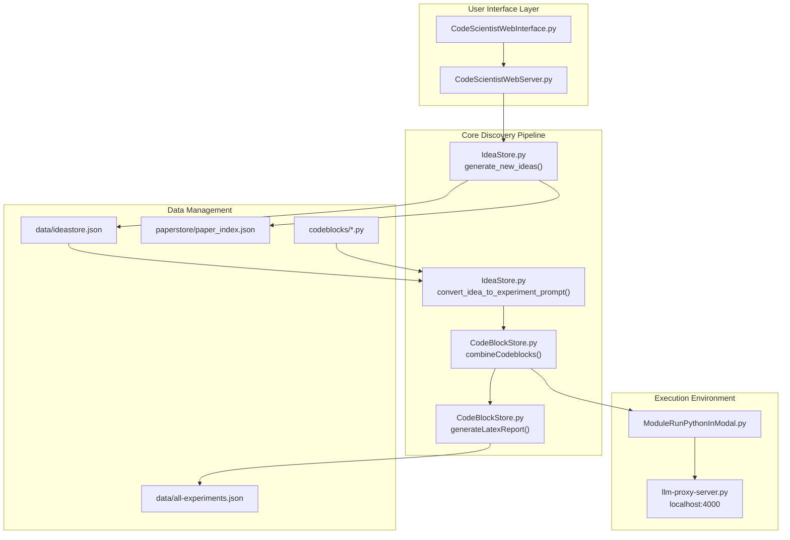
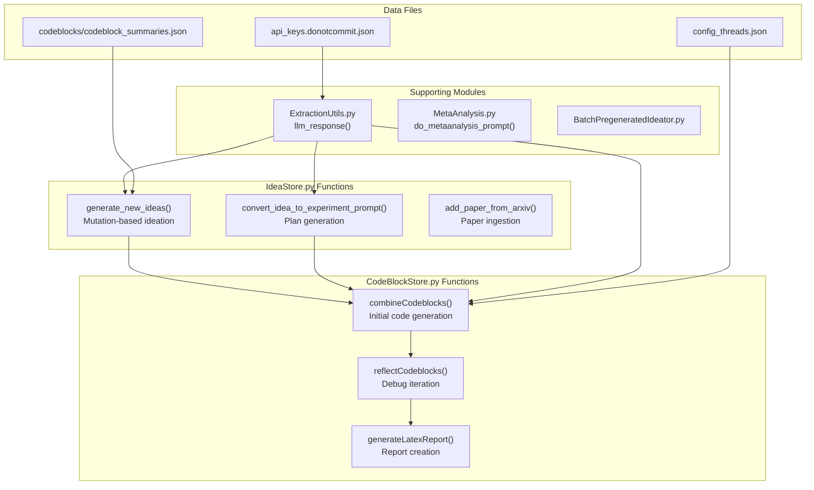
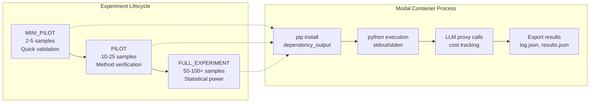
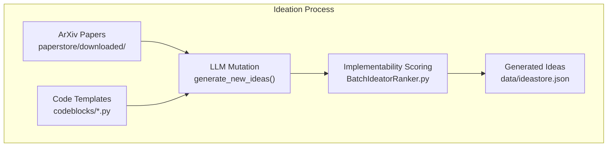

<!-- source: DeepWiki mcp.deepwiki.com · repo allenai/codescientist · page 1 CodeScientist Overview · fetched 2026-10-26 -->

# CodeScientist Overview

<details>
<summary>Relevant source files</summary>

The following files were used as context for generating this wiki page:

- [LICENSE](LICENSE)
- [README.md](README.md)

</details>


## Purpose and Scope

This document provides a comprehensive overview of the CodeScientist system - a semi-automated scientific discovery platform that designs, implements, and analyzes scientific experiments expressed as Python code. CodeScientist uses Large Language Models (LLMs) to generate novel research ideas through genetic mutation of scientific papers and code templates, automatically builds experiment implementations, and produces scientific reports.

For detailed information about specific subsystems, see: [Agent Architectures](#3), [Game Environments](#4), [Knowledge Systems](#5), [LLM Integration](#6), and [Experiment Infrastructure](#7).

## System Architecture

### High-Level Component Architecture



Sources: [README.md:1-895](), [src/CodeScientistWebInterface.py](), [src/CodeScientistWebServer.py](), [src/IdeaStore.py:128](), [src/CodeBlockStore.py:313]()

### Code Entity to System Function Mapping



Sources: [src/IdeaStore.py:128](), [src/IdeaStore.py:509](), [src/CodeBlockStore.py:313](), [src/CodeBlockStore.py:1001](), [src/CodeBlockStore.py:2267](), [src/MetaAnalysis.py:15]()

## Core Discovery Workflow

CodeScientist operates through a structured pipeline that transforms research papers into executable experiments:

| Stage | Component | Key Functions | Input | Output |
|-------|-----------|---------------|-------|--------|
| **Ideation** | `IdeaStore.py` | `generate_new_ideas()` | ArXiv papers + codeblocks | Research ideas |
| **Planning** | `IdeaStore.py` | `convert_idea_to_experiment_prompt()` | Ideas + expert comments | Experiment plans |
| **Implementation** | `CodeBlockStore.py` | `combineCodeblocks()` | Plans + codeblock library | Python code |
| **Execution** | `ModuleRunPythonInModal.py` | `run_python_in_modal()` | Code + dependencies | Results + logs |
| **Debugging** | `CodeBlockStore.py` | `reflectCodeblocks()` | Errors + logs | Fixed code |
| **Reporting** | `CodeBlockStore.py` | `generateLatexReport()` | Results + metadata | LaTeX reports |

### Experiment Execution Stages



Sources: [src/modules/ModuleRunPythonInModal.py](), [README.md:578-626]()

## Key System Components

### Ideation Engine

The ideation system uses LLM-based genetic mutation to combine scientific papers with code templates:

- **Paper Ingestion**: `PaperStore.py` downloads and processes ArXiv papers
- **Mutation Logic**: `IdeaStore.generate_new_ideas()` creates novel combinations
- **Filtering**: `BatchIdeatorRanker.py` scores ideas by implementability



Sources: [src/IdeaStore.py:128](), [src/PaperStore.py](), [src/BatchIdeatorRanker.py]()

### Code Generation and Debugging

The experiment builder combines codeblocks and iteratively debugs the result:

- **Initial Generation**: `CodeBlockStore.combineCodeblocks()` assembles code from templates
- **Reflection Loop**: `CodeBlockStore.reflectCodeblocks()` fixes errors using container feedback
- **Common Library**: `experiment_common_library.py` provides reusable functions

### Cost Control and Monitoring

CodeScientist implements multiple layers of cost protection:

| Component | Mechanism | Location |
|-----------|-----------|----------|
| **Hard Limit** | `LLM_COST_HARD_LIMIT` global check | `ExtractionUtils.py:20` |
| **Proxy Metering** | Per-container cost tracking | `llm-proxy-server.py` |
| **Model Costs** | Pricing configuration | `llm-proxy/experiment-llm-cost.json` |
| **Usage Logging** | Request/token counting | Container `llm_usage.json` |

Sources: [src/ExtractionUtils.py:20](), [llm-proxy/llm-proxy-server.py](), [llm-proxy/experiment-llm-cost.json]()

## Integration Points

### External Services

- **Modal.com**: Cloud container execution via `modal` Python package
- **LLM APIs**: OpenAI, Anthropic, Deepseek through `litellm`
- **ArXiv**: Paper download and LaTeX source extraction

### Game Environment APIs

CodeScientist integrates with multiple text-based research environments:

| Environment | API Module | Research Domain |
|-------------|------------|-----------------|
| **DiscoveryWorld** | `env_discoveryworld_*.py` | Scientific discovery tasks |
| **ScienceWorld** | `env_scienceworld_*.py` | Elementary science knowledge |
| **TextWorldExpress** | `env_textworldexpress_*.py` | Interactive text games |

### Knowledge Base Integration

- **ConceptNet**: Semantic relationship queries via `knowledge_conceptnet.py`
- **WordNet**: Lexical database access through `knowledge_wordnet.py`
- **Custom APIs**: Extensible knowledge base framework

Sources: [codeblocks/env_discoveryworld_random_agent.py](), [codeblocks/env_scienceworld_random_agent.py](), [codeblocks/knowledge_conceptnet.py](), [codeblocks/knowledge_wordnet.py]()

## Configuration and Customization

### Key Configuration Files

| File | Purpose | Key Settings |
|------|---------|--------------|
| `api_keys.donotcommit.json` | LLM provider credentials | OpenAI, Anthropic, Deepseek keys |
| `config_threads.json` | Concurrency control | `max_experiment_threads` |
| `cleaner_config.yaml` | Text processing rules | LaTeX cleaning patterns |
| `codeblock_summaries.json` | Template metadata | Inclusion/exclusion criteria |

### Codeblock Library Structure

Each codeblock in `codeblocks/` contains standardized metadata:

```python
# Name: [Descriptive name]
# Description: [Functionality overview]  
# inclusion_criteria: [When to use]
# exclusion_criteria: [When not to use]
# python_version: [Required version]
# pip_requirement: [Dependencies]
```

Sources: [README.md:603-621](), [codeblocks/env_scienceworld_random_agent.py:613-619]()

---

