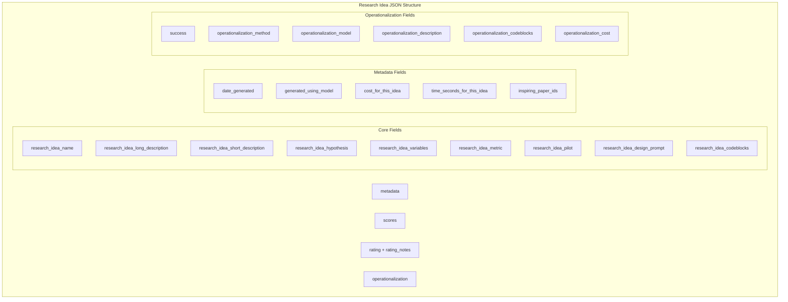
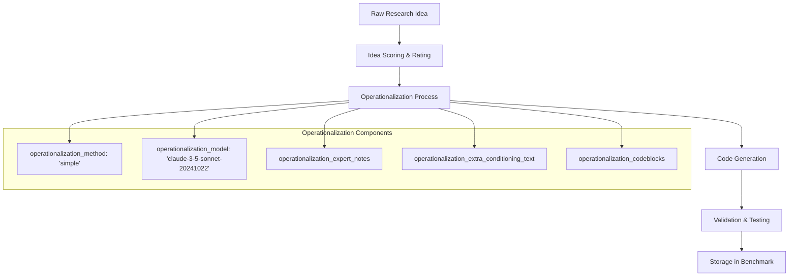
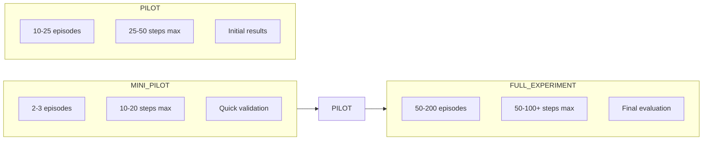
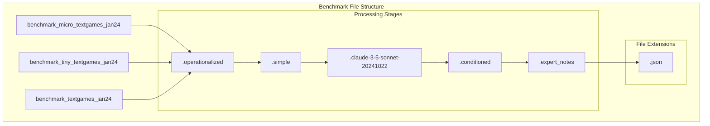
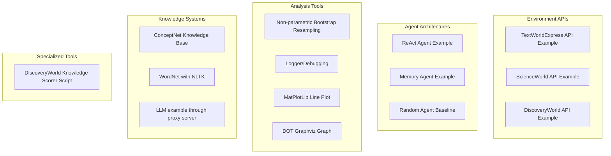

<!-- source: DeepWiki mcp.deepwiki.com · repo allenai/codescientist · page 10 Benchmarks and Research Ideas · fetched 2026-10-26 -->

# Benchmarks and Research Ideas

<details>
<summary>Relevant source files</summary>

The following files were used as context for generating this wiki page:

- [data/benchmark_micro_textgames_jan24.operationalized.simple.claude-3-5-sonnet-20241022.conditioned.expert_notes.json](data/benchmark_micro_textgames_jan24.operationalized.simple.claude-3-5-sonnet-20241022.conditioned.expert_notes.json)
- [data/benchmark_textgames_jan24.operationalized.simple.claude-3-5-sonnet-20241022.conditioned.expert_notes.json](data/benchmark_textgames_jan24.operationalized.simple.claude-3-5-sonnet-20241022.conditioned.expert_notes.json)
- [data/benchmark_textgames_jan24.operationalized.simple.claude-3-5-sonnet-20241022.conditioned.json](data/benchmark_textgames_jan24.operationalized.simple.claude-3-5-sonnet-20241022.conditioned.json)
- [data/benchmark_tiny_textgames_jan24.operationalized.simple.claude-3-5-sonnet-20241022.conditioned.expert_notes.json](data/benchmark_tiny_textgames_jan24.operationalized.simple.claude-3-5-sonnet-20241022.conditioned.expert_notes.json)

</details>


This document covers the benchmark experiment system and research idea collection framework within CodeScientist. The system generates, operationalizes, and executes research ideas as automated experiments across multiple game environments including TextWorldExpress, ScienceWorld, and DiscoveryWorld.

For information about the core experiment execution infrastructure, see [Experiment Infrastructure](#7). For details about agent architectures used in these benchmarks, see [Agent Architectures](#3).

## Research Idea Structure and Metadata

The CodeScientist system stores research ideas as structured JSON objects with comprehensive metadata and operationalization details. Each research idea follows a standardized format that enables automatic processing and execution.

### Core Research Idea Schema



Sources: [data/benchmark_textgames_jan24.operationalized.simple.claude-3-5-sonnet-20241022.conditioned.expert_notes.json:1-120](), [data/benchmark_micro_textgames_jan24.operationalized.simple.claude-3-5-sonnet-20241022.conditioned.expert_notes.json:1-60]()

### Research Idea Categories

The benchmark system organizes research ideas across several key categories based on their experimental focus:

| Category | Description | Example Ideas |
|----------|-------------|---------------|
| LLM Confidence Analysis | Testing LLM self-assessment capabilities | `simulation-confidence-analysis`, `basic-confidence-simulation` |
| Memory Management | Agent memory and pruning strategies | `simple-memory-pruning` |
| Knowledge Integration | Using external knowledge sources | `react-knowledge-retrieval`, `simple-property-verification` |
| Graph-Based Methods | Knowledge graphs and graph reasoning | `llm-graph-verification`, `simple-graph-alignment` |
| Agent Architectures | Hierarchical and planning agents | `two-level-discovery-agent`, `simple-planning-agent` |
| Environment-Specific | Game-specific optimization strategies | `wordnet-cooking-exploration`, `hierarchical-elimination` |

Sources: [data/benchmark_textgames_jan24.operationalized.simple.claude-3-5-sonnet-20241022.conditioned.expert_notes.json:3-711]()

## Operationalization Process

Research ideas undergo an operationalization process that converts high-level concepts into executable experimental code. This process uses LLM-based code generation with specific conditioning on available codeblocks.

### Operationalization Workflow



The operationalization process includes several standardized components:

- **Method**: Currently uses `"simple"` operationalization approach
- **Model**: Typically `"claude-3-5-sonnet-20241022"` for code generation
- **Expert Notes**: Human expert feedback incorporated into operationalization
- **Conditioning Text**: Standard instruction like `"Please use gpt-4o-mini for all LLM calls, because it's fast and inexpensive"`
- **Codeblocks**: References to existing code templates that can be reused

Sources: [data/benchmark_textgames_jan24.operationalized.simple.claude-3-5-sonnet-20241022.conditioned.expert_notes.json:42-59](), [data/benchmark_micro_textgames_jan24.operationalized.simple.claude-3-5-sonnet-20241022.conditioned.expert_notes.json:42-59]()

## Pilot Execution Framework

All operationalized experiments follow a three-tier pilot execution framework that enables incremental testing and validation before full-scale execution.

### Pilot Mode Configuration



The pilot framework is controlled by a global `PILOT_MODE` variable in each experiment:

- **MINI_PILOT**: Minimal execution for debugging and basic functionality verification
- **PILOT**: Medium-scale execution for preliminary results and parameter tuning  
- **FULL_EXPERIMENT**: Full-scale execution for final results (requires manual approval)

Experiments automatically progress from MINI_PILOT to PILOT if successful, but stop before FULL_EXPERIMENT to allow human verification.

Sources: [data/benchmark_textgames_jan24.operationalized.simple.claude-3-5-sonnet-20241022.conditioned.expert_notes.json:49-50](), [data/benchmark_micro_textgames_jan24.operationalized.simple.claude-3-5-sonnet-20241022.conditioned.expert_notes.json:49-50]()

## Benchmark Data Organization

The benchmark system organizes data files by scope and processing stage, enabling systematic management of research ideas and experimental results.

### File Naming Convention



The file naming follows a hierarchical pattern:
- **Scope**: `micro`, `tiny`, or full-scale benchmarks
- **Domain**: `textgames` for TextWorldExpress experiments  
- **Date**: `jan24` indicating generation timeframe
- **Processing**: `operationalized.simple` for operationalization method
- **Model**: `claude-3-5-sonnet-20241022` for the LLM used
- **Conditioning**: `conditioned` indicating expert conditioning applied
- **Expert Notes**: `expert_notes` when human expert feedback included

Sources: [data/benchmark_micro_textgames_jan24.operationalized.simple.claude-3-5-sonnet-20241022.conditioned.expert_notes.json:1](), [data/benchmark_textgames_jan24.operationalized.simple.claude-3-5-sonnet-20241022.conditioned.expert_notes.json:1](), [data/benchmark_tiny_textgames_jan24.operationalized.simple.claude-3-5-sonnet-20241022.conditioned.expert_notes.json:1]()

## Scoring and Rating System

Research ideas undergo systematic evaluation using both automated scoring and human expert ratings to prioritize execution and identify promising research directions.

### Scoring Components

Each research idea includes standardized scoring fields:

```json
{
  "scores": {
    "score": 13,
    "num_unknown_components": 0
  },
  "rating": "could work",
  "rating_notes": "Expert analysis of feasibility and potential impact"
}
```

**Score Categories**:
- Numerical score (typically 1-20 range)
- `num_unknown_components` tracking missing dependencies

**Rating Categories**:
- `"very interesting"` - High-potential ideas with strong experimental design
- `"could work"` - Feasible ideas with moderate potential  
- Expert rating notes provide detailed feasibility analysis

Sources: [data/benchmark_textgames_jan24.operationalized.simple.claude-3-5-sonnet-20241022.conditioned.expert_notes.json:135-141](), [data/benchmark_micro_textgames_jan24.operationalized.simple.claude-3-5-sonnet-20241022.conditioned.expert_notes.json:94-101]()

## Codeblock Integration

The benchmark system leverages a library of reusable code templates (codeblocks) that are referenced during operationalization and execution.

### Common Codeblock Categories



The most frequently used codeblocks across benchmarks include:

| Codeblock | Usage Count | Purpose |
|-----------|-------------|---------|
| `"TextWorldExpress API Example"` | Very High | Environment interaction |
| `"Logger/Debugging"` | Very High | Experiment logging |
| `"Non-parametric Bootstrap Resampling"` | High | Statistical analysis |
| `"MatPlotLib Line Plot"` | High | Visualization |
| `"LLM example through proxy server"` | High | LLM integration |
| `"ReAct Agent Example"` | Medium | Agent baseline |

Sources: [data/benchmark_textgames_jan24.operationalized.simple.claude-3-5-sonnet-20241022.conditioned.expert_notes.json:11-17](), [data/benchmark_micro_textgames_jan24.operationalized.simple.claude-3-5-sonnet-20241022.conditioned.expert_notes.json:11-17]()

## Example Research Ideas

### LLM Confidence Analysis

The `simulation-confidence-analysis` research idea investigates LLM self-assessment capabilities:

```json
{
  "research_idea_name": "simulation-confidence-analysis",
  "research_idea_hypothesis": "LLM confidence scores will correlate with prediction accuracy, allowing for identification of potentially incorrect predictions",
  "research_idea_metric": "Correlation between confidence scores and accuracy. Precision/recall for identifying incorrect predictions using confidence thresholds"
}
```

**Key Experimental Components**:
- State prediction with confidence scoring
- LLM-as-judge accuracy evaluation  
- ROC curve analysis for confidence thresholds
- Bootstrap resampling for statistical validation

Sources: [data/benchmark_micro_textgames_jan24.operationalized.simple.claude-3-5-sonnet-20241022.conditioned.expert_notes.json:3-10]()

### Memory Management Research

The `simple-memory-pruning` idea compares memory management strategies:

```json
{
  "research_idea_name": "simple-memory-pruning", 
  "research_idea_hypothesis": "Frequency-based memory pruning (removing least-used memories) will lead to better task performance than time-based pruning",
  "research_idea_variables": "Independent variables: (1) Memory pruning strategy (time-based, frequency-based, no pruning)"
}
```

**Experimental Framework**:
- ReAct agent augmented with memory system
- Comparison of pruning strategies: time-based, frequency-based, random, none
- Task score progression as primary metric
- ScienceWorld boiling water task as test environment

Sources: [data/benchmark_textgames_jan24.operationalized.simple.claude-3-5-sonnet-20241022.conditioned.expert_notes.json:604-612]()

## Expert Feedback Integration

The benchmark system incorporates human expert feedback through rating notes that guide operationalization and execution:

**Common Expert Guidance Patterns**:

- **Metric Recommendations**: "Should use task score rather than task completion rate since task completion is rare"
- **Environment Constraints**: "Should likely be run on very simple (e.g. 3 room maximum) environments"  
- **Architecture Suggestions**: "It could (for example) augment a ReAct agent with a memory"
- **Implementation Notes**: "Would benefit from having a word vector similarity codeblock"

This feedback is incorporated into the `operationalization_expert_notes` field and influences the final experimental implementation.

Sources: [data/benchmark_textgames_jan24.operationalized.simple.claude-3-5-sonnet-20241022.conditioned.expert_notes.json:98](), [data/benchmark_textgames_jan24.operationalized.simple.claude-3-5-sonnet-20241022.conditioned.expert_notes.json:604](), [data/benchmark_textgames_jan24.operationalized.simple.claude-3-5-sonnet-20241022.conditioned.expert_notes.json:207]()