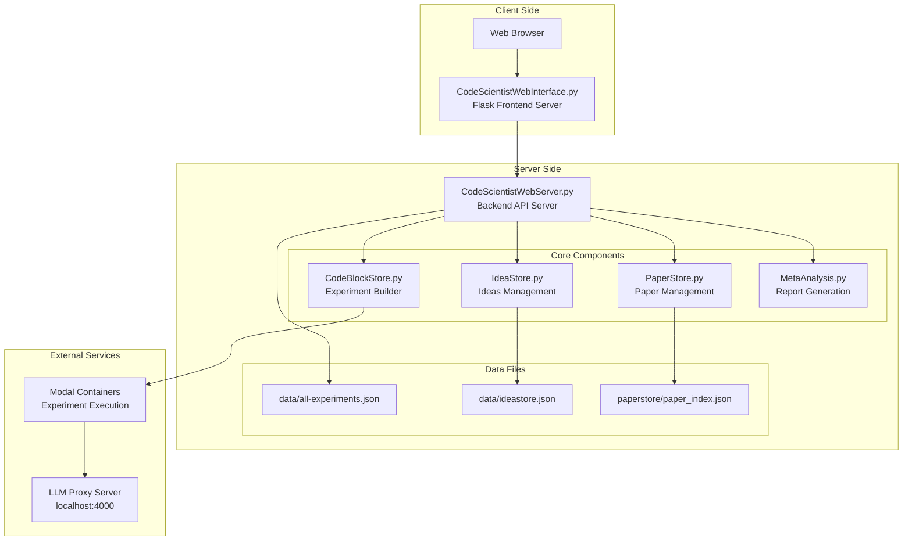
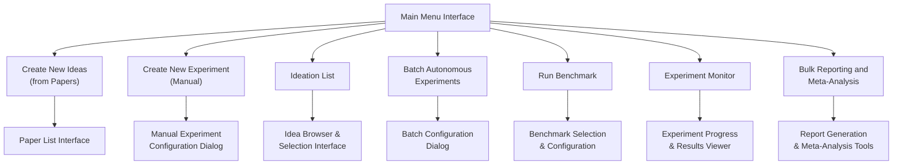
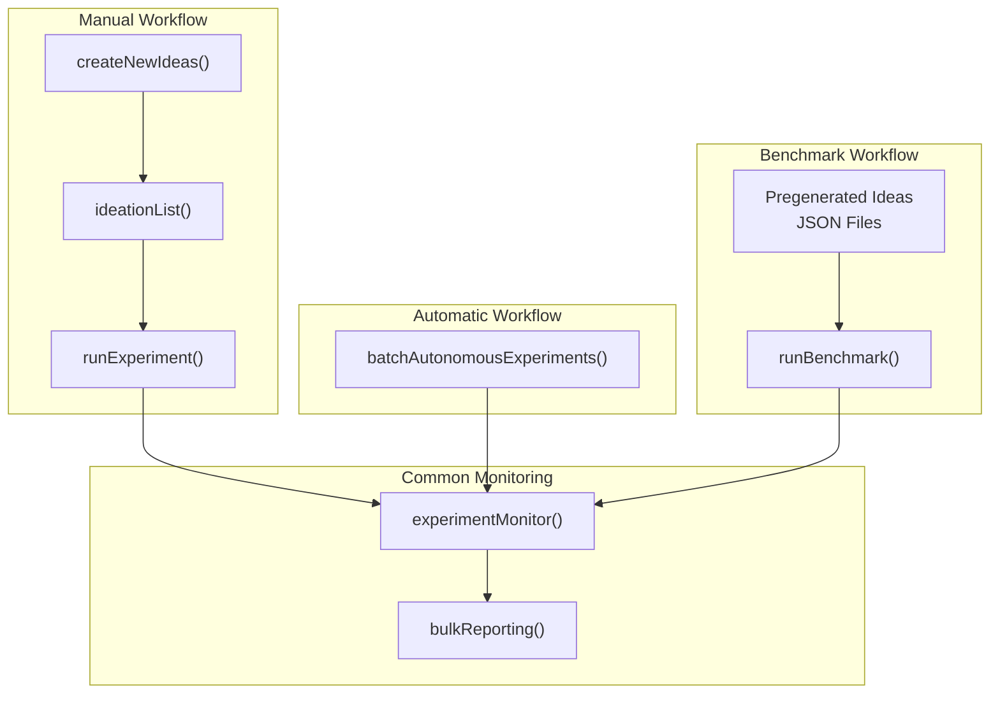
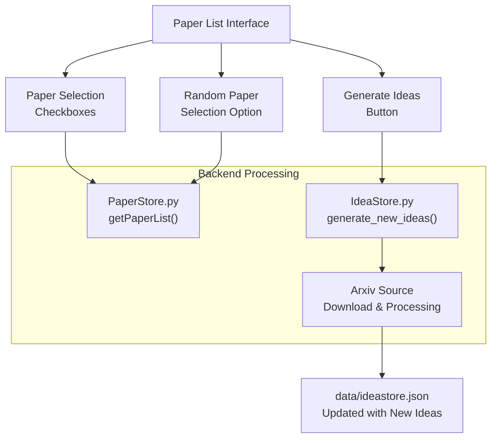
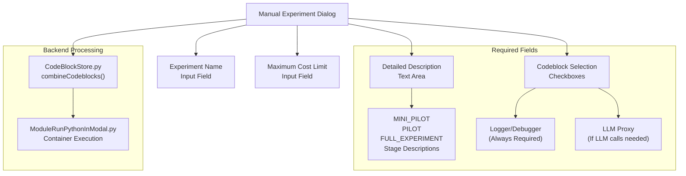
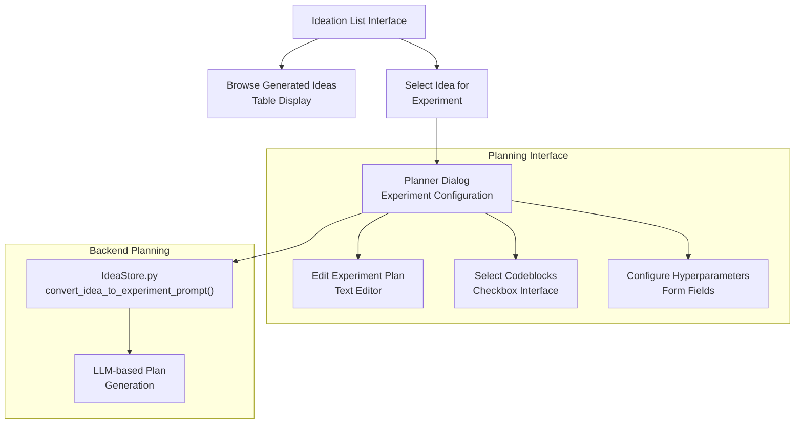
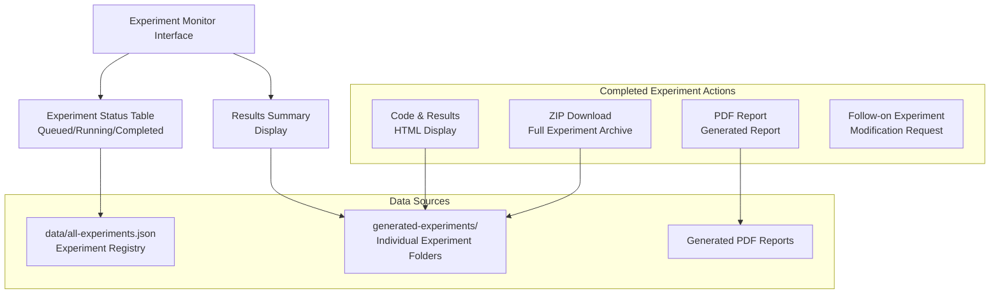
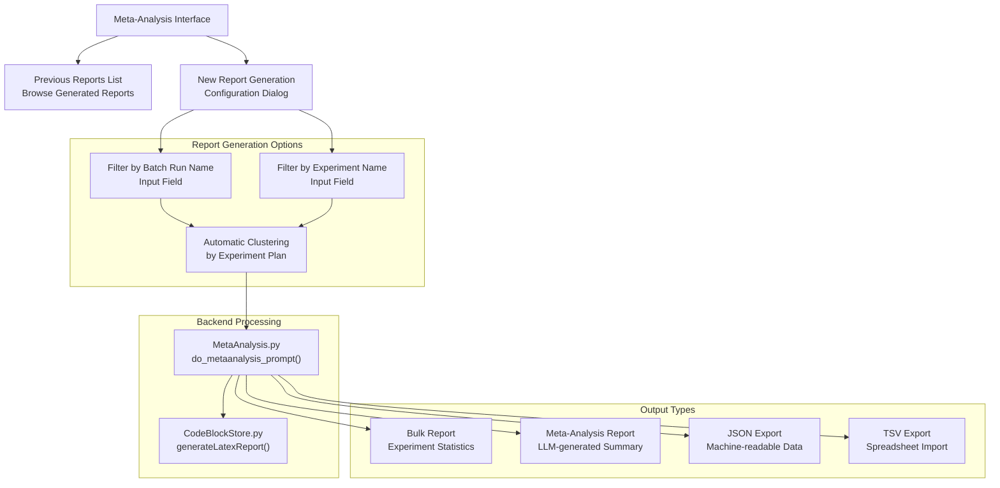
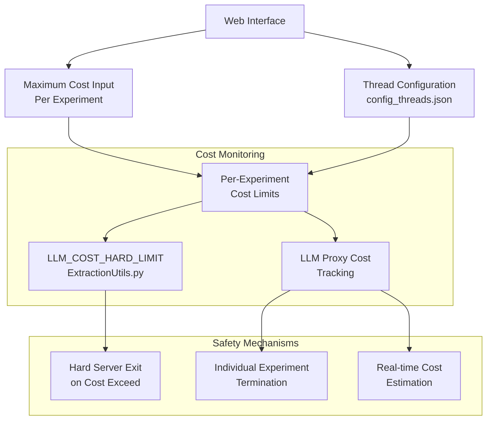

<!-- source: DeepWiki mcp.deepwiki.com · repo allenai/codescientist · page 2.1 Web Interface and User Interaction · fetched 2026-10-26 -->

# Web Interface and User Interaction

Relevant source files

The following files were used as context for generating this wiki page:

- [README.md](README.md)

This document covers the web-based user interface that provides human-in-the-loop control over CodeScientist's scientific discovery pipeline. The interface enables users to create research ideas, configure experiments, monitor execution progress, and analyze results through a browser-based graphical interface.

For information about the underlying data storage and management systems that support these interfaces, see [Data Storage and Management](#2.2). For details about the core system architecture components that the web interface orchestrates, see [Core System Architecture](#2).

## Web Interface Architecture

CodeScientist's web interface consists of two main components that work together to provide a complete user experience:

**Web Interface Architecture**

Sources: [README.md:315-325](), [README.md:333-334]()

The frontend server ([src/CodeScientistWebInterface.py]()) serves HTML pages and handles user interactions, while the backend server ([src/CodeScientistWebServer.py]()) provides API endpoints for all core functionality. Users access the system through a web browser pointed to the frontend server, typically running on `http://127.0.0.1:8080/`.

## Main Menu Interface

The main menu provides access to all major CodeScientist functions through a centralized interface:

**Main Menu Functions**

Sources: [README.md:333-334](), [README.md:342-352]()

## Core User Workflows

CodeScientist supports three primary user workflows, each optimized for different use cases:

| Workflow Type | Description | Key Interface Components |
|---------------|-------------|-------------------------|
| **Manual** | User-driven idea generation and experiment selection | `Create New Ideas`, `Ideation List`, Manual experiment creation |
| **Automatic** | Fully autonomous idea generation and experimentation | `Batch Autonomous Experiments` |
| **Benchmark/Batch** | Pre-generated ideas with filtering and batch execution | `Run Benchmark`, External idea filtering tools |

**User Workflow State Transitions**

Sources: [README.md:342-352]()

## Paper Management Interface

The paper list interface enables users to create new research ideas by combining scientific papers from the system's corpus:

**Paper Interface Components**

Sources: [README.md:354-367](), [README.md:798-799]()

The interface requires papers to be added as Arxiv links to enable full-text extraction from LaTeX source, avoiding PDF-to-text conversion challenges. Ideas typically take several minutes to generate and appear in the ideation list upon completion.

## Manual Experiment Creation

The manual experiment creation dialog allows users to bypass the ideator/planner and directly specify experiments:

**Manual Experiment Configuration**

Sources: [README.md:369-382](), [README.md:538-568]()

## Ideation List and Experiment Planning

The ideation list provides a browseable interface for all generated ideas with experiment execution capabilities:

**Ideation List Workflow**

Sources: [README.md:384-396](), [README.md:799-800]()

## Experiment Monitoring Interface

The experiment monitor tracks all submitted experiments and provides access to results:

**Experiment Monitor Components**

Sources: [README.md:420-434]()

## Bulk Reporting and Meta-Analysis Interface

The meta-analysis interface processes multiple related experiments to generate summary reports:

**Meta-Analysis Interface Structure**

Sources: [README.md:436-472](), [README.md:804-805]()

## Configuration and Cost Control

The web interface includes several configuration mechanisms for controlling system behavior and costs:

| Configuration File | Purpose | Location |
|-------------------|---------|----------|
| `config_threads.json` | Maximum simultaneous experiment threads | Root directory |
| `api_keys.donotcommit.json` | LLM API keys and credentials | Root directory |
| `llm-proxy/experiment-llm-cost.json` | LLM cost per token pricing | LLM proxy directory |

**Cost Control Integration**

Sources: [README.md:248-253](), [README.md:285-287](), [README.md:292-311]()

The interface enforces multiple layers of cost protection, including per-experiment limits set through the UI, a system-wide hard limit, and real-time monitoring through the LLM proxy system.

Sources: [README.md:315-325](), [README.md:333-568](), [src/CodeScientistWebServer.py](), [src/CodeScientistWebInterface.py]()

---

