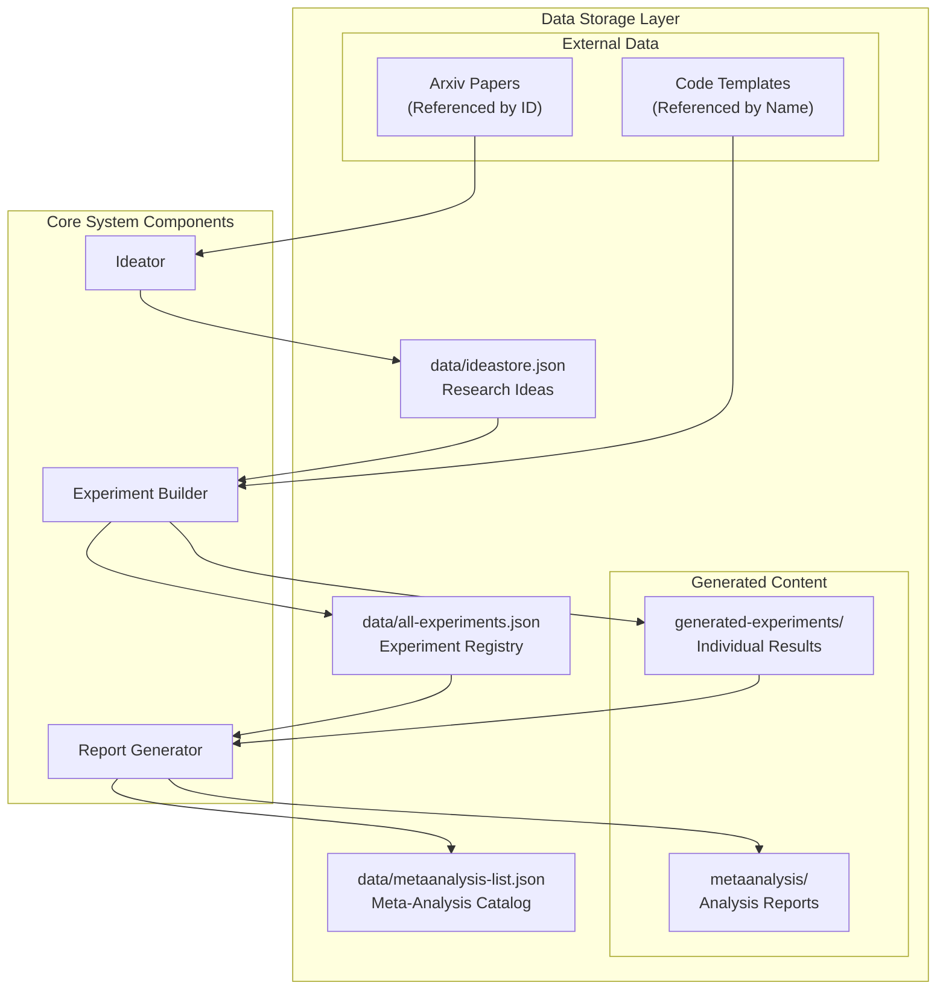
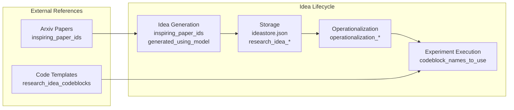
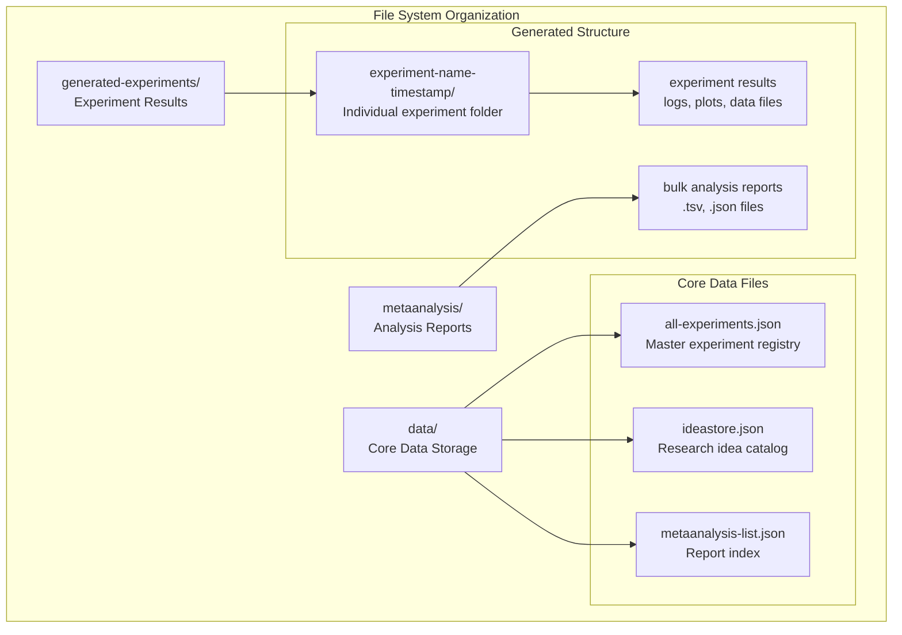
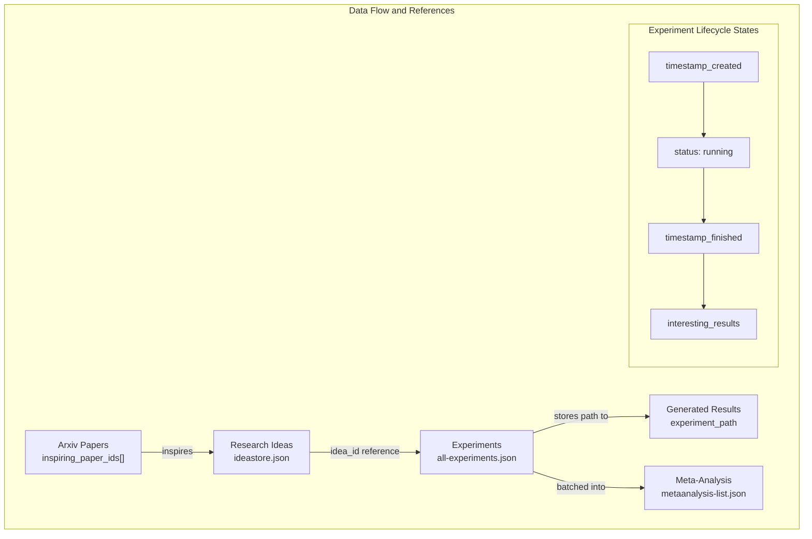
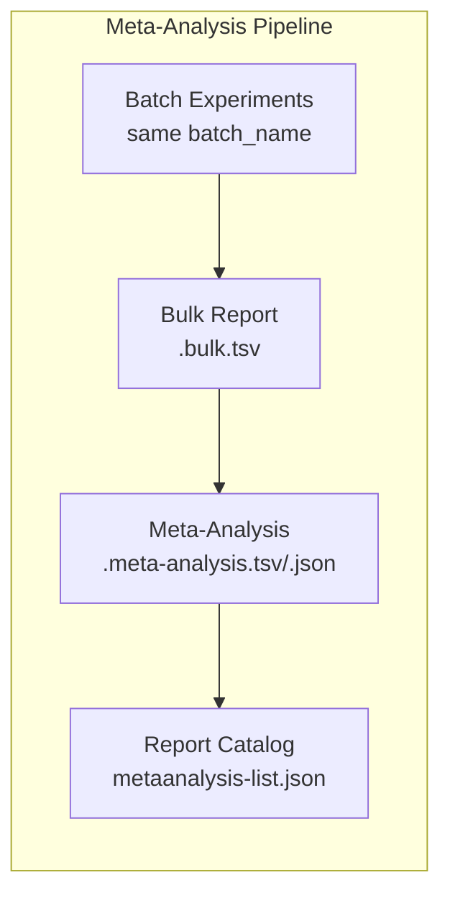

<!-- source: DeepWiki mcp.deepwiki.com · repo allenai/codescientist · page 2.2 Data Storage and Management · fetched 2026-10-26 -->

# Data Storage and Management

Relevant source files

The following files were used as context for generating this wiki page:

- [data/all-experiments.json](data/all-experiments.json)
- [data/ideastore.json](data/ideastore.json)
- [data/metaanalysis-list.json](data/metaanalysis-list.json)

This document explains how CodeScientist stores and organizes research ideas, experiments, papers, and results across its various data stores. The system uses primarily JSON-based file storage for persistence, with structured schemas for different data types.

For information about the web interface for accessing this data, see [Web Interface and User Interaction](#2.1). For details about the experiment execution infrastructure, see [Experiment Infrastructure](#7).

## Data Store Architecture

CodeScientist maintains several specialized data stores that work together to support the complete research workflow:

**Core Data Stores:**
- **Idea Store**: Central repository for research ideas with metadata and operationalization details
- **Experiment Registry**: Master catalog of all experiments with status, results, and execution metadata  
- **Meta-Analysis Catalog**: Index of generated analysis reports and bulk experiment runs

Sources: [data/all-experiments.json:1-10](), [data/ideastore.json:1-25](), [data/metaanalysis-list.json:1-10]()

## Idea Store Structure

The `data/ideastore.json` file maintains a comprehensive catalog of research ideas, each containing detailed specification and metadata:

| Field | Type | Description |
|-------|------|-------------|
| `research_idea_name` | String | Unique identifier for the idea |
| `research_idea_long_description` | String | Detailed description of the research proposal |
| `research_idea_hypothesis` | String | Testable hypothesis |
| `research_idea_variables` | String | Independent, dependent, and control variables |
| `research_idea_metric` | String | Primary and secondary evaluation metrics |
| `research_idea_codeblocks` | Array | Required code template names |
| `inspiring_paper_ids` | Array | Arxiv paper IDs that inspired the idea |
| `generated_using_model` | String | LLM model used for generation |
| `id` | String | Unique idea identifier |

Sources: [data/ideastore.json:2-50](), [data/ideastore.json:24-98]()

## Experiment Registry Schema

The `data/all-experiments.json` file serves as the master registry tracking all experiment executions with comprehensive metadata:

**Experiment Record Structure:**

```mermaid
graph TB
    subgraph "Experiment Record"
        Identity["experiment_name_short<br/>batch_name<br/>id"]
        Config["model_str<br/>codeblock_names_to_use<br/>max_time_per_iteration_mins"]
        Execution["timestamp_created<br/>timestamp_finished<br/>status<br/>num_iterations_run"]
        Results["results_summary<br/>results_summary_short<br/>interesting_results"]
        Costs["cost_so_far<br/>total_cost_build_debug<br/>max_llm_cost_container"]
        
        subgraph "Nested Objects"
            OriginalIdea["original_idea<br/>{full idea specification}"]
            Operationalization["operationalization<br/>{process metadata}"]
            BenchmarkProblem["full_original_benchmark_problem<br/>{complete problem def}"]
        end
    end
    
    Identity --> Config
    Config --> Execution  
    Execution --> Results
    Results --> Costs
    Costs --> OriginalIdea
    OriginalIdea --> Operationalization
    Operationalization --> BenchmarkProblem
```

**Key Status Values:**
- `completed`: Experiment finished successfully
- `failed`: Experiment encountered fatal error
- `running`: Currently executing
- `queued`: Waiting for execution

Sources: [data/all-experiments.json:4-100](), [data/all-experiments.json:234-247]()

## File Organization and Storage Patterns

CodeScientist follows a hierarchical file organization pattern with generated content isolated from core data:

**Storage Conventions:**
- **Core Data**: JSON files in `data/` directory for system state
- **Generated Results**: Timestamped directories under `generated-experiments/`
- **Analysis Reports**: Bulk processing outputs in `metaanalysis/`
- **Experiment Paths**: Stored in registry as `experiment_path` field

Sources: [data/all-experiments.json:241](), [data/metaanalysis-list.json:3-5]()

## Data Relationships and Lifecycle

The data stores maintain referential relationships that support the complete research workflow:

**Reference Patterns:**
- **Ideas → Experiments**: `idea_id` field links experiment to originating idea
- **Experiments → Results**: `experiment_path` field points to generated output directory
- **Batches → Meta-Analysis**: `batch_name` groups experiments for bulk analysis
- **Papers → Ideas**: `inspiring_paper_ids` array references external Arxiv papers

Sources: [data/all-experiments.json:23](), [data/all-experiments.json:241](), [data/ideastore.json:195-198]()

## Meta-Analysis and Reporting

The system maintains a catalog of generated analysis reports that aggregate results across multiple experiments:

| Field | Description |
|-------|-------------|
| `filename_bulk_report` | TSV file with individual experiment results |
| `filename_metaanalysis_report` | TSV file with aggregated analysis |  
| `filename_metaanalysis_report_json` | JSON version of analysis |
| `batch_run` | Associated batch identifier |
| `timestamp` | Report generation time |
| `notes` | Human-readable description |

Sources: [data/metaanalysis-list.json:3-11](), [data/metaanalysis-list.json:13-21]()

## Cost and Performance Tracking

The experiment registry includes detailed cost and performance metrics for system monitoring:

**Cost Tracking Fields:**
- `cost_so_far`: Total accumulated cost for experiment
- `total_cost_build_debug`: Cost for building and debugging phase
- `total_cost_llm_proxy`: Cost for LLM API calls during execution
- `max_llm_cost_container`: Cost limit for experiment execution

**Performance Metrics:**
- `runtime_seconds`: Total wall-clock execution time
- `num_iterations_run`: Number of debug/refinement iterations
- `max_debug_iterations`: Configured iteration limit

Sources: [data/all-experiments.json:239-246](), [data/all-experiments.json:482-490]()

---

