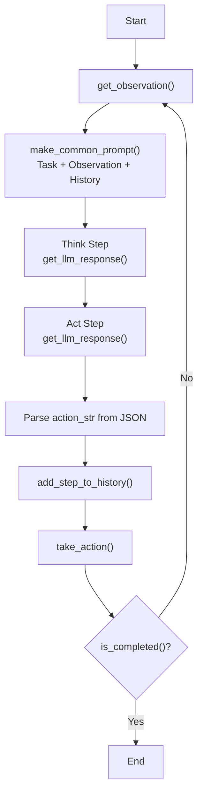
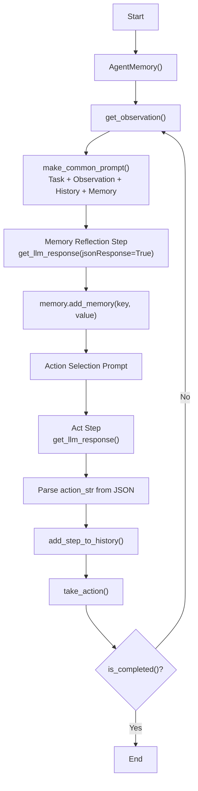
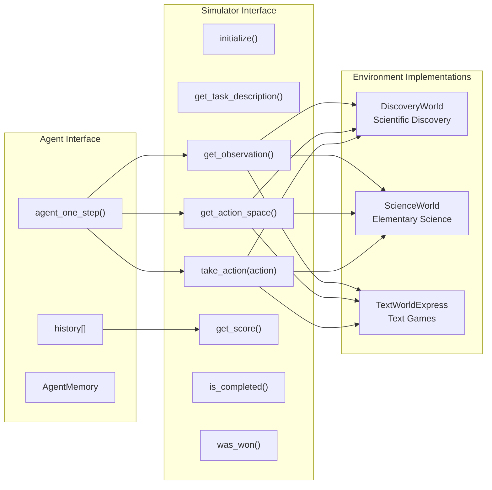
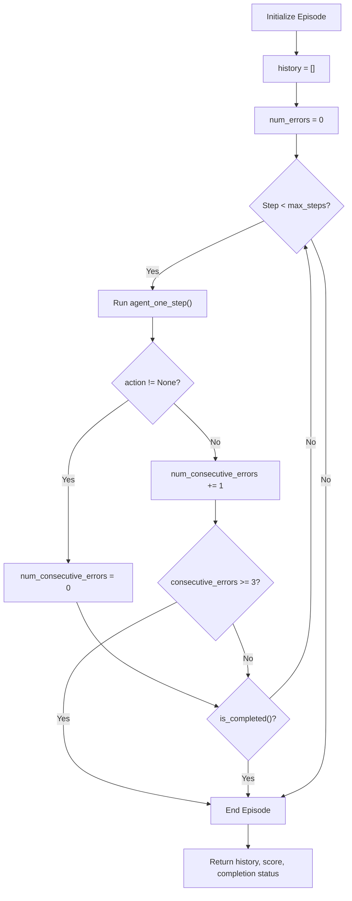

<!-- source: DeepWiki mcp.deepwiki.com · repo allenai/codescientist · page 3 Agent Architectures · fetched 2026-10-26 -->

# Agent Architectures

<details>
<summary>Relevant source files</summary>

The following files were used as context for generating this wiki page:

- [codeblocks/agent_memory_example.py](codeblocks/agent_memory_example.py)
- [codeblocks/agent_react_example.py](codeblocks/agent_react_example.py)
- [codeblocks/codeblock_summaries.json](codeblocks/codeblock_summaries.json)

</details>


This document covers the AI agent architectures implemented in CodeScientist for conducting automated scientific discovery experiments. These agents serve as the core reasoning and action-taking components that interact with text-based game environments to test scientific hypotheses and gather experimental data.

For information about the game environments that agents interact with, see [Game Environments](#4). For details about the experiment infrastructure and common utilities that support agent operations, see [Experiment Infrastructure](#7).

## Overview

CodeScientist implements multiple agent architectures that can be deployed across different experimental scenarios. Each architecture represents a different approach to AI reasoning and decision-making in interactive text-based environments.

```mermaid
graph TB
    subgraph "Agent Architecture Types"
        ReactAgent[ReActAgent<br/>"react_agent_one_step()"]
        MemoryAgent[MemoryAgent<br/>"memory_agent_one_step()"] 
        RandomAgent[RandomAgent<br/>"Baseline"]
    end
    
    subgraph "Core Components"
        LLMProxy[LLMProxy<br/>"get_llm_response()"]
        History[History<br/>"add_step_to_history()"]
        ActionSpace[ActionSpace<br/>"get_action_space()"]
    end
    
    subgraph "Game Environments"
        DiscoveryWorld[DiscoveryWorld<br/>"Simulator"]
        ScienceWorld[ScienceWorld<br/>"Simulator"] 
        TextWorldExpress[TextWorldExpress<br/>"Simulator"]
    end
    
    ReactAgent --> LLMProxy
    MemoryAgent --> LLMProxy
    ReactAgent --> History
    MemoryAgent --> History
    
    ReactAgent --> DiscoveryWorld
    ReactAgent --> ScienceWorld
    ReactAgent --> TextWorldExpress
    
    MemoryAgent --> DiscoveryWorld
    MemoryAgent --> ScienceWorld
    MemoryAgent --> TextWorldExpress
    
    RandomAgent --> DiscoveryWorld
    RandomAgent --> ScienceWorld 
    RandomAgent --> TextWorldExpress
    
    DiscoveryWorld --> ActionSpace
    ScienceWorld --> ActionSpace
    TextWorldExpress --> ActionSpace
```

**Agent Architecture Components:**

| Component | Function | Implementation |
|-----------|----------|----------------|
| `react_agent_one_step()` | Single step reasoning and action | [codeblocks/agent_react_example.py:74-133]() |
| `memory_agent_one_step()` | Memory-augmented reasoning and action | [codeblocks/agent_memory_example.py:157-217]() |
| `add_step_to_history()` | History tracking for context | [codeblocks/agent_react_example.py:214-221]() |
| `AgentMemory` | Memory management system | [codeblocks/agent_memory_example.py:17-59]() |

Sources: [codeblocks/agent_react_example.py](), [codeblocks/agent_memory_example.py](), [codeblocks/codeblock_summaries.json]()

## ReAct Agent Architecture

The ReAct (Reasoning and Acting) agent architecture implements a two-step process where the agent first reasons about its current situation, then chooses an action based on that reasoning.



**ReAct Agent Flow:**

1. **Observation Phase**: Retrieves current environment state via `get_observation()`
2. **Think Phase**: Generates reasoning about the situation using LLM
3. **Act Phase**: Selects action from available `action_space` based on reasoning  
4. **Execution Phase**: Executes action in environment via `take_action()`

The ReAct implementation separates thinking and acting into distinct LLM calls to provide clearer reasoning traces and better debugging capabilities.

**Key Functions:**

- `react_agent_one_step()`: Single step execution [codeblocks/agent_react_example.py:74-133]()
- `react_agent_multiple_steps()`: Multi-step episode execution [codeblocks/agent_react_example.py:136-209]()

Sources: [codeblocks/agent_react_example.py:74-133](), [codeblocks/agent_react_example.py:136-209]()

## Memory-Augmented Agent Architecture

The Memory-Augmented agent extends basic agent capabilities by maintaining and utilizing a persistent memory system that stores relevant information across interaction steps.



**Memory Management System:**

The `AgentMemory` class provides key-value storage for agent experiences:

| Method | Purpose | Implementation |
|--------|---------|----------------|
| `add_memory(key, value)` | Store/update memory entry | [codeblocks/agent_memory_example.py:23-24]() |
| `get_memory(key)` | Retrieve specific memory | [codeblocks/agent_memory_example.py:27-30]() |
| `get_all_memories()` | Export all memories | [codeblocks/agent_memory_example.py:33-34]() |
| `memories_to_prompt()` | Format memories for LLM | [codeblocks/agent_memory_example.py:46-52]() |
| `clone()` | Deep copy memory state | [codeblocks/agent_memory_example.py:55-58]() |

**Memory Reflection Process:**

1. **Reflection Step**: Agent analyzes recent observations and actions
2. **Memory Update**: Agent adds/modifies memory entries in JSON format
3. **Action Selection**: Agent chooses action considering both current state and memories

The memory system allows agents to build up knowledge over time, avoiding repeated mistakes and leveraging learned patterns.

Sources: [codeblocks/agent_memory_example.py:17-59](), [codeblocks/agent_memory_example.py:157-217]()

## Environment Integration

Both agent architectures integrate with multiple game environments through a standardized simulator interface.



**Standard Simulator Interface:**

All environments implement these core methods:

- `initialize()`: Set up new episode/task
- `get_task_description()`: Return task objective  
- `get_observation()`: Get current environment state
- `get_action_space()`: List available actions
- `take_action(action)`: Execute action and update state
- `get_score()`: Return current performance score
- `is_completed()`: Check if episode finished
- `was_won()`: Check if task was completed successfully

Sources: [codeblocks/agent_react_example.py:17-53](), [codeblocks/agent_memory_example.py:63-99]()

## Common Agent Infrastructure

Both agent architectures share common infrastructure components for execution management and error handling.

**Episode Management:**



**Error Handling:**

Both architectures implement consistent error handling:

- **Action Parsing Errors**: When LLM fails to generate valid JSON action
- **Consecutive Error Limits**: Stop episode after 3 consecutive failures  
- **Maximum Step Limits**: Prevent infinite loops with step bounds

**History Tracking:**

Each step records:
- `step_idx`: Step number in episode
- `observation`: Environment state
- `think`: Agent reasoning (ReAct only)  
- `memory`: Agent memory state (Memory agent only)
- `action`: Selected action

Sources: [codeblocks/agent_react_example.py:136-209](), [codeblocks/agent_memory_example.py:220-296]()

---

