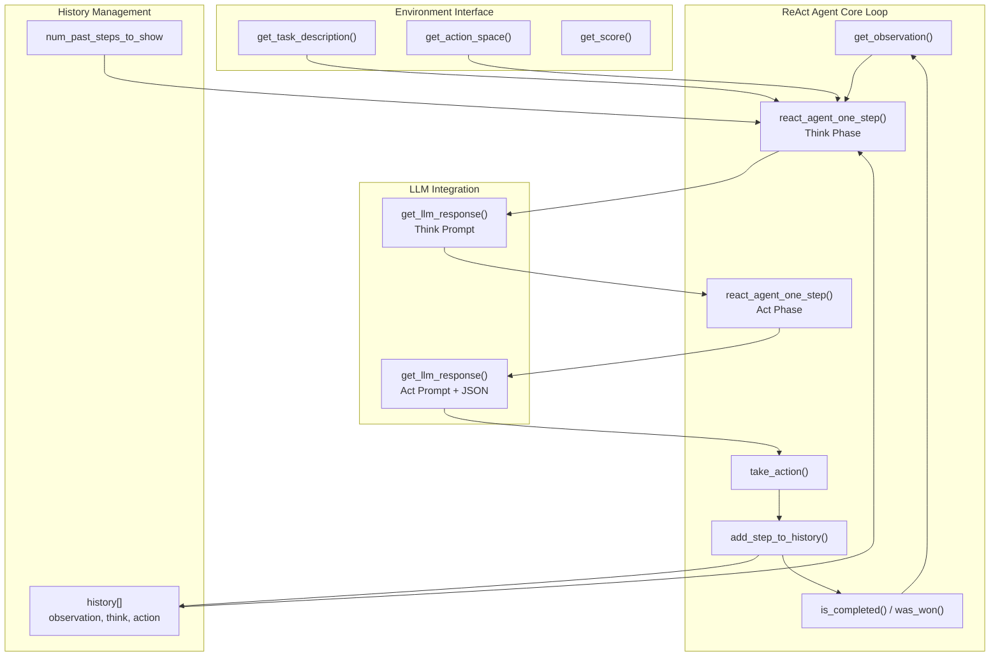
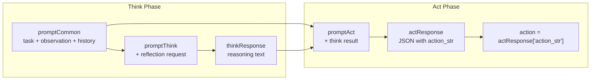
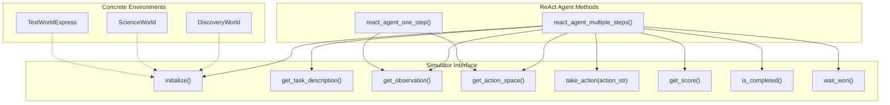
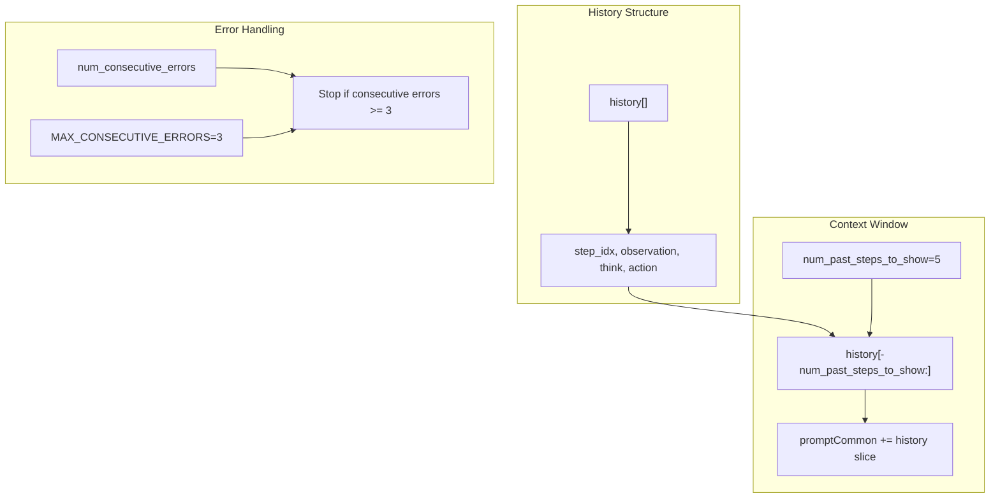
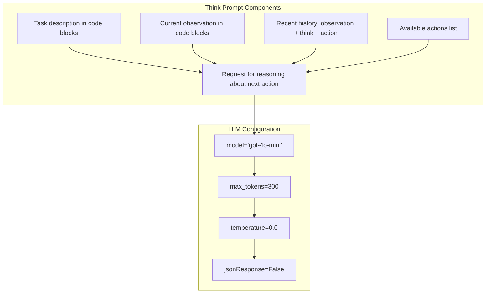
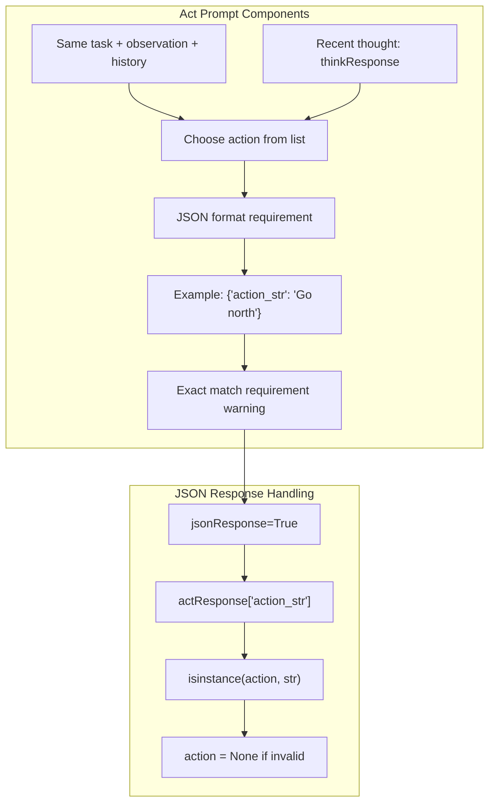
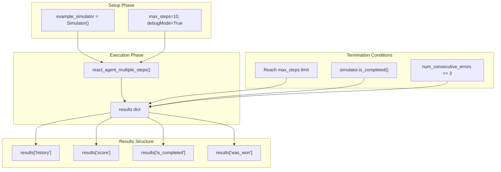

<!-- source: DeepWiki mcp.deepwiki.com · repo allenai/codescientist · page 3.1 ReAct Agents · fetched 2026-10-26 -->

# ReAct Agents

Relevant source files

The following files were used as context for generating this wiki page:

- [codeblocks/agent_react_example.py](codeblocks/agent_react_example.py)

## Purpose and Scope

This document covers the ReAct (Reasoning and Acting) agent architecture used in CodeScientist for scientific discovery experiments. ReAct agents implement a "think-then-act" pattern where the agent first reasons about the current situation and then selects an action to take. These agents are designed to work with text-based game environments and maintain conversation history for context-aware decision making.

For information about memory-augmented agents that extend beyond the basic ReAct pattern, see [Memory-Augmented Agents](#3.2). For details about the specific game environments these agents interact with, see [Game Environments](#4).

## Agent Architecture Overview

ReAct agents in CodeScientist follow a two-phase decision-making process implemented through separate LLM calls. The architecture emphasizes modularity and clear separation between reasoning and action selection.

**Sources:** [codeblocks/agent_react_example.py:72-133](), [codeblocks/agent_react_example.py:136-209]()

## Implementation Components

### Core Functions

The ReAct agent implementation centers around several key functions that handle the decision-making loop:

| Function | Purpose | Input | Output |
|----------|---------|--------|--------|
| `react_agent_one_step` | Single reasoning+acting cycle | task_description, observation, history | action string |
| `react_agent_multiple_steps` | Main agent loop | simulator, max_steps | results dict |
| `add_step_to_history` | History management | observation, think, action, step_idx | updates history list |
| `get_llm_response` | LLM interface placeholder | prompt, model, parameters | text or JSON response |

**Sources:** [codeblocks/agent_react_example.py:74-133](), [codeblocks/agent_react_example.py:136-209](), [codeblocks/agent_react_example.py:214-221](), [codeblocks/agent_react_example.py:56-65]()

### Think-Act Separation

The ReAct implementation deliberately separates thinking and acting into distinct LLM calls, unlike many implementations that combine them:

**Sources:** [codeblocks/agent_react_example.py:74-106](), [codeblocks/agent_react_example.py:107-132]()

## Environment Integration

### Simulator Interface

ReAct agents interact with environments through a standardized `Simulator` interface that provides the necessary methods for agent-environment interaction:

**Sources:** [codeblocks/agent_react_example.py:17-53](), [codeblocks/agent_react_example.py:136-209]()

### Context Management

The agent maintains context through a structured history mechanism that prevents prompt length issues while preserving relevant information:

**Sources:** [codeblocks/agent_react_example.py:82-92](), [codeblocks/agent_react_example.py:148-193](), [codeblocks/agent_react_example.py:214-221]()

## Prompt Engineering

### Think Phase Prompt Structure

The thinking phase uses a comprehensive prompt that includes task context, current observation, and relevant history:

**Sources:** [codeblocks/agent_react_example.py:76-105]()

### Act Phase Prompt Structure

The action phase incorporates the thinking result and enforces structured JSON output for reliable action parsing:

**Sources:** [codeblocks/agent_react_example.py:107-132]()

## Usage Patterns

### Basic Agent Execution

The standard usage pattern involves creating a simulator instance and running the agent loop with termination conditions:

**Sources:** [codeblocks/agent_react_example.py:224-244](), [codeblocks/agent_react_example.py:201-209]()

**Sources:** [codeblocks/agent_react_example.py:1-250]()

---

