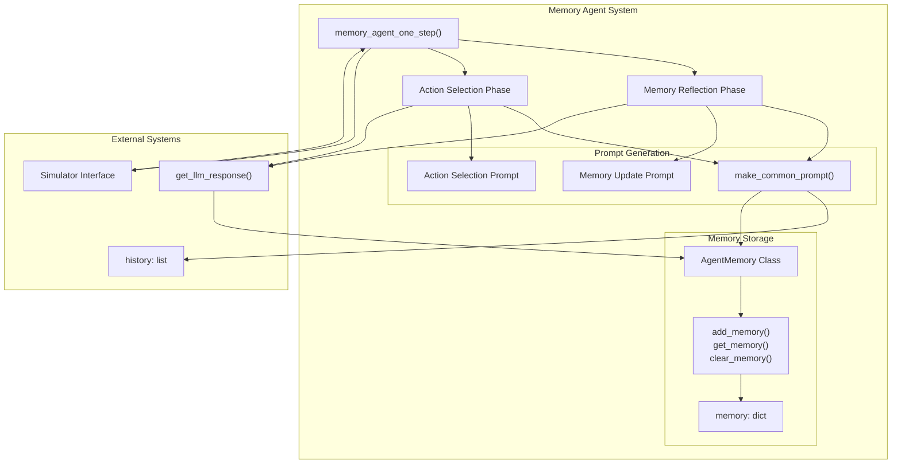
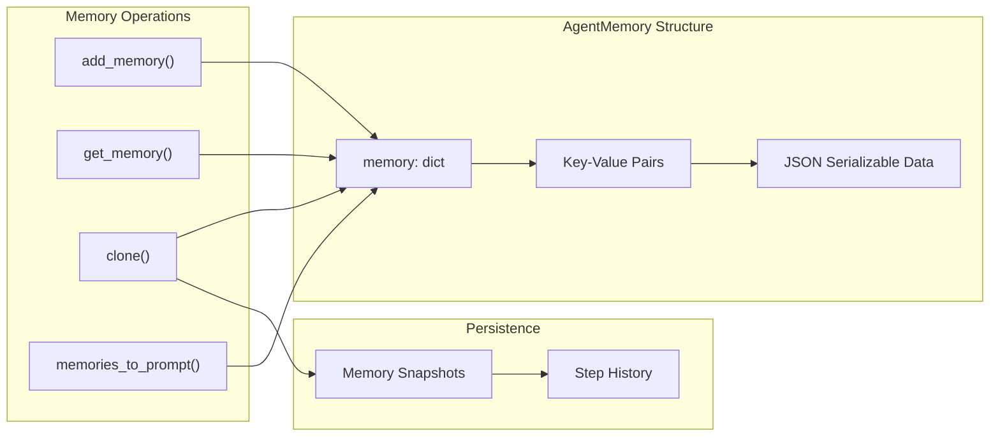
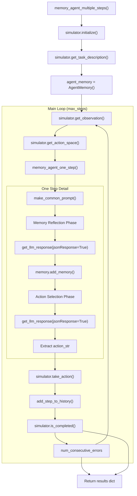
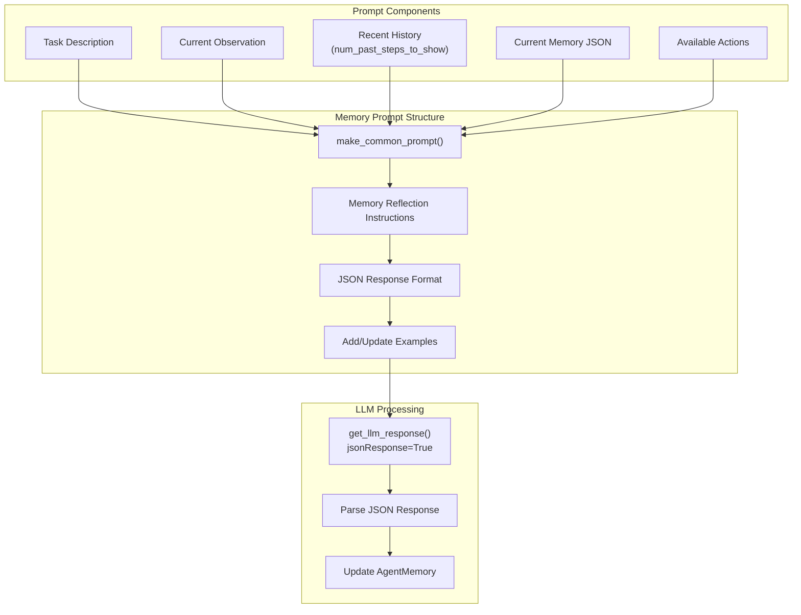
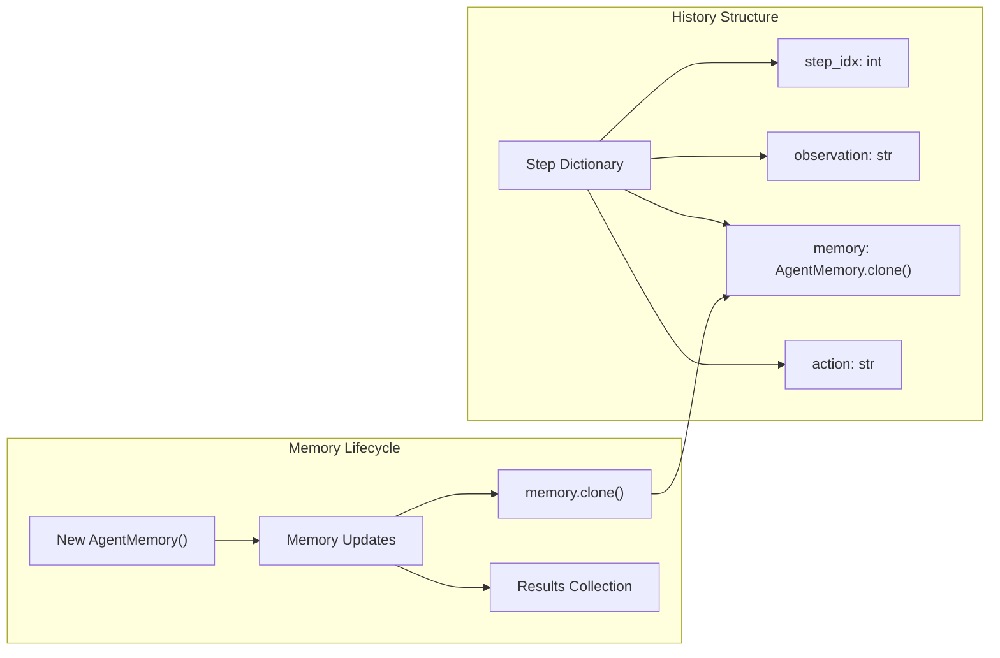

<!-- source: DeepWiki mcp.deepwiki.com · repo allenai/codescientist · page 3.2 Memory-Augmented Agents · fetched 2026-10-26 -->

# Memory-Augmented Agents

Relevant source files

The following files were used as context for generating this wiki page:

- [codeblocks/agent_memory_example.py](codeblocks/agent_memory_example.py)

This document covers the memory-augmented agent architecture used in CodeScientist for scientific discovery experiments. Memory-augmented agents maintain and utilize memory of past experiences to improve decision-making over time.

For information about other agent architectures, see [ReAct Agents](#3.1). For details on the game environments these agents operate in, see [Game Environments](#4).

## Overview

Memory-augmented agents extend basic agent architectures by maintaining a persistent memory system that stores key insights, observations, and learned patterns from past interactions. Unlike stateless agents that only consider immediate context, memory-augmented agents can accumulate knowledge across multiple steps and episodes.

The implementation follows a two-phase approach at each step:
1. **Memory Reflection Phase**: Analyze recent observations and update stored memories
2. **Action Selection Phase**: Choose actions based on current state and accumulated memory

Sources: [codeblocks/agent_memory_example.py:1-337]()

## Core Architecture

Sources: [codeblocks/agent_memory_example.py:17-58](), [codeblocks/agent_memory_example.py:154-216]()

## Memory System Implementation

The `AgentMemory` class provides a key-value storage system for agent memories:

| Method | Purpose | Parameters |
|--------|---------|------------|
| `add_memory(key, value)` | Store or update a memory | key: str, value: str |
| `get_memory(key)` | Retrieve a specific memory | key: str |
| `get_all_memories()` | Get complete memory dictionary | None |
| `clear_memory(key)` | Remove a specific memory | key: str |
| `clear_all_memories()` | Reset all memories | None |
| `memories_to_prompt()` | Format memories for LLM prompt | None |
| `clone()` | Create deep copy of memory | None |

The memory system uses JSON serialization for structured storage and supports nested data structures including dictionaries, lists, and primitive types.

Sources: [codeblocks/agent_memory_example.py:17-58](), [codeblocks/agent_memory_example.py:301-308]()

## Agent Execution Flow

The memory-augmented agent follows a structured execution pattern within the `memory_agent_multiple_steps()` function:

Sources: [codeblocks/agent_memory_example.py:219-295](), [codeblocks/agent_memory_example.py:154-216]()

## Memory Reflection and Prompt Engineering

The memory reflection phase uses structured prompts to guide the LLM in updating agent memory. The `make_common_prompt()` function creates context that includes:

- Task description from the simulator
- Current observation 
- Recent action history (limited by `num_past_steps_to_show`)
- Current memory contents in JSON format
- Available action space

The memory update prompt specifically instructs the agent to:
- Reflect on recent actions and observations
- Consider what information would be useful for future decisions
- Output memory updates as JSON key-value pairs
- Support both adding new memories and updating existing ones

Sources: [codeblocks/agent_memory_example.py:118-152](), [codeblocks/agent_memory_example.py:159-192]()

## Integration with Game Environments

Memory-augmented agents interface with game environments through a standardized simulator interface. The agent expects the simulator to provide:

| Method | Return Type | Purpose |
|--------|-------------|---------|
| `initialize()` | None | Reset environment state |
| `get_task_description()` | str | Task instructions |
| `get_observation()` | str | Current environment state |
| `get_action_space()` | list | Available actions |
| `take_action(action)` | None | Execute action |
| `get_score()` | int/float | Current performance metric |
| `is_completed()` | bool | Episode termination check |
| `was_won()` | bool | Success condition check |

This interface allows memory-augmented agents to work with multiple game environments including DiscoveryWorld, ScienceWorld, and TextWorldExpress without modification.

Sources: [codeblocks/agent_memory_example.py:62-99](), [codeblocks/agent_memory_example.py:222-287]()

## History and Memory Persistence

The agent maintains detailed execution history through the `add_step_to_history()` function, which stores:

- Step index and observation
- Complete memory state snapshot (via `memory.clone()`)
- Selected action

This history serves multiple purposes:
- Provides context for future decision-making
- Enables debugging and analysis of agent behavior
- Supports memory persistence across episodes when needed

Sources: [codeblocks/agent_memory_example.py:301-308](), [codeblocks/agent_memory_example.py:229-232]()

---

