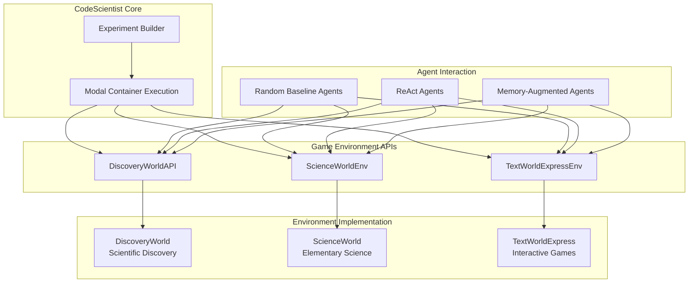
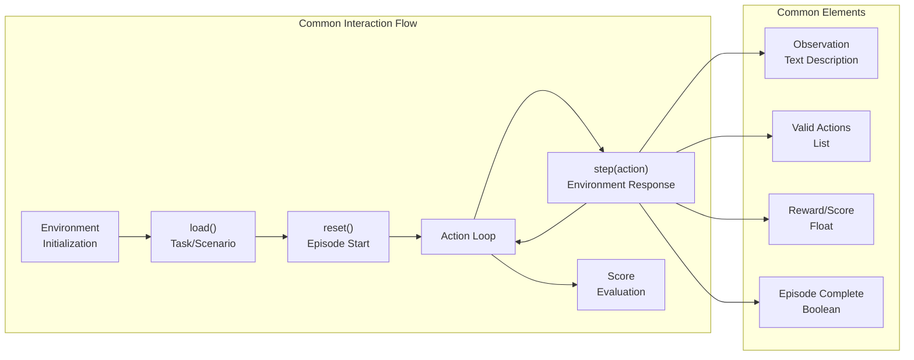

<!-- source: DeepWiki mcp.deepwiki.com · repo allenai/codescientist · page 4 Game Environments · fetched 2026-10-26 -->

# Game Environments

<details>
<summary>Relevant source files</summary>

The following files were used as context for generating this wiki page:

- [codeblocks/env_discoveryworld_random_agent.py](codeblocks/env_discoveryworld_random_agent.py)
- [codeblocks/env_scienceworld_random_agent.py](codeblocks/env_scienceworld_random_agent.py)
- [codeblocks/env_textworldexpress_random_agent.py](codeblocks/env_textworldexpress_random_agent.py)

</details>


This document covers the text-based game environments that serve as experimental testbeds for scientific discovery agents in the CodeScientist system. These environments provide controlled, interactive simulations where agents can perform scientific experiments, test hypotheses, and demonstrate reasoning capabilities.

For information about the agent architectures that interact with these environments, see [Agent Architectures](#3). For details about the experiment execution infrastructure, see [Experiment Infrastructure](#7).

## Overview

CodeScientist integrates three primary game environments, each designed to test different aspects of scientific reasoning and discovery:

- **DiscoveryWorld** - Complex scientific discovery tasks requiring end-to-end hypothesis formation and testing
- **ScienceWorld** - Elementary science knowledge testing through interactive scenarios  
- **TextWorldExpress** - General interactive text games including navigation, object manipulation, and problem-solving

These environments are accessed through standardized APIs and executed within containerized Modal environments to ensure reproducibility and cost control.

## Environment Integration Architecture



Sources: [codeblocks/env_discoveryworld_random_agent.py:8-9](), [codeblocks/env_scienceworld_random_agent.py:9](), [codeblocks/env_textworldexpress_random_agent.py:13-14]()

## Common API Patterns

All three environments follow similar interaction patterns, making it easier to develop agents that can work across multiple environments:



Sources: [codeblocks/env_discoveryworld_random_agent.py:102](), [codeblocks/env_scienceworld_random_agent.py:72](), [codeblocks/env_textworldexpress_random_agent.py:103]()

## Environment-Specific Features

| Environment | Primary Purpose | Key Features | Scoring Method |
|-------------|----------------|--------------|----------------|
| DiscoveryWorld | Scientific Discovery | Multi-step experiments, discovery feed, detailed scorecard | Procedure score + Task completion + Explanatory knowledge |
| ScienceWorld | Elementary Science | 30 task types, goal progress tracking, simplification options | Normalized score (0-1) with failure detection |
| TextWorldExpress | Interactive Games | 6 game types, gold path generation, parametric variations | Game-specific scoring with success/failure |

## Random Agent Implementations

Each environment includes a reference random agent implementation that demonstrates the API usage patterns:

### DiscoveryWorld Random Agent
- Function: `randomAgent()` in [codeblocks/env_discoveryworld_random_agent.py:67]()
- Handles both dialog and normal actions
- Supports video export functionality
- Provides detailed scorecard analysis

### ScienceWorld Random Agent  
- Function: `randomModel()` in [codeblocks/env_scienceworld_random_agent.py:26]()
- Supports task variations and simplification modes
- Includes goal progress tracking
- Handles negative score failure detection

### TextWorldExpress Random Agent
- Function: `randomModel()` in [codeblocks/env_textworldexpress_random_agent.py:56]()
- Supports multiple game types with parametric variations
- Includes gold path generation for training data
- Provides comprehensive timing statistics

## Environment Configuration

### Package Requirements
```
discoveryworld==0.0.2
scienceworld
textworld-express==1.0.4
```

### Execution Parameters
All environments support common configuration options:
- **Thread ID**: For concurrent execution isolation
- **Random Seed**: For reproducible experiments  
- **Step Limits**: Maximum actions per episode
- **Debug Mode**: Verbose output for development

Sources: [codeblocks/env_discoveryworld_random_agent.py:6](), [codeblocks/env_scienceworld_random_agent.py:6](), [codeblocks/env_textworldexpress_random_agent.py:6]()

## Integration with Experiment System

The game environments are tightly integrated with CodeScientist's experiment infrastructure:

1. **Codeblock Library**: Environment-specific code templates are stored as codeblocks for experiment generation
2. **Modal Execution**: All environments run in containerized Modal instances for isolation and scalability
3. **Cost Control**: Environment usage is monitored through the LLM proxy system for budget management
4. **Result Storage**: Game scores and trajectories are captured for analysis and reporting

For detailed information about specific environments, see:
- [DiscoveryWorld Environment](#4.1) - Complex scientific discovery scenarios
- [ScienceWorld Environment](#4.2) - Elementary science knowledge testing  
- [TextWorldExpress Environment](#4.3) - Interactive text-based games

Sources: [codeblocks/env_discoveryworld_random_agent.py:1-7](), [codeblocks/env_scienceworld_random_agent.py:1-7](), [codeblocks/env_textworldexpress_random_agent.py:1-7]()

---

