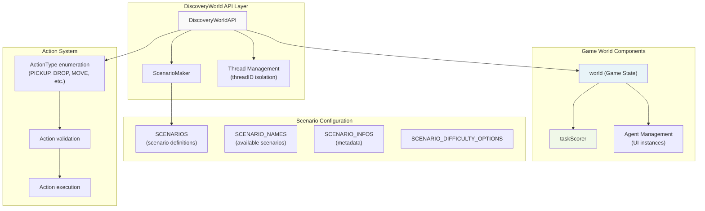
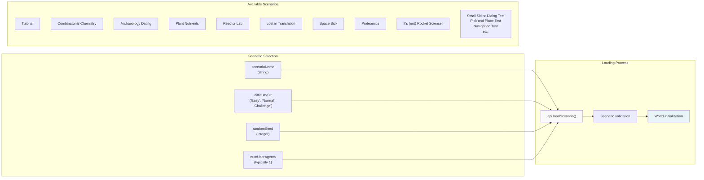
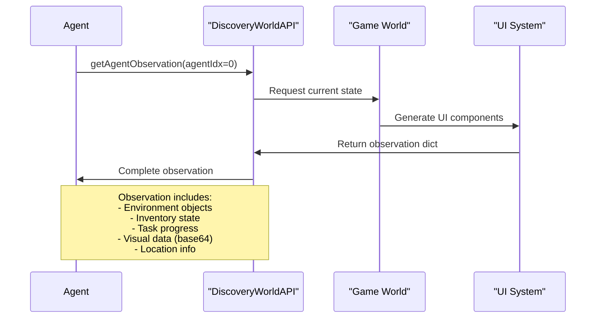
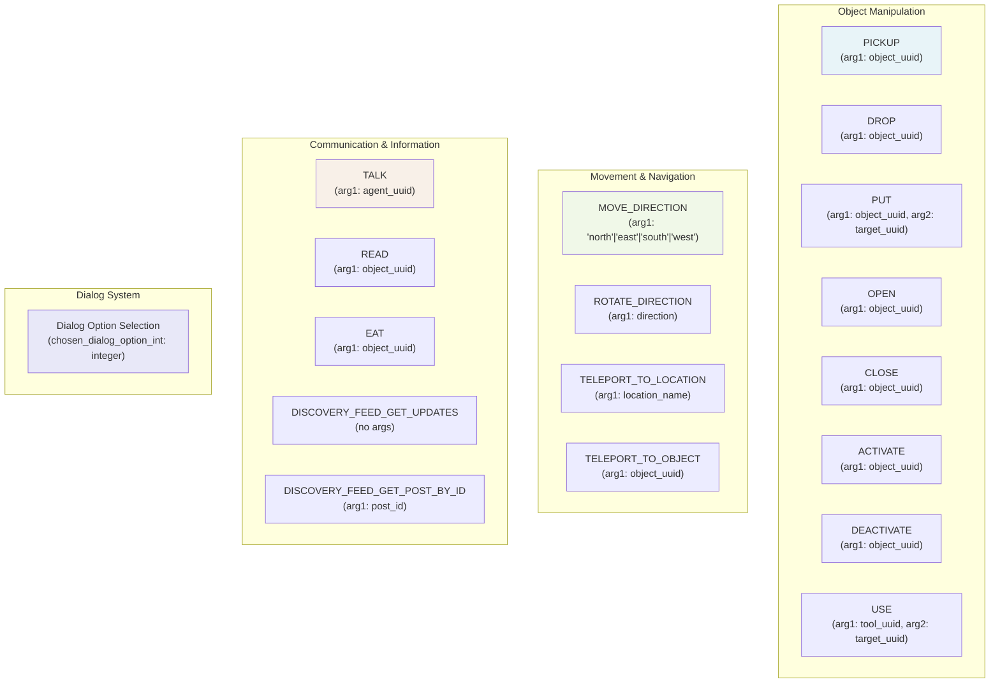
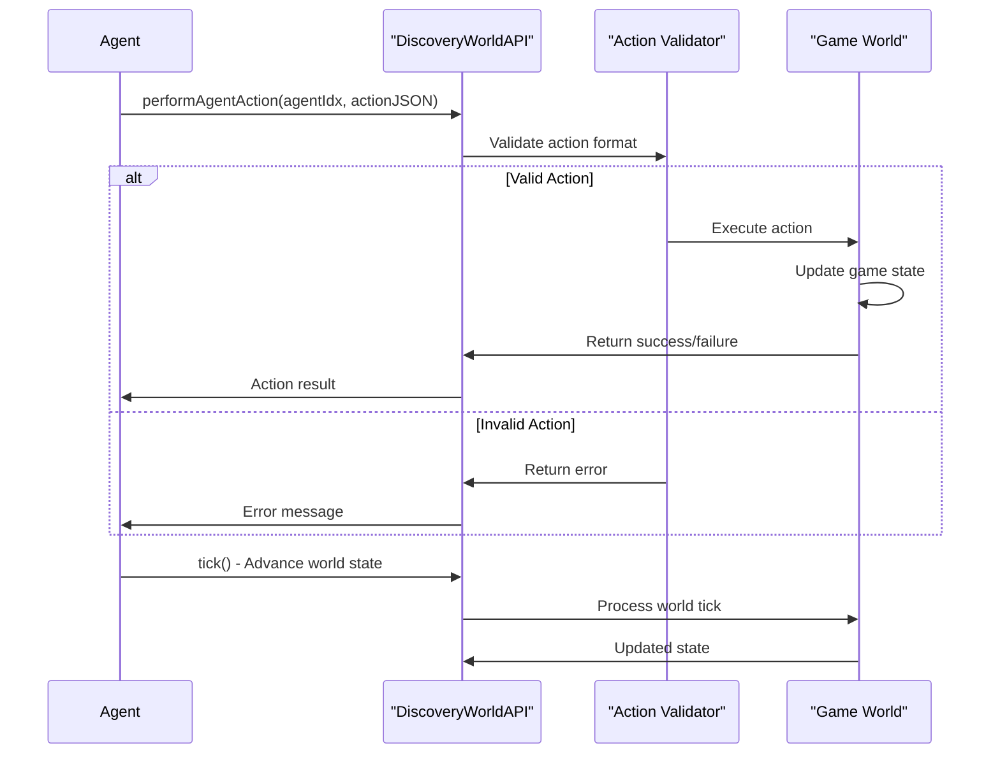
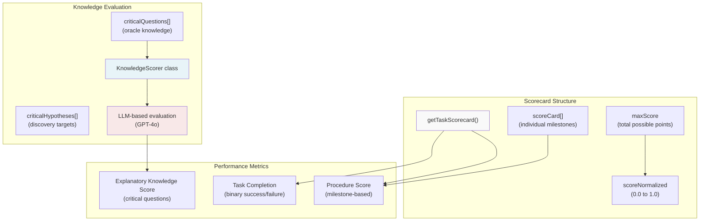
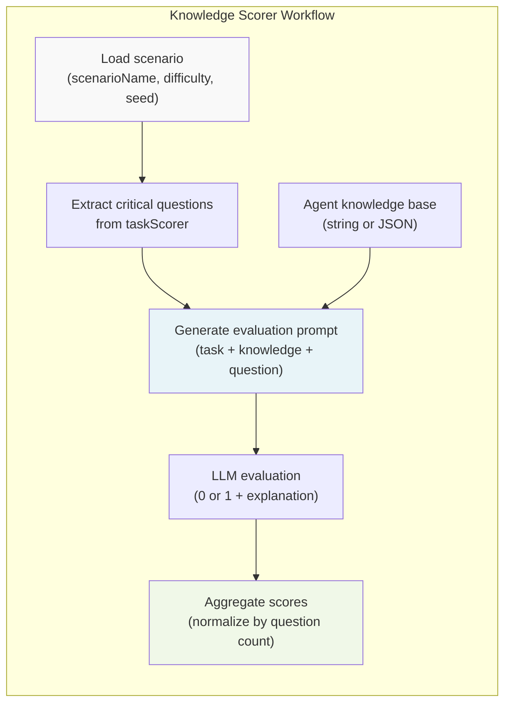
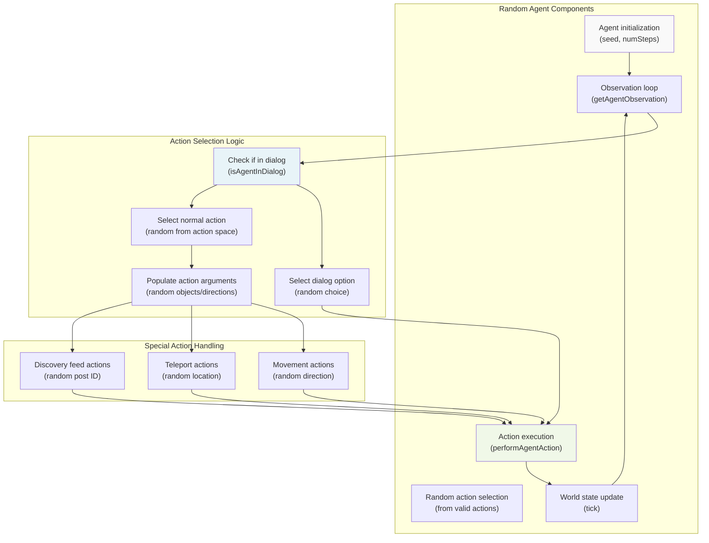

<!-- source: DeepWiki mcp.deepwiki.com · repo allenai/codescientist · page 4.1 DiscoveryWorld Environment · fetched 2026-10-26 -->

# DiscoveryWorld Environment

Relevant source files

The following files were used as context for generating this wiki page:

- [codeblocks/env_discoveryworld_knowledge_scorer.py](codeblocks/env_discoveryworld_knowledge_scorer.py)
- [codeblocks/env_discoveryworld_random_agent.py](codeblocks/env_discoveryworld_random_agent.py)

This document covers the DiscoveryWorld environment system within CodeScientist, which provides an interactive text-based game platform for testing agents' scientific discovery capabilities. DiscoveryWorld supports both textual and 2D visual interaction modes, with comprehensive scoring systems for evaluating agent performance across multiple dimensions.

For information about other game environments used in CodeScientist, see [ScienceWorld Environment](#4.2) and [TextWorldExpress Environment](#4.3). For details about the agent architectures that interact with these environments, see [Agent Architectures](#3).

## API Structure and Core Components

The DiscoveryWorld environment is accessed through the `DiscoveryWorldAPI` class, which provides the primary interface for loading scenarios, managing agent interactions, and collecting performance metrics.

### DiscoveryWorld API Core Components

Sources: [codeblocks/env_discoveryworld_random_agent.py:8-9](), [codeblocks/env_discoveryworld_random_agent.py:284-287]()

### Scenario Loading and Configuration

DiscoveryWorld scenarios are loaded through a standardized interface that accepts scenario names, difficulty levels, and random seeds for reproducible experiments.

Sources: [codeblocks/env_discoveryworld_random_agent.py:458-461](), [codeblocks/env_discoveryworld_random_agent.py:284-290]()

## Observation System

DiscoveryWorld provides rich observations that include textual descriptions, visual information, and structured data about the game state. The observation system is designed to support both human players and AI agents.

### Observation Structure

| Component | Description | Key Fields |
|-----------|-------------|------------|
| `errors` | Error messages from invalid actions | List of error strings |
| `vision` | 2D visual representation | `base64_no_grid`, `base64_with_grid` |
| `ui` | Primary interface data | Inventory, environment objects, location, tasks |
| `ui.accessibleEnvironmentObjects` | Directly interactable objects | `name`, `description`, `uuid` |
| `ui.inventoryObjects` | Agent's current inventory | `name`, `description`, `uuid` |
| `ui.agentLocation` | Agent's position and orientation | `x`, `y`, `faceDirection`, movement options |
| `ui.taskProgress` | Current task status | `taskName`, `description`, `completed` |
| `ui.nearbyObjects` | Objects within visual range | Directional mapping with distances |
| `ui.discoveryFeed` | Social/discovery updates | Posts with author, content, timestamps |

Sources: [codeblocks/env_discoveryworld_random_agent.py:102-117]()

### Agent Observation Workflow

Sources: [codeblocks/env_discoveryworld_random_agent.py:102]()

## Action System

DiscoveryWorld supports a comprehensive action space that covers object manipulation, movement, communication, and environment interaction.

### Core Action Types

Sources: [codeblocks/env_discoveryworld_random_agent.py:184-205](), [codeblocks/env_discoveryworld_random_agent.py:227-257]()

### Action Execution Process

Sources: [codeblocks/env_discoveryworld_random_agent.py:167](), [codeblocks/env_discoveryworld_random_agent.py:263-267](), [codeblocks/env_discoveryworld_random_agent.py:269]()

## Scoring and Evaluation System

DiscoveryWorld employs a multi-dimensional scoring system that evaluates agent performance across procedural execution, task completion, and explanatory knowledge discovery.

### Scoring Components

Sources: [codeblocks/env_discoveryworld_random_agent.py:128-136](), [codeblocks/env_discoveryworld_random_agent.py:305-307](), [codeblocks/env_discoveryworld_knowledge_scorer.py:16-38]()

### Knowledge Scoring Implementation

The `KnowledgeScorer` class provides automated evaluation of agent knowledge against predefined critical questions using Large Language Models.

Sources: [codeblocks/env_discoveryworld_knowledge_scorer.py:123-228](), [codeblocks/env_discoveryworld_knowledge_scorer.py:161-193]()

## Random Agent Implementation

The provided random agent serves as both a baseline and an example of proper DiscoveryWorld API usage. It demonstrates the complete interaction cycle while making random action selections.

### Random Agent Architecture

Sources: [codeblocks/env_discoveryworld_random_agent.py:67-279](), [codeblocks/env_discoveryworld_random_agent.py:141-169](), [codeblocks/env_discoveryworld_random_agent.py:229-257]()

## Integration with CodeScientist

DiscoveryWorld integrates with the broader CodeScientist system through standardized interfaces that support automated experiment generation and execution.

### Integration Points

| Component | Integration Method | Purpose |
|-----------|-------------------|---------|
| Experiment Builder | Code template inclusion | Generates agent experiments using DiscoveryWorld |
| Knowledge Systems | External knowledge bases | Provides background knowledge for agents |
| LLM Integration | Proxy server communication | Powers intelligent agents and knowledge scoring |
| Statistical Analysis | Scorecard data collection | Enables meta-analysis across experiments |
| Video Generation | `createAgentVideo()` method | Produces visual records of agent behavior |

Sources: [codeblocks/env_discoveryworld_random_agent.py:423-425](), [codeblocks/env_discoveryworld_knowledge_scorer.py:193]()

The DiscoveryWorld environment provides a comprehensive platform for testing scientific discovery capabilities in AI agents, with robust scoring mechanisms and extensive action spaces that enable complex experimental scenarios within the CodeScientist framework.

---

