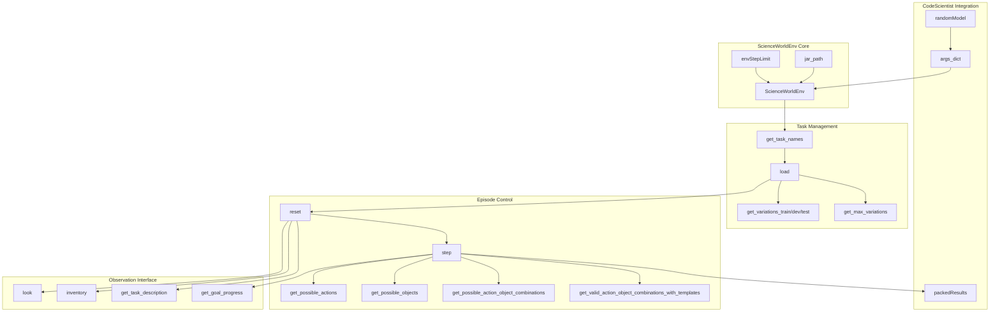
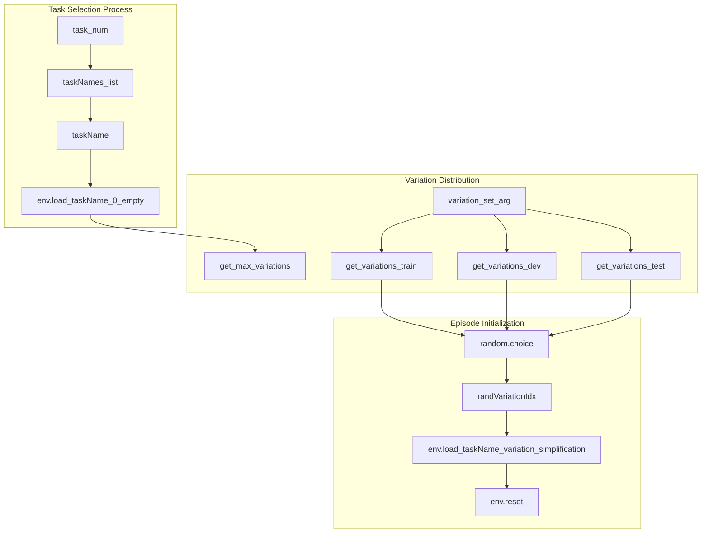
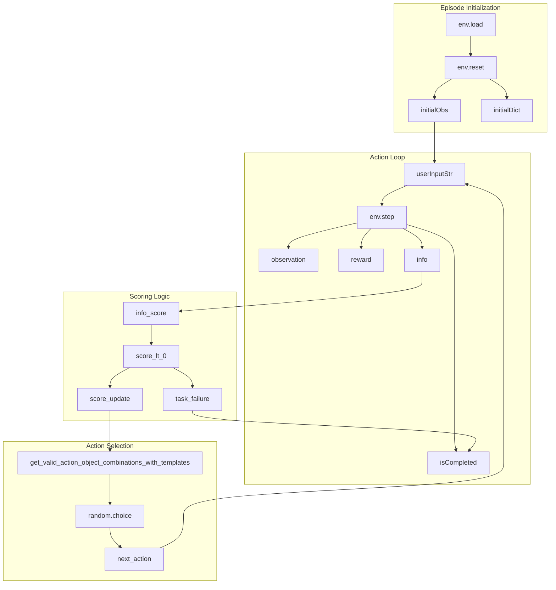
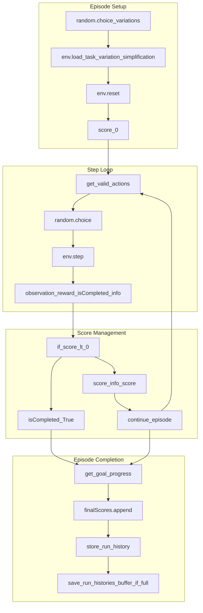

<!-- source: DeepWiki mcp.deepwiki.com · repo allenai/codescientist · page 4.2 ScienceWorld Environment · fetched 2026-10-26 -->

# ScienceWorld Environment

<details>
<summary>Relevant source files</summary>

The following files were used as context for generating this wiki page:

- [codeblocks/env_scienceworld_random_agent.py](codeblocks/env_scienceworld_random_agent.py)

</details>


## Purpose and Scope

This document covers the ScienceWorld Environment integration within CodeScientist, specifically how the system interfaces with ScienceWorld for elementary science knowledge testing. ScienceWorld is an interactive text-based game environment that challenges agents to demonstrate understanding of basic scientific concepts through 30 different task scenarios.

For information about other game environments used in CodeScientist, see DiscoveryWorld Environment ([4.1](#4.1)) and TextWorldExpress Environment ([4.3](#4.3)). For details about the agent architectures that interact with these environments, see Agent Architectures ([3](#3)).

## Core Architecture

ScienceWorld provides a standardized interface for elementary science experiments through the `ScienceWorldEnv` class. The environment supports 30 distinct task types, each with multiple parametric variations distributed across train/dev/test splits.

### ScienceWorld Environment Integration



Sources: [codeblocks/env_scienceworld_random_agent.py:1-214]()

## Task Structure

ScienceWorld provides 30 distinct task types covering various elementary science domains. Each task has multiple parametric variations to ensure diverse testing scenarios.

### Available Task Types

| Task Category | Example Tasks | Task Index Range |
|---------------|---------------|------------------|
| State Changes | `boil`, `freeze`, `melt`, `change-the-state-of-matter-of` | 0-4, 22 |
| Chemistry | `chemistry-mix`, `chemistry-mix-paint-secondary-color`, `chemistry-mix-paint-tertiary-color` | 2-4 |
| Biology | `find-animal`, `find-plant`, `find-living-thing`, `find-non-living-thing`, `grow-fruit`, `grow-plant` | 5-11 |
| Life Sciences | `identify-life-stages-1`, `identify-life-stages-2`, `lifespan-longest-lived`, `lifespan-shortest-lived` | 12-19 |
| Physics | `inclined-plane-determine-angle`, `inclined-plane-friction-named-surfaces`, `test-conductivity` | 14-16, 27-28 |
| Genetics | `mendelian-genetics-known-plant`, `mendelian-genetics-unknown-plant` | 23-24 |
| Energy | `power-component`, `power-component-renewable-vs-nonrenewable-energy` | 25-26 |
| Measurement | `measure-melting-point-known-substance`, `use-thermometer` | 20-21, 29 |

### Task Variation Management



Sources: [codeblocks/env_scienceworld_random_agent.py:40-72]()

## Environment Interface

The ScienceWorld environment provides multiple interface methods for accessing game state, possible actions, and environment feedback.

### Action and Object Discovery

The environment exposes several methods for discovering valid actions and objects:

| Method | Return Type | Description |
|--------|-------------|-------------|
| `get_possible_actions()` | `List[str]` | Action templates like "activate OBJ", "close OBJ" |
| `get_possible_objects()` | `List[str]` | Available objects like "apple", "door", "key" |
| `get_possible_action_object_combinations()` | `Tuple[List[dict], dict]` | All action-object combinations with lookup table |
| `get_valid_action_object_combinations_with_templates()` | `List[dict]` | Only currently valid action-object combinations |

### Episode Flow and Scoring



Sources: [codeblocks/env_scienceworld_random_agent.py:92-144]()

## Simplification Modes

ScienceWorld supports various simplification modes to adjust task difficulty:

### Available Simplifications

| Simplification | Effect |
|----------------|--------|
| `easy` | All simplifications applied (common setting) |
| `teleportAction` | Enables instant movement between locations |
| `selfWateringFlowerPots` | Plants water themselves automatically |
| `openContainers` | All containers start open |
| `openDoors` | All doors start open |
| `noElectricalAction` | Disables electrical interactions |

The simplification string is passed as a CSV parameter to the `load()` method: [codeblocks/env_scienceworld_random_agent.py:70]()

## Episode Lifecycle and Logging

### Episode Execution Pattern



Sources: [codeblocks/env_scienceworld_random_agent.py:66-163]()

### Data Persistence

The environment provides built-in logging capabilities:

- `store_run_history(episodeIdx, notes)` - Stores episode history with optional notes
- `save_run_histories_buffer_if_full(filenamePrefix, max_per_file, force_save)` - Exports histories to files when buffer is full

The logging system automatically manages file creation with configurable episodes per file limits.

## Integration with CodeScientist

### Return Data Structure

The `randomModel()` function returns a standardized results dictionary:

```python
packedResults = {
    'task_name': taskName,
    'task_idx': taskIdx, 
    'simplification_str': simplificationStr,
    'num_episodes': numEpisodes,
    'max_steps': args['env_step_limit'],
    'final_scores': finalScores,
    'average_score': avg
}
```

This structure enables integration with CodeScientist's experiment tracking and analysis systems.

### Configuration Parameters

| Parameter | Type | Description | Typical Value |
|-----------|------|-------------|---------------|
| `task_num` | `int` | Task index (0-29) | 0 |
| `simplification_str` | `str` | CSV of simplifications | "easy" |
| `num_episodes` | `int` | Episodes to run | 10-100 |
| `env_step_limit` | `int` | Max steps per episode | 100 |
| `output_path_prefix` | `str` | Log file prefix | "mylogprefix-" |
| `max_episode_per_file` | `int` | Episodes per log file | 100 |
| `variation_set` | `str` | train/dev/test split | "train" |

Sources: [codeblocks/env_scienceworld_random_agent.py:13-25](), [codeblocks/env_scienceworld_random_agent.py:196-206]()

---

