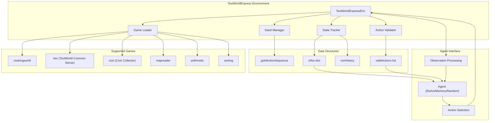
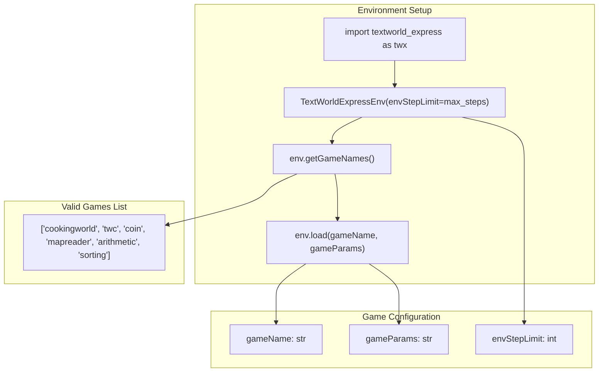
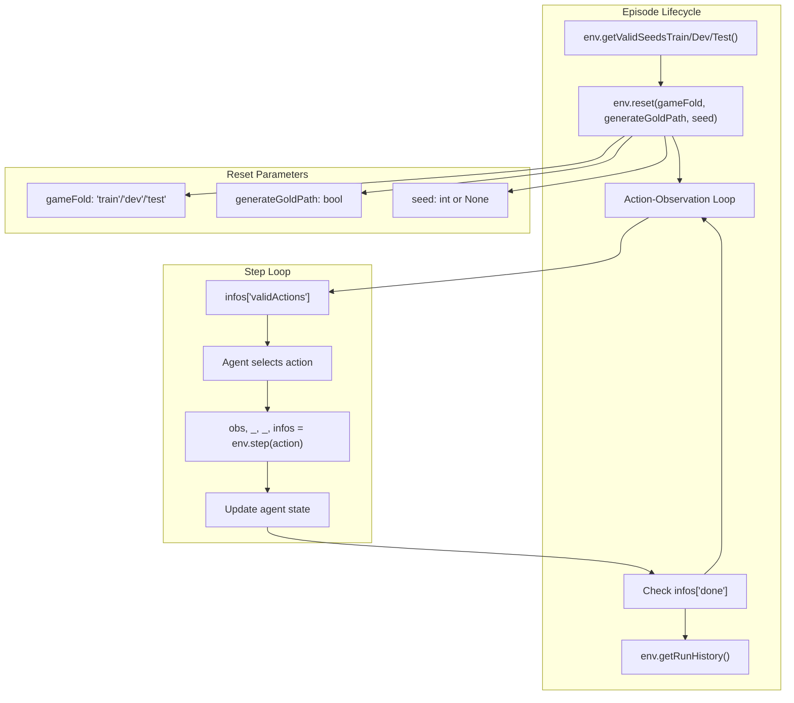
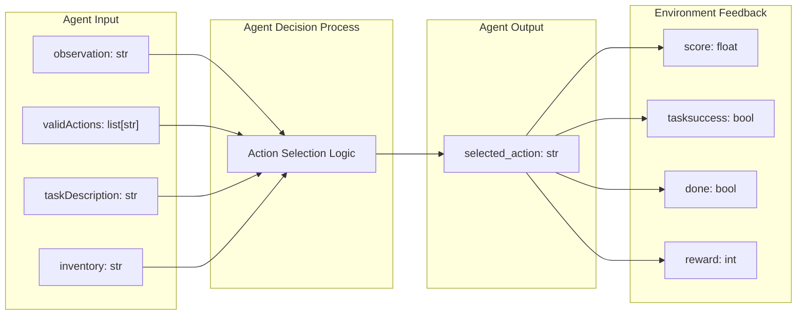
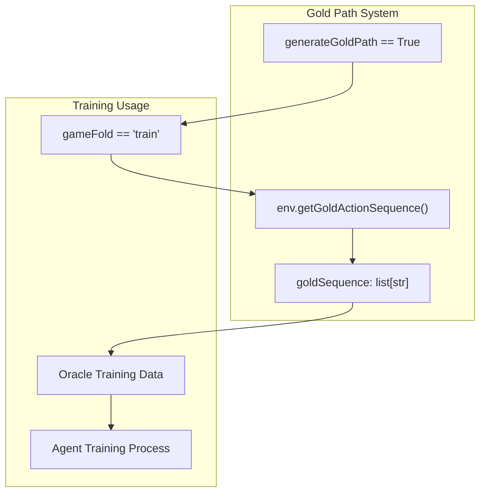
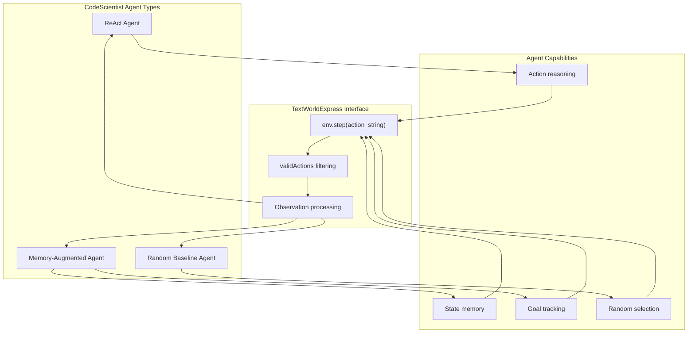
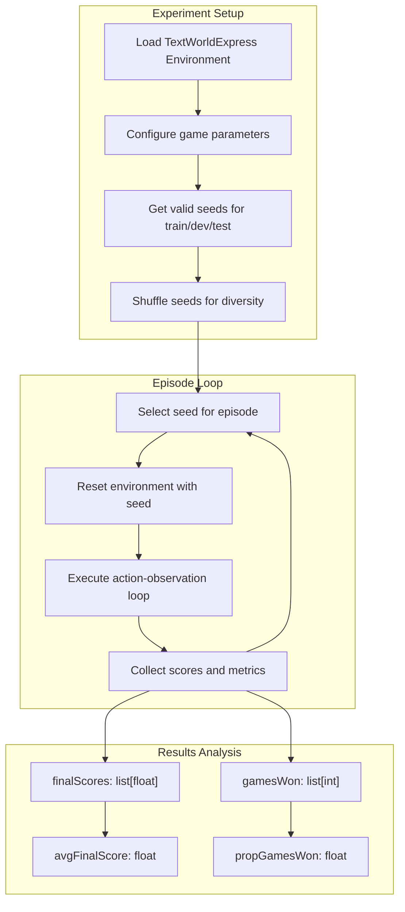
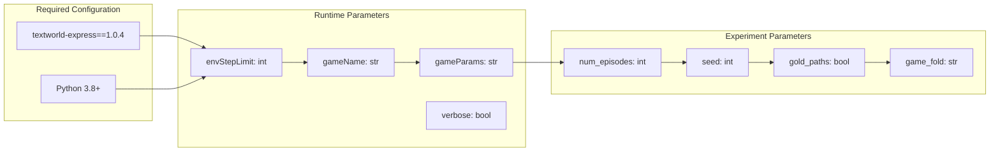

<!-- source: DeepWiki mcp.deepwiki.com · repo allenai/codescientist · page 4.3 TextWorldExpress Environment · fetched 2026-10-26 -->

# TextWorldExpress Environment

<details>
<summary>Relevant source files</summary>

The following files were used as context for generating this wiki page:

- [codeblocks/env_textworldexpress_random_agent.py](codeblocks/env_textworldexpress_random_agent.py)

</details>


This document covers the TextWorldExpress environment integration within CodeScientist, including its API structure, supported games, and usage patterns for conducting scientific discovery experiments. TextWorldExpress provides a fast simulator for interactive text-based games that agents can use to test reasoning and decision-making capabilities.

For information about other game environments in CodeScientist, see DiscoveryWorld Environment ([4.1](#4.1)) and ScienceWorld Environment ([4.2](#4.2)). For details on agent architectures that interact with these environments, see Agent Architectures ([3](#3)).

## Environment Overview

TextWorldExpress is a lightweight simulator that reimplements a subset of existing text-based interactive fiction games optimized for fast execution. The environment supports parametric generation of game instances based on provided seeds, with separate train/dev/test sets for controlled experimentation.



Sources: [codeblocks/env_textworldexpress_random_agent.py:1-294]()

## Supported Games and Parameters

TextWorldExpress includes six distinct games, each with configurable parameters that control complexity and task characteristics:

| Game | Description | Key Parameters |
|------|-------------|----------------|
| `cookingworld` | Recipe-based cooking tasks | `numLocations` (1-11), `numIngredients` (1-5), `numDistractorItems` (0-10), `includeDoors` (0/1), `limitInventorySize` (0/1) |
| `twc` | TextWorld Common Sense item organization | `numLocations` (1-3), `numItemsToPutAway` (1-10), `includeDoors` (0/1), `limitInventorySize` (0/1) |
| `coin` | Coin collection navigation | `numLocations` (1-11), `numDistractorItems` (0-10), `includeDoors` (0/1), `limitInventorySize` (0/1) |
| `mapreader` | Map-based navigation tasks | `numLocations` (1-50), `maxDistanceApart` (1-8), `maxDistractorItemsPerLocation` (0-3), `includeDoors` (0/1), `limitInventorySize` (0/1) |
| `arithmetic` | Mathematical problem solving | No configurable parameters |
| `sorting` | Sequence ordering tasks | No configurable parameters |

```mermaid
graph LR
    subgraph "Game Categories"
        NavigationGames["Navigation-Based"]
        TaskGames["Task-Based"]
        LogicGames["Logic-Based"]
    end
    
    subgraph "Navigation-Based Games"
        CookingWorld["cookingworld"]
        CoinCollector["coin"]
        MapReader["mapreader"]
        TWC["twc"]
    end
    
    subgraph "Logic-Based Games"
        Arithmetic["arithmetic"]
        Sorting["sorting"]
    end
    
    NavigationGames --> CookingWorld
    NavigationGames --> CoinCollector
    NavigationGames --> MapReader
    NavigationGames --> TWC
    
    LogicGames --> Arithmetic
    LogicGames --> Sorting
    
    CookingWorld --> "Recipe Following"
    CoinCollector --> "Item Collection"
    MapReader --> "Spatial Navigation"
    TWC --> "Common Sense Reasoning"
    Arithmetic --> "Mathematical Operations"
    Sorting --> "Sequence Ordering"
```

Sources: [codeblocks/env_textworldexpress_random_agent.py:16-49]()

## API Structure and Core Classes

The TextWorldExpress API centers around the `TextWorldExpressEnv` class, which provides the main interface for loading games, managing episodes, and executing actions.

### Environment Initialization



Sources: [codeblocks/env_textworldexpress_random_agent.py:70-81]()

### Episode Management

The environment follows a standard reset-step loop with seed-based parametric generation:



Sources: [codeblocks/env_textworldexpress_random_agent.py:86-103](), [codeblocks/env_textworldexpress_random_agent.py:148-175]()

## Data Structures and Interfaces

### Information Dictionary Structure

The `infos` dictionary returned by `env.step()` and `env.reset()` contains comprehensive state information:

| Key | Type | Description |
|-----|------|-------------|
| `observation` | str | Current environment description |
| `look` | str | Room description from 'look around' |
| `inventory` | str | Player inventory description |
| `validActions` | list[str] | Complete valid action strings |
| `scoreRaw` | float | Raw game score |
| `score` | float | Normalized score |
| `tasksuccess` | bool | Task completion status |
| `taskfailure` | bool | Task failure status |
| `reward` | int | Reward for last action |
| `done` | bool | Episode termination status |
| `numMoves` | int | Current step count |
| `taskDescription` | str | Natural language task description |



Sources: [codeblocks/env_textworldexpress_random_agent.py:104-132]()

### Gold Path Generation

For training data generation, the environment can provide optimal action sequences:



Sources: [codeblocks/env_textworldexpress_random_agent.py:142-145]()

## Integration with CodeScientist Agents

TextWorldExpress integrates with CodeScientist's agent architectures through a standardized interface that supports both random baseline agents and sophisticated reasoning agents.

### Agent-Environment Interface



Sources: [codeblocks/env_textworldexpress_random_agent.py:154-165]()

### Experiment Execution Pattern

The typical experiment pattern involves running multiple episodes with different seeds to gather statistical data:



Sources: [codeblocks/env_textworldexpress_random_agent.py:85-91](), [codeblocks/env_textworldexpress_random_agent.py:200-227]()

## Configuration and Usage

### Environment Configuration

TextWorldExpress requires minimal configuration compared to other environments in the CodeScientist system:



Sources: [codeblocks/env_textworldexpress_random_agent.py:5-6](), [codeblocks/env_textworldexpress_random_agent.py:238-262]()

The TextWorldExpress environment provides a fast, controlled testbed for evaluating agent reasoning capabilities across diverse interactive text-based scenarios, supporting CodeScientist's goal of automated scientific discovery through systematic experimentation.

Sources: [codeblocks/env_textworldexpress_random_agent.py:1-294]()

---

