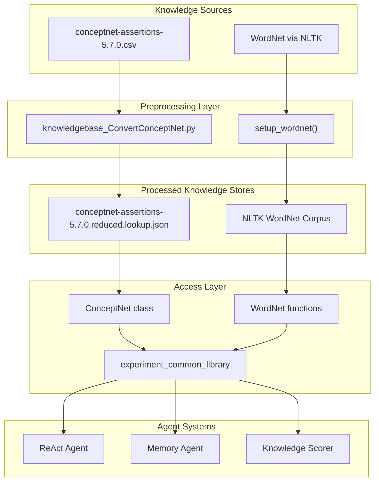
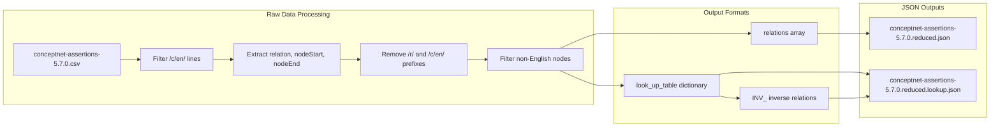
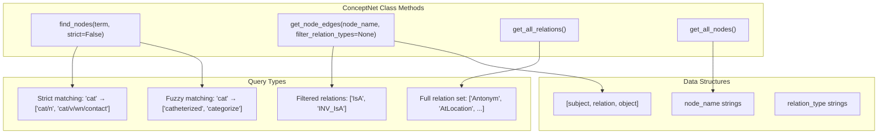
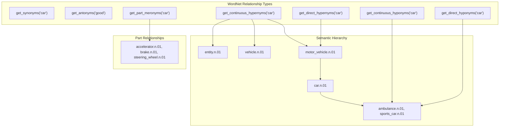
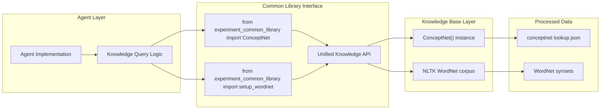

<!-- source: DeepWiki mcp.deepwiki.com · repo allenai/codescientist · page 5 Knowledge Systems · fetched 2026-10-26 -->

# Knowledge Systems

Relevant source files

The following files were used as context for generating this wiki page:

- [codeblocks/knowledgebase_ConvertConceptNet.py](codeblocks/knowledgebase_ConvertConceptNet.py)
- [codeblocks/knowledgebase_conceptnet.py](codeblocks/knowledgebase_conceptnet.py)
- [codeblocks/knowledgebase_wordnet.py](codeblocks/knowledgebase_wordnet.py)

## Purpose and Scope

The Knowledge Systems provide structured access to external knowledge bases that enhance agent reasoning capabilities within CodeScientist. This infrastructure enables agents to leverage semantic relationships, word meanings, and conceptual hierarchies when performing scientific discovery tasks.

This document covers the integration and preprocessing of ConceptNet and WordNet knowledge bases. For agent architectures that utilize these knowledge systems, see [Agent Architectures](#3). For the common library utilities that provide the underlying access methods, see [Common Experiment Library](#7.1).

## Architecture Overview

CodeScientist integrates two primary knowledge bases to support agent reasoning: ConceptNet for broad conceptual relationships and WordNet for lexical semantic information. These systems are accessed through a common interface provided by the `experiment_common_library` module.

### Knowledge Base Integration Architecture

Sources: [codeblocks/knowledgebase_ConvertConceptNet.py:1-86](), [codeblocks/knowledgebase_conceptnet.py:8-64](), [codeblocks/knowledgebase_wordnet.py:9-254]()

## ConceptNet Integration

ConceptNet provides a large-scale semantic network with relationships between concepts expressed in natural language. The CodeScientist implementation focuses on the English subset for performance and relevance.

### ConceptNet Data Processing Pipeline

Sources: [codeblocks/knowledgebase_ConvertConceptNet.py:10-86]()

The preprocessing pipeline transforms ConceptNet's raw CSV format into optimized JSON structures. Key transformations include:

| Processing Step | Purpose | Implementation |
|-----------------|---------|----------------|
| English Filtering | Reduce dataset size | Filter lines containing `/c/en/` [codeblocks/knowledgebase_ConvertConceptNet.py:17-18]() |
| Prefix Removal | Simplify node names | Remove `/r/` and `/c/en/` prefixes [codeblocks/knowledgebase_ConvertConceptNet.py:29-35]() |
| Inverse Relations | Bidirectional lookup | Create `INV_` prefixed relations [codeblocks/knowledgebase_ConvertConceptNet.py:74-76]() |
| Lookup Table | Fast access | Dictionary keyed by subject nodes [codeblocks/knowledgebase_ConvertConceptNet.py:63-82]() |

### ConceptNet Access Interface

The `ConceptNet` class provides methods for querying the processed knowledge base:

Sources: [codeblocks/knowledgebase_conceptnet.py:14-60]()

## WordNet Integration

WordNet provides lexical semantic relationships including synonyms, antonyms, hypernyms, hyponyms, and meronyms. The integration uses NLTK's WordNet interface with setup utilities from the common library.

### WordNet Function Categories

| Function Category | Methods | Return Type | Example |
|-------------------|---------|-------------|---------|
| Synset Operations | `get_synsets()`, `get_synset_definition()`, `get_words_in_synset()` | Synset objects, strings, lists | `car.n.01` synset |
| Synonym/Antonym | `get_synonyms()`, `get_antonyms()` | List of strings | `['car', 'auto', 'automobile']` |
| Hierarchical | `get_direct_hypernyms()`, `get_continuous_hypernyms()` | List of Synset objects | Hypernym chains |
| Part Relations | `get_part_meronyms()` | List of Synset objects | Car parts like `accelerator.n.01` |

Sources: [codeblocks/knowledgebase_wordnet.py:12-254]()

### WordNet Semantic Relationship Mapping

Sources: [codeblocks/knowledgebase_wordnet.py:98-254]()

## Integration with Agent Systems

Knowledge systems are accessed by agents through the `experiment_common_library` module, which provides unified interfaces for both ConceptNet and WordNet. This design allows agents to leverage semantic knowledge without directly managing knowledge base connections.

### Agent Knowledge Access Pattern

Sources: [codeblocks/knowledgebase_conceptnet.py:12](), [codeblocks/knowledgebase_wordnet.py:9]()

The knowledge systems enable agents to perform semantic reasoning by providing access to:

- **Conceptual relationships** through ConceptNet's `IsA`, `PartOf`, `UsedFor`, and other semantic relations
- **Lexical semantics** through WordNet's synonym, hypernym, and meronym relationships  
- **Inverse relationship traversal** via ConceptNet's `INV_` prefixed relations
- **Hierarchical concept navigation** through WordNet's hypernym/hyponym chains

This semantic knowledge enhances agent reasoning capabilities in scientific discovery tasks by providing structured background knowledge about concepts, their relationships, and semantic hierarchies.

---

