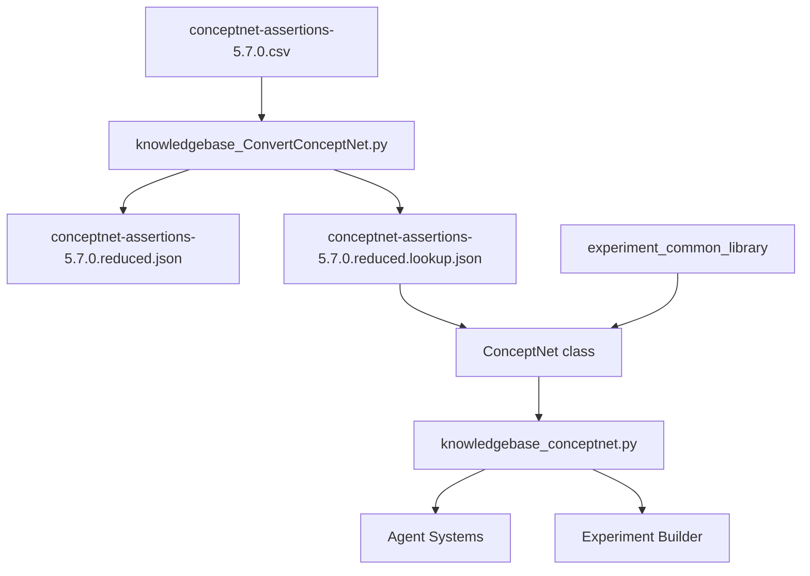
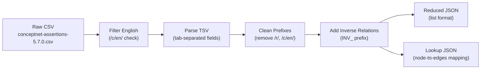
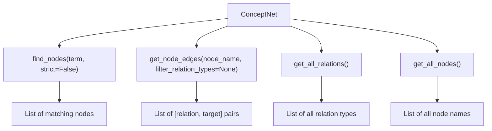

<!-- source: DeepWiki mcp.deepwiki.com · repo allenai/codescientist · page 5.1 ConceptNet Integration · fetched 2026-10-26 -->

# ConceptNet Integration

<details>
<summary>Relevant source files</summary>

The following files were used as context for generating this wiki page:

- [codeblocks/knowledgebase_ConvertConceptNet.py](codeblocks/knowledgebase_ConvertConceptNet.py)
- [codeblocks/knowledgebase_conceptnet.py](codeblocks/knowledgebase_conceptnet.py)

</details>


## Purpose and Scope

The ConceptNet Integration system provides fast, local access to a preprocessed English subset of the ConceptNet knowledge base within the CodeScientist framework. This system enables agents to query commonsense knowledge about concepts, relationships, and semantic associations during scientific discovery tasks.

For information about other knowledge base integrations, see [WordNet Integration](#5.2). For broader knowledge system architecture, see [Knowledge Systems](#5).

## System Architecture

The ConceptNet integration consists of two main components: a preprocessing pipeline that converts raw ConceptNet data into optimized formats, and a runtime interface that provides efficient querying capabilities.



**Sources:** [codeblocks/knowledgebase_ConvertConceptNet.py:1-86](), [codeblocks/knowledgebase_conceptnet.py:1-65]()

## Data Preprocessing Pipeline

The preprocessing system transforms raw ConceptNet CSV data into optimized JSON formats suitable for fast local querying.

### Preprocessing Steps

| Step | Operation | Purpose |
|------|-----------|---------|
| **Filtering** | Extract lines containing `/c/en/` | English-only content |
| **Parsing** | Split TSV fields into components | Extract relation triplets |
| **Normalization** | Remove `/r/` and `/c/en/` prefixes | Clean node/relation names |
| **Inverse Relations** | Add `INV_` prefixed relations | Bidirectional lookup |
| **Lookup Generation** | Create node-to-edges mapping | Fast query performance |



**Sources:** [codeblocks/knowledgebase_ConvertConceptNet.py:10-86]()

### Data Structure Format

The preprocessing creates two output formats:

**Reduced Format** (list of relations):
```json
[
  {
    "subj": "cat",
    "relation": "IsA", 
    "obj": "animal"
  }
]
```

**Lookup Format** (node-to-edges mapping):
```json
{
  "cat": [
    ["IsA", "animal"],
    ["INV_HasProperty", "furry"]
  ]
}
```

**Sources:** [codeblocks/knowledgebase_ConvertConceptNet.py:49-77]()

## ConceptNet Class Interface

The `ConceptNet` class from `experiment_common_library` provides the runtime interface for querying the preprocessed ConceptNet data.



**Sources:** [codeblocks/knowledgebase_conceptnet.py:12-59]()

### Core Methods

| Method | Parameters | Return Type | Description |
|--------|------------|-------------|-------------|
| `find_nodes()` | `term: str, strict: bool` | `List[str]` | Find nodes matching term prefix |
| `get_node_edges()` | `node_name: str, filter_relation_types: List[str]` | `List[List[str]]` | Get edges for specific node |
| `get_all_relations()` | None | `List[str]` | Get all relation types in graph |
| `get_all_nodes()` | None | `List[str]` | Get all node names |

**Sources:** [codeblocks/knowledgebase_conceptnet.py:21-59]()

## Usage Patterns and Examples

### Node Discovery

The system supports both strict and non-strict node searching:

```python
# Non-strict search (contains substring)
nodes = conceptNet.find_nodes("cat", strict=False)
# Returns: ['catheterized', 'categorize/v/wn/cognition', ...]

# Strict search (exact prefix match)  
nodes = conceptNet.find_nodes("cat", strict=True)
# Returns: ['cat/n/wn/animal', 'cat/n/wn/artifact', ...]
```

**Sources:** [codeblocks/knowledgebase_conceptnet.py:21-31]()

### Relationship Querying

The system provides efficient edge lookup with optional relation filtering:

```python
# Get all edges for a node
edges = conceptNet.get_node_edges("cat/n")
# Returns: [['INV_FormOf', 'cats'], ['IsA', 'felis/n'], ...]

# Filter by specific relation types
edges = conceptNet.get_node_edges("cat/n/wn/animal", 
                                 filter_relation_types=["IsA", "INV_IsA"])
# Returns: [['INV_IsA', 'domestic_cat/n/wn/animal'], ['IsA', 'feline/n/wn/animal']]
```

**Sources:** [codeblocks/knowledgebase_conceptnet.py:33-53]()

## Relation Types and Semantics

The ConceptNet integration supports a comprehensive set of relation types, including both forward and inverse relations.

### Core Relation Categories

| Category | Examples | Description |
|----------|----------|-------------|
| **Taxonomic** | `IsA`, `INV_IsA` | Hierarchical relationships |
| **Meronymic** | `PartOf`, `INV_PartOf` | Part-whole relationships |
| **Functional** | `UsedFor`, `CapableOf` | Purpose and capability |
| **Spatial** | `AtLocation`, `LocatedNear` | Spatial relationships |
| **Causal** | `Causes`, `CausesDesire` | Causal relationships |
| **Linguistic** | `Synonym`, `Antonym` | Lexical relationships |

### Inverse Relation Handling

The system automatically generates inverse relations with `INV_` prefixes, enabling bidirectional traversal:

- `Cat IsA Animal` ↔ `Animal INV_IsA Cat`
- `Wheel PartOf Car` ↔ `Car INV_PartOf Wheel`

This design allows efficient lookup in both directions without duplicating storage.

**Sources:** [codeblocks/knowledgebase_conceptnet.py:44-45](), [codeblocks/knowledgebase_ConvertConceptNet.py:73-76]()

## Integration with Codeblock System

The ConceptNet integration is packaged as a codeblock template for use in experiment generation.

### Codeblock Metadata

| Field | Value | Purpose |
|-------|-------|---------|
| **Name** | "ConceptNet Knowledge Base" | Template identifier |
| **Description** | Fast local access to English ConceptNet subset | Capability description |
| **Inclusion Criteria** | Need ConceptNet access, English subset | When to use |
| **Exclusion Criteria** | No ConceptNet needed, other languages | When not to use |
| **Requirements** | `gdown` package | External dependencies |

**Sources:** [codeblocks/knowledgebase_conceptnet.py:1-6]()

---

