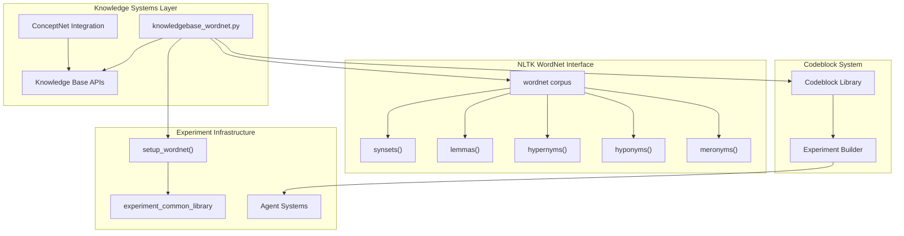
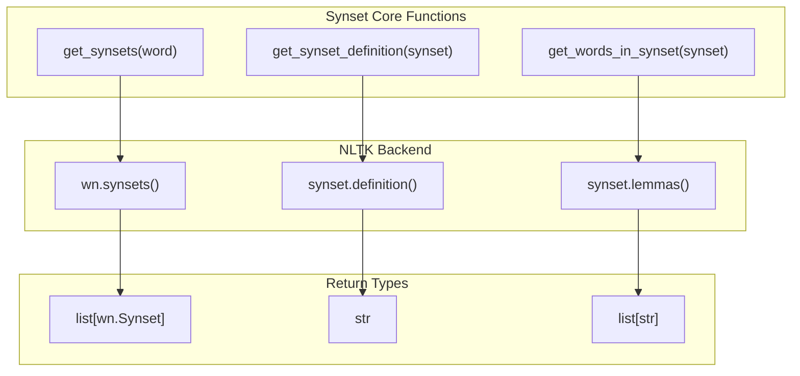
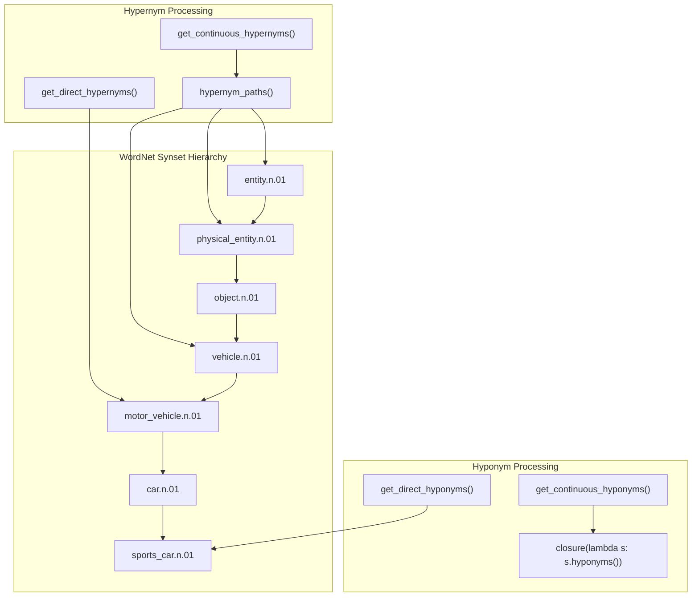
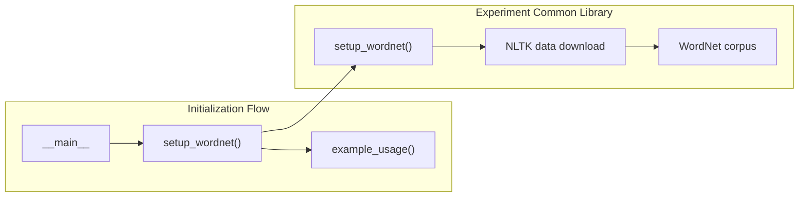
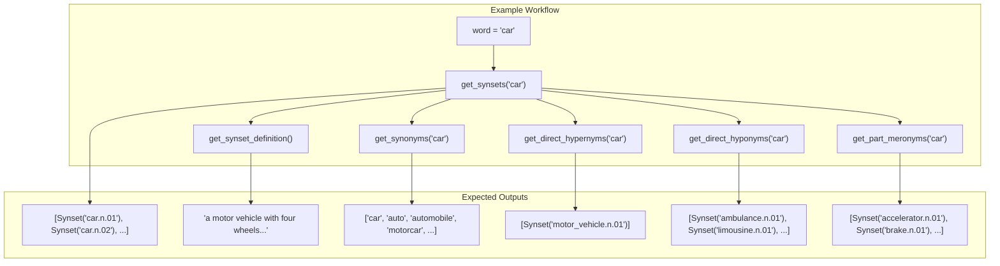

<!-- source: DeepWiki mcp.deepwiki.com · repo allenai/codescientist · page 5.2 WordNet Integration · fetched 2026-10-26 -->

# WordNet Integration

Relevant source files

The following files were used as context for generating this wiki page:

- [codeblocks/knowledgebase_wordnet.py](codeblocks/knowledgebase_wordnet.py)

This document covers the WordNet lexical database integration in CodeScientist, which provides access to semantic relationships between words including synonyms, antonyms, hypernyms, hyponyms, and meronyms through the NLTK library. 

For information about ConceptNet knowledge base integration, see [ConceptNet Integration](#5.1). For broader knowledge system architecture, see [Knowledge Systems](#5).

## Purpose and Scope

The WordNet integration provides a standardized interface for accessing lexical semantic relationships in scientific discovery experiments. WordNet serves as a structured lexical database that organizes English words into synsets (synonym sets) and defines semantic relationships between them. This integration is implemented as a codeblock template that can be incorporated into experiments requiring lexical knowledge.

The system focuses specifically on:
- Synset extraction and definition retrieval
- Synonym and antonym identification  
- Hierarchical relationships (hypernyms/hyponyms)
- Part-whole relationships (meronyms)
- Integration with the experiment infrastructure through `setup_wordnet()`

## WordNet System Architecture

Sources: [codeblocks/knowledgebase_wordnet.py:1-255]()

## Core WordNet Functions

The WordNet integration provides a comprehensive set of functions for lexical analysis organized around different types of semantic relationships.

### Synset Operations

Sources: [codeblocks/knowledgebase_wordnet.py:12-49]()

### Lexical Relationship Functions

| Function | Purpose | Return Type | NLTK Method |
|----------|---------|-------------|-------------|
| `get_synonyms(word)` | Extract all synonyms across synsets | `list[str]` | `synset.lemmas()` |
| `get_antonyms(word)` | Extract antonyms from lemmas | `list[str]` | `lemma.antonyms()` |
| `get_direct_hypernyms(word)` | Get immediate broader terms | `list[wn.Synset]` | `synset.hypernyms()` |
| `get_continuous_hypernyms(word)` | Get complete hypernym chain | `list[wn.Synset]` | `synset.hypernym_paths()` |
| `get_direct_hyponyms(word)` | Get immediate narrower terms | `list[wn.Synset]` | `synset.hyponyms()` |
| `get_continuous_hyponyms(word)` | Get complete hyponym tree | `list[wn.Synset]` | `synset.closure()` |
| `get_part_meronyms(word)` | Get component parts | `list[wn.Synset]` | `synset.part_meronyms()` |

Sources: [codeblocks/knowledgebase_wordnet.py:51-210]()

## Hierarchical Relationship Processing

Sources: [codeblocks/knowledgebase_wordnet.py:98-187]()

## Integration with Experiment Infrastructure

### Setup and Initialization

The WordNet integration requires initialization through the `experiment_common_library.setup_wordnet()` function, which handles NLTK data download and configuration.

Sources: [codeblocks/knowledgebase_wordnet.py:9-10](), [codeblocks/knowledgebase_wordnet.py:252-254]()

### Codeblock Template Structure

The WordNet integration follows the standard codeblock template format with metadata and inclusion criteria:

| Metadata Field | Value |
|----------------|-------|
| `inclusion_criteria` | Use when explicitly requiring WordNet lexical database |
| `exclusion_criteria` | Avoid when not explicitly using WordNet |
| `python_version` | `>=3.8` |
| `pip_requirement` | `nltk` |

Sources: [codeblocks/knowledgebase_wordnet.py:1-6]()

## Example Usage and Output

The system includes comprehensive example usage demonstrating all major functions:

Sources: [codeblocks/knowledgebase_wordnet.py:212-250]()

## Data Processing and Deduplication

The integration implements deduplication strategies to handle overlapping results from multiple synsets:

- **Synonym extraction**: Uses `list(set(synonyms))` to remove duplicates across synsets
- **Antonym extraction**: Uses `list(set(antonyms))` for unique antonyms
- **Hypernym/hyponym processing**: Uses `list(set())` to deduplicate synset objects
- **Meronym extraction**: Applies deduplication to component relationships

Sources: [codeblocks/knowledgebase_wordnet.py:72](), [codeblocks/knowledgebase_wordnet.py:96](), [codeblocks/knowledgebase_wordnet.py:118](), [codeblocks/knowledgebase_wordnet.py:142](), [codeblocks/knowledgebase_wordnet.py:164](), [codeblocks/knowledgebase_wordnet.py:187](), [codeblocks/knowledgebase_wordnet.py:209]()

---

