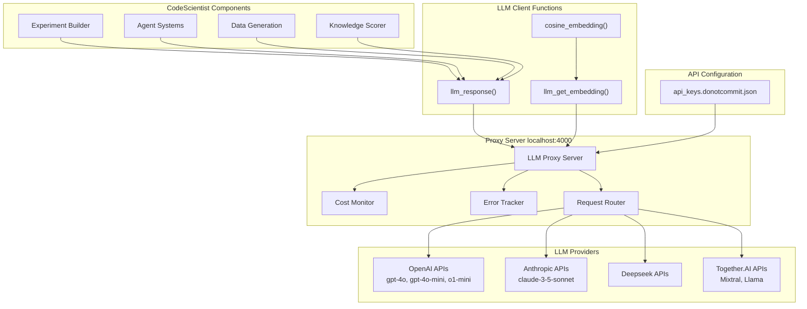
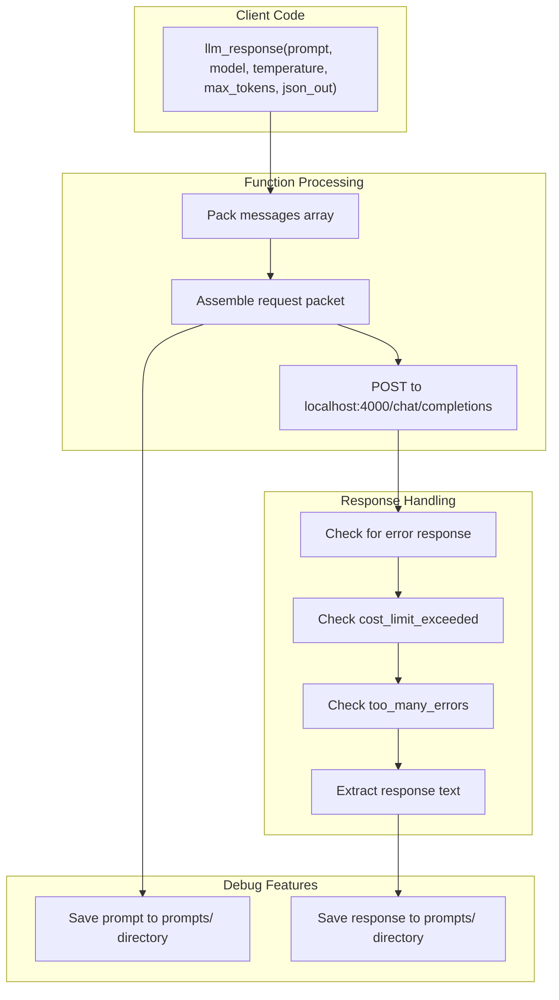
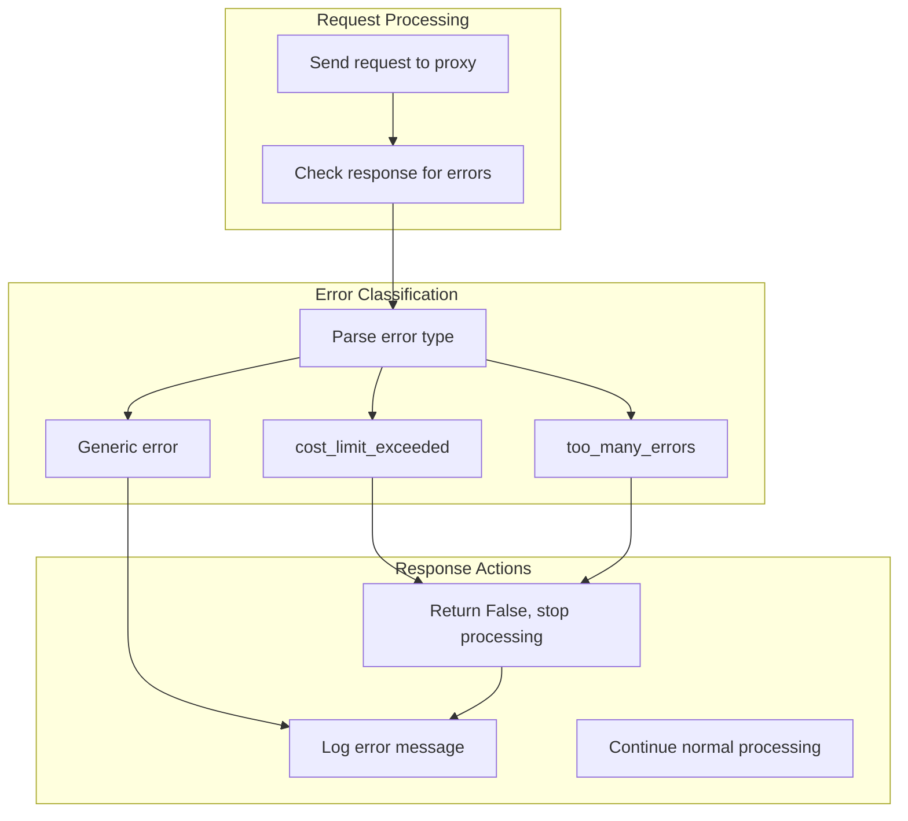

<!-- source: DeepWiki mcp.deepwiki.com · repo allenai/codescientist · page 6 LLM Integration and Cost Control · fetched 2026-10-26 -->

# LLM Integration and Cost Control

<details>
<summary>Relevant source files</summary>

The following files were used as context for generating this wiki page:

- [api_keys.donotcommit.json](api_keys.donotcommit.json)
- [codeblocks/llm_proxy_usage.py](codeblocks/llm_proxy_usage.py)
- [codeblocks/llm_submit_proxy.py](codeblocks/llm_submit_proxy.py)

</details>


This document covers the Large Language Model (LLM) integration system used throughout CodeScientist, including the proxy server architecture, cost monitoring, and API management. The system provides a unified interface for accessing multiple LLM providers (OpenAI, Anthropic, Deepseek) while implementing hard cost limits and usage tracking.

For detailed information about the LLM proxy server implementation, see [LLM Proxy System](#6.1). For API key management and provider configuration, see [API Configuration](#6.2).

## System Architecture

The LLM integration is built around a centralized proxy server that handles all communication with external LLM providers. This architecture ensures cost control, unified error handling, and consistent request formatting across the entire codebase.

### LLM Proxy Architecture



Sources: [codeblocks/llm_proxy_usage.py](), [codeblocks/llm_submit_proxy.py](), [api_keys.donotcommit.json]()

## API Configuration

The system uses a centralized configuration file to manage API keys for all supported LLM providers. This ensures secure credential management and easy provider switching.

### Configuration Structure

| Provider | Configuration Key | Supported Models |
|----------|-------------------|------------------|
| OpenAI | `openai` | gpt-4o, gpt-4o-mini, o1-mini, o1-preview |
| Anthropic | `anthropic` | claude-3-5-sonnet-20240620, claude-3-5-sonnet-20241022 |
| Deepseek | `deepseek` | deepseek models |

The API keys are stored in [api_keys.donotcommit.json:1-5]() with the following structure:

```json
{
    "openai": "YOUR_OPENAI_API_KEY_HERE",
    "anthropic": "YOUR_ANTHROPIC_API_KEY_HERE", 
    "deepseek": "YOUR_DEEPSEEK_API_KEY_HERE"
}
```

Sources: [api_keys.donotcommit.json:1-5]()

## Core LLM Functions

The system provides three primary functions for LLM interaction, all accessible through the `experiment_common_library` module.

### Text Generation Function Flow



Sources: [codeblocks/llm_proxy_usage.py:18-78]()

### Embedding Generation

The `llm_get_embedding()` function handles vector embeddings for text similarity calculations:

- **Endpoint**: `http://localhost:4000/embeddings`
- **Input**: List of strings to embed, model name
- **Output**: List of embedding vectors
- **Error Handling**: Same cost and error limits as text generation

Key implementation details from [codeblocks/llm_proxy_usage.py:87-145]():
- Supports batch embedding of multiple strings
- Maintains order through index tracking
- Validates that all requested embeddings are returned

### Cosine Similarity Calculation

The `cosine_embedding()` function provides local similarity computation:

```python
cosine_similarity = dot_product / (magnitude1 * magnitude2)
```

This function operates locally without proxy calls, calculating similarity between embedding vectors from [codeblocks/llm_proxy_usage.py:152-174]().

Sources: [codeblocks/llm_proxy_usage.py:87-174]()

## Cost Control Mechanisms

The system implements multiple layers of cost control to prevent runaway LLM usage.

### Cost Monitoring Features

| Control Type | Implementation | Error Response |
|--------------|----------------|----------------|
| Hard Cost Limits | Proxy-level tracking | `cost_limit_exceeded` |
| Error Rate Limiting | Request failure tracking | `too_many_errors` |
| Token Limits | Per-request max_tokens | Request truncation |

### Model Cost Structure

The system tracks costs for different model tiers as documented in [codeblocks/llm_submit_proxy.py:14-33]():

**Text Generation Models:**
- **GPT-4o**: $2.50 per 1M prompt tokens, $10.00 per 1M completion tokens
- **GPT-4o-mini**: $0.15 per 1M prompt tokens, $0.60 per 1M completion tokens  
- **Claude-3.5-Sonnet**: $3.00 per 1M prompt tokens, $15.00 per 1M completion tokens
- **Together.AI Models**: $0.18-$0.60 per 1M tokens

**Embedding Models:**
- **text-embedding-3-small**: $0.02 per 1M tokens
- **text-embedding-3-large**: $0.12 per 1M tokens

### Error Handling Flow



Sources: [codeblocks/llm_proxy_usage.py:53-63](), [codeblocks/llm_proxy_usage.py:98-109]()

## Supported Models and Providers

The system supports multiple LLM providers through standardized model names:

### Provider Integration

| Provider | Access Method | Model Prefix |
|----------|---------------|--------------|
| OpenAI | Direct API | None |
| Anthropic | Direct API | None |
| Together.AI | Prefixed routing | `together_ai/` |
| Deepseek | Direct API | None |

### Example Model Usage

From [codeblocks/llm_submit_proxy.py:38-39](), the system supports queries across multiple models:

```python
models = ["gpt-4o", "gpt-4o-mini", "o1-mini", "claude-3-5-sonnet-20240620", 
          "together_ai/mistralai/Mixtral-8x7B-Instruct-v0.1", 
          "together_ai/meta-llama/Meta-Llama-3.1-8B-Instruct-Turbo"]
```

Sources: [codeblocks/llm_submit_proxy.py:14-39]()

## Debug and Development Features

The system includes comprehensive debugging capabilities for development and troubleshooting.

### Request/Response Logging

All LLM interactions are automatically logged with timestamps:
- **Prompt files**: `prompts/prompt-debug.{timestamp}.txt`
- **Response files**: `prompts/prompt-debug.{timestamp}.response.txt`

This logging is implemented in [codeblocks/llm_proxy_usage.py:22-29]() and [codeblocks/llm_proxy_usage.py:71-74]().

### JSON Response Parsing

The system provides utilities for structured response handling, including codeblock extraction for JSON responses as shown in [codeblocks/llm_submit_proxy.py:78-108]().

Sources: [codeblocks/llm_proxy_usage.py:22-74](), [codeblocks/llm_submit_proxy.py:78-108]()

---

