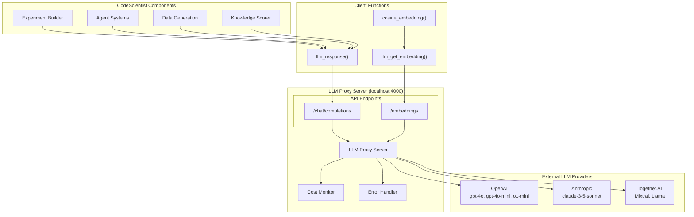
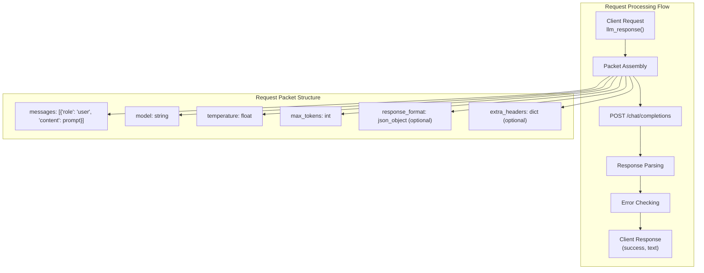
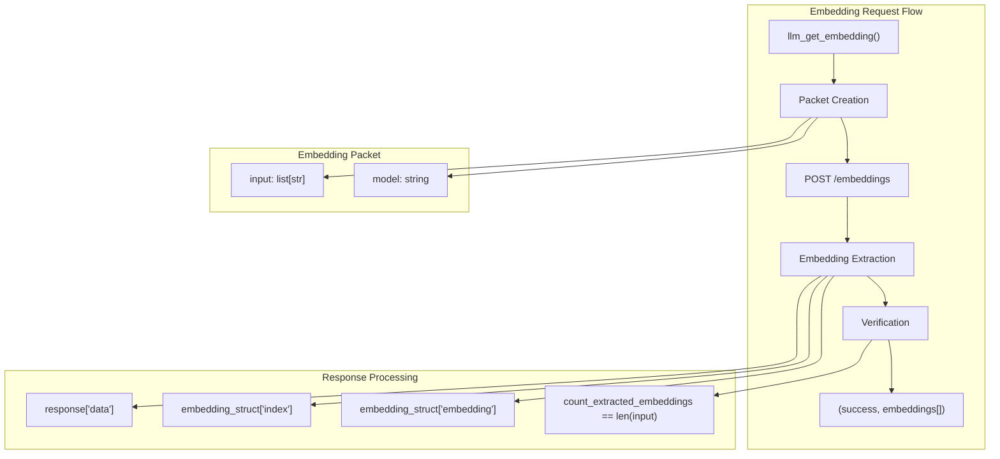
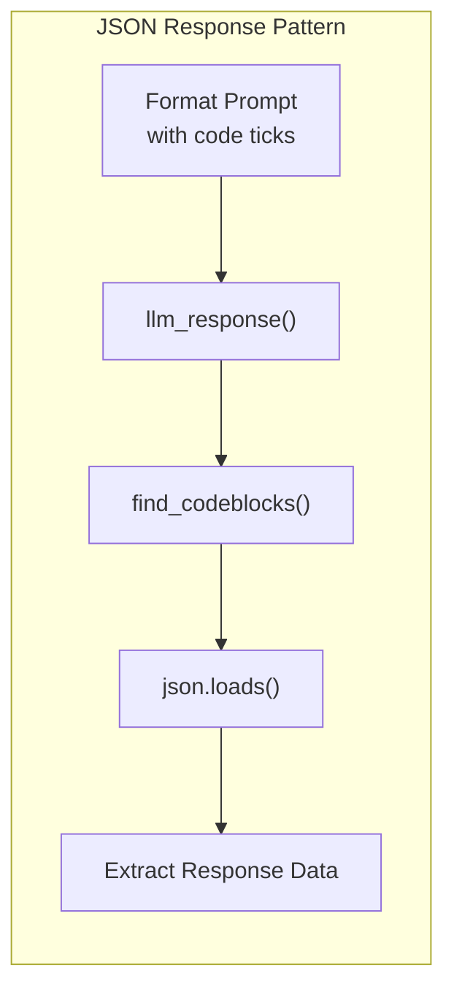

<!-- source: DeepWiki mcp.deepwiki.com · repo allenai/codescientist · page 6.1 LLM Proxy System · fetched 2026-10-26 -->

# LLM Proxy System

<details>
<summary>Relevant source files</summary>

The following files were used as context for generating this wiki page:

- [codeblocks/llm_proxy_usage.py](codeblocks/llm_proxy_usage.py)
- [codeblocks/llm_submit_proxy.py](codeblocks/llm_submit_proxy.py)

</details>


## Purpose and Scope

The LLM Proxy System provides centralized access to Large Language Model APIs with integrated cost monitoring and error handling. This system acts as a middleware layer between CodeScientist components and external LLM providers, ensuring controlled resource usage and consistent error management across all LLM interactions.

The proxy server runs locally on `localhost:4000` and routes requests to multiple LLM providers including OpenAI, Anthropic, and Together.AI. All LLM interactions within CodeScientist must go through this proxy to maintain cost controls and usage tracking.

For information about API key configuration and provider setup, see [API Configuration](#6.2). For broader LLM integration patterns, see [LLM Integration and Cost Control](#6).

## Architecture Overview

The LLM Proxy System operates as a standalone server that manages all external LLM API communications:



**Sources:** [codeblocks/llm_proxy_usage.py:48-50](), [codeblocks/llm_submit_proxy.py:12]()

## API Endpoints and Request Flow

The proxy exposes two primary endpoints that mirror standard LLM API patterns:

### Chat Completions Endpoint

The `/chat/completions` endpoint handles text generation requests with the following request structure:



**Sources:** [codeblocks/llm_proxy_usage.py:39-49](), [codeblocks/llm_submit_proxy.py:42]()

### Embeddings Endpoint

The `/embeddings` endpoint processes text embedding requests:



**Sources:** [codeblocks/llm_proxy_usage.py:87-95](), [codeblocks/llm_proxy_usage.py:119-141]()

## Cost Management and Error Handling

The proxy implements comprehensive cost monitoring and error management:

### Error Response Types

| Error Type | Description | Client Action |
|------------|-------------|---------------|
| `cost_limit_exceeded` | Total usage has exceeded configured limits | Stop making requests, exit |
| `too_many_errors` | Excessive API errors detected | Stop making requests, investigate |
| Generic errors | Other API or processing failures | Handle gracefully, may continue |

**Sources:** [codeblocks/llm_proxy_usage.py:54-63](), [codeblocks/llm_proxy_usage.py:100-109]()

### Model Cost Structure

The system tracks costs for both text generation and embeddings:

| Model | Prompt Cost (per 1M tokens) | Completion Cost (per 1M tokens) |
|-------|------------------------------|----------------------------------|
| `gpt-4o` | $2.50 | $10.00 |
| `gpt-4o-mini` | $0.15 | $0.60 |
| `o1-mini` | $3.00 | $12.00 |
| `claude-3-5-sonnet-20240620` | $3.00 | $15.00 |
| `together_ai/mistralai/Mixtral-8x7B-Instruct-v0.1` | $0.60 | $0.60 |

| Embedding Model | Cost (per 1M tokens) |
|-----------------|----------------------|
| `text-embedding-3-small` | $0.02 |
| `text-embedding-3-large` | $0.12 |

**Sources:** [codeblocks/llm_submit_proxy.py:14-33]()

## Core Client Functions

The proxy system provides three primary client functions accessible through the `experiment_common_library`:

### Text Generation Function

```python
def llm_response(prompt: str, model: str, temperature: float = 0, 
                max_tokens: int = 100, json_out: bool = False) -> tuple[bool, str]
```

This function returns a tuple where the first element indicates success status and the second contains either the response text or an error message.

**Sources:** [codeblocks/llm_proxy_usage.py:18](), [codeblocks/llm_submit_proxy.py:42]()

### Embedding Generation Function

```python
def llm_get_embedding(strings_to_embed: list[str], model: str) -> tuple[bool, list]
```

Returns embeddings for input strings, with success status and either embedding vectors or error messages.

**Sources:** [codeblocks/llm_proxy_usage.py:87](), [codeblocks/llm_submit_proxy.py:118]()

### Cosine Similarity Function

```python
def cosine_embedding(embedding1: list, embedding2: list) -> float
```

Calculates cosine similarity between two embedding vectors using dot product and magnitude calculations.

**Sources:** [codeblocks/llm_proxy_usage.py:152-174](), [codeblocks/llm_submit_proxy.py:139]()

## Usage Patterns and Best Practices

### JSON Response Parsing

The system supports structured JSON responses through format prompting rather than the `json_out` parameter:



**Sources:** [codeblocks/llm_submit_proxy.py:54-108]()

### Debug and Logging Features

The proxy system includes comprehensive logging capabilities:

- **Prompt Logging**: All prompts are saved to timestamped files in the `prompts/` directory
- **Response Logging**: LLM responses are saved alongside prompts for debugging
- **Error Tracking**: Detailed error information is captured and returned to clients

**Sources:** [codeblocks/llm_proxy_usage.py:22-29](), [codeblocks/llm_proxy_usage.py:71-74]()

### Embedding Processing Constraints

When working with embeddings, observe these limitations:
- Maximum string length: ~8000 characters
- Maximum batch size: ~100 strings per request
- Embedding extraction includes index verification to ensure complete responses

**Sources:** [codeblocks/llm_submit_proxy.py:112](), [codeblocks/llm_proxy_usage.py:139-141]()

---

