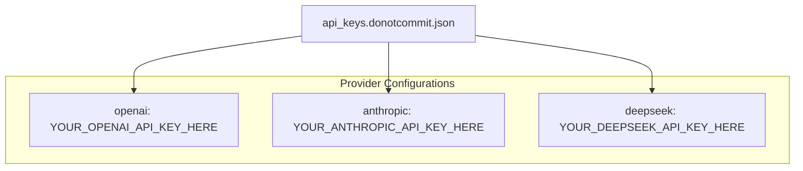
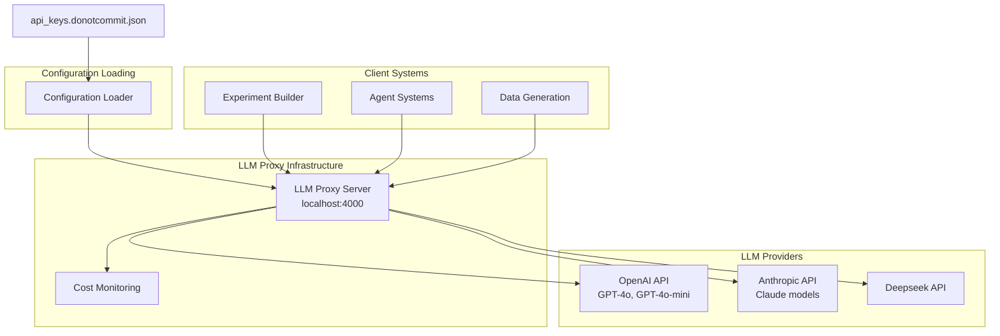

<!-- source: DeepWiki mcp.deepwiki.com · repo allenai/codescientist · page 6.2 API Configuration · fetched 2026-10-26 -->

# API Configuration

Relevant source files

The following files were used as context for generating this wiki page:

- [api_keys.donotcommit.json](api_keys.donotcommit.json)

## Purpose and Scope

This document covers the API key configuration and provider setup for Large Language Model (LLM) access in the CodeScientist system. It describes how API credentials are structured, stored, and used to authenticate with different LLM providers. For details about how these configurations are consumed by the LLM proxy server, see [LLM Proxy System](#6.1). For broader information about LLM integration architecture, see [LLM Integration and Cost Control](#6).

## API Keys Configuration File

The CodeScientist system uses a centralized configuration file to manage API credentials for multiple LLM providers. This configuration is stored in `api_keys.donotcommit.json` and follows a simple key-value structure where each key represents a provider identifier and the value contains the corresponding API key.

### Configuration Structure

The API keys configuration file uses the following structure:

| Provider Key | Purpose | Required |
|--------------|---------|----------|
| `openai` | OpenAI API access (GPT-4o, GPT-4o-mini models) | Yes |
| `anthropic` | Anthropic API access (Claude models) | Yes |
| `deepseek` | Deepseek API access | Yes |

**API Keys Configuration Structure**

Sources: [api_keys.donotcommit.json:1-5]()

## Provider Configuration Details

### OpenAI Configuration

The `openai` key configures access to OpenAI's API services. This enables the system to use models like GPT-4o and GPT-4o-mini for text generation and reasoning tasks.

### Anthropic Configuration

The `anthropic` key configures access to Anthropic's Claude models. This provides an alternative LLM provider for text generation and analysis tasks.

### Deepseek Configuration

The `deepseek` key configures access to Deepseek's API services, offering another LLM provider option for the system.

## Configuration Flow in System Architecture

The API configuration integrates with the broader LLM infrastructure through a well-defined flow from configuration to actual API usage.

**API Configuration Data Flow**

Sources: [api_keys.donotcommit.json:1-5]()

## Security Considerations

### File Naming Convention

The configuration file uses the `.donotcommit` naming convention to prevent accidental version control commits of sensitive API credentials. This naming pattern should be respected in deployment and development environments.

### Credential Management

API keys should be treated as sensitive credentials and managed according to security best practices:

- Store actual API keys in place of placeholder values
- Ensure file permissions restrict access to authorized users only
- Use environment-specific configuration files for different deployment stages
- Rotate API keys regularly according to provider recommendations

### Configuration Validation

The system expects all three provider keys to be present in the configuration file. Missing or invalid keys may result in LLM proxy server initialization failures or reduced functionality when specific providers are unavailable.

Sources: [api_keys.donotcommit.json:1-5]()

---

