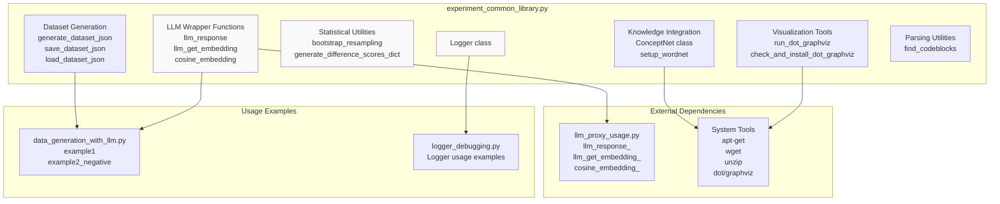
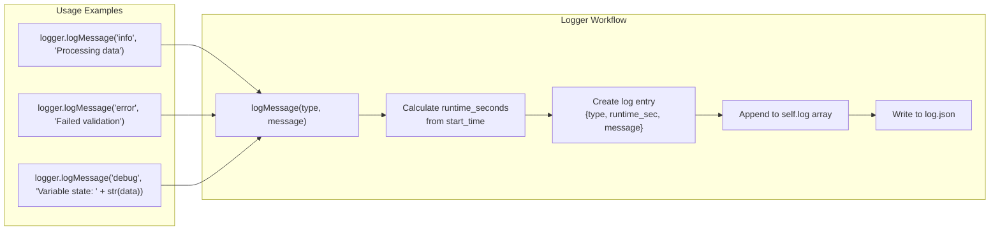
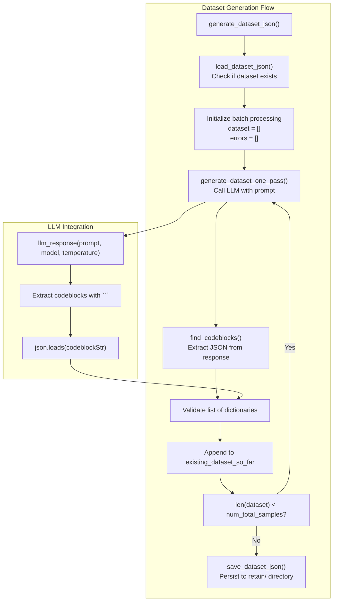
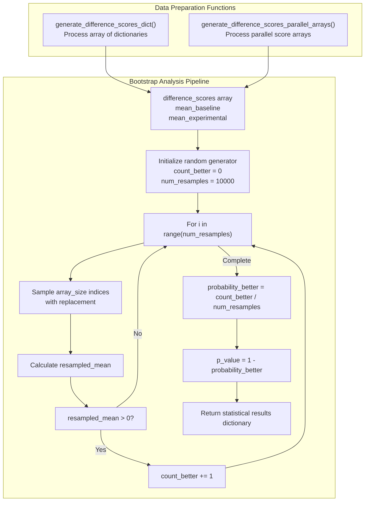
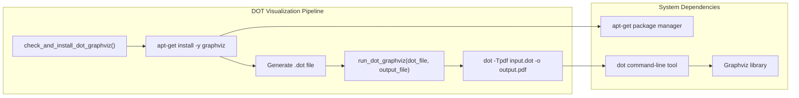
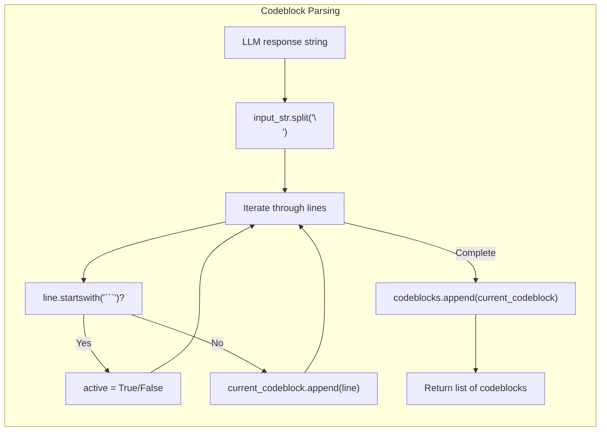

<!-- source: DeepWiki mcp.deepwiki.com · repo allenai/codescientist · page 7 Experiment Infrastructure · fetched 2026-10-26 -->

# Experiment Infrastructure

Relevant source files

The following files were used as context for generating this wiki page:

- [codeblocks/data_generation_with_llm.py](codeblocks/data_generation_with_llm.py)
- [codeblocks/experiment_common_library.py](codeblocks/experiment_common_library.py)
- [codeblocks/logger_debugging.py](codeblocks/logger_debugging.py)

This document covers the supporting infrastructure for running and analyzing experiments in CodeScientist. This includes logging systems, statistical analysis tools, data generation utilities, visualization capabilities, and common experiment libraries. For information about the core system architecture and experiment execution, see [Core System Architecture](#2). For details about LLM integration, see [LLM Integration and Cost Control](#6).

## Infrastructure Component Architecture

The experiment infrastructure is built around a centralized common library that provides essential utilities for all experiments. The core component is the `experiment_common_library.py` module which serves as the foundation for logging, LLM interaction, statistical analysis, and data management.

Sources: [codeblocks/experiment_common_library.py:1-581](), [codeblocks/data_generation_with_llm.py:1-89](), [codeblocks/logger_debugging.py:1-61]()

## Logging and Debugging System

The logging infrastructure centers around the `Logger` class which provides structured, timestamped logging with automatic file persistence. All experiments must use this logging system for proper debugging and monitoring.

### Logger Class Implementation

The `Logger` class implements a JSON-based logging system that captures runtime information, error messages, and debug data:

| Component | Description | File Location |
|-----------|-------------|---------------|
| `Logger` class | Core logging functionality with timestamp tracking | [codeblocks/experiment_common_library.py:18-39]() |
| `logMessage` method | Primary logging interface with message type categorization | [codeblocks/experiment_common_library.py:30-38]() |
| Log file | JSON output file at fixed path `log.json` | [codeblocks/experiment_common_library.py:20]() |

### Message Types and Usage

The logging system supports categorized message types for efficient filtering and debugging:

- **info**: General information about code execution and processing status
- **warning**: Non-fatal issues that might indicate potential problems  
- **error**: Fatal errors that prevent code continuation
- **debug**: Detailed information for troubleshooting specific issues

Sources: [codeblocks/experiment_common_library.py:18-39](), [codeblocks/logger_debugging.py:8-61]()

## Data Generation Infrastructure

The data generation system enables LLM-driven dataset creation with automatic validation, error handling, and batch processing. This infrastructure supports consistent dataset generation across experiments while maintaining data quality.

### Dataset Generation Pipeline

The core dataset generation process uses the `generate_dataset_json` function which orchestrates batch-based LLM calls with error recovery:

Sources: [codeblocks/experiment_common_library.py:401-546](), [codeblocks/data_generation_with_llm.py:14-47]()

### Dataset Persistence and Retrieval

The system provides functions for consistent dataset storage and retrieval:

| Function | Purpose | Storage Location |
|----------|---------|------------------|
| `save_dataset_json` | Persist dataset to JSON file | `retain/{dataset_name}.json` |
| `load_dataset_json` | Load existing dataset or return None | `retain/{dataset_name}.json` |
| `generate_dataset_json` | Complete generation pipeline with batching | Calls both save and load functions |

Sources: [codeblocks/experiment_common_library.py:549-581]()

## Statistical Analysis Tools

The statistical analysis infrastructure provides non-parametric bootstrap resampling for comparing model performance, along with utilities for preparing difference scores from experimental data.

### Bootstrap Resampling Implementation

The `bootstrap_resampling` function implements statistical significance testing using resampling methodology:

Sources: [codeblocks/experiment_common_library.py:287-394]()

### Statistical Output Format

The bootstrap analysis returns a structured dictionary containing:

| Field | Description | Data Type |
|-------|-------------|-----------|
| `mean_baseline` | Average performance of baseline model | float |
| `mean_experimental` | Average performance of experimental model | float |
| `p_value` | Statistical significance (1 - probability_better) | float |
| `dataset_size` | Number of data points in analysis | int |
| `num_resamples` | Number of bootstrap iterations performed | int |

Sources: [codeblocks/experiment_common_library.py:321-328]()

## Visualization Infrastructure

The visualization system provides tools for creating graphs and plots using both Graphviz DOT format and matplotlib integration. The infrastructure handles automatic installation of dependencies and file format conversion.

### Graphviz DOT Integration

The DOT graph visualization system provides functions for creating and rendering network diagrams:

Sources: [codeblocks/experiment_common_library.py:238-280]()

## Knowledge Base Integration

The infrastructure provides integrated access to external knowledge bases including ConceptNet and WordNet for semantic analysis and concept relationships.

### ConceptNet Knowledge Base

The `ConceptNet` class provides preprocessed access to the ConceptNet semantic network:

| Method | Purpose | Return Type |
|--------|---------|-------------|
| `download_and_load_conceptnet` | Download and parse knowledge base | None |
| `find_nodes` | Search nodes by prefix with strict/loose matching | list[str] |
| `get_node_edges` | Retrieve edges for a node with optional filtering | list[list] |
| `get_all_relations` | List all relation types in the graph | list[str] |

### WordNet Integration

WordNet access is provided through NLTK with automatic setup and download:

```mermaid
graph TB
    subgraph "Knowledge Base Setup"
        SetupWordNet["setup_wordnet()"]
        CheckNLTK["nltk.data.find('corpora/wordnet.zip')"]
        DownloadWN["nltk.download('wordnet')<br/>nltk.download('omw-1.4')"]
    end
    
    subgraph "ConceptNet Setup" 
        InitCN["ConceptNet.__init__()"]
        DownloadCN["wget conceptnet-assertions-5.7.0.reduced.lookup.zip"]
        UnzipCN["unzip -o conceptnet file"]
        LoadJSON["json.load(knowledgebase_file)"]
        BuildIndices["Create nodeNames and relations sets"]
    end
    
    SetupWordNet --> CheckNLTK
    CheckNLTK -->|Missing| DownloadWN
    
    InitCN --> DownloadCN
    DownloadCN --> UnzipCN
    UnzipCN --> LoadJSON
    LoadJSON --> BuildIndices
```

Sources: [codeblocks/experiment_common_library.py:106-230]()

## LLM Integration Utilities

The infrastructure provides wrapper functions for LLM access through the proxy system, with parsing utilities for structured responses.

### LLM Wrapper Functions

| Function | Purpose | Parameters |
|----------|---------|------------|
| `llm_response` | Text generation wrapper | prompt, model, temperature, max_tokens, json_out |
| `llm_get_embedding` | Embedding generation wrapper | strings_to_embed, model |
| `cosine_embedding` | Similarity calculation | embedding1, embedding2 |
| `find_codeblocks` | Extract code blocks from LLM responses | input_str |

### Response Parsing Pipeline

The `find_codeblocks` function extracts structured data from LLM responses by identifying markdown code blocks:

Sources: [codeblocks/experiment_common_library.py:45-98]()

---

