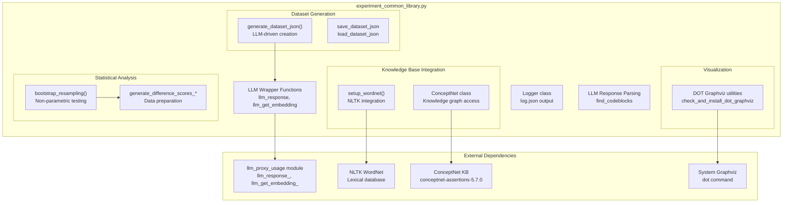
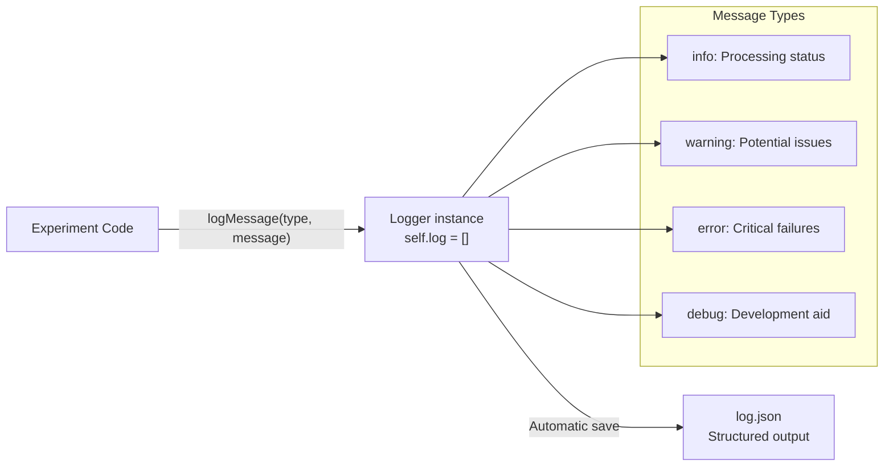
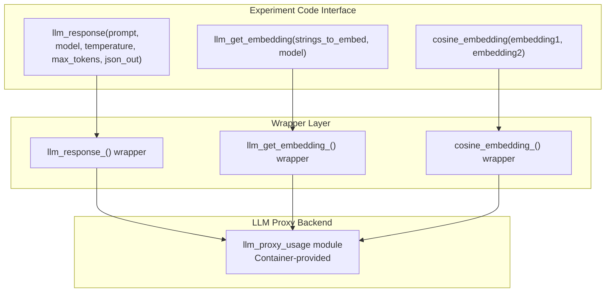
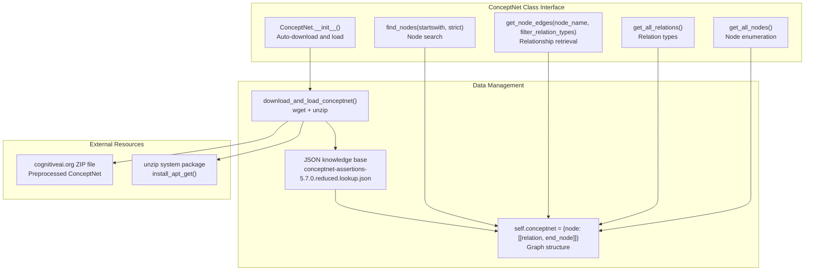
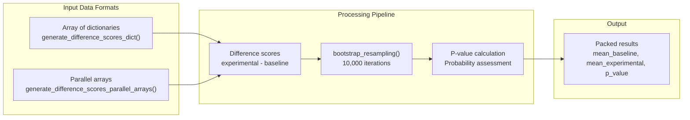
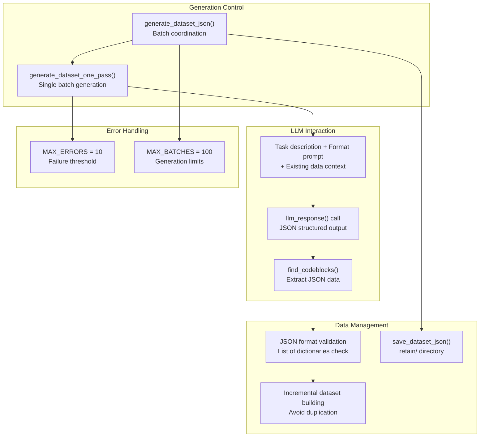
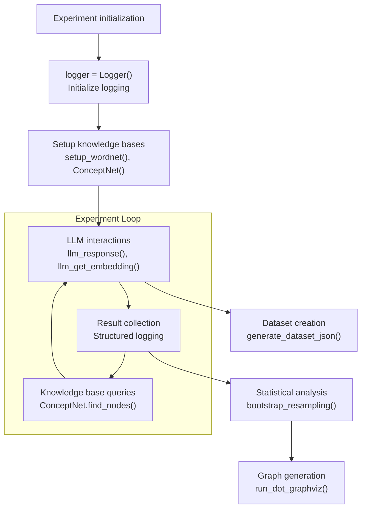

<!-- source: DeepWiki mcp.deepwiki.com · repo allenai/codescientist · page 7.1 Common Experiment Library · fetched 2026-10-26 -->

# Common Experiment Library

Relevant source files

The following files were used as context for generating this wiki page:

- [codeblocks/experiment_common_library.py](codeblocks/experiment_common_library.py)

The Common Experiment Library provides shared utilities and infrastructure components used across all experiments in the CodeScientist system. This library serves as the foundation layer that experiment code imports to access logging, LLM integration, knowledge bases, statistical analysis, and dataset generation capabilities.

For LLM proxy configuration and cost management details, see [LLM Integration and Cost Control](#6). For specific knowledge base implementations, see [Knowledge Systems](#5). For detailed logging system documentation, see [Logging and Debugging](#7.2).

## Library Architecture Overview

The experiment common library is organized into several core functional areas that work together to support scientific discovery experiments.

Sources: [codeblocks/experiment_common_library.py:1-581]()

## Core Logging Infrastructure

The `Logger` class provides centralized logging functionality that all experiments must use. It maintains a structured log with timestamps and message types.

The logger automatically calculates runtime timestamps relative to program start and saves the log after each message to ensure data persistence even if experiments crash.

Sources: [codeblocks/experiment_common_library.py:18-38]()

## LLM Integration Layer

The library provides wrapper functions that interface with the LLM proxy system, abstracting away the underlying proxy communication while maintaining the same API surface.

The `find_codeblocks()` function extracts structured data from LLM responses by parsing markdown code blocks, which is essential for getting structured outputs from language models.

Sources: [codeblocks/experiment_common_library.py:45-98]()

## Knowledge Base Integration

The library provides access to two major knowledge bases: WordNet through NLTK and a preprocessed version of ConceptNet.

### ConceptNet Integration Architecture

The ConceptNet integration uses a specially preprocessed English-only version that simplifies node names (e.g., "cat" instead of "/c/en/cat") and provides efficient lookup capabilities.

Sources: [codeblocks/experiment_common_library.py:122-230]()

## Statistical Analysis Infrastructure

The library implements bootstrap resampling for non-parametric statistical testing, commonly used to compare model performance.

The bootstrap resampling procedure generates resampled datasets through random sampling with replacement and calculates the probability that the experimental model performs better than the baseline.

Sources: [codeblocks/experiment_common_library.py:287-393]()

## Dataset Generation System

The library provides LLM-driven dataset generation capabilities that create structured datasets according to specified formats and requirements.

The system generates datasets in configurable batch sizes (typically ≤10 samples per batch to maintain quality) and automatically saves completed datasets to the `retain/` directory.

Sources: [codeblocks/experiment_common_library.py:401-581]()

## Visualization Support

The library provides Graphviz integration for creating graph visualizations, with automatic installation of required system dependencies.

| Function | Purpose | Dependencies |
|----------|---------|-------------|
| `check_and_install_dot_graphviz()` | Verify and install Graphviz | `apt-get install graphviz` |
| `run_dot_graphviz(dot_file, image_filename_out)` | Generate PDF from DOT | System `dot` command |

The visualization system automatically handles system package installation and supports PDF output generation from DOT graph specifications.

Sources: [codeblocks/experiment_common_library.py:238-280]()

## Usage Integration Patterns

Experiments typically follow this integration pattern with the common library:

This common library serves as the foundational layer that enables consistent experiment infrastructure across all CodeScientist research activities.

Sources: [codeblocks/experiment_common_library.py:1-581]()

---

