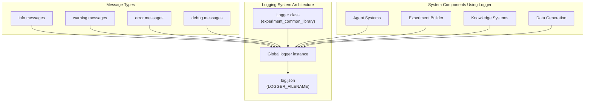
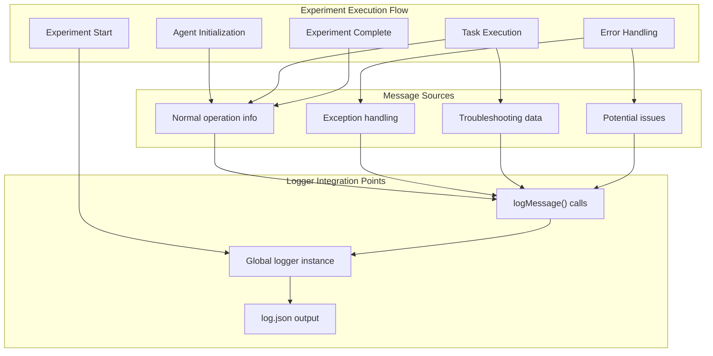

<!-- source: DeepWiki mcp.deepwiki.com · repo allenai/codescientist · page 7.2 Logging and Debugging · fetched 2026-10-26 -->

# Logging and Debugging

<details>
<summary>Relevant source files</summary>

The following files were used as context for generating this wiki page:

- [codeblocks/logger_debugging.py](codeblocks/logger_debugging.py)

</details>


This document covers the logging and debugging infrastructure used throughout the CodeScientist system. The logging system provides centralized message recording for experiments, agent operations, and system debugging, while debugging utilities help developers troubleshoot issues during experiment execution.

For information about the broader experiment infrastructure, see [Experiment Infrastructure](#7). For details about the common experiment library that provides the logging foundation, see [Common Experiment Library](#7.1).

## Logger System Overview

The CodeScientist logging system is built around a centralized `Logger` class from the `experiment_common_library`. This logger is designed to be used as a global singleton throughout experiment execution to capture messages, errors, and debugging information in a structured format.

### Core Logger Architecture



Sources: [codeblocks/logger_debugging.py:1-61]()

## Logger Implementation Details

### Basic Logger Usage

The logger follows a simple pattern of importing, instantiating globally, and using throughout the codebase:

| Component | Description | Code Reference |
|-----------|-------------|----------------|
| Import | `from experiment_common_library import Logger` | [codeblocks/logger_debugging.py:8]() |
| Global Instance | `logger = Logger()` | [codeblocks/logger_debugging.py:11]() |
| Message Logging | `logger.logMessage(level, message)` | [codeblocks/logger_debugging.py:16-19]() |
| File Output | `logger.LOGGER_FILENAME` | [codeblocks/logger_debugging.py:60]() |

### Message Levels and Methods

The logger supports four standard message levels:

- **info**: Informational messages for tracking normal operation
- **warning**: Warning messages for potential issues
- **error**: Error messages for caught exceptions and failures  
- **debug**: Debug messages for detailed troubleshooting

All messages are logged using the `logMessage(level, message)` method pattern.

Sources: [codeblocks/logger_debugging.py:16-19](), [codeblocks/logger_debugging.py:54-57]()

## Integration with Experiment Infrastructure

### Logger Data Flow



Sources: [codeblocks/logger_debugging.py:36-46](), [codeblocks/logger_debugging.py:25-48]()

## Usage Patterns and Best Practices

### Global Logger Pattern

The codeblock template emphasizes creating a single global logger instance to prevent log file overwrites and ensure consistent logging across the experiment:

```
# THIS SHOULD ALMOST ALWAYS BE GLOBAL, SO IT CAN BE USED THROUGHOUT YOUR CODE.  
# ALSO, IF MULTIPLE INSTANCES ARE CREATED, THE LOG FILE WILL BE OVERWRITTEN, LOSING INFORMATION.
```

### Error Handling with Logging

The recommended pattern for error handling includes informative logging that aids in debugging:

| Pattern | Purpose | Example Usage |
|---------|---------|---------------|
| Try-Catch with Logging | Capture and log exceptions with context | [codeblocks/logger_debugging.py:38-43]() |
| Informative Error Messages | Include variable values and types | [codeblocks/logger_debugging.py:43]() |
| Operation Boundaries | Log start and end of operations | [codeblocks/logger_debugging.py:36](), [codeblocks/logger_debugging.py:45]() |

### Structured Information Logging

The logger supports detailed error information including:
- Variable names and values
- Data types causing issues
- Context about the operation being performed
- Clear identification of the failure point

Sources: [codeblocks/logger_debugging.py:10-11](), [codeblocks/logger_debugging.py:38-48]()

## Debugging Utilities

### Example Debugging Scenarios

The logger codeblock provides two example debugging scenarios:

1. **Basic Message Logging** (`example1`): Demonstrates logging different message types for normal operation tracking
2. **Exception Handling** (`example2`): Shows proper error catching and logging with informative messages for type mismatches

### File Output and Access

The logger writes to a file accessible via the `LOGGER_FILENAME` attribute, allowing developers to:
- Review execution logs after experiment completion
- Debug issues by examining the sequence of logged events
- Trace errors back to their source with detailed context information

Sources: [codeblocks/logger_debugging.py:14-22](), [codeblocks/logger_debugging.py:25-48](), [codeblocks/logger_debugging.py:60]()

---

