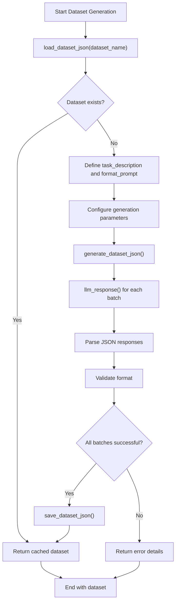
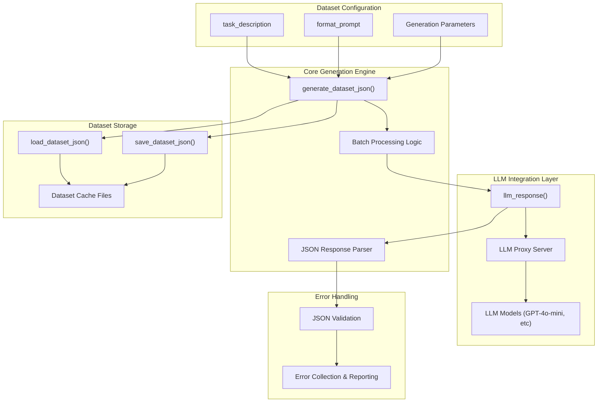
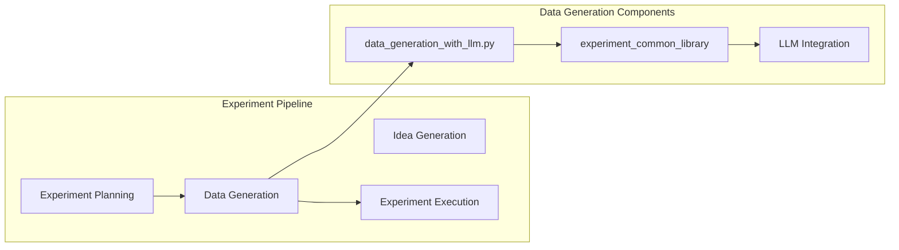

<!-- source: DeepWiki mcp.deepwiki.com · repo allenai/codescientist · page 7.3 Data Generation · fetched 2026-10-26 -->

# Data Generation

<details>
<summary>Relevant source files</summary>

The following files were used as context for generating this wiki page:

- [codeblocks/data_generation_with_llm.py](codeblocks/data_generation_with_llm.py)

</details>


## Purpose and Scope

This document covers the LLM-driven dataset generation capabilities within CodeScientist. The data generation system enables automated creation of structured datasets using large language models for scientific experiments and agent training. For information about LLM integration and proxy configuration, see [LLM Integration and Cost Control](#6). For details about the common experiment library that provides the underlying functions, see [Common Experiment Library](#7.1).

## System Overview

The data generation system provides a standardized approach to creating datasets using large language models. It implements caching mechanisms to ensure dataset consistency across experiments, batch processing for efficiency, and error handling for robust dataset creation.

### Core Data Generation Workflow



Sources: [codeblocks/data_generation_with_llm.py:1-89]()

## Core Functions and API

### Dataset Management Functions

The data generation system provides three primary functions for dataset management:

| Function | Purpose | Return Type |
|----------|---------|-------------|
| `load_dataset_json(name)` | Load existing dataset by name | `dict` or `None` |
| `save_dataset_json(name, dataset)` | Save dataset with given name | `bool` |
| `generate_dataset_json(...)` | Generate new dataset using LLM | `dict` with success status |

### Dataset Generation Parameters

The `generate_dataset_json()` function accepts the following parameters:

| Parameter | Type | Description |
|-----------|------|-------------|
| `dataset_name` | `str` | Unique identifier for caching |
| `task_description` | `str` | Natural language task specification |
| `format_prompt` | `str` | JSON schema and formatting instructions |
| `model` | `str` | LLM model identifier (e.g., "gpt-4o-mini") |
| `num_total_samples` | `int` | Total number of samples to generate |
| `num_to_generate_per_batch` | `int` | Batch size for generation |
| `temperature` | `float` | LLM temperature parameter |
| `max_tokens` | `int` | Maximum tokens per LLM response |

Sources: [codeblocks/data_generation_with_llm.py:35](), [codeblocks/data_generation_with_llm.py:70]()

### Data Generation Architecture



Sources: [codeblocks/data_generation_with_llm.py:10](), [codeblocks/data_generation_with_llm.py:35]()

## Implementation Examples

### Science Questions Dataset Generation

The system includes a complete example for generating multiple-choice science questions:

```python
# Example configuration from the codebase
dataset_name = "science-questions-1"
task_description = "Please generate multiple choice 4-choice questions about any topic covered in 4th grade science in the United States. For this condition, the distractors (i.e. incorrect answers) should all have the following property: one should be obviously incorrect, the remaining two distractors should contain words that are highly associated with the correct answer."

format_prompt = "Each dictionary should have the following keys:\n"
format_prompt += " 1. 'question': The question text.\n"
format_prompt += " 2. 'choices': A dictionary of answer choices (keys = A, B, C, D, values = the answer choice)\n"
format_prompt += " 3. 'correct': The correct answer choice (A, B, C, or D).\n"
format_prompt += " 4. 'explanation': An explanation of the correct answer.\n"
```

### Dataset Caching Strategy

The system implements a mandatory caching strategy to ensure dataset consistency:

1. **Check for existing dataset**: `load_dataset_json(dataset_name)` returns `None` if not found
2. **Generate only if needed**: Dataset generation occurs only when cache miss
3. **Automatic versioning**: Change dataset name (e.g., "science-questions-2") to force regeneration
4. **Persistent storage**: Successfully generated datasets are automatically saved

Sources: [codeblocks/data_generation_with_llm.py:17-21](), [codeblocks/data_generation_with_llm.py:54-58]()

## Best Practices and Guidelines

### Appropriate Use Cases

The data generation system is designed for tasks where:
- Creativity and linguistic variation are beneficial
- Manual dataset creation would be time-intensive
- The task requires domain knowledge that LLMs possess
- JSON-structured output is desired

### Inappropriate Use Cases

The system includes a negative example demonstrating when not to use LLM generation:

```python
# Example of inappropriate use: 10-digit multiplication problems
# LLMs are generally bad at arithmetic, and a simple Python script 
# could generate this more accurately
```

This highlights that LLM-based generation should be avoided for:
- Mathematical calculations requiring precision
- Tasks where deterministic algorithms are more reliable
- Simple pattern-based data that doesn't require linguistic creativity

Sources: [codeblocks/data_generation_with_llm.py:49-82]()

## Integration with Experiment Infrastructure

### Connection to Common Library

The data generation system integrates with the broader experiment infrastructure through the `experiment_common_library`:

| Import | Purpose |
|--------|---------|
| `llm_response` | Core LLM interaction function |
| `find_codeblocks` | Code template discovery |
| `load_dataset_json` | Dataset loading utility |
| `save_dataset_json` | Dataset persistence utility |
| `generate_dataset_json` | Main generation orchestrator |

### Experiment Workflow Integration



Sources: [codeblocks/data_generation_with_llm.py:10]()

## Error Handling and Validation

The system provides comprehensive error handling through the `generate_dataset_json()` return structure:

```python
# Return format for dataset generation
{
    "success": bool,      # Generation success status
    "dataset": dict,      # Generated dataset (if successful)
    "errors": list        # List of error messages (if unsuccessful)
}
```

This enables experiments to gracefully handle generation failures and provide meaningful feedback for debugging dataset creation issues.

Sources: [codeblocks/data_generation_with_llm.py:37-42](), [codeblocks/data_generation_with_llm.py:72-77]()

---

