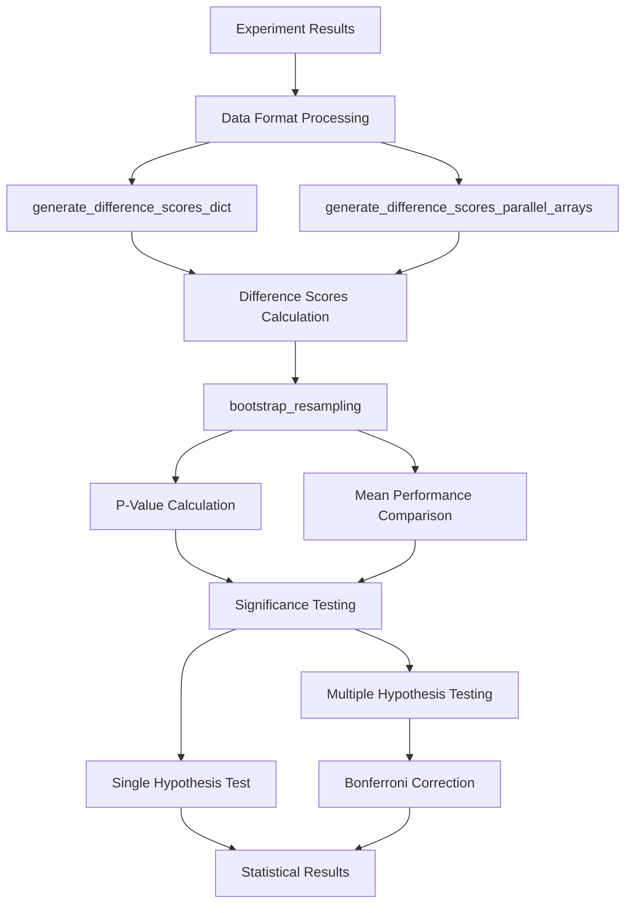
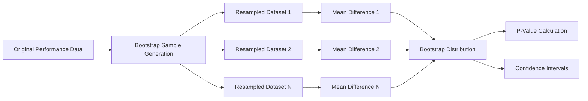
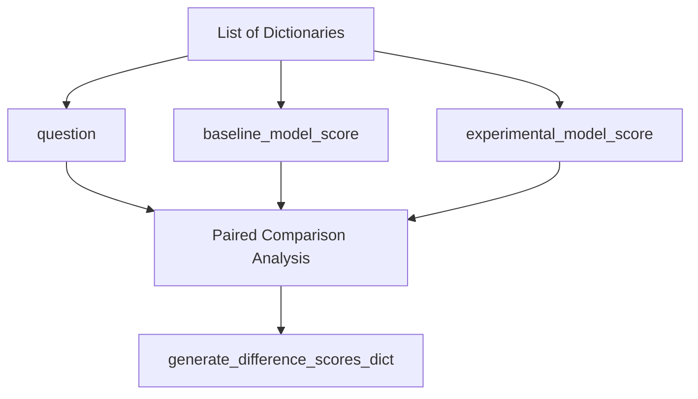
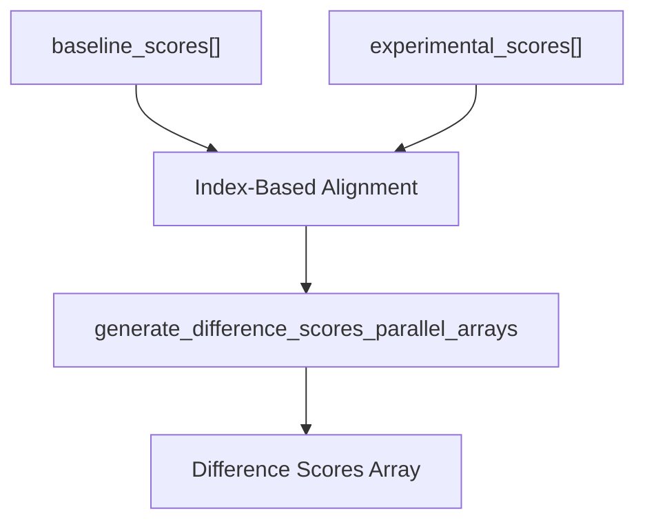
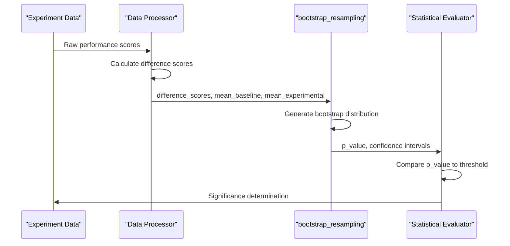
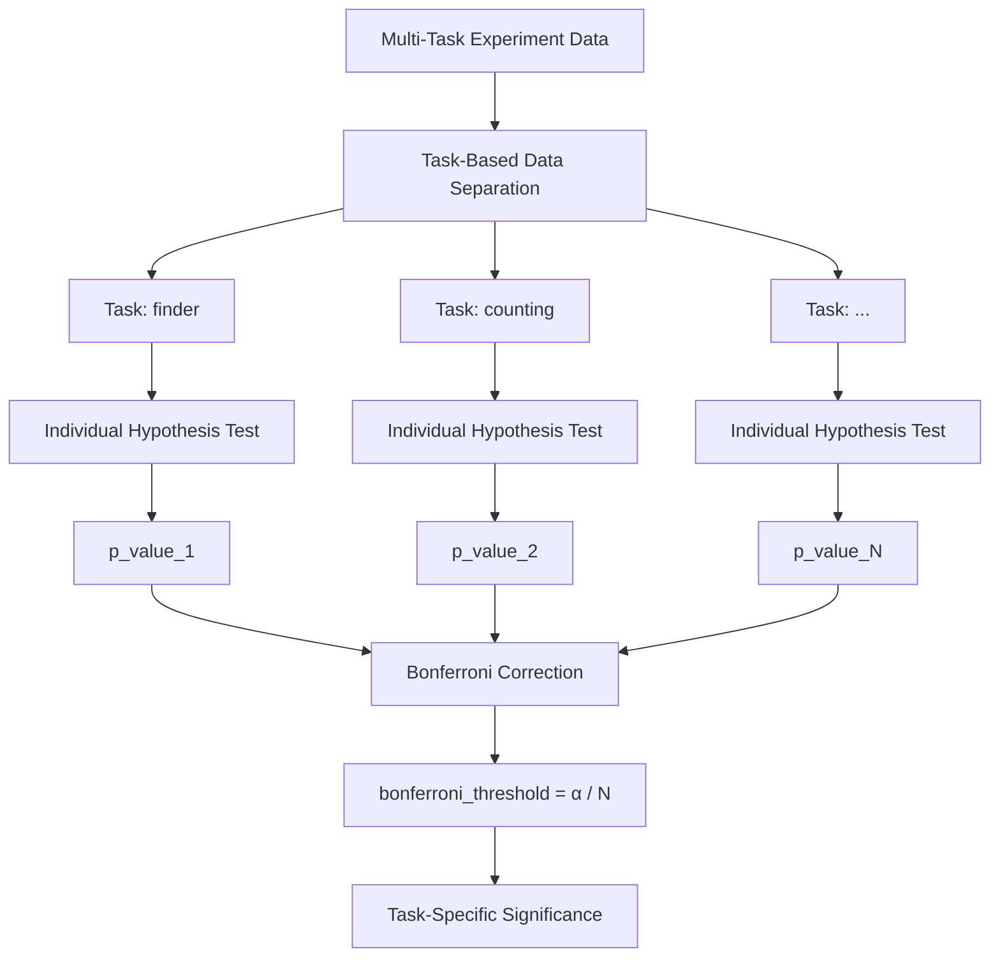
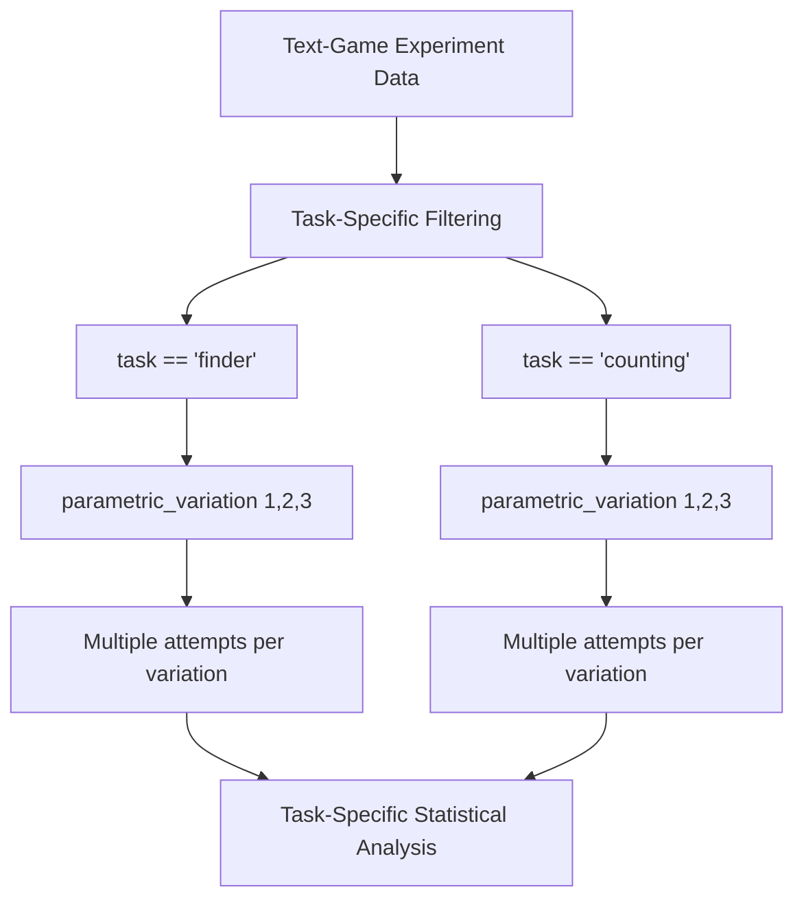
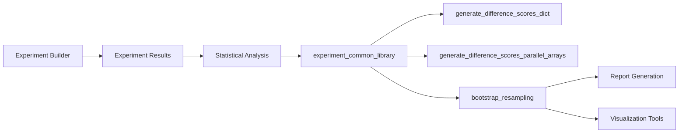

<!-- source: DeepWiki mcp.deepwiki.com · repo allenai/codescientist · page 7.4 Statistical Analysis · fetched 2026-10-26 -->

# Statistical Analysis

<details>
<summary>Relevant source files</summary>

The following files were used as context for generating this wiki page:

- [codeblocks/stats_nonparametric_bootstrap_resampling.py](codeblocks/stats_nonparametric_bootstrap_resampling.py)

</details>


## Purpose and Scope

This document covers the statistical testing and analysis tools used within the CodeScientist experiment infrastructure. The statistical analysis system provides non-parametric bootstrap resampling capabilities for comparing agent performance across different experimental conditions. This system is primarily used to determine whether experimental agents significantly outperform baseline agents in various scientific discovery tasks.

For information about the broader experiment infrastructure, see [Experiment Infrastructure](#7). For logging and debugging capabilities, see [Logging and Debugging](#7.2). For visualization of statistical results, see [Visualization Tools](#7.5).

## Statistical Analysis Architecture

The statistical analysis system is built around bootstrap resampling methodology and integrates with the experiment evaluation pipeline to provide rigorous statistical testing of agent performance differences.



**Core Statistical Analysis Flow**

Sources: [codeblocks/stats_nonparametric_bootstrap_resampling.py:14-15]()

## Bootstrap Resampling Implementation

The system implements non-parametric bootstrap resampling through the `experiment_common_library` module. Bootstrap resampling enables hypothesis testing without making distributional assumptions about the underlying data.



**Bootstrap Resampling Process**

The `bootstrap_resampling` function generates a distribution of mean differences through repeated resampling, enabling statistical inference about performance differences between baseline and experimental conditions.

Sources: [codeblocks/stats_nonparametric_bootstrap_resampling.py:42-43](), [codeblocks/stats_nonparametric_bootstrap_resampling.py:73-74]()

## Data Format Support

The statistical analysis system supports multiple data formats to accommodate different experimental designs and data collection patterns.

### Dictionary-Based Format



**Dictionary Data Format Processing**

| Field | Purpose | Example |
|-------|---------|---------|
| `question` | Unique identifier for test instance | "What is the capital of France?" |
| `baseline_model_score` | Performance score for baseline agent | 0.8 |
| `experimental_model_score` | Performance score for experimental agent | 0.9 |

Sources: [codeblocks/stats_nonparametric_bootstrap_resampling.py:25-37](), [codeblocks/stats_nonparametric_bootstrap_resampling.py:40]()

### Parallel Arrays Format



**Parallel Arrays Data Format Processing**

The parallel arrays format stores baseline and experimental scores in separate arrays, with corresponding indices representing the same evaluation instance.

Sources: [codeblocks/stats_nonparametric_bootstrap_resampling.py:67-68](), [codeblocks/stats_nonparametric_bootstrap_resampling.py:71]()

## Hypothesis Testing Workflow

The statistical analysis system implements a standardized workflow for hypothesis testing that integrates with the experiment evaluation pipeline.



**Statistical Testing Sequence**

### Hypothesis Test Results Structure

The `bootstrap_resampling` function returns a structured results dictionary containing:

| Field | Description |
|-------|-------------|
| `p_value` | Probability of observing the difference by chance |
| `mean_baseline` | Mean performance of baseline condition |
| `mean_experimental` | Mean performance of experimental condition |
| `confidence_intervals` | Bootstrap confidence intervals |

Sources: [codeblocks/stats_nonparametric_bootstrap_resampling.py:49-55](), [codeblocks/stats_nonparametric_bootstrap_resampling.py:80-86]()

## Multiple Hypothesis Testing

The system supports multiple hypothesis testing scenarios, particularly relevant for evaluating agent performance across different tasks or parametric variations.



**Multiple Hypothesis Testing with Bonferroni Correction**

### Bonferroni Correction Implementation

The system applies Bonferroni correction to control family-wise error rate when testing multiple hypotheses simultaneously:

```
bonferroni_threshold = maximum_p_value_threshold / number_of_tasks
```

This ensures that the overall Type I error rate remains at the desired significance level across all tested conditions.

Sources: [codeblocks/stats_nonparametric_bootstrap_resampling.py:145-173](), [codeblocks/stats_nonparametric_bootstrap_resampling.py:148-149]()

## Text-Game Task Analysis

The statistical system provides specialized support for analyzing performance in text-based game environments, where agents are evaluated across multiple parametric variations and repeated attempts.

### Text-Game Data Structure

| Field | Purpose |
|-------|---------|
| `task` | Game environment identifier (e.g., "finder", "counting") |
| `parametric_variation` | Environment configuration variant |
| `attempt` | Repeated run number for stochastic evaluation |
| `baseline_score` | Baseline agent performance |
| `experimental_score` | Experimental agent performance |



**Text-Game Statistical Analysis Structure**

Sources: [codeblocks/stats_nonparametric_bootstrap_resampling.py:95-114](), [codeblocks/stats_nonparametric_bootstrap_resampling.py:152-157]()

## Integration with Experiment Pipeline

The statistical analysis system integrates with the broader CodeScientist experiment infrastructure through the `experiment_common_library` module, providing standardized statistical evaluation capabilities for all experiment types.



**Statistical Analysis Integration Architecture**

The statistical analysis functions are designed as reusable components that can be integrated into various experiment evaluation workflows throughout the CodeScientist system.

Sources: [codeblocks/stats_nonparametric_bootstrap_resampling.py:14-15]()

---

