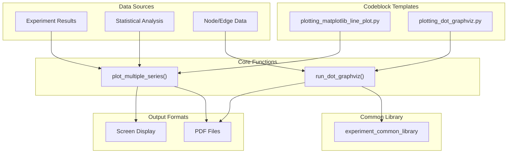
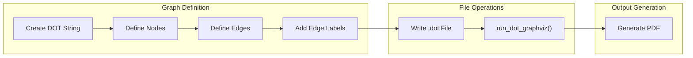

<!-- source: DeepWiki mcp.deepwiki.com · repo allenai/codescientist · page 7.5 Visualization Tools · fetched 2026-10-26 -->

# Visualization Tools

<details>
<summary>Relevant source files</summary>

The following files were used as context for generating this wiki page:

- [codeblocks/plotting_dot_graphviz.py](codeblocks/plotting_dot_graphviz.py)
- [codeblocks/plotting_matplotlib_line_plot.py](codeblocks/plotting_matplotlib_line_plot.py)

</details>


This document covers the visualization capabilities within the CodeScientist system, specifically the tools for generating line plots and graph diagrams. These visualization tools are primarily used for presenting experimental results, statistical analyses, and graphical representations of data structures or relationships discovered during scientific experiments.

The visualization system provides two main types of output: statistical line plots using matplotlib and graph diagrams using DOT/Graphviz. For information about the statistical analysis that feeds into these visualizations, see [Statistical Analysis](#7.4). For the broader reporting infrastructure that incorporates these visualizations, see [Experiment Infrastructure](#7).

## Core Visualization Architecture

The visualization system consists of reusable codeblock templates that can be incorporated into generated experiments, along with supporting utilities in the common experiment library.



Sources: [codeblocks/plotting_matplotlib_line_plot.py:1-116](), [codeblocks/plotting_dot_graphviz.py:1-45]()

## Matplotlib Line Plot System

The matplotlib-based visualization system provides comprehensive line plotting capabilities for displaying experimental data and statistical results.

### Plot Function Interface

The primary plotting function `plot_multiple_series` accepts structured data and produces publication-ready line plots:

| Parameter | Type | Description |
|-----------|------|-------------|
| `series_list` | List of lists of dictionaries | Multiple data series to plot |
| `x_key` | String | Dictionary key for x-axis values (default: 'x') |
| `y_key` | String | Dictionary key for y-axis values (default: 'y') |
| `labels` | List of strings | Series labels for legend |
| `title` | String | Plot title |
| `xlabel` | String | X-axis label |
| `ylabel` | String | Y-axis label |
| `filename` | String | Output PDF filename (optional) |

### Configuration and Backend

The matplotlib system uses the Agg backend for headless server environments, which is critical for containerized execution:

```python
matplotlib.use("Agg")  # Required for headless environments
```

This configuration prevents the system from freezing in containerized environments where display servers are not available.

Sources: [codeblocks/plotting_matplotlib_line_plot.py:9-13](), [codeblocks/plotting_matplotlib_line_plot.py:15-61]()

## DOT/Graphviz Graph Generation

The Graphviz system enables creation of structured diagrams representing relationships, workflows, or data structures discovered during experiments.

### Graph Creation Workflow



### DOT Format Structure

The system supports standard DOT format for directed graphs:

- Basic edges: `A -> B;`
- Labeled edges: `A -> B [label="Edge Description"];`
- Graph declaration: `digraph G { ... }`

### Integration with Common Library

The `run_dot_graphviz` function from the experiment common library handles the conversion from DOT files to PDF output, abstracting the underlying Graphviz command-line tools.

Sources: [codeblocks/plotting_dot_graphviz.py:8-24](), [codeblocks/plotting_dot_graphviz.py:26-40]()

## Data Format Requirements

Both visualization systems expect structured input data formats that align with experimental output patterns.

### Matplotlib Data Format

Data must be provided as lists of dictionaries with consistent key structures:

```python
series_data = [
    {'time': 0, 'value': 1.0},
    {'time': 1, 'value': 2.5},
    {'time': 2, 'value': 1.8}
]
```

### Graphviz Data Format

Graph data is constructed programmatically as DOT language strings:

```python
dot_content = "digraph G {\n"
dot_content += "    NodeA -> NodeB [label=\"relationship\"];\n"
dot_content += "}\n"
```

Sources: [codeblocks/plotting_matplotlib_line_plot.py:66-68](), [codeblocks/plotting_dot_graphviz.py:13-17]()

## Output Management

Both visualization systems support PDF output for consistent formatting across different execution environments. The matplotlib system additionally supports direct display for interactive development scenarios.

### File Naming and Organization

- Matplotlib outputs: User-specified `.pdf` filenames
- Graphviz outputs: Corresponding `.pdf` files generated from `.dot` sources
- All outputs are saved to the current working directory during execution

### Headless Execution Compatibility

The visualization tools are designed for execution in containerized environments without display capabilities, making them suitable for automated experiment pipelines running on remote servers.

Sources: [codeblocks/plotting_matplotlib_line_plot.py:53-60](), [codeblocks/plotting_dot_graphviz.py:23-24]()

---

