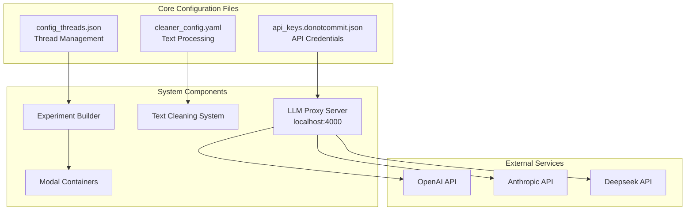
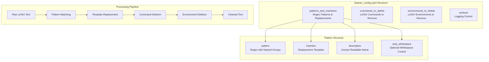
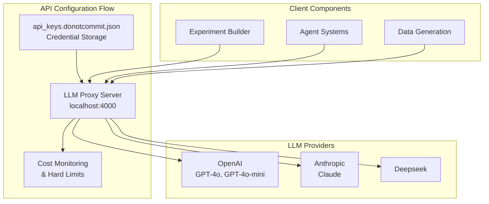
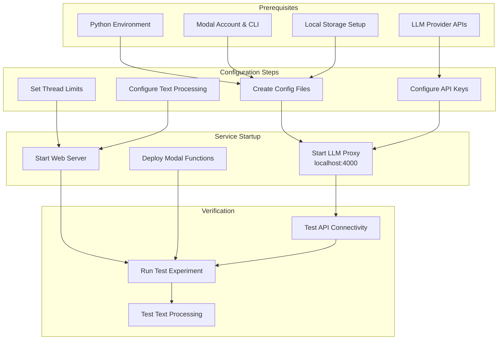

<!-- source: DeepWiki mcp.deepwiki.com · repo allenai/codescientist · page 8 Configuration and Setup · fetched 2026-10-26 -->

# Configuration and Setup

<details>
<summary>Relevant source files</summary>

The following files were used as context for generating this wiki page:

- [cleaner_config.yaml](cleaner_config.yaml)
- [config_threads.json](config_threads.json)

</details>


This document covers the configuration files and setup procedures required to operate the CodeScientist system. The configuration system manages API credentials, thread limits, text processing rules, and other runtime parameters. For information about the LLM proxy system configuration, see [LLM Proxy System](#6.1). For API key management details, see [API Configuration](#6.2).

## Overview

The CodeScientist system uses a distributed configuration approach with multiple configuration files serving different subsystems. The configuration system enables control over experiment execution limits, text processing behavior, and external service integration.

**Configuration Architecture**



Sources: [config_threads.json:1-4](), [cleaner_config.yaml:1-26]()

## Thread Management Configuration

The `config_threads.json` file controls concurrent experiment execution limits to prevent resource exhaustion and manage computational costs.

**Thread Configuration Structure**

| Parameter | Type | Description | Default |
|-----------|------|-------------|---------|
| `max_experiment_threads` | integer | Maximum concurrent experiment threads | 10 |

**Configuration File Format**

```json
{
    "max_experiment_threads": 10
}
```

This configuration is consumed by the Experiment Builder component to limit parallel experiment execution. The thread limit applies to experiments running in Modal containers and helps prevent overwhelming the LLM proxy system.

Sources: [config_threads.json:1-4]()

## Text Processing Configuration

The `cleaner_config.yaml` file defines patterns and rules for processing LaTeX and other text content. This configuration supports the text cleaning system used throughout the codebase.

**Text Cleaner Configuration Diagram**



**Configuration Parameters**

| Section | Parameter | Purpose |
|---------|-----------|---------|
| `patterns_and_insertions` | Array of pattern objects | Define regex patterns and replacement templates |
| `commands_to_delete` | Array of strings | LaTeX commands to remove from text |
| `environments_to_delete` | Array of strings | LaTeX environments to remove from text |
| `verbose` | Boolean | Enable detailed logging during processing |

**Pattern Object Structure**

Each pattern in `patterns_and_insertions` contains:
- `pattern`: Python regex with named groups
- `insertion`: Replacement template using named group references
- `description`: Human-readable description of the transformation
- `strip_whitespace`: Optional parameter to control whitespace handling

**Example Pattern Configuration**

```yaml
patterns_and_insertions:
    - pattern: '(?:\\figcomp{\s*)(?P<first>.*?)\s*}\s*{\s*(?P<second>.*?)\s*}\s*{\s*(?P<third>.*?)\s*}'
      insertion: '\parbox[c]{{ {second} \linewidth}} {{ \includegraphics[width= {third} \linewidth]{{figures/{first} }} }}'
      description: "Replace figcomp"
```

Sources: [cleaner_config.yaml:1-26]()

## API Configuration Setup

The system requires API credentials for accessing external LLM services. The configuration follows a secure pattern where sensitive credentials are stored in a `.donotcommit` file that should not be version controlled.

**API Configuration Structure**



**Required API Keys**

The `api_keys.donotcommit.json` file should contain credentials for:
- OpenAI API access
- Anthropic API access  
- Deepseek API access

**Security Considerations**

- The `.donotcommit` extension prevents accidental version control inclusion
- API keys are loaded by the LLM proxy server at startup
- Cost monitoring prevents accidental high usage

Sources: Configuration references from system architecture diagrams

## Environment Setup Procedures

Setting up a CodeScientist instance requires configuring multiple interconnected systems and ensuring proper credential management.

**Setup Dependencies**



**Configuration File Checklist**

1. **Thread Configuration**: Create `config_threads.json` with appropriate thread limits
2. **Text Processing**: Configure `cleaner_config.yaml` for LaTeX processing rules  
3. **API Credentials**: Set up `api_keys.donotcommit.json` with provider keys
4. **Storage Directories**: Ensure proper permissions for experiment data storage

**Service Dependencies**

- LLM Proxy Server must be running on localhost:4000
- Modal CLI must be authenticated and configured
- Web server requires thread configuration to be present
- Text cleaning system needs cleaner configuration for LaTeX processing

Sources: [config_threads.json:1-4](), [cleaner_config.yaml:1-26]()

---

