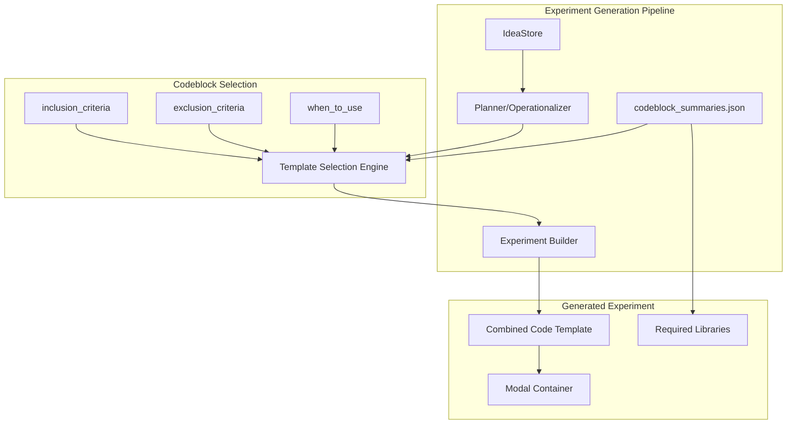
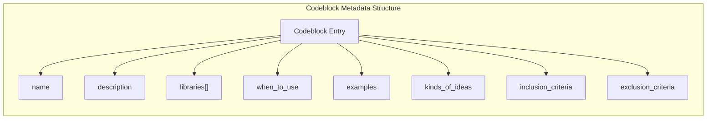
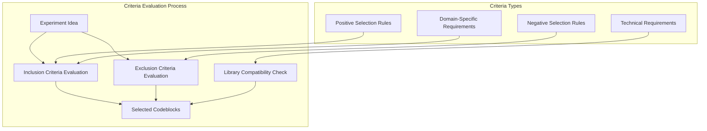
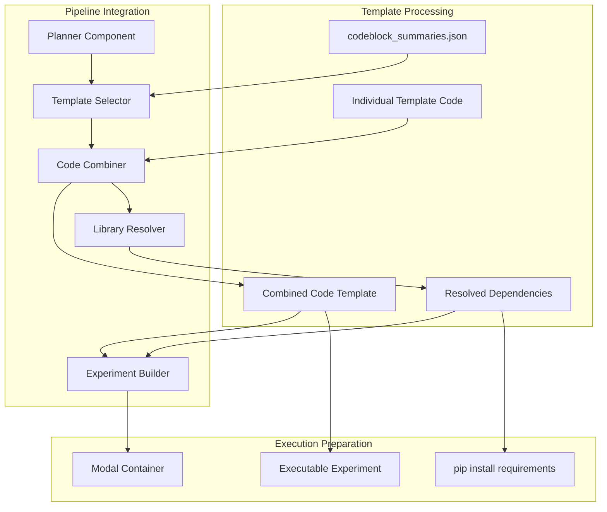

<!-- source: DeepWiki mcp.deepwiki.com · repo allenai/codescientist · page 9 Code Templates and Examples · fetched 2026-10-26 -->

# Code Templates and Examples

Relevant source files

The following files were used as context for generating this wiki page:

- [codeblocks/codeblock_summaries.json](codeblocks/codeblock_summaries.json)

This document describes the codeblock library system used by CodeScientist for experiment generation. The codeblock library provides reusable code templates that can be combined and adapted to create scientific discovery experiments. For information about how these templates are integrated into the experiment generation pipeline, see [Core System Architecture](#2). For details about the specific execution environment where these templates run, see [Experiment Infrastructure](#7).

## Codeblock System Architecture

The codeblock library serves as a foundational component in CodeScientist's experiment generation pipeline. It provides pre-built, tested code templates that can be selected and combined based on experimental requirements.

Sources: [codeblocks/codeblock_summaries.json:1-199]()

## Codeblock Structure and Metadata

Each codeblock in the library contains structured metadata that enables automated selection and combination. The metadata includes descriptive information, technical requirements, and usage guidelines.

### Core Metadata Fields

| Field | Purpose | Example |
|-------|---------|---------|
| `name` | Human-readable identifier | "ReAct Agent Example" |
| `description` | Detailed explanation of functionality | Template implementation details |
| `libraries` | Required Python packages | `["json", "copy"]` |
| `when_to_use` | Usage context guidelines | Environment-specific conditions |
| `examples` | Code usage demonstrations | Function call examples |
| `kinds_of_ideas` | Applicable research domains | Agent-based simulations, NLP tasks |
| `inclusion_criteria` | Positive selection rules | "You would normally use this codeblock if..." |
| `exclusion_criteria` | Negative selection rules | "If you're not implementing an agent..." |

Sources: [codeblocks/codeblock_summaries.json:19-30](), [codeblocks/codeblock_summaries.json:44-55]()

## Codeblock Categories

The library contains templates organized into several functional categories, each serving specific experimental needs.

### Game Environment APIs

Templates for interacting with text-based scientific discovery environments:

- **DiscoveryWorld API Example**: Interactive scientific discovery simulations
  - Libraries: `discoveryworld`, `json`, `time`, `random`, `copy`, `traceback`
  - Usage: Agent interaction with scientific discovery scenarios
  
- **ScienceWorld API Example**: Elementary science knowledge testing
  - Libraries: `scienceworld`, `random`
  - Usage: Text-based science education games
  
- **TextWorldExpress API Example**: Interactive text-based games
  - Libraries: `textworld_express`, `time`, `random`, `argparse`, `json`
  - Usage: Parametrically generated game environments

### Agent Architectures

Templates implementing different AI agent patterns:

- **ReAct Agent Example**: Reasoning-then-acting agent architecture
  - Libraries: `json`
  - Usage: Think-then-act decision making in constrained action spaces
  
- **Memory Agent Example**: Memory-augmented agent architecture
  - Libraries: `json`, `copy`
  - Usage: Agents requiring historical context for decision making

### Knowledge Systems

Templates for accessing structured knowledge bases:

- **ConceptNet Knowledge Base**: English subset of ConceptNet
  - Libraries: `os`, `json`, `subprocess`, `experiment_common_library`
  - Usage: Semantic network operations and relationship queries
  
- **WordNet with NLTK**: Lexical database operations
  - Libraries: `nltk`
  - Usage: Synonyms, antonyms, hypernyms, hyponyms, meronyms

### LLM Integration

Templates for language model interaction:

- **LLM example through proxy server**: API-based language model access
  - Libraries: `os`, `time`, `json`, `requests`, `experiment_common_library`
  - Usage: Cost-managed LLM queries through `litellm` proxy

### Data Analysis and Visualization

Templates for statistical analysis and visualization:

- **Non-parametric Bootstrap Resampling**: Statistical hypothesis testing
  - Libraries: `random`, `json`, `sys`, `os`, `experiment_common_library`
  - Usage: Model performance comparison with significance testing
  
- **MatPlotLib Line Plot**: Line plot generation for headless environments
  - Libraries: `matplotlib`, `numpy`
  - Usage: Time series visualization and multi-series comparison
  
- **DOT Graphviz Graph**: Graph visualization using DOT format
  - Libraries: `experiment_common_library`
  - Usage: Node-edge graph creation and PDF export

### Core Utilities

Essential templates required for all experiments:

- **Logger/Debugging**: Required logging and debugging functionality
  - Libraries: `experiment_common_library`
  - Usage: Universal logging for all experiments (always required)
  
- **Data generation with LLM**: LLM-driven dataset creation
  - Libraries: `os`, `json`, `experiment_common_library`
  - Usage: Creative data generation for experiments

Sources: [codeblocks/codeblock_summaries.json:2-18](), [codeblocks/codeblock_summaries.json:97-109](), [codeblocks/codeblock_summaries.json:137-152](), [codeblocks/codeblock_summaries.json:44-55](), [codeblocks/codeblock_summaries.json:72-84](), [codeblocks/codeblock_summaries.json:122-136](), [codeblocks/codeblock_summaries.json:153-168](), [codeblocks/codeblock_summaries.json:169-184](), [codeblocks/codeblock_summaries.json:19-30]()

## Selection Criteria System

The codeblock library uses a dual-criteria system to automatically select appropriate templates based on experimental requirements. This system enables the Planner component to make informed decisions about which templates to include.

### Inclusion Criteria Examples

| Template | Inclusion Criteria |
|----------|-------------------|
| `Logger/Debugging` | "This codeblock helps you log and debug, and is always useful." |
| `ReAct Agent Example` | "You would normally use this codeblock if you'd like to implement a ReAct agent" |
| `DiscoveryWorld API Example` | "You would normally use this codeblock if you'd like an agent to play/interact with DiscoveryWorld" |
| `LLM example through proxy server` | "If you need to use an API-based language model, then you *need* this codeblock." |

### Exclusion Criteria Examples

| Template | Exclusion Criteria |
|----------|-------------------|
| `Logger/Debugging` | "There are no exclusion criteria -- you must ALWAYS include the logger/debugger codeblock." |
| `DiscoveryWorld Knowledge Scorer` | "If you are not specifically evaluating explanatory knowledge *in DiscoveryWorld*, this codeblock is unlikely to be useful." |
| `ConceptNet Knowledge Base` | "If you don't need to access ConceptNet knowledge base, or need a different language subset, this codeblock is unlikely to be useful." |

Sources: [codeblocks/codeblock_summaries.json:28-29](), [codeblocks/codeblock_summaries.json:53-54](), [codeblocks/codeblock_summaries.json:16-17](), [codeblocks/codeblock_summaries.json:166-167]()

## Integration with Experiment Generation

The codeblock library integrates with CodeScientist's experiment generation pipeline through several key mechanisms that ensure appropriate template selection and combination.

### Library Dependency Resolution

The system automatically resolves library dependencies by aggregating requirements from selected templates:

| Library Category | Common Dependencies |
|------------------|-------------------|
| Core Utilities | `experiment_common_library`, `os`, `json`, `time` |
| Game Environments | `discoveryworld`, `scienceworld`, `textworld_express` |
| Knowledge Systems | `nltk`, `subprocess` |
| LLM Integration | `requests`, `openai` |
| Visualization | `matplotlib`, `numpy` |
| Statistical Analysis | `random`, `sys` |

### Template Combination Rules

1. **Mandatory Templates**: The `Logger/Debugging` template is always included
2. **Environment-Specific**: Only one game environment API template per experiment
3. **Agent Architecture**: Typically one primary agent architecture template
4. **Utility Templates**: Selected based on experimental analysis requirements

Sources: [codeblocks/codeblock_summaries.json:22-24](), [codeblocks/codeblock_summaries.json:34-37](), [codeblocks/codeblock_summaries.json:156-162]()

---

