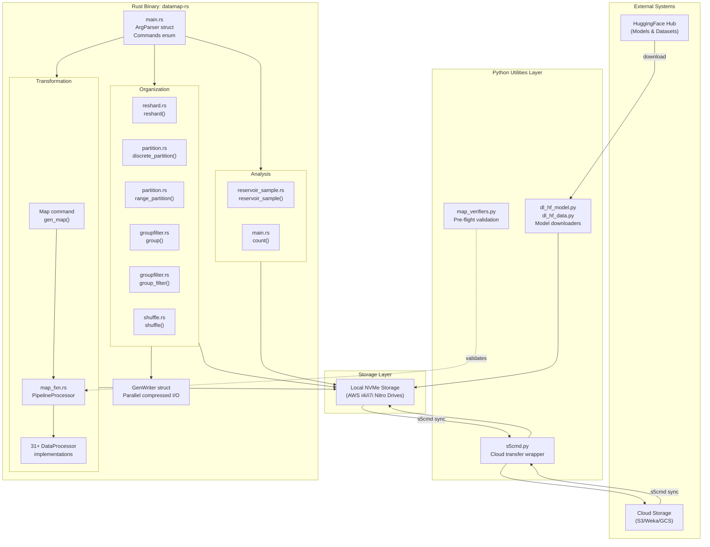
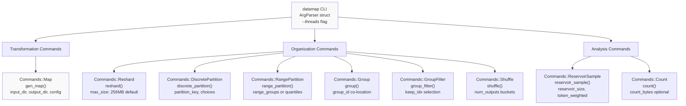
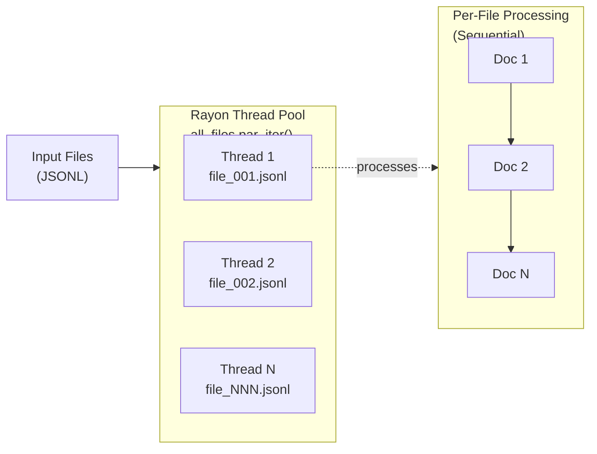
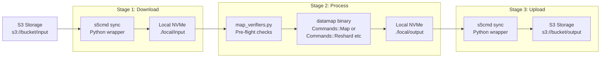

<!-- source: DeepWiki mcp.deepwiki.com · repo allenai/datamap-rs · page 1 Overview · fetched 2026-10-26 -->

# Overview

<details>
<summary>Relevant source files</summary>

The following files were used as context for generating this wiki page:

- [Cargo.toml](Cargo.toml)
- [README.md](README.md)
- [src/main.rs](src/main.rs)

</details>


This document introduces datamap-rs, its purpose, architecture, and when to use it. For installation instructions and environment setup, see [Installation and Setup](#1.1). For hands-on examples, see [Quick Start Guide](#1.2).

## Purpose and Scope

datamap-rs is a high-performance Rust toolkit for processing, filtering, and transforming large-scale text datasets stored in JSONL format. It provides nine specialized commands that operate on terabyte-scale data using parallel processing and a local-first storage architecture.

The system is designed for batch processing workflows where data is downloaded to local NVMe storage, processed using multiple CPU cores, and uploaded back to cloud storage. This approach prioritizes reliability and performance over streaming-based architectures.

**Sources:** [README.md:1-21](), [src/main.rs:1-50]()

## What Problems Does datamap-rs Solve?

datamap-rs addresses the challenges of large-scale data curation and processing:

| Problem | Solution in datamap-rs |
|---------|----------------------|
| **Quality filtering at scale** | Configurable pipeline with 31+ processors (filters, modifiers, annotators) |
| **Uneven file sizes** | `Reshard` command normalizes to 256MB chunks |
| **Categorical organization** | `DiscretePartition` splits by discrete fields (language, domain) |
| **Numeric organization** | `RangePartition` splits by continuous values with quantile support |
| **Deduplication** | Two-stage `Group` → `GroupFilter` workflow |
| **Statistical sampling** | `ReservoirSample` with optional token-weighting |
| **Dataset statistics** | `Count` command for documents, sizes, and text bytes |
| **Data mixing** | `Shuffle` command for random redistribution |

All operations are **embarrassingly parallel at the file level**, processing hundreds of files simultaneously while maintaining deterministic per-document semantics.

**Sources:** [README.md:22-69](), [src/main.rs:59-224]()

## System Architecture

datamap-rs follows a three-layer architecture: Python utilities for cloud I/O, Rust core for data processing, and local NVMe storage as the processing substrate.



**Architecture Diagram: Three-Layer System**

The Python layer handles unreliable network I/O, the Rust core performs deterministic data processing, and local NVMe storage provides the performance substrate. The boundary between Python and Rust is the filesystem.

**Sources:** [src/main.rs:1-50](), [README.md:113-128](), [Cargo.toml:1-45]()

## Command Structure

The CLI is implemented using the `clap` framework with a `Commands` enum defining nine subcommands. All commands accept `--threads N` to control parallelism (defaults to all available cores).



**Command Hierarchy Diagram**

Each command corresponds to a variant in the `Commands` enum at [src/main.rs:59-224]() and dispatches to a dedicated function. The `Map` command is the most complex, supporting arbitrary transformation pipelines.

**Sources:** [src/main.rs:49-224](), [src/main.rs:506-584]()

## Key Design Principles

### Local-First Architecture

datamap-rs **requires** local storage and does not support streaming from cloud storage. This is not a limitation but an architectural decision for reliability and performance.

**Workflow pattern:**
```
1. Download:  s5cmd sync s3://bucket/input ./local/input
2. Process:   datamap map --input-dir ./local/input --output-dir ./local/output
3. Upload:    s5cmd sync ./local/output s3://bucket/output
```

The system assumes fast NVMe drives (AWS i4i/i7i instances with Nitro Drives are recommended). Processing directly from S3 is "finnicky and unreliable" per design documentation.

**Sources:** [README.md:20-21](), [README.md:113-128]()

### File-Level Parallelism

The system uses Rayon's parallel iterators to process files concurrently. Each file is processed by a single thread from start to finish. This means:

- **Parallelism scales with number of files**, not file size
- Documents within a file are processed sequentially through the pipeline
- The 256MB target file size balances parallelism (more files = more parallel work) with memory usage (larger files = more RAM per thread)



**Parallelism Model Diagram**

At [src/main.rs:359](), the code uses `all_files.par_iter().for_each()` to distribute files across threads. Within each file, documents are processed sequentially at [src/main.rs:407-411]().

**Sources:** [src/main.rs:359-382](), [README.md:104-112]()

### JSONL Format and Compression

All input and output uses **JSONL** (newline-delimited JSON) with **Zstandard compression** (level 3). Files follow the naming pattern `*.jsonl.zst`. This format enables:

- Line-by-line streaming (memory-efficient)
- Parallel processing (each line is independent)
- Fast compression/decompression
- Human-readable when uncompressed

**Sources:** [README.md:10-19](), [Cargo.toml:32]()

## When to Use datamap-rs

Use datamap-rs when you need to:

| Scenario | Recommended Commands |
|----------|---------------------|
| **Filter low-quality documents** | `map` with filter processors |
| **Add metadata annotations** | `map` with annotator processors |
| **Normalize file sizes** | `reshard` to 256MB chunks |
| **Organize by language/domain** | `discrete-partition` by category field |
| **Organize by quality score** | `range-partition` with quantiles |
| **Deduplicate by ID** | `group` then `group-filter` |
| **Create training samples** | `reservoir-sample` with token-weighting |
| **Mix datasets** | `shuffle` for random redistribution |
| **Audit dataset statistics** | `count` for docs/bytes totals |

**Do not use datamap-rs for:**
- Real-time streaming processing (designed for batch)
- Small datasets (<10GB) where overhead isn't worth it
- Non-JSONL formats without conversion
- Processing without local NVMe storage

**Sources:** [README.md:22-69](), [README.md:104-112]()

## Core Components Map

The following table maps system concepts to code entities:

| Concept | Code Entity | Location |
|---------|-------------|----------|
| CLI entry point | `fn main()` | [src/main.rs:506-584]() |
| Command definitions | `enum Commands` | [src/main.rs:59-224]() |
| Argument parsing | `struct ArgParser` | [src/main.rs:49-57]() |
| Pipeline orchestration | `struct PipelineProcessor` | [src/map_fxn.rs]() |
| Individual processors | `trait DataProcessor` | [src/map_fxn.rs]() |
| Parallel file writing | `struct GenWriter` | Referenced in multiple modules |
| Configuration parsing | `fn parse_config()` | [src/main.rs:230-248]() |
| Statistics collection | `DashMap<usize, AtomicUsize>` | [src/main.rs:348-354]() |
| File discovery | `expand_dirs()` | From `mj_io` crate |
| Progress tracking | `build_pbar()` | From `mj_io` crate |

**Sources:** [src/main.rs:1-584](), [Cargo.toml:10-40]()

## Typical Data Flow

A complete processing workflow involves three stages:



**Complete Workflow Diagram**

The verification step (optional but recommended) checks that required models and banlists exist before processing begins. For complex workflows involving multiple commands, see [Common Workflow Patterns](#1.3).

**Sources:** [README.md:113-137](), [README.md:139-151]()

## Technology Stack Summary

datamap-rs leverages specialized Rust libraries for performance:

| Category | Libraries | Purpose |
|----------|-----------|---------|
| **Concurrency** | `rayon`, `dashmap` | File-level parallelism, lock-free maps |
| **JSON** | `serde_json`, `sonic-rs`, `simd-json`, `gjson` | Parsing, serialization, path queries |
| **Text Processing** | `fasttext`, `tiktoken-rs`, `aho-corasick`, `regex` | ML models, tokenization, pattern matching |
| **Hashing** | `fxhash`, `xxhash-rust`, `ahash` | Fast hashing for grouping/shuffling |
| **Compression** | `zstd` | Level 3 compression for all output |
| **CLI** | `clap` | Command-line argument parsing |

For detailed information on each library and when it's used, see [Technology Stack](#9).

**Sources:** [Cargo.toml:10-40]()

---

**Navigation:**
- Next: [Installation and Setup](#1.1)
- Related: [System Architecture](#2) for deep architectural details
- Related: [Map Command (Pipeline Processing)](#3) for the most complex subsystem

---

