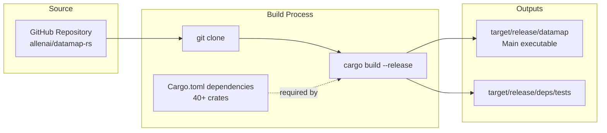
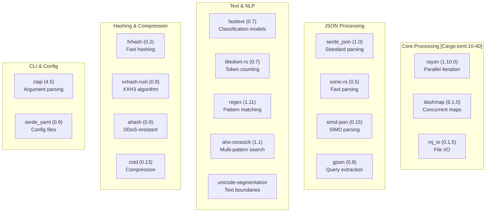
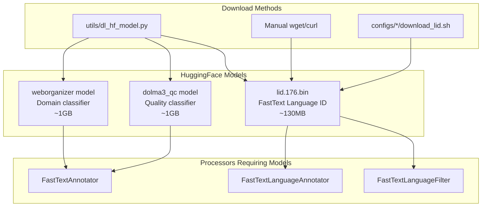
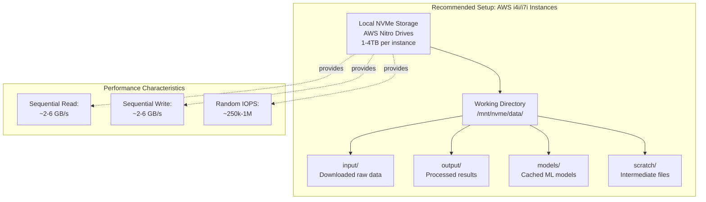

<!-- source: DeepWiki mcp.deepwiki.com · repo allenai/datamap-rs · page 1.1 Installation and Setup · fetched 2026-10-26 -->

# Installation and Setup

<details>
<summary>Relevant source files</summary>

The following files were used as context for generating this wiki page:

- [Cargo.toml](Cargo.toml)
- [README.md](README.md)

</details>


This page guides you through installing datamap-rs and setting up the required environment. By the end, you will have a working `datamap` binary and understand how to configure optional components like Python utilities, cloud storage tools, and ML models.

For running your first data processing workflow, see [Quick Start Guide](#1.2). For understanding why certain setup choices matter (like local NVMe storage), see [Data Flow and Storage Strategy](#2.3).

---

## Prerequisites

### Rust Toolchain

datamap-rs requires Rust 2021 edition or later. The build system uses Cargo, Rust's package manager.

**Installation:**
```bash
curl --proto '=https' --tlsv1.2 -sSf https://sh.rustup.rs | sh
```

After installation, verify:
```bash
rustc --version  # Should show 1.56.0 or higher
cargo --version
```

**Sources:** [README.md:73-76]()

### System Requirements

| Resource | Minimum | Recommended |
|----------|---------|-------------|
| CPU Cores | 4 | 16+ (parallelism scales linearly) |
| RAM | 8GB | 32GB+ (depends on document sizes) |
| Storage | 100GB SSD | 1TB+ NVMe (AWS i4i/i7i instances) |
| OS | Linux, macOS | Linux on AWS Nitro |

The architecture assumes **local file processing** rather than streaming from cloud storage. Fast local NVMe drives are critical for performance.

**Sources:** [README.md:20](), Diagram 5, Diagram 6

---

## Core Binary Installation



**Diagram: Core Installation Flow**

### Steps

1. **Clone the repository:**
```bash
git clone https://github.com/allenai/datamap-rs
cd datamap-rs
```

2. **Build the release binary:**
```bash
cargo build --release
```

This compiles with optimizations enabled. Build time: 5-15 minutes depending on system.

3. **Locate the binary:**
```bash
ls -lh target/release/datamap
# Binary is typically 30-50MB
```

4. **Optional: Add to PATH:**
```bash
# Add to ~/.bashrc or ~/.zshrc
export PATH="$PATH:/path/to/datamap-rs/target/release"
```

Or copy to a system location:
```bash
sudo cp target/release/datamap /usr/local/bin/
```

**Sources:** [README.md:79-89]()

---

## Dependency Overview

The build process automatically downloads and compiles all Rust dependencies. Understanding these helps troubleshoot build issues.



**Diagram: Cargo Dependencies by Category**

### Notable Dependencies

- **`rayon`**: Enables file-level parallelism across all commands
- **`fasttext`**: Required for `FastTextAnnotator` and `FastTextLanguageFilter` processors
- **`tiktoken-rs`**: Required for `TiktokenTokenCounter` processor
- **`zstd`**: All output files use Zstandard compression (level 3)
- **`mj_io`**: Handles file reading/writing with automatic decompression

**Sources:** [Cargo.toml:10-40]()

---

## Optional Components

### Python Utilities

Three Python scripts provide cloud integration and verification:

| Script | Purpose | When Needed |
|--------|---------|-------------|
| `utils/dl_hf_model.py` | Download HuggingFace models | Using FastText processors |
| `utils/dl_hf_data.py` | Download HuggingFace datasets | Processing HF datasets |
| `utils/s5cmd.py` | Wrapper for s5cmd S3 tool | Cloud storage workflows |
| `utils/map_verifiers.py` | Validate pipeline configs | Before large processing runs |

**Installation:**
```bash
pip install boto3 click tqdm huggingface-hub
```

These scripts are standalone and don't affect the Rust binary. See [Python Utilities](#7) for detailed documentation.

**Sources:** [README.md:91-94](), Diagram 6

### S5CMD: Cloud Storage CLI

`s5cmd` is a high-performance S3 client used for downloading/uploading data. It supports S3, Weka (`weka://`), and GCS (`gs://`) protocols.

**Installation (Linux):**
```bash
wget https://github.com/peak/s5cmd/releases/download/v2.2.2/s5cmd_2.2.2_Linux-64bit.tar.gz
tar -xvzf s5cmd_2.2.2_Linux-64bit.tar.gz
sudo mv s5cmd /usr/local/bin
chmod +x /usr/local/bin/s5cmd
```

**Verification:**
```bash
s5cmd version
# Output: s5cmd version 2.2.2
```

The typical workflow is:
1. `s5cmd sync s3://source ./local/` - Download to NVMe
2. `datamap map ...` - Process locally
3. `s5cmd sync ./local/ s3://dest` - Upload results

See [S5CMD Wrapper for Cloud Storage](#7.2) for Python wrapper usage.

**Sources:** [README.md:96-102](), [README.md:115-128](), Diagram 6

---

## ML Model Setup

Certain processors require pre-trained models that must be downloaded separately.



**Diagram: ML Model Dependencies**

### FastText Language ID Model

**Location:** Used by `FastTextLanguageFilter` and `FastTextLanguageAnnotator`

**Download options:**

1. **Using provided script:**
```bash
cd configs/all_dressed
./download_lid.sh
# Downloads to configs/all_dressed/lid.176.bin
```

2. **Using Python utility:**
```bash
python utils/dl_hf_model.py \
  --model facebook/fasttext-language-identification \
  --filename lid.176.bin \
  --output ./models/
```

3. **Manual download:**
```bash
wget https://dl.fbaipublicfiles.com/fasttext/supervised-models/lid.176.bin
```

### Custom FastText Models

For `FastTextAnnotator` with custom models, ensure the model path in your pipeline configuration points to an accessible `.bin` file.

**Example configuration:**
```yaml
- processor: FastTextAnnotator
  annotator_name: "quality_score"
  model_path: "/path/to/dolma3_qc.bin"
  score_names: ["low", "medium", "high"]
```

**Sources:** [README.md:137](), Diagram 3, Diagram 6

---

## Storage Configuration

### Local Storage Architecture



**Diagram: Recommended Storage Layout**

### Instance Recommendations

| Instance Type | NVMe Capacity | vCPUs | RAM | Use Case |
|---------------|---------------|-------|-----|----------|
| i4i.2xlarge | 468 GB | 8 | 64 GB | Development/testing |
| i4i.8xlarge | 1,875 GB | 32 | 256 GB | Medium workloads |
| i4i.16xlarge | 3,750 GB | 64 | 512 GB | Large-scale processing |
| i7i.16xlarge | 3,750 GB | 64 | 512 GB | Latest generation |

**Why local NVMe matters:**
- Datamap processes files in parallel (one thread per file)
- Fast local I/O enables maximum CPU utilization
- Cloud streaming introduces latency and reliability issues
- The 256MB file size target is optimized for NVMe performance

**Sources:** [README.md:20](), Diagram 5, Diagram 6

---

## Verification

### Test Basic Functionality

1. **Check binary works:**
```bash
datamap --help
# Should display command list
```

2. **Verify command availability:**
```bash
datamap map --help
datamap reshard --help
datamap count --help
```

3. **Test with small dataset:**
```bash
# Create test data
echo '{"text": "hello", "id": 1}' > test.jsonl
echo '{"text": "world", "id": 2}' >> test.jsonl

# Run count command
datamap count --input test.jsonl --text-field text
# Expected output:
# Documents: 2
# Total text bytes: 10
```

### Verify Optional Components

```bash
# Test Python utilities available
python utils/dl_hf_model.py --help
python utils/s5cmd.py --help

# Test s5cmd installed
s5cmd version

# Test ML model downloaded
ls -lh configs/all_dressed/lid.176.bin
# Should show ~130MB file
```

### Common Build Issues

| Issue | Solution |
|-------|----------|
| `linker 'cc' not found` | Install build tools: `sudo apt-get install build-essential` |
| `fasttext` compilation fails | Install C++ compiler: `sudo apt-get install g++` |
| Out of memory during build | Use `cargo build --release --jobs 1` to limit parallelism |
| Slow build on EC2 | Ensure using instance with adequate CPU (not t2/t3) |

**Sources:** [Cargo.toml:1-45](), [README.md:72-102]()

---

## Next Steps

After installation:

1. **Verify with a simple workflow:** See [Quick Start Guide](#1.2)
2. **Understand common patterns:** See [Common Workflow Patterns](#1.3)
3. **Explore example pipelines:** Review `configs/` directory or see [Example: DCLM Pipeline](#8.2)
4. **Set up cloud storage:** Configure AWS credentials for S3 access (if needed)

For development and extending datamap-rs, see [Development Guide](#10).

**Sources:** [README.md:131-151]()

---

