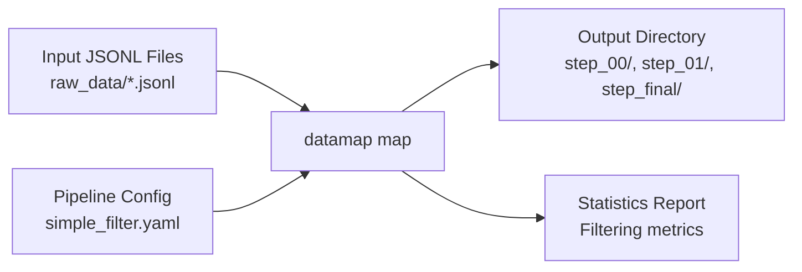
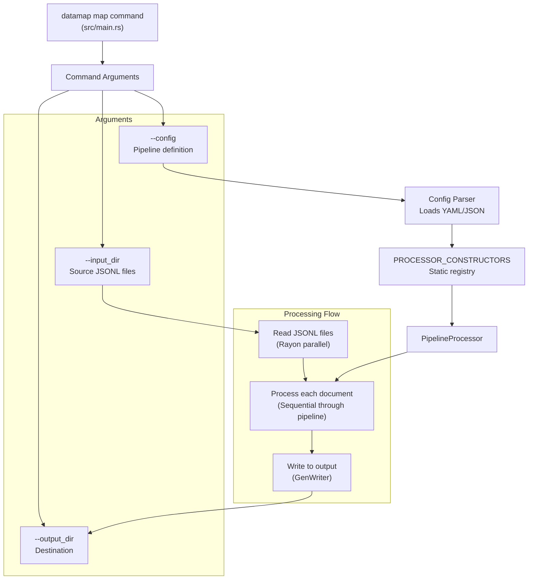
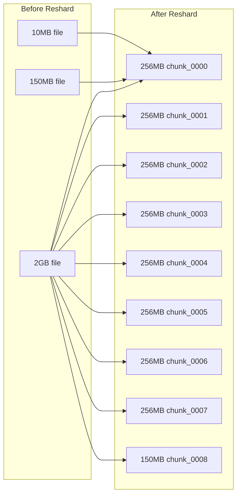
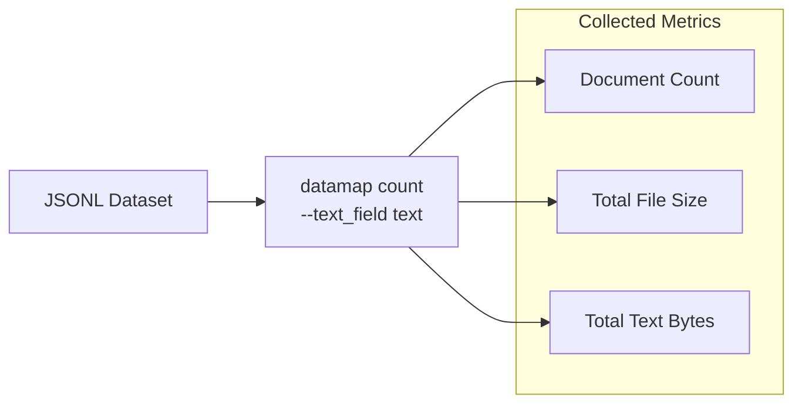
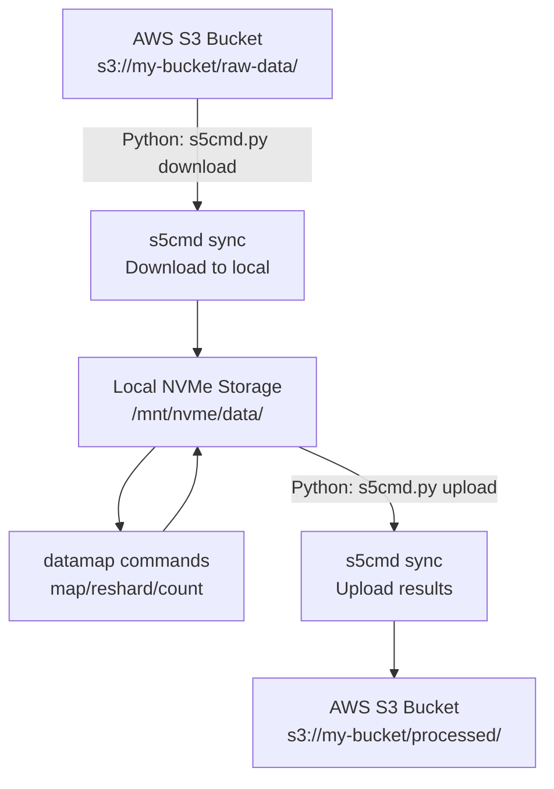

<!-- source: DeepWiki mcp.deepwiki.com · repo allenai/datamap-rs · page 1.2 Quick Start Guide · fetched 2026-10-26 -->

# Quick Start Guide

<details>
<summary>Relevant source files</summary>

The following files were used as context for generating this wiki page:

- [.gitignore](.gitignore)
- [README.md](README.md)
- [docs/map.md](docs/map.md)
- [python/s5cmd.py](python/s5cmd.py)

</details>


## Purpose and Scope

This guide walks through your first end-to-end workflow with datamap-rs, from preparing data to interpreting results. You'll learn the basic command patterns and see how different commands work together in typical data processing workflows.

For installation instructions, see [Installation and Setup](#1.1). For comprehensive multi-command workflows, see [Common Workflow Patterns](#1.3). For detailed pipeline configuration, see [Pipeline Configuration](#3.6).

**Sources:** [README.md:1-151]()

---

## Prerequisites

Before starting, ensure you have:
- **datamap-rs binary** built and accessible in your PATH
- **Local storage** with sufficient space (NVMe drives recommended)
- **Sample JSONL data** to process
- **(Optional)** s5cmd installed for cloud storage operations
- **(Optional)** FastText models if using language classification

**Sources:** [README.md:71-103]()

---

## Example 1: Simple Text Filtering Pipeline

### Workflow Overview



**Sources:** [README.md:26-29](), [docs/map.md:1-192]()

### Step 1: Prepare Sample Data

Create a directory with sample JSONL files. Each line should be a valid JSON object:

```bash
mkdir -p input_data
cat > input_data/sample.jsonl << 'EOF'
{"text": "This is a short text."}
{"text": "This is a much longer text with many words that should pass our minimum length filter. It contains substantial content that demonstrates what we consider acceptable document length."}
{"text": "Hi"}
{"text": "The quick brown fox jumps over the lazy dog. This sentence contains many common English words including articles and prepositions."}
{"text": "Lorem ipsum dolor sit amet consectetur adipiscing elit sed do eiusmod tempor incididunt."}
EOF
```

**Sources:** [docs/map.md:28-33]()

### Step 2: Create Pipeline Configuration

Create a simple pipeline that filters by text length and ensures English stop words are present:

```bash
cat > simple_filter.yaml << 'EOF'
text_field: "text"
pipeline:
  - name: "text_len_filter"
    kwargs:
      lower_bound: 50
      upper_bound: 100000
  - name: "stop_word_filter"
    kwargs:
      min_stop_word: 3
  - name: "word_count_adder"
    kwargs:
      word_count_field: "word_count"
EOF
```

This pipeline:
1. **text_len_filter**: Removes documents with fewer than 50 or more than 100,000 characters
2. **stop_word_filter**: Removes documents without at least 3 common English stop words
3. **word_count_adder**: Adds word count metadata to surviving documents

**Sources:** [docs/map.md:67-84]()

### Step 3: Run the Map Command

```bash
datamap map \
  --input_dir ./input_data \
  --output_dir ./output_data \
  --config simple_filter.yaml
```

### Command Components



**Sources:** [docs/map.md:8-26](), [README.md:26-29]()

### Step 4: Examine Output Structure

The map command creates a structured output directory:

```bash
output_data/
├── step_00/           # Filtered at text_len_filter (step 0)
│   └── sample.jsonl.zst
├── step_01/           # Filtered at stop_word_filter (step 1)
│   └── sample.jsonl.zst
└── step_final/        # Passed all filters
    └── sample.jsonl.zst
```

| Directory | Contents | Meaning |
|-----------|----------|---------|
| `step_00/` | Documents removed by processor at position 0 | Failed `text_len_filter` (too short/long) |
| `step_01/` | Documents removed by processor at position 1 | Failed `stop_word_filter` (insufficient stop words) |
| `step_final/` | Documents that survived entire pipeline | Passed all filters, includes word_count annotation |

**Sources:** [docs/map.md:34-52]()

### Step 5: Inspect Results

```bash
# View documents that passed all filters
zstd -d output_data/step_final/sample.jsonl.zst -c | head -2

# Count documents at each stage
echo "Filtered at step 0 (text_len_filter):"
zstd -d output_data/step_00/sample.jsonl.zst -c | wc -l

echo "Filtered at step 1 (stop_word_filter):"
zstd -d output_data/step_01/sample.jsonl.zst -c | wc -l

echo "Final output:"
zstd -d output_data/step_final/sample.jsonl.zst -c | wc -l
```

**Expected output documents in `step_final/`:**
- Document 2: Long text with stop words and word_count field added
- Document 4: Fox sentence with stop words and word_count field added

**Sources:** [docs/map.md:49-63]()

### Understanding Pipeline Statistics

After processing completes, datamap prints statistics:

```
Processing Statistics:
=====================
Total documents processed: 5
Total processing time: 0.15s

Step 0 (text_len_filter):
  - Removed: 2 documents (40.0% of input)
  - Remaining: 3 documents

Step 1 (stop_word_filter):
  - Removed: 1 document (33.3% of remaining, 20.0% of total)
  - Remaining: 2 documents

Step 2 (word_count_adder):
  - Modified: 2 documents
  - Final output: 2 documents (40.0% of input)
```

**Sources:** [docs/map.md:54-63]()

---

## Example 2: File Size Normalization

### Why Reshard?

Uneven file sizes hurt parallel processing efficiency. The reshard command normalizes files to approximately 256MB (uncompressed), which balances:
- **Parallelism**: More files = more parallel work units
- **Memory**: Smaller files = lower memory per thread
- **Throughput**: 256MB is optimal for I/O patterns



**Sources:** [README.md:31-33]()

### Run Reshard Command

```bash
datamap reshard \
  --input_dir ./output_data/step_final \
  --output_dir ./resharded_data \
  --target_size_mb 256
```

This produces files of approximately 256MB (uncompressed) named `chunk_0000.jsonl.zst`, `chunk_0001.jsonl.zst`, etc.

**Command Arguments:**
- `--input_dir`: Source directory with JSONL files (any size)
- `--output_dir`: Destination for normalized files
- `--target_size_mb`: Target file size in MB (default: 256)
- `--respect_subdirectory`: (Optional) Maintain subdirectory structure

**Sources:** [README.md:31-33]()

---

## Example 3: Dataset Statistics

### Count Command Overview



**Sources:** [README.md:66-69]()

### Run Count Command

```bash
datamap count \
  --input_dir ./resharded_data \
  --text_field text
```

**Example Output:**
```
Dataset Statistics:
==================
Total documents: 1,247,839
Total file size: 4.2 GB (compressed)
Total text bytes: 15.8 GB (uncompressed)
Average document size: 12,657 bytes
```

**Command Arguments:**
- `--input_dir`: Directory containing JSONL files
- `--text_field`: (Optional) Field to measure text byte count
- `--threads`: (Optional) Number of parallel threads

**Sources:** [README.md:66-69]()

---

## Example 4: Cloud Storage Integration

### Download-Process-Upload Workflow



**Sources:** [README.md:113-128](), [python/s5cmd.py:1-402]()

### Using s5cmd Directly

```bash
# Download from S3 to local
s5cmd sync s3://my-bucket/raw-data/ ./local-data/

# Process with datamap
datamap map \
  --input_dir ./local-data \
  --output_dir ./processed-data \
  --config my_pipeline.yaml

# Upload results back to S3
s5cmd sync ./processed-data/ s3://my-bucket/processed-data/
```

**Sources:** [README.md:117-122]()

### Using Python Wrapper for Partitioned Downloads

For large datasets, download in parallel parts:

```bash
# Download part 0 of 4 (downloads every 4th file)
python python/s5cmd.py download \
  --src s3://my-bucket/raw-data/ \
  --dst ./local-data/ \
  --part 0 \
  --num-parts 4
```

The wrapper:
1. Lists all files with `s5.ls()` [python/s5cmd.py:215-265]()
2. Sorts and partitions the file list [python/s5cmd.py:380-382]()
3. Generates an s5cmd run file [python/s5cmd.py:384-387]()
4. Executes with progress bar [python/s5cmd.py:388]()

**Sources:** [README.md:124-128](), [python/s5cmd.py:359-389]()

---

## Command Composition Patterns

### Pattern 1: Quality Filtering

```bash
# Step 1: Run quality filters
datamap map \
  --input_dir ./raw \
  --output_dir ./filtered \
  --config quality_filters.yaml

# Step 2: Normalize file sizes
datamap reshard \
  --input_dir ./filtered/step_final \
  --output_dir ./final \
  --target_size_mb 256

# Step 3: Verify results
datamap count --input_dir ./final --text_field text
```

**Sources:** [README.md:22-69]()

### Pattern 2: Deduplication Workflow

```bash
# Step 1: Group documents by ID
datamap group \
  --input_dir ./data \
  --output_dir ./grouped \
  --group_key document_id

# Step 2: Keep one document per group
datamap group-filter \
  --input_dir ./grouped \
  --output_dir ./deduplicated \
  --keep_idx 0
```

**Sources:** [README.md:51-59]()

---

## Common Next Steps

After completing this quick start, you may want to:

1. **Learn more complex pipelines**: See [Pipeline Configuration](#3.6) and [Example: DCLM Pipeline](#8.2)
2. **Understand processor types**: See [Filter Processors](#3.3), [Modifier Processors](#3.4), [Annotator Processors](#3.5)
3. **Explore partitioning**: See [Discrete Partition](#4.2) and [Range Partition](#4.3)
4. **Set up verification**: See [Pipeline Verification Tool](#7.3)
5. **Optimize performance**: See [Parallelism and Performance Model](#2.2)

### Key Takeaways

| Concept | Summary |
|---------|---------|
| **Local-first architecture** | Always download to fast local storage, process, then upload |
| **File-level parallelism** | Each input file processed independently on separate thread |
| **Sequential pipelines** | Documents flow sequentially through pipeline stages |
| **Structured output** | `step_XX/` directories show where documents were filtered |
| **Compression** | All output uses Zstandard level 3 compression (.zst) |
| **256MB sweet spot** | Optimal file size balances parallelism and memory usage |

**Sources:** [README.md:1-151](), [docs/map.md:1-192]()

---

