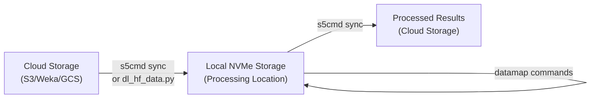
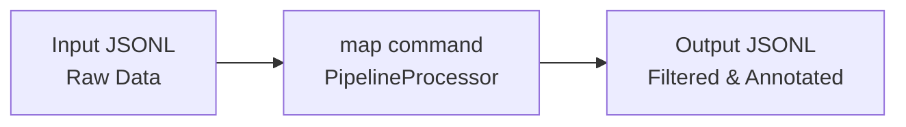
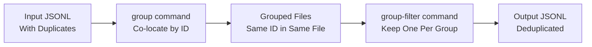
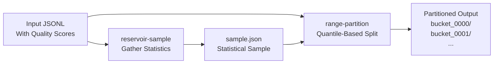
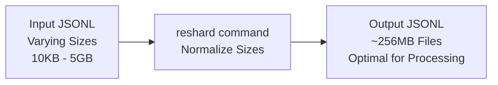
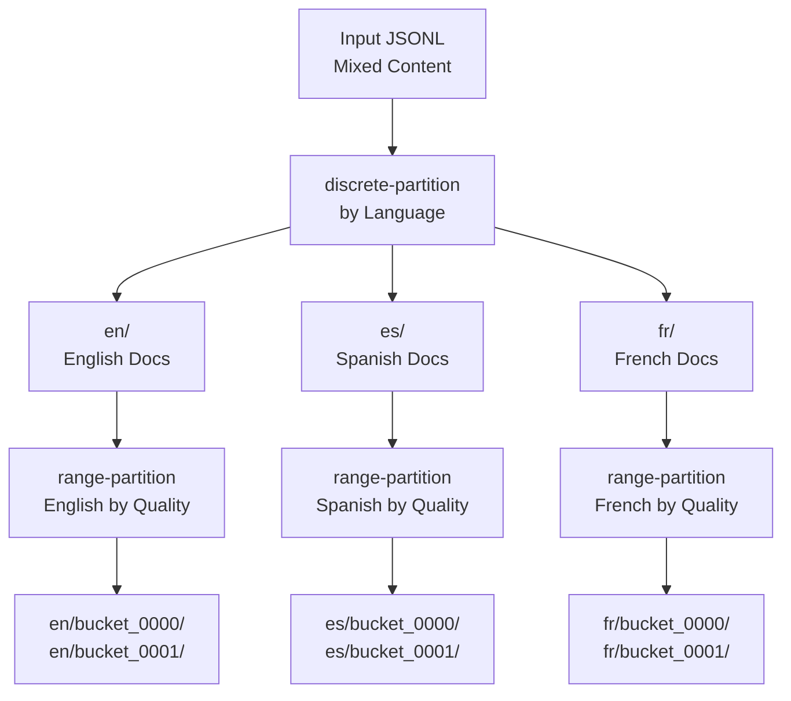
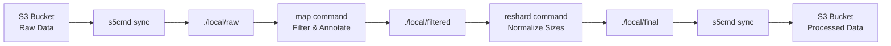
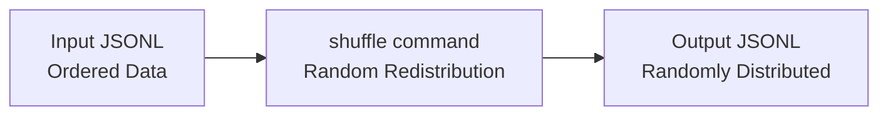
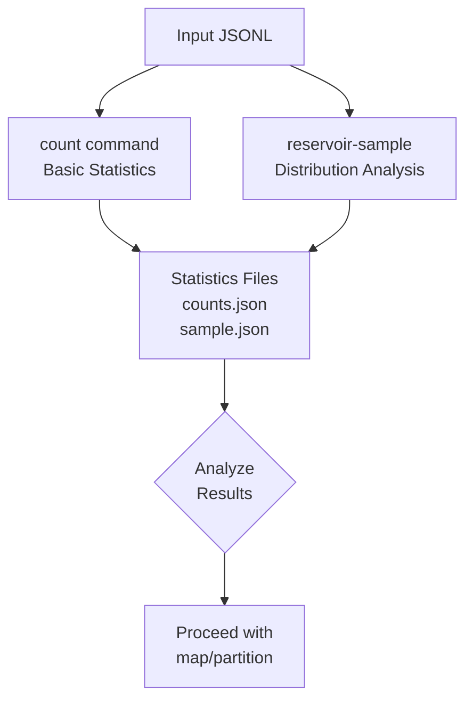

<!-- source: DeepWiki mcp.deepwiki.com · repo allenai/datamap-rs · page 1.3 Common Workflow Patterns · fetched 2026-10-26 -->

# Common Workflow Patterns

<details>
<summary>Relevant source files</summary>

The following files were used as context for generating this wiki page:

- [README.md](README.md)
- [docs/partition.md](docs/partition.md)
- [src/main.rs](src/main.rs)

</details>


## Purpose and Scope

This document describes typical multi-command workflows used with datamap-rs and when to apply each pattern. It provides concrete examples of how to chain commands together to accomplish common data processing tasks.

For detailed information about individual commands, see their respective documentation sections: [Map Command](#3), [Data Organization Commands](#4), and [Analysis Commands](#5). For a simple introduction to using datamap-rs, see [Quick Start Guide](#1.2).

---

## Fundamental Workflow Architecture

All datamap-rs workflows follow a **local-first processing model** where data is downloaded to fast local storage, processed, and then uploaded back to cloud storage. This architecture is not optional—it is a core design requirement for performance and reliability.



**Sources:** [README.md:20-21](), [README.md:115-128]()

### Typical Workflow Steps

| Step | Tool | Purpose |
|------|------|---------|
| 1. Download | `s5cmd`, `dl_hf_data.py`, `dl_hf_model.py` | Transfer data and models to local NVMe storage |
| 2. Verify | `map_verifiers.py` | Pre-flight check of pipeline configurations and resources |
| 3. Process | `datamap` commands | Execute data transformations |
| 4. Upload | `s5cmd` | Transfer results back to cloud storage |

**Example:**
```bash
# Step 1: Download data
s5cmd sync s3://bucket/raw_data ./local/input

# Step 2: Download models if needed
python utils/dl_hf_model.py facebook/fasttext-language-identification

# Step 3: Verify configuration
python utils/map_verifiers.py verify --config pipeline.yaml

# Step 4: Process data
datamap map --input_dir ./local/input --output_dir ./local/output --config pipeline.yaml

# Step 5: Upload results
s5cmd sync ./local/output s3://bucket/processed_data
```

**Sources:** [README.md:115-128](), Diagram 6 from system architecture

---

## Pattern 1: Sequential Pipeline Processing

**Use Case:** Apply a series of filters, modifiers, and annotators to transform and clean data.

This is the most common pattern, using the [`map`](#3) command with a configured pipeline of processors.



**Configuration Structure:**
```yaml
pipeline:
  - name: "URLSubstringFilter"
    kwargs:
      banlist_path: "./banlists/domains.txt"
  - name: "FastTextAnnotator"
    kwargs:
      model_path: "./models/lid176.bin"
      field: "metadata.language"
  - name: "MassiveWebRepetitionFilter"
    kwargs:
      min_char_length: 100
```

**Command:**
```bash
datamap map \
  --input_dir ./input \
  --output_dir ./output \
  --config pipeline.yaml \
  --threads 32
```

**Output Structure:**
```
output/
├── step_00/          # Documents filtered at first step
├── step_01/          # Documents filtered at second step
├── step_02/          # Documents filtered at third step
└── step_final/       # Documents that passed all filters
```

**Sources:** [src/main.rs:62-77](), [src/main.rs:328-386](), Diagram 2 and Diagram 3 from system architecture

---

## Pattern 2: Two-Stage Deduplication

**Use Case:** Remove duplicate documents based on a group ID (e.g., URL hash, content hash, document ID).

This pattern uses [`group`](#4.4) to co-locate documents with the same ID, followed by [`group-filter`](#4.5) to keep only one document per group.



**Step 1: Group Configuration (group_config.yaml)**
```yaml
group_key: "metadata.url_hash"
max_len: 256000000  # 256MB per output file
```

**Step 1: Group Command**
```bash
datamap group \
  --input_dir ./input \
  --group_dir ./grouped \
  --config group_config.yaml
```

**Step 2: GroupFilter Configuration (filter_config.yaml)**
```yaml
group_key: "metadata.url_hash"
sort_key: "metadata.timestamp"  # Optional: control which document to keep
keep_idx: -1  # -1 for last, 0 for first
max_len: 256000000
```

**Step 2: GroupFilter Command**
```bash
datamap group-filter \
  --input_dir ./grouped \
  --output_dir ./deduplicated \
  --config filter_config.yaml
```

**Sources:** [src/main.rs:169-192](), [README.md:52-59](), Diagram 2 from system architecture

---

## Pattern 3: Sample-Informed Partitioning

**Use Case:** Partition data into quantile-based buckets (e.g., split by quality score deciles) where you want approximately equal-sized partitions.

This pattern uses [`reservoir-sample`](#5.1) to gather statistics, then [`range-partition`](#4.3) to split data based on automatically calculated quantiles.



**Step 1: Create Reservoir Sample**
```bash
datamap reservoir-sample \
  --input_dir ./input \
  --output_file ./stats/quality_sample.json \
  --key "metadata.quality_score" \
  --reservoir_size 100000 \
  --token_weighted \
  --text_key "text"
```

The `--token_weighted` flag weights sampling by document length, ensuring quantiles represent token distribution rather than document distribution.

**Step 2: Range Partition Using Sample**
```bash
datamap range-partition \
  --input_dir ./input \
  --output_dir ./partitioned \
  --value "metadata.quality_score" \
  --reservoir_path ./stats/quality_sample.json \
  --num_buckets 10 \
  --bucket_name "quality_decile"
```

**Alternative: Manual Range Boundaries**
```bash
datamap range-partition \
  --input_dir ./input \
  --output_dir ./partitioned \
  --value "metadata.quality_score" \
  --range_groups 0.3,0.6,0.8 \
  --bucket_name "quality_tier"
```

**Sources:** [src/main.rs:102-121](), [src/main.rs:137-167](), [docs/partition.md:226-284](), Diagram 2 from system architecture

---

## Pattern 4: File Size Normalization

**Use Case:** Reorganize data into consistently-sized files for optimal parallel processing.

The 256MB target size balances parallelism (more files = more concurrent work) with memory efficiency (smaller files = less memory per thread).



**Command:**
```bash
datamap reshard \
  --input_dir ./input \
  --output_dir ./resharded \
  --max_size 256000000 \
  --keep_dirs  # Preserve subdirectory structure
```

**Options:**
- `--max_size`: Target size in bytes (default: 256MB = 268,435,456 bytes)
- `--max_lines`: Alternative limit by line count
- `--keep_dirs`: Preserve input directory structure in output
- `--subsample`: Random subsample (0.0-1.0) for creating smaller datasets

**Sources:** [src/main.rs:79-100](), [README.md:31-33](), Diagram 4 from system architecture

---

## Pattern 5: Multi-Criteria Partitioning

**Use Case:** Organize data by multiple criteria (e.g., first by language, then by quality within each language).

This pattern chains multiple partition commands.



**Step 1: Partition by Language**
```bash
datamap discrete-partition \
  --input_dir ./input \
  --output_dir ./by_language \
  --partition_key "metadata.language"
```

**Step 2: Partition Each Language by Quality**
```bash
# For each language directory
for lang in en es fr; do
  datamap range-partition \
    --input_dir ./by_language/$lang \
    --output_dir ./by_lang_quality/$lang \
    --value "metadata.quality_score" \
    --range_groups 0.3,0.6,0.8
done
```

**Sources:** [src/main.rs:123-167](), [docs/partition.md:1-315]()

---

## Pattern 6: Filter → Reshard → Upload Pipeline

**Use Case:** Clean data with filters, normalize file sizes for downstream processing, then upload to cloud storage.

This is a complete end-to-end workflow combining multiple patterns.



**Complete Script:**
```bash
#!/bin/bash
set -e

# Step 1: Download from S3
echo "Downloading data..."
s5cmd sync s3://input-bucket/raw_data ./local/raw

# Step 2: Download models
echo "Downloading models..."
python utils/dl_hf_model.py facebook/fasttext-language-identification

# Step 3: Verify configuration
echo "Verifying pipeline..."
python utils/map_verifiers.py verify --config pipeline.yaml

# Step 4: Filter and annotate
echo "Running pipeline..."
datamap map \
  --input_dir ./local/raw \
  --output_dir ./local/filtered \
  --config pipeline.yaml \
  --threads 32

# Step 5: Reshard to consistent sizes
echo "Resharding..."
datamap reshard \
  --input_dir ./local/filtered/step_final \
  --output_dir ./local/final \
  --max_size 256000000

# Step 6: Upload results
echo "Uploading results..."
s5cmd sync ./local/final s3://output-bucket/processed_data

echo "Complete!"
```

**Sources:** [README.md:115-128](), Diagram 6 from system architecture

---

## Pattern 7: Shuffle for Random Distribution

**Use Case:** Randomly redistribute documents across files, useful before training dataset sampling or to break ordering biases.



**Command:**
```bash
datamap shuffle \
  --input_dir ./input \
  --output_dir ./shuffled \
  --num_outputs 1000 \
  --max_len 256000000
```

**Note:** This provides coarse shuffling at the file level. Documents are randomly assigned to output files, but within each file they maintain their input order. For fine-grained shuffling, use external tools after this command.

**Sources:** [src/main.rs:194-209](), [README.md:61-64]()

---

## Pattern 8: Statistical Analysis Before Processing

**Use Case:** Understand data characteristics before applying filters or partitions.



**Step 1: Count Documents and Bytes**
```bash
datamap count \
  --input_dir ./input \
  --output_file ./stats/counts.json \
  --count_bytes "text"
```

**Output (counts.json):**
```json
{
  "total_docs": 15000000,
  "total_file_size": 87234567890,
  "total_text_bytes": 65432109876
}
```

**Step 2: Sample Key Fields**
```bash
# Sample quality scores
datamap reservoir-sample \
  --input_dir ./input \
  --output_file ./stats/quality_sample.json \
  --key "metadata.quality_score" \
  --reservoir_size 100000

# Sample document lengths
datamap reservoir-sample \
  --input_dir ./input \
  --output_file ./stats/length_sample.json \
  --key "metadata.length" \
  --reservoir_size 100000
```

**Step 3: Analyze and Decide**
```python
import json
import numpy as np

with open('./stats/quality_sample.json') as f:
    sample = json.load(f)

values = [doc['metadata.quality_score'] for doc in sample]
print(f"Quality score distribution:")
print(f"  Min: {np.min(values):.3f}")
print(f"  25th percentile: {np.percentile(values, 25):.3f}")
print(f"  Median: {np.median(values):.3f}")
print(f"  75th percentile: {np.percentile(values, 75):.3f}")
print(f"  Max: {np.max(values):.3f}")
```

**Sources:** [src/main.rs:211-220](), [src/main.rs:452-499](), [README.md:66-69]()

---

## Workflow Decision Guide

This table helps you choose which commands to use based on your goals:

| Goal | Primary Command(s) | Common Follow-up |
|------|-------------------|------------------|
| Filter and clean data | `map` | `reshard` → `count` |
| Remove duplicates | `group` → `group-filter` | `reshard` |
| Split by category (language, domain) | `discrete-partition` | None (already organized) |
| Split by quality/score quantiles | `reservoir-sample` → `range-partition` | None |
| Normalize file sizes | `reshard` | Any subsequent command |
| Random redistribution | `shuffle` | None |
| Understand dataset | `count`, `reservoir-sample` | Any processing command |
| Complete cleaning pipeline | `map` → `reshard` → `discrete-partition` | Upload to cloud |
| Deduplicate then filter | `group` → `group-filter` → `map` | `reshard` |

**Sources:** [README.md:22-69](), [src/main.rs:59-224]()

---

## Performance Considerations

### Thread Control

All commands support `--threads N` to limit parallelism:

```bash
# Use all available cores (default)
datamap map --input_dir ./input --output_dir ./output --config pipeline.yaml

# Limit to 16 threads (useful on shared machines)
datamap map --input_dir ./input --output_dir ./output --config pipeline.yaml --threads 16
```

### File Size Targets

The 256MB file size is optimal for most workloads:

| File Size | Parallelism | Memory Usage | I/O Efficiency |
|-----------|-------------|--------------|----------------|
| < 50MB | High | Low | Poor (overhead) |
| ~256MB | **Optimal** | **Moderate** | **Excellent** |
| > 1GB | Low | High | Poor (memory pressure) |

### Delete After Read

Some commands support `--delete_after_read` to free disk space during processing:

```bash
datamap map \
  --input_dir ./input \
  --output_dir ./output \
  --config pipeline.yaml \
  --delete_after_read  # Delete input files after processing
```

**Warning:** Only use this flag when you have backups or can re-download the data.

**Sources:** [src/main.rs:55-57](), [src/main.rs:76](), [src/main.rs:99](), [src/main.rs:208](), [README.md:104-112]()

---

## Command Composition Best Practices

### 1. Always Verify Before Processing

```bash
python utils/map_verifiers.py verify --config pipeline.yaml
```

This checks that all required models, banlists, and resources exist before starting expensive processing.

### 2. Use Reshard After Major Transformations

After `map`, `group-filter`, or other commands that may create unevenly-sized output files:

```bash
datamap reshard --input_dir ./uneven --output_dir ./normalized --max_size 256000000
```

### 3. Count Before and After

```bash
# Before processing
datamap count --input_dir ./input --output_file ./stats/before.json --count_bytes "text"

# Process data
datamap map --input_dir ./input --output_dir ./output --config pipeline.yaml

# After processing
datamap count --input_dir ./output/step_final --output_file ./stats/after.json --count_bytes "text"
```

### 4. Partition After Filtering

Run expensive filters first with `map`, then partition the cleaned data:

```bash
# Filter first (expensive)
datamap map --input_dir ./input --output_dir ./filtered --config filters.yaml

# Then partition (cheap)
datamap discrete-partition \
  --input_dir ./filtered/step_final \
  --output_dir ./partitioned \
  --partition_key "metadata.language"
```

### 5. Use Configuration Files for Reproducibility

Store all configurations in version control:

```
configs/
├── filter_pipeline.yaml
├── quality_partition.yaml
├── group_config.yaml
└── dedup_config.yaml
```

**Sources:** [src/main.rs:230-248](), [README.md:137-151]()

---

