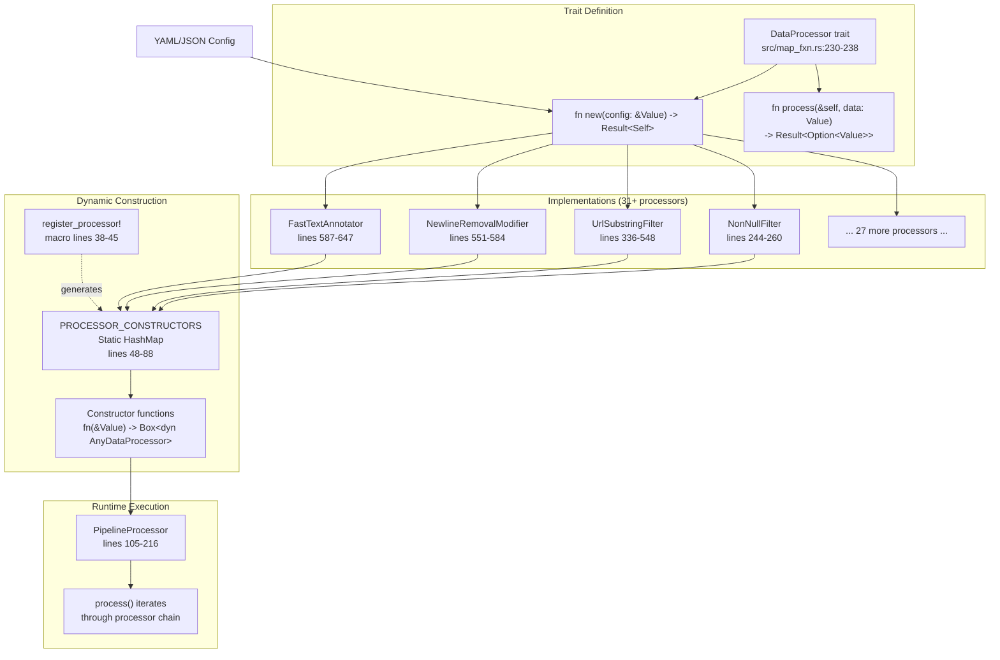
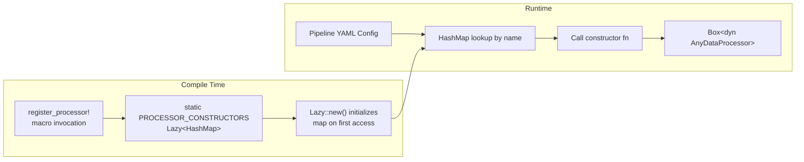
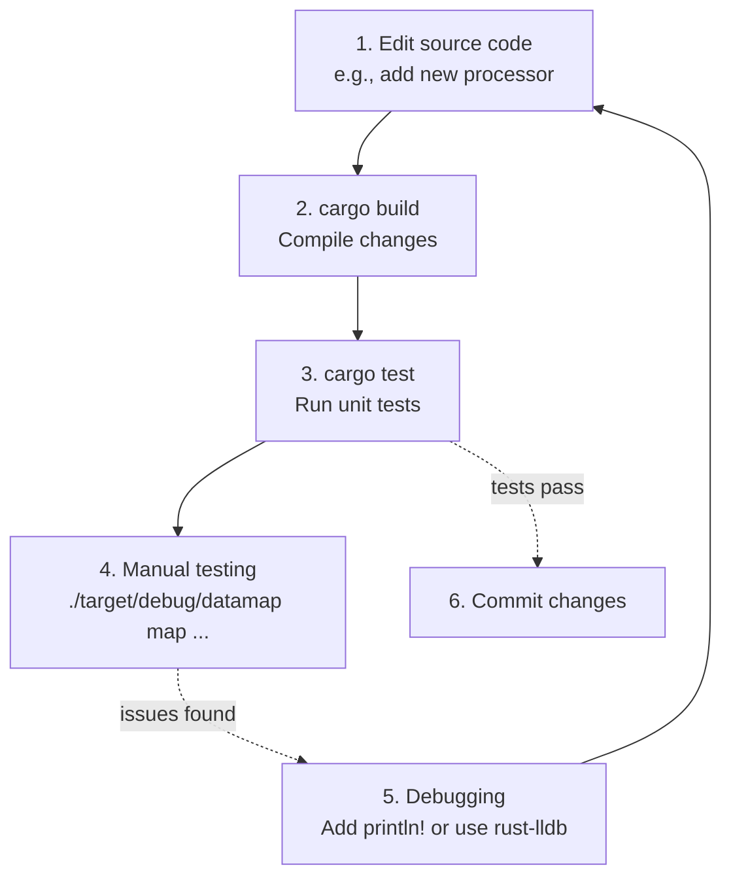
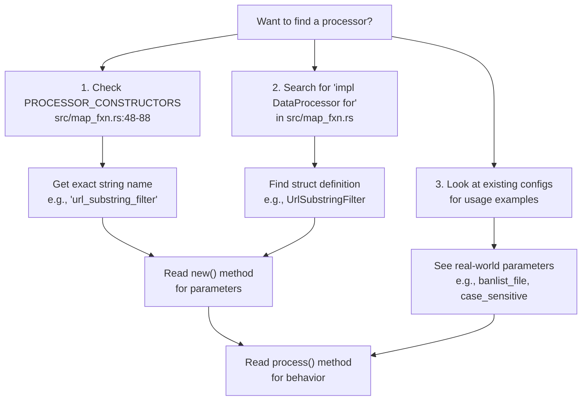
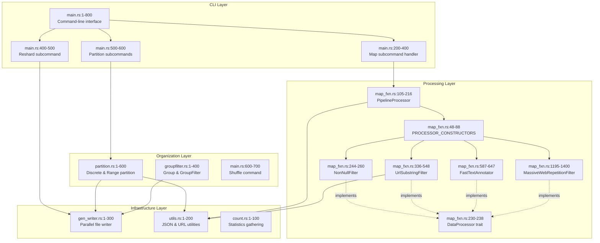

<!-- source: DeepWiki mcp.deepwiki.com · repo allenai/datamap-rs · page 10 Development Guide · fetched 2026-10-26 -->

# Development Guide

<details>
<summary>Relevant source files</summary>

The following files were used as context for generating this wiki page:

- [src/map_fxn.rs](src/map_fxn.rs)
- [tests/map_fxn_tests/fast_text_annotator_test.rs](tests/map_fxn_tests/fast_text_annotator_test.rs)
- [tests/map_fxn_tests/page_len_filter_test.rs](tests/map_fxn_tests/page_len_filter_test.rs)

</details>


## Purpose and Scope

This guide is for developers who want to extend, modify, or contribute to the datamap-rs codebase. It covers the project structure, core architectural patterns, build system, and common development workflows. 

For step-by-step instructions on adding new processors, see [Adding New Processors](#10.1). For testing strategies, see [Testing Processors](#10.2). For detailed architectural patterns, see [Code Architecture Patterns](#10.3).

---

## Codebase Organization

The datamap-rs project follows a standard Rust project structure with all source code in the `src/` directory and tests in `tests/`.

### Directory Structure

```
datamap-rs/
├── src/
│   ├── main.rs              # CLI entry point and command dispatch
│   ├── map_fxn.rs           # Pipeline processing and all DataProcessors
│   ├── partition.rs         # Discrete and range partitioning
│   ├── groupfilter.rs       # Grouping and deduplication
│   ├── gen_writer.rs        # Concurrent file writing infrastructure
│   ├── utils.rs             # JSON manipulation, URL parsing utilities
│   └── count.rs             # Count command implementation
├── tests/
│   ├── map_fxn_tests/       # Unit tests for processors
│   └── integration_tests/   # End-to-end command tests
├── python_utils/            # Cloud I/O and verification scripts
├── ft_classifiers/          # FastText model files
└── Cargo.toml              # Rust dependencies and build config
```

### Key Source Files

| File | Lines | Primary Responsibility |
|------|-------|----------------------|
| `src/main.rs` | ~800 | CLI argument parsing with `clap`, command dispatch to subcommands |
| `src/map_fxn.rs` | ~2300 | `DataProcessor` trait, `PipelineProcessor`, 31+ processor implementations |
| `src/gen_writer.rs` | ~300 | `GenWriter` for thread-safe parallel file output with compression |
| `src/partition.rs` | ~600 | Discrete and range partitioning logic |
| `src/groupfilter.rs` | ~400 | Group and GroupFilter command implementations |
| `src/utils.rs` | ~200 | JSON path manipulation (`json_get`, `json_set`), URL utilities |

Sources: Project directory structure, [src/main.rs:1-800](), [src/map_fxn.rs:1-2300]()

---

## Build System and Dependencies

### Prerequisites

**System Requirements:**
- Rust 1.70+ (2021 edition)
- C compiler (for FastText bindings)
- Optional: FastText model files in `ft_classifiers/`

**Building the Project:**

```bash
# Development build
cargo build

# Release build (optimized)
cargo build --release

# The binary will be in target/release/datamap
```

### Key Dependencies

The project uses several high-performance Rust crates:

| Dependency | Purpose | Usage Location |
|-----------|---------|----------------|
| `rayon` | Data parallelism | File-level parallel processing throughout |
| `dashmap` | Lock-free maps | `GenWriter` output stream registry |
| `serde_json` | JSON parsing | Primary JSON handling |
| `sonic-rs` | Fast JSON parsing | Alternative parser for speed |
| `fasttext` | ML models | `FastTextAnnotator` processor |
| `aho-corasick` | Multi-pattern matching | `UrlSubstringFilter` banlist matching |
| `regex` | Pattern matching | Multiple line modifier processors |
| `tiktoken-rs` | Tokenization | Token counting in processors |

Sources: [Cargo.toml](), Technology Stack diagram from overview

---

## Processor Architecture Overview

### The DataProcessor Trait System

All data transformation logic in the Map command is implemented through the `DataProcessor` trait:



**Key Types:**

- **`DataProcessor`**: Core trait that all processors implement. Two methods: `new()` for initialization, `process()` for transformation.
- **`AnyDataProcessor`**: Trait object wrapper that enables dynamic dispatch for heterogeneous processor collections.
- **`PipelineProcessor`**: Orchestrator that holds `Vec<Box<dyn AnyDataProcessor>>` and executes the pipeline sequentially.

**The `process()` Return Type:**

```rust
fn process(&self, data: Value) -> Result<Option<Value>, Error>
```

- `Ok(Some(value))`: Document passes, continue to next processor
- `Ok(None)`: Document filtered, stop pipeline for this document
- `Err(e)`: Processing error, typically logged but document may be dropped

Sources: [src/map_fxn.rs:230-238](), [src/map_fxn.rs:90-102](), [src/map_fxn.rs:105-135]()

---

## Static Processor Registration System

Processors are registered at compile time using a macro-based pattern:



**Registration Example:**

The macro expands processor registration:

```rust
// Macro definition (lines 38-45)
macro_rules! register_processor {
    ($map:expr, $name:expr, $processor_type:ty) => {
        $map.insert($name, |config| {
            let processor = <$processor_type>::new(config).unwrap();
            Ok(Box::new(processor) as Box<dyn AnyDataProcessor>)
        });
    };
}

// Usage in static initialization (lines 48-88)
static PROCESSOR_CONSTRUCTORS: Lazy<HashMap<&'static str, ProcessorConstructor>> =
    Lazy::new(|| {
        let mut m = HashMap::new();
        register_processor!(m, "non_null_filter", NonNullFilter);
        register_processor!(m, "fasttext_annotator", FastTextAnnotator);
        // ... 29 more registrations
        m
    });
```

**Why This Pattern:**

1. **Decoupling**: Config names don't need to match struct names
2. **Type Safety**: Compile-time verification that all registered types implement `DataProcessor`
3. **Zero Runtime Cost**: HashMap is initialized once lazily, then cached
4. **Extensibility**: Adding a processor requires only implementing the trait and adding one registration line

Sources: [src/map_fxn.rs:38-88](), [src/map_fxn.rs:110-133]()

---

## Development Workflow

### Local Development Loop



### Running Specific Tests

```bash
# Run all tests
cargo test

# Run tests for a specific processor
cargo test page_len_filter

# Run tests in a specific file
cargo test --test fast_text_annotator_test

# Run with output visible
cargo test -- --nocapture

# Run in release mode (faster for heavy computations)
cargo test --release
```

### Testing with Real Data

For integration testing with actual datasets:

```bash
# 1. Prepare small test dataset
head -n 1000 large_dataset.jsonl > test_data.jsonl

# 2. Create test config
cat > test_config.yaml <<EOF
pipeline:
  - name: text_len_filter
    kwargs:
      lower_bound: 10
      upper_bound: 1000
EOF

# 3. Run map command
./target/debug/datamap map \
  --input test_data.jsonl \
  --config test_config.yaml \
  --output test_output/

# 4. Inspect results
ls -lh test_output/step_*/
head test_output/step_final/*.jsonl
```

### Performance Profiling

For performance-critical changes:

```bash
# Build with profiling symbols
cargo build --release

# Profile with perf (Linux)
perf record --call-graph dwarf ./target/release/datamap map ...
perf report

# Profile with instruments (macOS)
instruments -t "Time Profiler" ./target/release/datamap map ...

# Use cargo flamegraph
cargo install flamegraph
cargo flamegraph -- map --input data.jsonl --config config.yaml --output out/
```

Sources: Standard Rust development practices, [tests/map_fxn_tests/]()

---

## Key Code Patterns

### Pattern 1: Configuration with Defaults

Most processors use the `get_default()` utility for configuration:

```rust
// From src/utils.rs
pub fn get_default<T: serde::de::DeserializeOwned>(
    config: &Value, 
    key: &str, 
    default: T
) -> T

// Usage in processor new() methods
let text_field = get_default(config, "text_field", String::from("text"));
let lower_bound = get_default(config, "lower_bound", 0);
let flag = get_default(config, "flag", false);
```

This allows configs to omit optional parameters while ensuring type safety.

### Pattern 2: JSON Path Manipulation

The `json_get()` and `json_set()` functions handle nested JSON paths:

```rust
// Reading nested values (src/utils.rs)
let value = json_get(&data, "metadata.language")?;

// Writing nested values (creates intermediate objects)
json_set(&mut data, "metadata.score", json!(0.95))?;

// Removing nested values
json_remove(&mut data, "metadata.temp")?;
```

Paths use dot notation: `"field"`, `"parent.child"`, `"a.b.c.d"`.

### Pattern 3: Error Handling with anyhow

The project uses `anyhow` for ergonomic error handling:

```rust
use anyhow::{anyhow, ensure, Result};

fn process(&self, data: Value) -> Result<Option<Value>, Error> {
    // Early return on error
    let text = json_get(&data, &self.text_field)
        .ok_or_else(|| anyhow!("Missing text field: {}", self.text_field))?;
    
    // Assertions with context
    ensure!(
        self.lower_bound <= self.upper_bound,
        "Invalid bounds: {} > {}", self.lower_bound, self.upper_bound
    );
    
    // ? operator propagates errors
    let value = parse_something(text)?;
    
    Ok(Some(data))
}
```

### Pattern 4: Lazy Static Initialization

Heavy resources are initialized once using `Lazy<T>`:

```rust
use once_cell::sync::Lazy;

// Processor registry (src/map_fxn.rs:48-88)
static PROCESSOR_CONSTRUCTORS: Lazy<HashMap<&'static str, ProcessorConstructor>> =
    Lazy::new(|| {
        // Expensive initialization happens once, on first access
        let mut m = HashMap::new();
        // ... populate map
        m
    });

// Thread-safe lazy initialization in processors
use once_cell::sync::OnceCell;

struct MyProcessor {
    regex: OnceCell<Regex>,
}

impl MyProcessor {
    fn get_regex(&self) -> Result<&Regex> {
        self.regex.get_or_try_init(|| {
            Regex::new(&self.pattern)
        })
    }
}
```

### Pattern 5: File-Level Parallelism with Rayon

Commands use Rayon for parallel file processing:

```rust
use rayon::prelude::*;

files.par_iter()
    .try_for_each(|file| -> Result<()> {
        // Each file processed in parallel
        let lines = read_file(file)?;
        let results = process_lines(lines)?;
        write_output(results)?;
        Ok(())
    })?;
```

**Important**: Parallelism is at file level, not document level. This maintains pipeline semantics while maximizing throughput.

Sources: [src/utils.rs:1-200](), [src/map_fxn.rs:48-88](), [src/main.rs:400-600]()

---

## Common Development Tasks

### Adding a New Field to Documents

If you need to add metadata or computed fields:

1. **Choose processor type**: Annotator (adds data) or Modifier (transforms)
2. **Use `json_set()`** to write to nested paths
3. **Preserve original data** unless explicitly modifying

Example: Adding a character count field

```rust
#[derive(Serialize, Debug)]
pub struct CharCountAdder {
    text_field: String,
    output_field: String,
}

impl DataProcessor for CharCountAdder {
    fn new(config: &Value) -> Result<Self, Error> {
        Ok(Self {
            text_field: get_default(config, "text_field", String::from("text")),
            output_field: get_default(config, "output_field", String::from("char_count")),
        })
    }
    
    fn process(&self, mut data: Value) -> Result<Option<Value>, Error> {
        let text = json_get(&data, &self.text_field)?.as_str().unwrap();
        let count = text.chars().count();
        json_set(&mut data, &self.output_field, json!(count))?;
        Ok(Some(data))
    }
}
```

Then register in `PROCESSOR_CONSTRUCTORS`:
```rust
register_processor!(m, "char_count_adder", CharCountAdder);
```

### Debugging Processor Behavior

**Technique 1: Print Debugging**

```rust
fn process(&self, data: Value) -> Result<Option<Value>, Error> {
    eprintln!("Processing doc: {:?}", data.get("id"));
    
    let result = self.do_work(&data)?;
    eprintln!("Result: {:?}", result);
    
    Ok(result)
}
```

Use `eprintln!` (stderr) to avoid mixing with jsonl output.

**Technique 2: Conditional Filtering**

Add a debug field to see which documents trigger certain code paths:

```rust
if some_condition {
    json_set(&mut data, "debug.triggered", json!(true))?;
}
```

**Technique 3: Step Output Inspection**

The Map command writes filtered documents to `step_XX/` directories. Check these to see where documents are dropped:

```bash
# Count docs in each step
wc -l output/step_*/chunk_0000.jsonl

# Examine filtered docs
head output/step_03/chunk_0000.jsonl
```

### Working with FastText Models

Loading and using FastText models:

```rust
use fasttext::FastText;

struct MyAnnotator {
    model: FastText,
}

impl DataProcessor for MyAnnotator {
    fn new(config: &Value) -> Result<Self, Error> {
        let model_path = config.get("model_path")?.as_str()?;
        let mut model = FastText::new();
        model.load_model(model_path)?;
        
        Ok(Self { model })
    }
    
    fn process(&self, mut data: Value) -> Result<Option<Value>, Error> {
        let text = json_get(&data, "text")?.as_str()?.replace("\n", " ");
        
        // Predict with k=5, threshold=0.1
        let predictions = self.model.predict(&text, 5, 0.1)?;
        
        for pred in predictions {
            // pred.label: String, pred.prob: f32
            json_set(&mut data, &format!("scores.{}", pred.label), json!(pred.prob))?;
        }
        
        Ok(Some(data))
    }
}
```

**Model File Locations**: Place models in `ft_classifiers/` directory. Common models:
- `lid176.bin`: Language identification (176 languages)
- `dolma3_qc.bin`: Quality classification model

Sources: [src/map_fxn.rs:587-647](), [tests/map_fxn_tests/fast_text_annotator_test.rs:1-209]()

---

## Understanding Existing Processors

### Processor Categorization

The codebase contains 31+ processors organized by purpose:

**Filters** (return `None` to drop documents):
- `NonNullFilter`: Drop null documents
- `TextLenFilter`: Filter by text length
- `FloatFilter`: Filter by numeric field ranges
- `UrlSubstringFilter`: Filter by URL patterns (uses AhoCorasick)
- `MassiveWebRepetitionFilter`: Complex repetition detection with 13 configurations

**Modifiers** (transform document content):
- `NewlineRemovalModifier`: Limit consecutive newlines
- `RatioLineModifier`: Remove lines with too many uppercase/digits
- `RegexLineModifier`: Remove lines matching regex
- `LineLenModifier`: Remove short lines
- `SubstringLineModifier`: Remove lines with banned substrings

**Annotators** (add metadata, never filter):
- `FastTextAnnotator`: ML classification scores
- `HashAnnotator`: Add content hash
- `WordCountAdder`: Add word count field
- `ConstantAnnotator`: Add constant values
- `Madlad400SentenceAnnotator`: Multi-rule quality scoring

### Finding Processor Implementations



**Example: Understanding `UrlSubstringFilter`**

1. Find registration: Line 55 `register_processor!(m, "url_substring_filter", UrlSubstringFilter);`
2. Find struct: Lines 336-376 define fields
3. Find `new()`: Lines 378-396 parse config and load banlist file
4. Find `process()`: Lines 398-496 implement filtering logic
5. Find tests: `tests/map_fxn_tests/url_substring_filter_test.rs` (if exists)

### Processor Complexity Levels

| Complexity | Examples | Characteristics |
|-----------|----------|----------------|
| **Simple** | `NonNullFilter`, `SubsampleFilter` | <50 lines, no external data |
| **Medium** | `TextLenFilter`, `WordCountAdder` | 50-150 lines, text processing |
| **Complex** | `UrlSubstringFilter`, `FastTextAnnotator` | 150-300 lines, external resources |
| **Advanced** | `MassiveWebRepetitionFilter` | 300+ lines, sophisticated algorithms |

Start by studying simple processors, then progress to more complex ones.

Sources: [src/map_fxn.rs:243-2300](), processor implementations throughout file

---

## Code Navigation Map

This diagram maps high-level concepts to specific code locations:



Sources: [src/main.rs:1-800](), [src/map_fxn.rs:1-2300](), [src/gen_writer.rs:1-300](), [src/partition.rs:1-600]()

---

## Testing Infrastructure

### Unit Test Structure

Tests are organized by processor in `tests/map_fxn_tests/`:

```
tests/
└── map_fxn_tests/
    ├── page_len_filter_test.rs
    ├── fast_text_annotator_test.rs
    ├── url_substring_filter_test.rs
    └── ... more processor tests
```

**Standard Test Pattern:**

```rust
extern crate datamap_rs;
use datamap_rs::map_fxn::{DataProcessor, YourProcessor};
use serde_json::{json, Value};

#[cfg(test)]
mod tests {
    use super::*;
    
    // Helper to create test configs
    fn create_test_config() -> Value {
        json!({
            "param1": "value1",
            "param2": 42
        })
    }
    
    #[test]
    fn test_processor_creation() {
        let config = create_test_config();
        let processor = YourProcessor::new(&config).unwrap();
        
        assert_eq!(processor.param1, "value1");
        assert_eq!(processor.param2, 42);
    }
    
    #[test]
    fn test_document_passes() {
        let config = create_test_config();
        let processor = YourProcessor::new(&config).unwrap();
        
        let doc = json!({"text": "test content"});
        let result = processor.process(doc).unwrap();
        
        assert!(result.is_some());
    }
    
    #[test]
    fn test_document_filtered() {
        let config = create_test_config();
        let processor = YourProcessor::new(&config).unwrap();
        
        let doc = json!({"text": ""}); // Empty should be filtered
        let result = processor.process(doc).unwrap();
        
        assert!(result.is_none());
    }
}
```

**Test Coverage Goals:**

1. ✅ Processor creation with minimal config
2. ✅ Processor creation with full config
3. ✅ Documents that should pass
4. ✅ Documents that should be filtered
5. ✅ Edge cases (empty text, missing fields, extreme values)
6. ✅ Error handling (invalid config, malformed data)

Sources: [tests/map_fxn_tests/page_len_filter_test.rs:1-172](), [tests/map_fxn_tests/fast_text_annotator_test.rs:1-209]()

---

## Performance Considerations

### When to Optimize

Profile before optimizing. Most processors are IO-bound, not CPU-bound.

**CPU-Bound Processors:**
- `MassiveWebRepetitionFilter`: Rolling hash computations
- `FastTextAnnotator`: ML model inference
- `PageLenFilter`: Unicode word boundary detection

**IO-Bound Operations:**
- File reading/writing (parallelized by Rayon)
- JSON parsing (use `sonic-rs` for speed-critical paths)
- Decompression of `.zst` files

### Optimization Techniques

**1. Avoid Allocations in Hot Paths**

```rust
// BAD: Allocates string every time
fn count_words(&self, text: &str) -> usize {
    text.split_whitespace()
        .map(|w| w.to_string())  // Unnecessary allocation
        .count()
}

// GOOD: Work with string slices
fn count_words(&self, text: &str) -> usize {
    text.split_whitespace().count()
}
```

**2. Use Efficient Data Structures**

```rust
// Use FxHashMap for non-cryptographic hashing
use fxhash::FxHashMap;
let mut map = FxHashMap::default();

// Use AhoCorasick for multi-pattern matching
use aho_corasick::AhoCorasick;
let ac = AhoCorasick::new(patterns)?;
```

**3. Lazy Initialization of Heavy Resources**

```rust
use once_cell::sync::OnceCell;

struct Processor {
    regex: OnceCell<Regex>,  // Compiled once, cached
}

impl Processor {
    fn get_regex(&self) -> &Regex {
        self.regex.get_or_init(|| Regex::new(&self.pattern).unwrap())
    }
}
```

**4. Early Returns**

```rust
fn process(&self, data: Value) -> Result<Option<Value>, Error> {
    // Check cheapest conditions first
    if data.is_null() {
        return Ok(None);
    }
    
    // Then more expensive checks
    let text = json_get(&data, "text")?;
    if text.as_str()?.is_empty() {
        return Ok(None);
    }
    
    // Finally, expensive processing
    // ...
}
```

Sources: [src/map_fxn.rs:1158-1191](), performance optimization patterns throughout codebase

---

## Next Steps

- **To add a new processor**: See [Adding New Processors](#10.1) for a step-by-step guide
- **To write tests**: See [Testing Processors](#10.2) for testing patterns and examples  
- **To understand patterns in depth**: See [Code Architecture Patterns](#10.3) for trait objects, registration system, and more

For questions about existing processors or architectural decisions, examine the source code using the navigation map above, or refer to specific processor implementations in `src/map_fxn.rs`.

---

