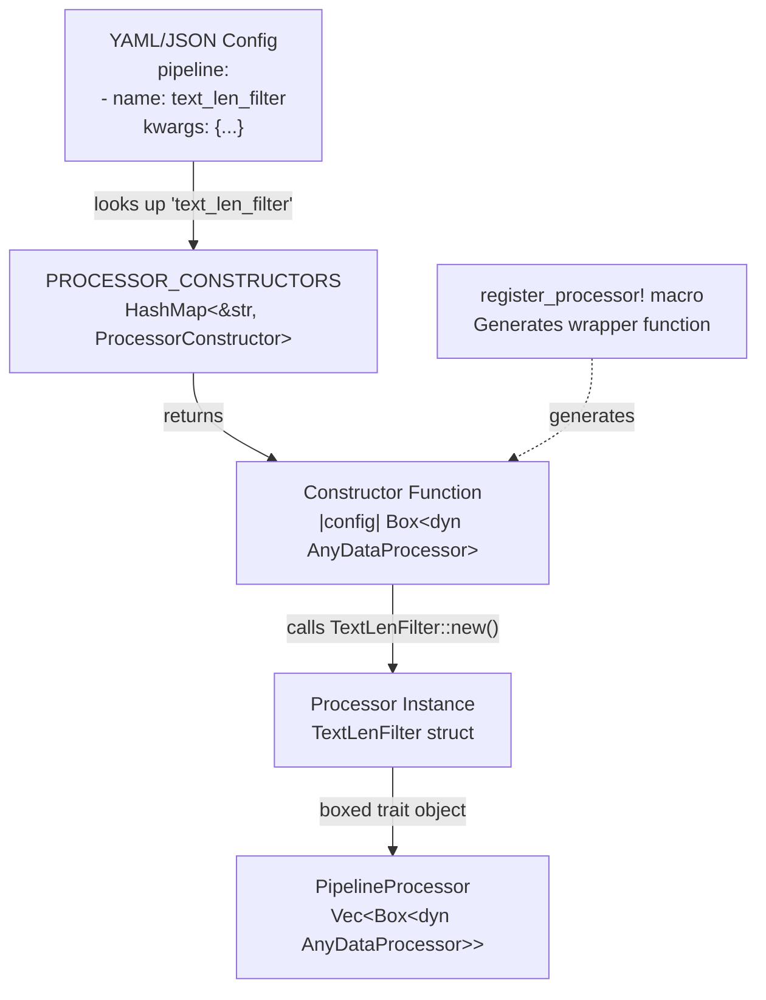
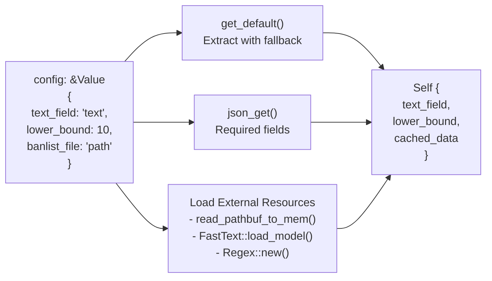
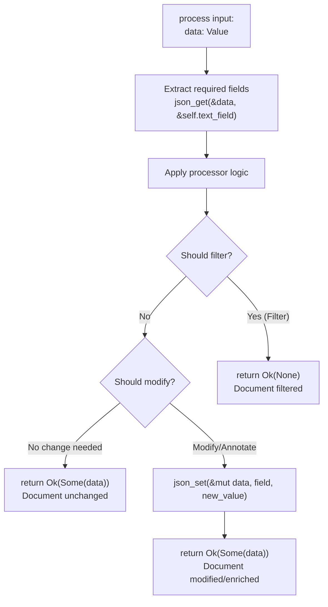
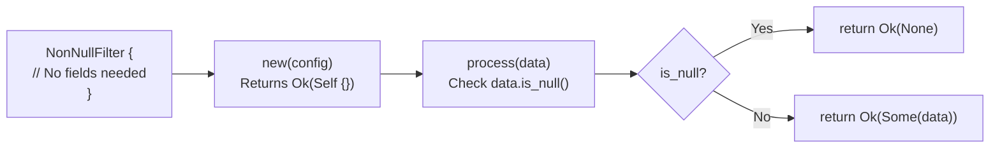
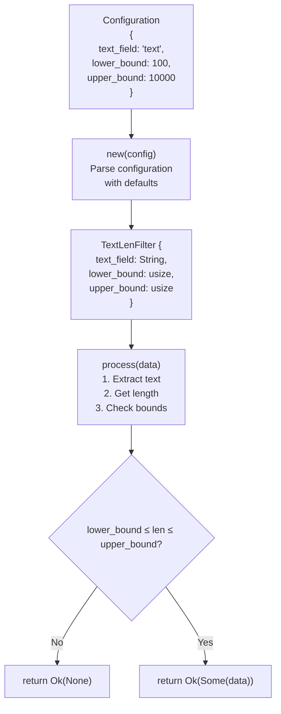
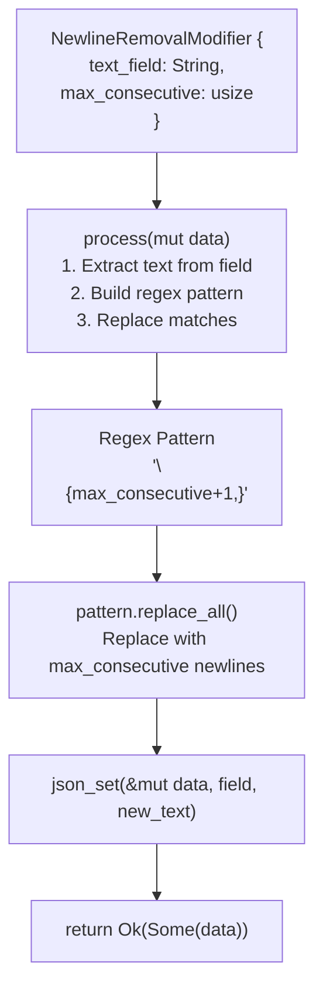
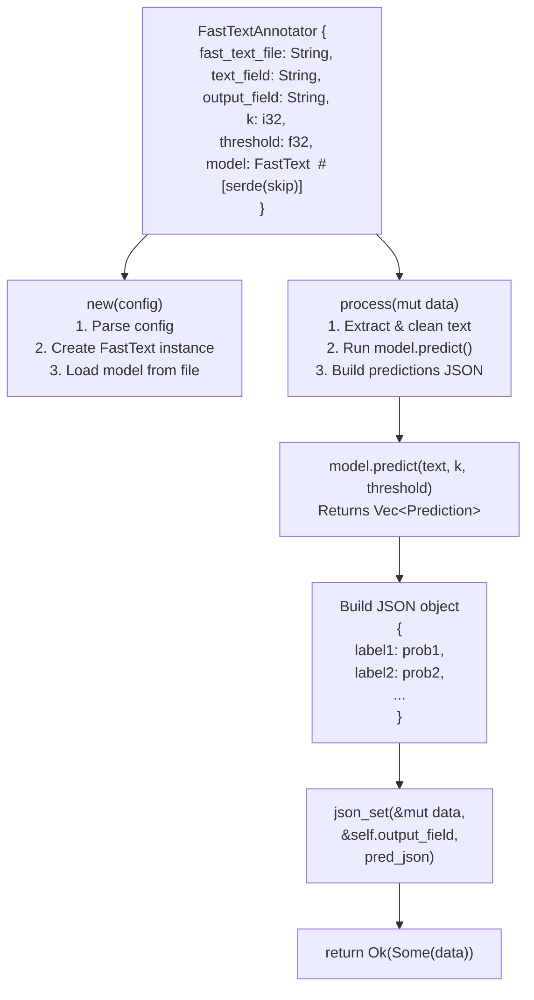
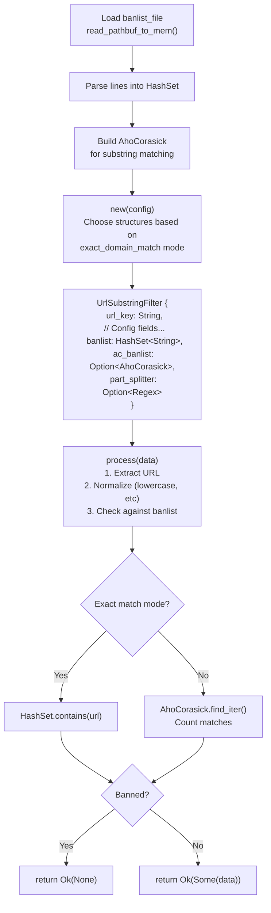

<!-- source: DeepWiki mcp.deepwiki.com · repo allenai/datamap-rs · page 10.1 Adding New Processors · fetched 2026-10-26 -->

# Adding New Processors

<details>
<summary>Relevant source files</summary>

The following files were used as context for generating this wiki page:

- [src/map_fxn.rs](src/map_fxn.rs)
- [tests/map_fxn_tests/fast_text_annotator_test.rs](tests/map_fxn_tests/fast_text_annotator_test.rs)
- [tests/map_fxn_tests/page_len_filter_test.rs](tests/map_fxn_tests/page_len_filter_test.rs)

</details>


## Purpose and Scope

This guide provides step-by-step instructions for developers who want to extend datamap-rs by implementing new `DataProcessor` types. Processors are the fundamental building blocks of the Map pipeline system and enable custom filtering, modification, and annotation logic for document processing.

This page covers the technical implementation details of creating and registering processors. For information about how processors work within the pipeline architecture, see [Pipeline Architecture](#3.1). For details on using existing processors, see sections [3.3](#3.3), [3.4](#3.4), and [3.5](#3.5).

---

## Understanding the Processor System

### The DataProcessor Trait

All processors in datamap-rs implement the `DataProcessor` trait, which defines two required methods:

**Core Trait Definition**
```
DataProcessor trait methods:
- new(config: &Value) -> Result<Self, Error>
- process(data: Value) -> Result<Option<Value>, Error>
```

The `new` method constructs the processor from a JSON/YAML configuration, while `process` transforms a single document. Returning `None` from `process` filters out the document; returning `Some(data)` passes it forward (potentially modified).

Sources: [src/map_fxn.rs:230-238]()

### Processor Registration System

The system uses a static registry pattern with dynamic dispatch to instantiate processors from configuration. The `PROCESSOR_CONSTRUCTORS` map associates string names with constructor functions, and the `register_processor!` macro simplifies registration.



**Processor Registration Flow**

Sources: [src/map_fxn.rs:36-88]()

### Processor Categories

Processors fall into three behavioral categories, though all implement the same trait:

| Category | Behavior | Return Pattern | Use Cases |
|----------|----------|----------------|-----------|
| **Filters** | Remove documents | `Ok(None)` to filter, `Ok(Some(data))` to keep | Quality thresholds, content restrictions, URL banlists |
| **Modifiers** | Transform content | Always `Ok(Some(modified_data))` | Text cleaning, field renaming, line-level edits |
| **Annotators** | Add metadata | Always `Ok(Some(enriched_data))` | ML classification, statistics computation, hash generation |

Sources: [src/map_fxn.rs:90-102]()

---

## Step-by-Step: Implementing a New Processor

### Step 1: Define the Struct

Create a struct that holds all configuration parameters and cached resources. Use `#[derive(Serialize, Debug)]` for serialization support.

```
Example struct patterns:

Simple filter (no cached data):
- Fields: text_field, lower_bound, upper_bound
- Derives: Serialize, Debug

Complex processor (with cached resources):
- Fields: text_field, config params, cached HashSet/AhoCorasick/Model
- Derives: Serialize, Debug
- Use #[serde(skip)] for non-serializable fields like models
```

**Example from TextLenFilter:**

[src/map_fxn.rs:263-269]() shows a simple filter with only configuration fields.

**Example from UrlSubstringFilter:**

[src/map_fxn.rs:333-376]() shows a complex filter with cached `AhoCorasick` patterns and `HashSet` banlists, using `#[serde(skip)]` for runtime-constructed fields.

**Example from FastTextAnnotator:**

[src/map_fxn.rs:587-596]() demonstrates loading an ML model during construction, with `#[serde(skip)]` on the `model` field.

Sources: [src/map_fxn.rs:263-269](), [src/map_fxn.rs:333-376](), [src/map_fxn.rs:587-596]()

### Step 2: Implement the `new` Method

The `new` method parses configuration using helper functions and initializes cached resources.



**Configuration Parsing Pattern**

**Common Helper Functions:**

| Function | Purpose | Example Usage |
|----------|---------|---------------|
| `get_default(config, "key", default_value)` | Extract with fallback | `get_default(config, "lower_bound", 0)` |
| `json_get(&data, "field.nested")` | Navigate nested JSON | `json_get(&data, "metadata.score")` |
| `config.get("key").unwrap().as_str()` | Required string field | For paths, identifiers |
| `read_pathbuf_to_mem(&path)` | Load file to memory | Banlist files, regex patterns |

**Example Pattern:**

[src/map_fxn.rs:270-280]() shows typical configuration parsing for `TextLenFilter`.

[src/map_fxn.rs:378-396]() demonstrates loading external resources (banlist file) and constructing efficient data structures (`AhoCorasick`).

Sources: [src/map_fxn.rs:4](), [src/map_fxn.rs:270-280](), [src/map_fxn.rs:378-396]()

### Step 3: Implement the `process` Method

The `process` method contains the core logic. It should handle errors gracefully and decide whether to filter, modify, or enrich the document.



**Processing Decision Flow**

**Key Patterns:**

1. **Filtering Pattern**: Check condition, return `None` if fails
   ```
   if condition_failed {
       return Ok(None);  // Document filtered
   }
   Ok(Some(data))  // Document passes
   ```

2. **Modification Pattern**: Clone or mutate, modify fields, return modified
   ```
   let mut data = data;
   json_set(&mut data, &self.field, new_value)?;
   Ok(Some(data))
   ```

3. **Annotation Pattern**: Add metadata without removing fields
   ```
   let mut data = data;
   let annotations = compute_annotations();
   json_set(&mut data, &self.output_field, annotations)?;
   Ok(Some(data))
   ```

**Example Implementations:**

[src/map_fxn.rs:282-290]() shows a simple filter that returns `None` when bounds check fails.

[src/map_fxn.rs:566-583]() demonstrates text modification using regex replacement.

[src/map_fxn.rs:622-646]() illustrates annotation with ML model predictions.

Sources: [src/map_fxn.rs:282-290](), [src/map_fxn.rs:566-583](), [src/map_fxn.rs:622-646]()

### Step 4: Register the Processor

Add a single line to the `PROCESSOR_CONSTRUCTORS` initialization using the `register_processor!` macro.

**Registration Location:**

The static map initialization is in [src/map_fxn.rs:48-88](). Add your processor to this list:

```
register_processor!(m, "your_processor_name", YourProcessorStruct);
```

The macro automatically generates the wrapper function that calls `YourProcessorStruct::new(config)` and boxes the result as a trait object.

**Registration Examples:**

[src/map_fxn.rs:51]() - Simple filter: `register_processor!(m, "non_null_filter", NonNullFilter)`

[src/map_fxn.rs:55]() - URL filter: `register_processor!(m, "url_substring_filter", UrlSubstringFilter)`

[src/map_fxn.rs:57]() - Annotator: `register_processor!(m, "fasttext_annotator", FastTextAnnotator)`

The string name you choose (first parameter) is what users will specify in their pipeline YAML configuration.

Sources: [src/map_fxn.rs:38-45](), [src/map_fxn.rs:48-88]()

---

## Configuration Patterns

### Standard Configuration Fields

Most processors follow common patterns for configuration. Understanding these patterns helps maintain consistency across the codebase.

| Field Pattern | Type | Purpose | Default Handling |
|---------------|------|---------|------------------|
| `text_field` | `String` | Field containing text to process | `get_default(config, "text_field", "text")` |
| `lower_bound` / `upper_bound` | `usize` or `f32` | Numeric thresholds | `get_default(config, "key", 0)` / `usize::MAX` |
| `output_field` | `String` | Where to write annotations | `get_default(config, "output_field", "metadata.X")` |
| `*_file` | `String` | Path to external resource | `config.get("key").unwrap().as_str()` (required) |
| `negate` / `keep_matches` | `bool` | Invert filter logic | `get_default(config, "key", false)` |

### Loading External Resources

When processors need external data (banlists, models, regex patterns), load them once during construction:

**File Loading Pattern:**

[src/map_fxn.rs:382-393]() demonstrates loading a banlist file into a `HashSet`:
1. Get file path from config
2. Use `read_pathbuf_to_mem(&path)` to load file
3. Process lines into appropriate data structure
4. Store in struct field

**ML Model Loading Pattern:**

[src/map_fxn.rs:600-619]() shows FastText model initialization:
1. Get model path from config
2. Create model instance: `let mut model = FastText::new()`
3. Load model: `model.load_model(&path)`
4. Mark field with `#[serde(skip)]`

### Efficient Data Structures

Choose appropriate cached structures for performance:

| Use Case | Structure | Example Processor | Code Reference |
|----------|-----------|-------------------|----------------|
| Exact membership testing | `HashSet<String>` | `UrlSubstringFilter` | [src/map_fxn.rs:367]() |
| Multi-pattern substring matching | `AhoCorasick` | `UrlSubstringFilter` | [src/map_fxn.rs:370]() |
| Pattern matching | `Regex` | `RegexLineModifier` | [src/map_fxn.rs:1519]() |
| ML classification | `FastText` | `FastTextAnnotator` | [src/map_fxn.rs:595]() |
| Character set checking | `HashSet<char>` | `Madlad400SentenceAnnotator` | [src/map_fxn.rs:1783]() |

Sources: [src/map_fxn.rs:382-393](), [src/map_fxn.rs:600-619](), [src/map_fxn.rs:367](), [src/map_fxn.rs:370](), [src/map_fxn.rs:1519](), [src/map_fxn.rs:595]()

---

## Complete Implementation Examples

### Example 1: Simple Filter (NonNullFilter)

The simplest possible processor filters null JSON values.



**NonNullFilter Implementation Flow**

**Complete Implementation:**

- **Struct Definition**: [src/map_fxn.rs:243-246]()
- **new method**: [src/map_fxn.rs:248-250]() - No configuration needed
- **process method**: [src/map_fxn.rs:252-259]() - Single null check
- **Registration**: [src/map_fxn.rs:51]()

This processor demonstrates the minimal implementation: no configuration fields, no external resources, straightforward filter logic.

Sources: [src/map_fxn.rs:243-259]()

### Example 2: Filter with Configuration (TextLenFilter)

A more realistic filter that uses configuration parameters to check text length bounds.



**TextLenFilter Implementation Flow**

**Complete Implementation:**

- **Struct Definition**: [src/map_fxn.rs:263-269]()
- **new method**: [src/map_fxn.rs:270-280]() - Uses `get_default` for optional parameters
- **process method**: [src/map_fxn.rs:282-290]() - Extracts text, checks length, filters if outside bounds
- **Registration**: [src/map_fxn.rs:52]()

**Key Techniques:**
- Default values: `get_default(config, "lower_bound", 0)` provides sensible fallback
- Field navigation: `json_get(&data, &self.text_field)` handles nested fields
- Clear filter logic: Simple boolean condition determines filter outcome

Sources: [src/map_fxn.rs:263-290]()

### Example 3: Modifier with Text Transformation (NewlineRemovalModifier)

Modifiers transform document content rather than filtering. This example removes excessive consecutive newlines.



**NewlineRemovalModifier Processing Flow**

**Complete Implementation:**

- **Struct Definition**: [src/map_fxn.rs:551-555]()
- **new method**: [src/map_fxn.rs:556-564]() - Simple configuration parsing
- **process method**: [src/map_fxn.rs:566-583]() - Constructs regex, performs replacement, updates field
- **Registration**: [src/map_fxn.rs:56]()

**Key Techniques:**
- `mut data`: Document must be mutable for modification
- Dynamic regex: Pattern constructed from configuration parameter
- `json_set`: Updates field in place with modified text
- Always returns `Some(data)`: Modifiers never filter

Sources: [src/map_fxn.rs:551-583]()

### Example 4: Annotator with ML Model (FastTextAnnotator)

Annotators add metadata using external models or computation. This example uses a FastText model to classify text.



**FastTextAnnotator Implementation Flow**

**Complete Implementation:**

- **Struct Definition**: [src/map_fxn.rs:587-596]() - Note `#[serde(skip)]` on model field
- **new method**: [src/map_fxn.rs:598-620]() - Loads ML model during initialization
- **process method**: [src/map_fxn.rs:622-646]() - Runs prediction, formats results, adds to document
- **Registration**: [src/map_fxn.rs:57]()

**Key Techniques:**
- Model caching: Load once in `new`, reuse in `process`
- Error handling: Returns `None` if prediction fails (rare UTF-8 issues)
- Clean text: Replaces newlines with spaces before prediction
- Structured output: Converts predictions to JSON object with label→probability mapping

Sources: [src/map_fxn.rs:587-646]()

### Example 5: Complex Filter with External Resources (UrlSubstringFilter)

The most complex processors combine multiple data structures and operational modes.



**UrlSubstringFilter Implementation Flow**

**Complete Implementation:**

- **Struct Definition**: [src/map_fxn.rs:333-376]() - Multiple cached structures
- **new method**: [src/map_fxn.rs:378-396]() - Loads banlist file
- **Helper constructor**: [src/map_fxn.rs:499-547]() - Builds efficient data structures based on config
- **process method**: [src/map_fxn.rs:398-496]() - Complex matching logic with multiple modes
- **Registration**: [src/map_fxn.rs:55]()

**Key Techniques:**
- Multiple operational modes: Exact domain, exact subdomain, exact URL, substring matching
- Efficient structures: `HashSet` for exact matching, `AhoCorasick` for multi-pattern substring searches
- Configuration complexity: Many boolean flags control behavior
- Optional fields: `Option<AhoCorasick>` only constructed when needed

Sources: [src/map_fxn.rs:333-547]()

---

## Testing Your Processor

### Unit Test Structure

Create a test file in `tests/map_fxn_tests/` following this pattern:

```
tests/map_fxn_tests/
├── your_processor_test.rs      # Your new test file
├── page_len_filter_test.rs     # Example reference
└── fast_text_annotator_test.rs # Example reference
```

**Test File Template:**

```
extern crate datamap_rs;
use datamap_rs::map_fxn::{DataProcessor, YourProcessor};

#[cfg(test)]
mod tests {
    use super::*;
    use serde_json::{json, Value};
    
    // Test constructor with minimal config
    // Test constructor with full config
    // Test process with valid input
    // Test process with edge cases
    // Test filter/modification behavior
}
```

### Essential Test Cases

| Test Category | Purpose | Example Test |
|---------------|---------|--------------|
| **Constructor Tests** | Verify configuration parsing | Default values, custom values, validation |
| **Process Success** | Test normal operation | Valid input produces expected output |
| **Edge Cases** | Test boundary conditions | Empty text, null values, extreme values |
| **Filter Behavior** | Verify filtering logic | Documents that should pass/fail |
| **Field Handling** | Test custom field names | Non-default text_field, nested paths |

**Example Test Structure (PageLenFilter):**

[tests/map_fxn_tests/page_len_filter_test.rs:14-41]() shows constructor testing with minimal and full configurations.

[tests/map_fxn_tests/page_len_filter_test.rs:53-90]() demonstrates testing documents within and outside bounds.

[tests/map_fxn_tests/page_len_filter_test.rs:148-171]() covers edge cases like empty text.

**Example Test Structure (FastTextAnnotator):**

[tests/map_fxn_tests/fast_text_annotator_test.rs:29-57]() tests configuration parsing.

[tests/map_fxn_tests/fast_text_annotator_test.rs:61-82]() verifies annotation is added correctly.

[tests/map_fxn_tests/fast_text_annotator_test.rs:171-208]() includes integration test with multiple documents.

Sources: [tests/map_fxn_tests/page_len_filter_test.rs:1-172](), [tests/map_fxn_tests/fast_text_annotator_test.rs:1-209]()

---

## Implementation Checklist

Before submitting your new processor, verify:

### Code Requirements

- [ ] Struct derives `Serialize` and `Debug`
- [ ] Non-serializable fields marked with `#[serde(skip)]`
- [ ] `DataProcessor` trait fully implemented
- [ ] Configuration parsing uses `get_default` for optional parameters
- [ ] Required configuration fields validated in `new`
- [ ] External resources loaded once in `new`, cached in struct
- [ ] `process` method handles errors gracefully
- [ ] `process` returns `Ok(None)` for filtering, `Ok(Some(data))` otherwise
- [ ] Processor registered in `PROCESSOR_CONSTRUCTORS` map
- [ ] Registration name follows snake_case convention

### Documentation Requirements

- [ ] Struct fields have clear comments
- [ ] Complex logic documented inline
- [ ] Configuration parameters explained in struct or method comments
- [ ] Edge cases and special behaviors documented

### Testing Requirements

- [ ] Test file created in `tests/map_fxn_tests/`
- [ ] Constructor tests with default and custom configs
- [ ] Process tests with valid inputs
- [ ] Edge case tests (empty, null, boundary values)
- [ ] Filter behavior verified (if applicable)
- [ ] Custom field handling tested
- [ ] All tests pass with `cargo test`

---

## Common Patterns and Best Practices

### Performance Considerations

1. **Lazy Compilation**: Use `OnceCell<Regex>` for regex patterns that don't need to exist at construction time [src/map_fxn.rs:1619]()

2. **Efficient Data Structures**: 
   - `AhoCorasick` for multi-pattern matching (faster than multiple regex)
   - `HashSet` for membership tests (O(1) lookup)
   - `FxHashMap` for non-cryptographic hashing (faster than std HashMap)

3. **Avoid Allocations**: Process iterators directly rather than collecting into vectors when possible

4. **Cache Everything**: Load files, compile patterns, initialize models in `new`, not in `process`

### Error Handling Patterns

1. **Graceful Degradation**: If prediction/processing fails non-critically, return `None` to filter the document rather than crashing [src/map_fxn.rs:633-636]()

2. **Required Fields**: Use `unwrap()` on required fields after validation, or propagate errors with `?`

3. **Optional Fields**: Use `json_get(...).unwrap_or(default)` or `if let Some(val) = json_get(...)`

### Configuration Patterns

1. **Text Field Default**: Almost all processors should have `text_field` with default "text"

2. **Bounds Defaults**: Use `0` and `usize::MAX`/`f32::MAX` for inclusive bounds

3. **Boolean Flags**: Default to `false` unless the "enabled" state is most common

4. **Output Fields**: Default to `"metadata.{processor_name}"` for annotation processors

Sources: [src/map_fxn.rs:1619](), [src/map_fxn.rs:633-636]()

---

