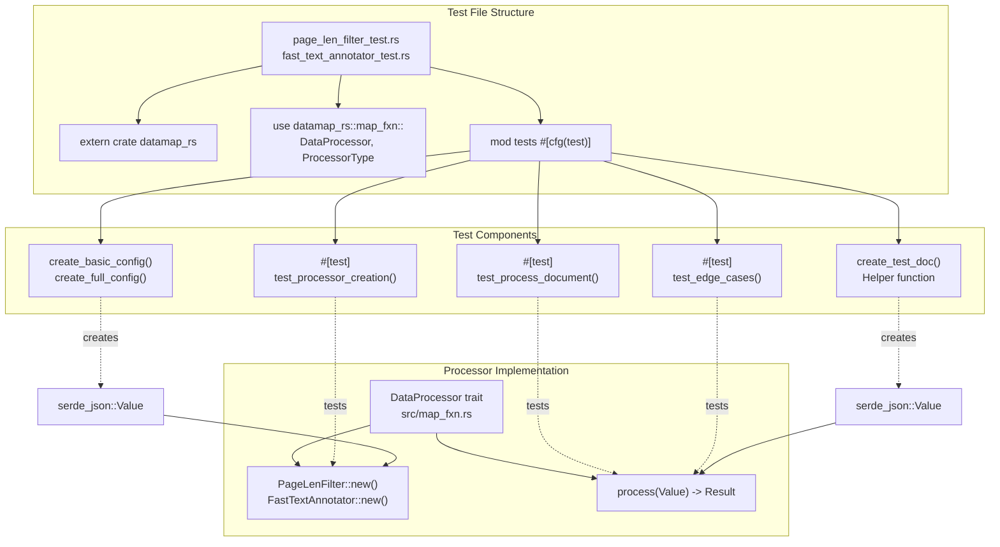
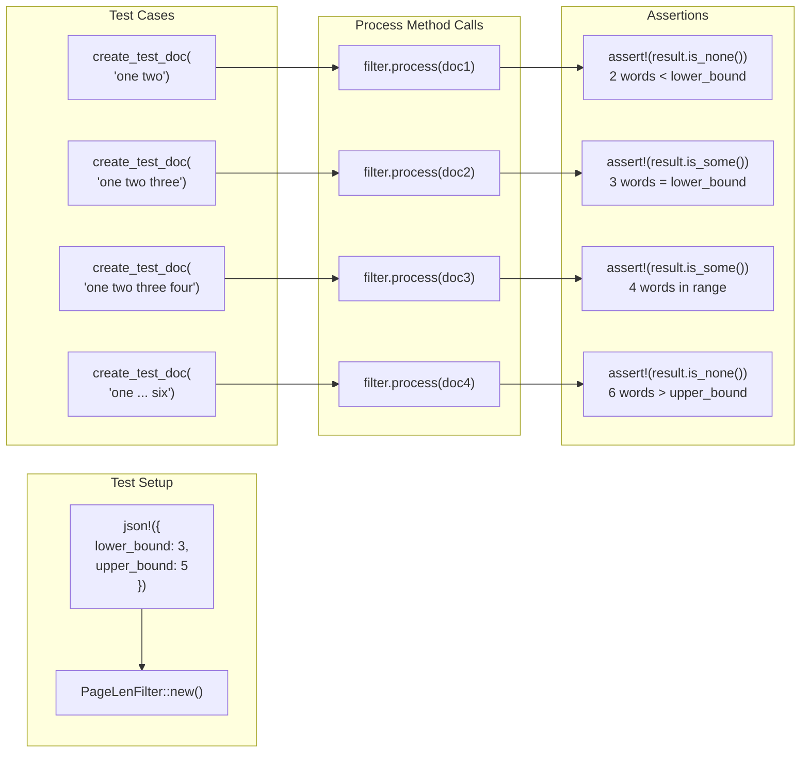

<!-- source: DeepWiki mcp.deepwiki.com · repo allenai/datamap-rs · page 10.2 Testing Processors · fetched 2026-10-26 -->

# Testing Processors

<details>
<summary>Relevant source files</summary>

The following files were used as context for generating this wiki page:

- [tests/map_fxn_tests/fast_text_annotator_test.rs](tests/map_fxn_tests/fast_text_annotator_test.rs)
- [tests/map_fxn_tests/page_len_filter_test.rs](tests/map_fxn_tests/page_len_filter_test.rs)

</details>


This document explains how to write unit tests for `DataProcessor` implementations in datamap-rs. It covers test organization, common patterns, assertion strategies, and edge case handling. For information about implementing new processors, see [Adding New Processors](#10.1). For general code patterns, see [Code Architecture Patterns](#10.3).

---

## Test Organization and Structure

Tests for processors are organized in the `tests/map_fxn_tests/` directory, with one test file per processor. Each test file follows a standard structure that imports the processor being tested and uses Rust's built-in testing framework.

### Standard Test File Structure

```
tests/map_fxn_tests/
├── page_len_filter_test.rs
├── fast_text_annotator_test.rs
└── [processor_name]_test.rs
```

Each test file contains:
- External crate import for `datamap_rs`
- Import of specific processor type and `DataProcessor` trait
- A test module marked with `#[cfg(test)]`
- Helper functions for creating test data
- Multiple test functions covering different scenarios

**Sources:** [tests/map_fxn_tests/page_len_filter_test.rs:1-12](), [tests/map_fxn_tests/fast_text_annotator_test.rs:1-16]()

---

## Test Module Architecture

The following diagram shows how test files relate to the processor implementation and testing framework:



**Sources:** [tests/map_fxn_tests/page_len_filter_test.rs:1-12](), [tests/map_fxn_tests/fast_text_annotator_test.rs:1-28]()

---

## Core Testing Patterns

### Pattern 1: Constructor Testing

Test the `new()` method with various configuration combinations to ensure proper initialization and validation.

| Test Scenario | Configuration | Expected Outcome |
|---------------|---------------|------------------|
| Minimal config | Only required fields | Uses default values for optional fields |
| Full config | All fields specified | All fields set to specified values |
| Invalid config | Invalid enum values or missing required fields | Returns `Err` |

**Example from PageLenFilter:**

[tests/map_fxn_tests/page_len_filter_test.rs:15-41]() demonstrates testing both minimal and full configurations:

```rust
// Minimal config test
let config = json!({"length_type": "word"});
let filter = PageLenFilter::new(&config).unwrap();
assert_eq!(filter.text_field, "text");
assert_eq!(filter.lower_bound, 1);

// Full config test  
let config = json!({
    "text_field": "content",
    "length_type": "word",
    "lower_bound": 5,
    "upper_bound": 10,
    "ignore_punctuation": false
});
let filter = PageLenFilter::new(&config).unwrap();
assert_eq!(filter.text_field, "content");
```

**Sources:** [tests/map_fxn_tests/page_len_filter_test.rs:15-41](), [tests/map_fxn_tests/fast_text_annotator_test.rs:29-57]()

### Pattern 2: Invalid Configuration Testing

Verify that invalid configurations are properly rejected:

[tests/map_fxn_tests/page_len_filter_test.rs:43-50]() shows validation testing:

```rust
let config = json!({"length_type": "invalid"});
let result = PageLenFilter::new(&config);
assert!(result.is_err());
```

**Sources:** [tests/map_fxn_tests/page_len_filter_test.rs:43-50]()

---

## Testing Filter Processors

Filter processors return `Option<Value>` from their `process()` method: `Some(value)` when the document passes, `None` when filtered out.

### Testing Boundary Conditions

The following diagram shows the test execution flow for filter processors:



**Key assertions for filter processors:**

| Condition | Expected Result | Assertion |
|-----------|-----------------|-----------|
| Below lower bound | Filtered | `assert!(result.unwrap().is_none())` |
| At lower bound | Passes | `assert!(result.unwrap().is_some())` |
| Within range | Passes | `assert!(result.unwrap().is_some())` |
| At upper bound | Passes | `assert!(result.unwrap().is_some())` |
| Above upper bound | Filtered | `assert!(result.unwrap().is_none())` |

**Example from PageLenFilter:**

[tests/map_fxn_tests/page_len_filter_test.rs:53-90]() demonstrates comprehensive boundary testing:

```rust
// Test within bounds
let doc = create_test_doc("one two three four");
assert!(filter.process(doc).unwrap().is_some());

// Test below lower bound
let doc = create_test_doc("one two");
assert!(filter.process(doc).unwrap().is_none());

// Test above upper bound
let doc = create_test_doc("one two three four five six");
assert!(filter.process(doc).unwrap().is_none());
```

**Sources:** [tests/map_fxn_tests/page_len_filter_test.rs:53-90]()

---

## Testing Annotator Processors

Annotator processors always return `Some(modified_value)`, adding metadata without filtering. Tests must verify that annotations are correctly added at the specified JSON path.

### Annotation Verification Pattern

[tests/map_fxn_tests/fast_text_annotator_test.rs:61-82]() shows the standard annotation test pattern:

```rust
let data = json!({
    "text": "Sample text",
    "metadata": {}
});

let result = annotator.process(data);
assert!(result.is_ok());

let processed = result.unwrap().unwrap();

// Verify annotation field exists
assert!(processed.pointer("/metadata/fasttext").is_some());

// Verify structure
assert!(processed.pointer("/metadata/fasttext").unwrap().is_object());
```

### Testing Custom Output Fields

Test that annotations are written to custom JSON paths using `pointer()` method:

| Test Configuration | Output Field | Verification |
|--------------------|--------------|--------------|
| Default | `"metadata.fasttext"` | `processed.pointer("/metadata/fasttext")` |
| Custom shallow | `"custom_field"` | `processed.pointer("/custom_field")` |
| Custom nested | `"deep.nested.field"` | `processed.pointer("/deep/nested/field")` |

[tests/map_fxn_tests/fast_text_annotator_test.rs:137-168]() demonstrates testing deeply nested output fields:

```rust
let config = json!({
    "fast_text_file": "ft_classifiers/lid176.bin",
    "output_field": "deep.nested.classifications.fasttext"
});

let annotator = FastTextAnnotator::new(&config).unwrap();

let result = annotator.process(data);
let processed = result.unwrap().unwrap();

// Verify deeply nested path
assert!(processed.pointer("/deep/nested/classifications/fasttext").is_some());
```

**Sources:** [tests/map_fxn_tests/fast_text_annotator_test.rs:61-82](), [tests/map_fxn_tests/fast_text_annotator_test.rs:137-168]()

---

## Helper Functions

Helper functions reduce boilerplate and improve test readability. Common patterns include:

### Document Creation Helpers

[tests/map_fxn_tests/page_len_filter_test.rs:9-12]():

```rust
fn create_test_doc(text: &str) -> Value {
    json!({ "text": text })
}
```

### Configuration Creation Helpers

[tests/map_fxn_tests/fast_text_annotator_test.rs:11-27]():

```rust
fn create_basic_config(fast_text_file: &str) -> Value {
    json!({"fast_text_file": fast_text_file})
}

fn create_full_config(fast_text_file: &str) -> Value {
    json!({
        "fast_text_file": fast_text_file,
        "text_field": "content.body",
        "output_field": "metadata.classifications",
        "k": 5,
        "threshold": 0.1
    })
}
```

**Helper Function Benefits:**

| Benefit | Example |
|---------|---------|
| Consistency | All tests use same document structure |
| Readability | `create_test_doc("text")` vs inline JSON |
| Maintainability | Change structure in one place |
| Test focus | Highlights what's being tested |

**Sources:** [tests/map_fxn_tests/page_len_filter_test.rs:9-12](), [tests/map_fxn_tests/fast_text_annotator_test.rs:11-27]()

---

## Edge Case Testing

Comprehensive tests must cover edge cases that may not occur in typical usage:

### Common Edge Cases

| Edge Case | Test Purpose | Example |
|-----------|--------------|---------|
| Empty input | Verify handling of empty strings | `create_test_doc("")` |
| Missing fields | Verify graceful handling of missing JSON fields | Document without `text` field |
| Boundary values | Test exact boundary conditions | Lower/upper bound equality |
| Special characters | Test punctuation, unicode handling | `"one, two. three!"` |
| Extreme values | Test with very large/small values | `upper_bound: usize::MAX` |

### Empty Input Testing

[tests/map_fxn_tests/page_len_filter_test.rs:148-171]() shows edge case testing:

```rust
// Empty text
let doc = create_test_doc("");
assert!(filter.process(doc).unwrap().is_none());

// Text with only punctuation
let doc = create_test_doc(".,;!?");
assert!(filter.process(doc).unwrap().is_some());
```

[tests/map_fxn_tests/fast_text_annotator_test.rs:116-134]() tests empty text with annotators:

```rust
let data = json!({
    "text": "",
    "metadata": {}
});

let result = annotator.process(data);
assert!(result.is_ok());

let processed = result.unwrap().unwrap();
// Model might return predictions for empty text
assert!(processed.pointer("/metadata/fasttext").is_some());
```

**Sources:** [tests/map_fxn_tests/page_len_filter_test.rs:148-171](), [tests/map_fxn_tests/fast_text_annotator_test.rs:116-134]()

---

## Integration Testing Pattern

Integration tests verify that processors work correctly in realistic scenarios with multiple documents:

### Multi-Document Pipeline Test

[tests/map_fxn_tests/fast_text_annotator_test.rs:171-208]() demonstrates integration testing:

```rust
let documents = vec![
    json!({"id": "doc1", "text": "Short text", "metadata": {}}),
    json!({"id": "doc2", "text": "Lengthy article", "metadata": {}}),
    json!({"id": "doc3", "text": "Scientific research", "metadata": {}})
];

for doc in documents {
    let result = annotator.process(doc.clone());
    assert!(result.is_ok());
    
    let processed = result.unwrap().unwrap();
    
    // Verify original fields preserved
    assert_eq!(processed["id"], doc["id"]);
    assert_eq!(processed["text"], doc["text"]);
    
    // Verify annotations added
    assert!(processed.pointer("/metadata/fasttext").is_some());
}
```

**Integration test characteristics:**

- Process multiple documents sequentially
- Verify original data preservation
- Verify consistent annotation behavior
- Test with varied input content

**Sources:** [tests/map_fxn_tests/fast_text_annotator_test.rs:171-208]()

---

## Custom Field Testing

Many processors support custom field names for input and output. Tests must verify this flexibility:

### Input Field Testing

[tests/map_fxn_tests/page_len_filter_test.rs:121-133]():

```rust
let config = json!({
    "text_field": "content",
    "length_type": "word",
    "lower_bound": 4,
    "upper_bound": 4
});
let filter = PageLenFilter::new(&config).unwrap();

// Test with custom text field
let doc = json!({ "content": "one two three four" });
assert!(filter.process(doc).unwrap().is_some());
```

### Output Field Testing

[tests/map_fxn_tests/fast_text_annotator_test.rs:85-112]():

```rust
let config = json!({
    "fast_text_file": "ft_classifiers/lid176.bin",
    "text_field": "content.body",
    "output_field": "metadata.classifications"
});

let data = json!({
    "content": {"body": "Text"},
    "metadata": {}
});

let processed = annotator.process(data).unwrap().unwrap();
assert!(processed.pointer("/metadata/classifications").is_some());
```

**Sources:** [tests/map_fxn_tests/page_len_filter_test.rs:121-133](), [tests/map_fxn_tests/fast_text_annotator_test.rs:85-112]()

---

## Processor-Specific Configuration Testing

Different processor types have specialized configuration options that require targeted testing:

### Filter-Specific Options

For `PageLenFilter`, test punctuation handling:

[tests/map_fxn_tests/page_len_filter_test.rs:93-118]():

```rust
// With ignore_punctuation = true (default)
let doc = create_test_doc("one, two. three!");
assert!(filter.process(doc).unwrap().is_some()); // Counts as 3 words

// With ignore_punctuation = false
let config = json!({
    "ignore_punctuation": false,
    "lower_bound": 6,
    "upper_bound": 6
});
let filter = PageLenFilter::new(&config).unwrap();
let doc = create_test_doc("one, two. three!");
assert!(filter.process(doc).unwrap().is_some()); // Counts as 6 words
```

### Annotator-Specific Options

For `FastTextAnnotator`, test k and threshold parameters:

[tests/map_fxn_tests/fast_text_annotator_test.rs:85-112]():

```rust
let config = json!({
    "k": 5,
    "threshold": 0.1
});

let processed = annotator.process(data).unwrap().unwrap();
let predictions = processed.pointer("/metadata/classifications")
    .unwrap().as_object().unwrap();

// Verify at most k predictions
assert!(predictions.len() <= 5);

// Verify all probabilities above threshold
for (_, prob) in predictions {
    assert!(prob.as_f64().unwrap() >= 0.1);
}
```

**Sources:** [tests/map_fxn_tests/page_len_filter_test.rs:93-118](), [tests/map_fxn_tests/fast_text_annotator_test.rs:85-112]()

---

## Test Execution Flow

The following diagram illustrates the complete test execution flow from setup to assertion:

```mermaid
graph TB
    subgraph "Test Function"
        Start["#[test]<br/>fn test_processor()"]
    end
    
    subgraph "Setup Phase"
        Config["json!({...})<br/>Create config Value"]
        Constructor["Processor::new(&config)<br/>Returns Result"]
        Unwrap["unwrap() or ?<br/>Extract processor"]
        
        Config --> Constructor
        Constructor --> Unwrap
    end
    
    subgraph "Test Data Creation"
        Helper["create_test_doc()<br/>Helper function"]
        JSONDoc["serde_json::Value<br/>Document"]
        
        Helper --> JSONDoc
    end
    
    subgraph "Process Execution"
        ProcessCall["processor.process(doc)<br/>Returns Result<Option<Value>>"]
        ResultUnwrap["unwrap() Result<br/>Get Option<Value>"]
        OptionCheck["Check is_some() or is_none()"]
        
        JSONDoc --> ProcessCall
        ProcessCall --> ResultUnwrap
        ResultUnwrap --> OptionCheck
    end
    
    subgraph "Verification Phase"
        FilterAssert["assert!(result.is_none())<br/>or is_some()"]
        AnnotatorAssert["assert!(pointer().is_some())<br/>Field exists"]
        ValueAssert["assert_eq!(field, expected)<br/>Value check"]
        
        OptionCheck --> FilterAssert
        OptionCheck --> AnnotatorAssert
        OptionCheck --> ValueAssert
    end
    
    Start --> Setup Phase
    Setup Phase --> Test Data Creation
    Test Data Creation --> Process Execution
    Process Execution --> Verification Phase
```

**Sources:** [tests/map_fxn_tests/page_len_filter_test.rs:14-90](), [tests/map_fxn_tests/fast_text_annotator_test.rs:29-112]()

---

## Test Naming Conventions

Follow consistent naming patterns for test functions:

| Test Type | Naming Pattern | Example |
|-----------|----------------|---------|
| Constructor | `test_[processor]_creation()` | `test_pagelength_filter_creation()` |
| Valid config | `test_new_with_[scenario]()` | `test_new_with_minimal_config()` |
| Invalid config | `test_invalid_[parameter]()` | `test_invalid_length_type()` |
| Basic processing | `test_process_[scenario]()` | `test_process_simple_document()` |
| Boundary conditions | `test_[field]_[condition]()` | `test_word_length_within_bounds()` |
| Edge cases | `test_edge_cases()` | `test_edge_cases()` |
| Integration | `test_integration()` | `test_integration()` |
| Custom fields | `test_custom_[field]()` | `test_custom_text_field()` |

**Sources:** [tests/map_fxn_tests/page_len_filter_test.rs:14-171](), [tests/map_fxn_tests/fast_text_annotator_test.rs:29-208]()

---

## Required Test Coverage

A comprehensive test suite for a processor should include:

### Minimum Test Set

1. **Constructor Tests** (2-3 tests)
   - Minimal configuration with defaults
   - Full configuration with all parameters
   - Invalid configuration rejection

2. **Processing Tests** (3-5 tests)
   - Successful processing (pass/annotate)
   - Filtering behavior (for filters)
   - Custom field handling

3. **Edge Case Tests** (2-3 tests)
   - Empty or missing input
   - Boundary values
   - Special characters

4. **Integration Test** (1 test)
   - Multi-document processing
   - Data preservation verification

### Test Coverage Matrix

| Category | Filter Tests | Annotator Tests | Required |
|----------|-------------|-----------------|----------|
| Constructor - minimal | ✓ | ✓ | Yes |
| Constructor - full | ✓ | ✓ | Yes |
| Invalid config | ✓ | ✓ | Yes |
| Within bounds | ✓ | N/A | If applicable |
| Outside bounds | ✓ | N/A | If applicable |
| Adds annotations | N/A | ✓ | Yes |
| Custom input field | ✓ | ✓ | If supported |
| Custom output field | N/A | ✓ | If supported |
| Empty input | ✓ | ✓ | Yes |
| Special characters | ✓ | ✓ | If applicable |
| Integration | ✓ | ✓ | Recommended |

**Sources:** [tests/map_fxn_tests/page_len_filter_test.rs:1-172](), [tests/map_fxn_tests/fast_text_annotator_test.rs:1-209]()

---

