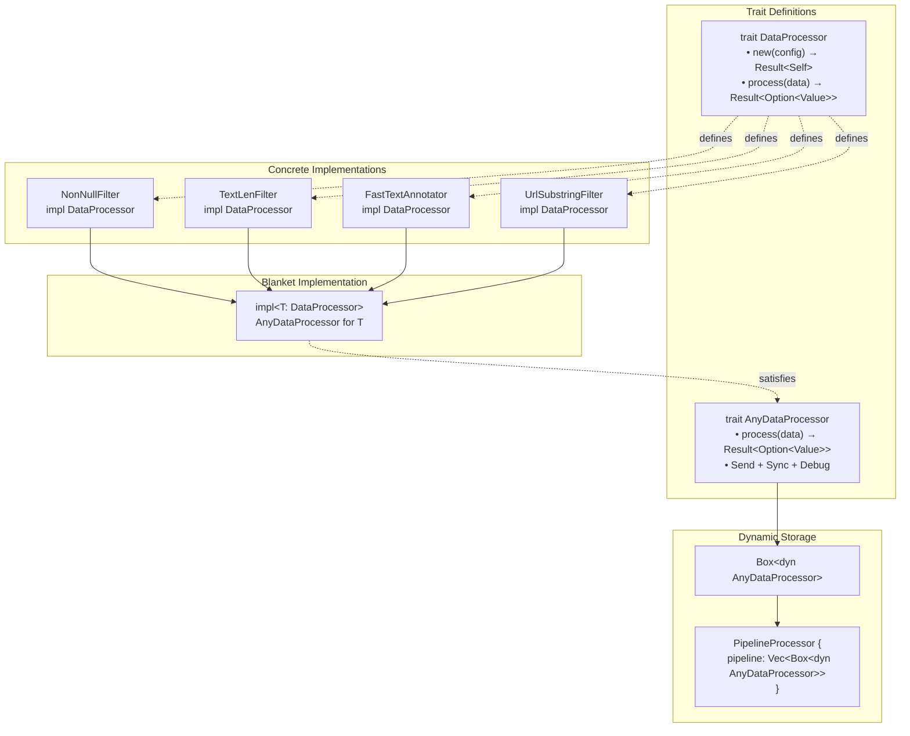
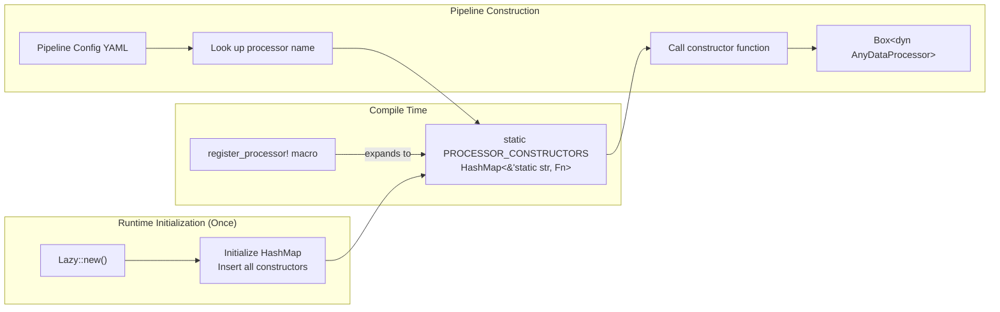
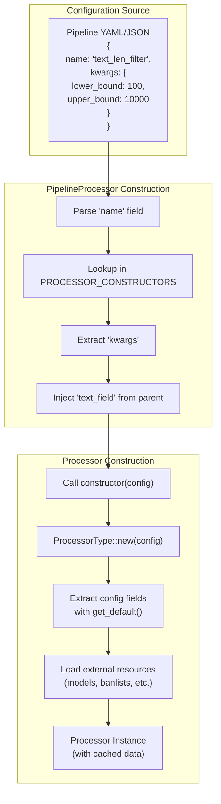
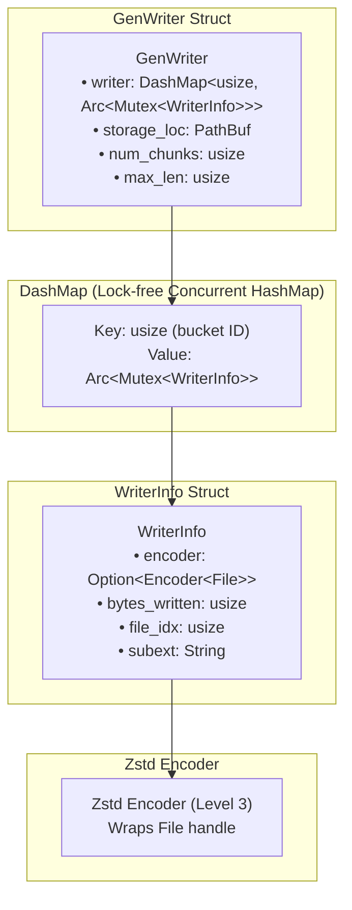
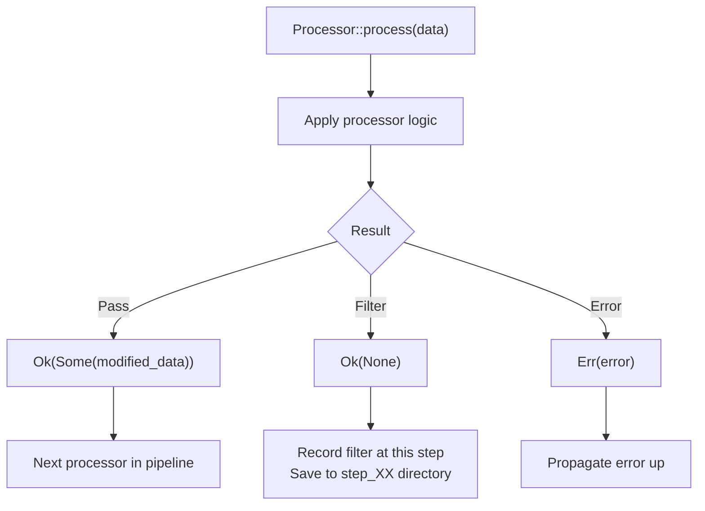

<!-- source: DeepWiki mcp.deepwiki.com · repo allenai/datamap-rs · page 10.3 Code Architecture Patterns · fetched 2026-10-26 -->

# Code Architecture Patterns

<details>
<summary>Relevant source files</summary>

The following files were used as context for generating this wiki page:

- [src/groupfilter.rs](src/groupfilter.rs)
- [src/lib.rs](src/lib.rs)
- [src/map_fxn.rs](src/map_fxn.rs)
- [src/shuffle.rs](src/shuffle.rs)

</details>


This document describes common architectural patterns and design principles used throughout the datamap-rs codebase. Understanding these patterns is essential for developers who want to extend the system, particularly when adding new processors or commands. For step-by-step instructions on implementing new processors, see [Adding New Processors](#10.1). For testing guidance, see [Testing Processors](#10.2).

## Pattern Categories

The codebase employs several recurring patterns that provide structure, extensibility, and performance:

| Pattern Category | Purpose | Primary Location |
|-----------------|---------|------------------|
| Trait-based Plugin System | Extensible processor architecture | [src/map_fxn.rs]() |
| Static Registration | Zero-overhead processor discovery | [src/map_fxn.rs:38-88]() |
| Configuration-driven Construction | Declarative processor instantiation | All processor implementations |
| Concurrent Writer Architecture | Thread-safe parallel file I/O | [src/groupfilter.rs:297-433](), [src/shuffle.rs:64-200]() |
| Optional Filtering | Uniform document filtering API | [src/map_fxn.rs:90-102]() |
| Lazy Static Initialization | Efficient one-time setup | [src/map_fxn.rs:48-88]() |

---

## Trait-Based Plugin Architecture

The processor system uses Rust traits to achieve **dynamic polymorphism** while maintaining type safety. This allows the pipeline to work with heterogeneous processor types through a uniform interface.

### Dual-Trait Design

The system uses two related traits to bridge between concrete types and dynamic dispatch:

```
DataProcessor (Generic Trait)
    ↓ implements
Concrete Processors (NonNullFilter, TextLenFilter, etc.)
    ↓ blanket impl
AnyDataProcessor (Object-Safe Trait)
    ↓ Box<dyn AnyDataProcessor>
PipelineProcessor.pipeline: Vec<Box<dyn AnyDataProcessor>>
```

**Diagram: Trait Hierarchy and Type Conversion**



**Sources:** [src/map_fxn.rs:90-102](), [src/map_fxn.rs:230-238]()

### Why Two Traits?

The `DataProcessor` trait is **not object-safe** because it requires `Self: Sized` in the `new()` method. Object safety is required for trait objects (`dyn Trait`). The solution:

1. **`DataProcessor`**: Generic trait for concrete types with associated construction logic
2. **`AnyDataProcessor`**: Object-safe trait for dynamic dispatch
3. **Blanket implementation**: Automatically implements `AnyDataProcessor` for any `DataProcessor`

**Code Pattern:**

[src/map_fxn.rs:94-102]()
```rust
impl<T> AnyDataProcessor for T
where
    T: DataProcessor + Send + Sync + serde::Serialize + std::fmt::Debug,
{
    fn process(&self, data: Value) -> Result<Option<Value>, Error> {
        DataProcessor::process(self, data)
    }
}
```

This pattern allows:
- Type-safe construction via `DataProcessor::new()`
- Type-erased storage via `Box<dyn AnyDataProcessor>`
- Zero-cost abstraction at runtime (virtual dispatch only during `process()`)

**Sources:** [src/map_fxn.rs:90-102](), [src/map_fxn.rs:230-238]()

---

## Static Registration with Macros

Processors are registered in a **static global map** that associates string names with constructor functions. This enables configuration-driven pipeline construction without runtime overhead.

### Registration Architecture

**Diagram: Static Registration Flow**



**Sources:** [src/map_fxn.rs:36-88]()

### The Registration Macro

The `register_processor!` macro provides a DRY (Don't Repeat Yourself) way to register processors:

[src/map_fxn.rs:38-45]()
```rust
macro_rules! register_processor {
    ($map:expr, $name:expr, $processor_type:ty) => {
        $map.insert($name, |config| {
            let processor = <$processor_type>::new(config).unwrap();
            Ok(Box::new(processor) as Box<dyn AnyDataProcessor>)
        });
    };
}
```

**What it does:**
1. Takes a processor type (e.g., `NonNullFilter`)
2. Creates a closure that constructs the processor from config
3. Type-erases it to `Box<dyn AnyDataProcessor>`
4. Inserts the closure into the static map with a string key

**Usage:**

[src/map_fxn.rs:48-88]()
```rust
static PROCESSOR_CONSTRUCTORS: Lazy<HashMap<&'static str, ProcessorConstructor>> =
    Lazy::new(|| {
        let mut m: HashMap<&'static str, ProcessorConstructor> = HashMap::new();
        register_processor!(m, "non_null_filter", NonNullFilter);
        register_processor!(m, "text_len_filter", TextLenFilter);
        register_processor!(m, "fasttext_annotator", FastTextAnnotator);
        // ... 28 more processors
        m
    });
```

**Sources:** [src/map_fxn.rs:36-88]()

### Lazy Static Pattern

The `once_cell::sync::Lazy` type ensures the registration happens **exactly once**, on first access:

- **Thread-safe**: Multiple threads can access simultaneously
- **No runtime cost**: After initialization, access is a simple pointer dereference
- **Delayed initialization**: Only pays the cost when first used

**Key characteristics:**
- Type: `Lazy<HashMap<&'static str, ProcessorConstructor>>`
- Initializer: Closure that builds the full registry
- Access: Derefs to `&HashMap<...>` automatically

**Sources:** [src/map_fxn.rs:48-49]()

---

## Configuration-Driven Construction

All processors follow a uniform construction pattern that separates **configuration** from **implementation**.

### The DataProcessor::new() Pattern

Every processor implements:

```rust
trait DataProcessor {
    fn new(config: &Value) -> Result<Self, Error>;
    fn process(&self, data: Value) -> Result<Option<Value>, Error>;
}
```

**Diagram: Configuration Flow**



**Sources:** [src/map_fxn.rs:109-135]()

### Configuration Extraction Utilities

The `get_default()` utility function provides type-safe config extraction with defaults:

[src/utils.rs]() (referenced in multiple processor implementations)
```rust
// Pattern used throughout processors:
let text_field = get_default(config, "text_field", String::from("text"));
let lower_bound = get_default(config, "lower_bound", 0);
let case_sensitive = get_default(config, "case_sensitive", false);
```

**Benefits:**
- **Type inference**: Return type determined by default value
- **Fallback values**: Missing configs don't cause errors
- **Consistency**: All processors use same pattern

**Sources:** [src/map_fxn.rs:270-280](), [src/map_fxn.rs:378-396](), [src/map_fxn.rs:598-619]()

### Resource Loading Pattern

Processors that need external resources (models, banlists) load them during construction:

**Example: FastTextAnnotator**

[src/map_fxn.rs:598-619]()
```rust
fn new(config: &Value) -> Result<Self, Error> {
    let fast_text_file = config
        .get("fast_text_file")
        .unwrap()
        .as_str()
        .unwrap()
        .to_string();
    // ... extract other config
    
    let mut model = FastText::new();
    model.load_model(&fast_text_file).unwrap();  // Load at construction
    
    Ok(Self {
        fast_text_file,
        text_field,
        output_field,
        k,
        threshold,
        model,  // Store loaded model in struct
    })
}
```

**Pattern characteristics:**
- Resources loaded **once** during processor construction
- Stored in struct fields (often with `#[serde(skip)]`)
- Reused for every document processed
- Enables amortized cost for expensive loading operations

**Sources:** [src/map_fxn.rs:587-647](), [src/map_fxn.rs:378-547]()

---

## Concurrent Writer Architecture (GenWriter)

The `GenWriter` pattern enables **thread-safe, concurrent file writing** with automatic file rotation. It appears in multiple commands that need parallel output.

### GenWriter Architecture

**Diagram: GenWriter Component Structure**



**Sources:** [src/groupfilter.rs:297-304](), [src/shuffle.rs:64-70]()

### Thread-Safety Through Layered Locking

The GenWriter uses a **two-tier locking strategy**:

1. **DashMap (outer layer)**: Lock-free concurrent hashmap for finding the right writer
2. **Arc<Mutex<WriterInfo>> (inner layer)**: Per-stream mutex for exclusive write access

**Why this design?**

| Layer | Type | Purpose | Contention |
|-------|------|---------|------------|
| Outer | `DashMap<usize, Arc<Mutex<...>>>` | Look up bucket ID → writer mapping | Low (lock-free reads) |
| Inner | `Arc<Mutex<WriterInfo>>` | Exclusive access to specific file writer | Low (each bucket independent) |

**Access pattern:**

[src/groupfilter.rs:367-389]()
```rust
pub fn write_batch(&self, key: usize, contents: Vec<u8>) -> Result<(), Error> {
    let binding = self.writer.get(&key).unwrap();  // DashMap lookup (lock-free)
    let mut writer_info = binding.lock().unwrap(); // Mutex lock (per-bucket)
    
    writer_info.bytes_written += contents.len();
    
    if let Some(encoder) = &mut writer_info.encoder {
        encoder.write_all(&contents)?;
        
        // File rotation logic
        if writer_info.bytes_written >= self.max_len {
            // Finish old file, create new one
            let mut old_encoder = writer_info.encoder.take().unwrap();
            old_encoder.finish()?;
            writer_info.file_idx += 1;
            let new_encoder = self.create_new_encoder(key, writer_info.file_idx, ...);
            writer_info.encoder = Some(new_encoder);
            writer_info.bytes_written = 0;
        }
    }
    
    Ok(())
}
```

**Sources:** [src/groupfilter.rs:367-389](), [src/shuffle.rs:134-156]()

### File Rotation Mechanism

Writers automatically rotate to a new file when size exceeds `max_len`:

**Rotation sequence:**


**Filename pattern:**
```
chunk_{bucket:08}.{file_idx:08}.{subext}.jsonl.zst
```

**Sources:** [src/groupfilter.rs:344-347](), [src/shuffle.rs:111-114]()

### GenWriter Instantiation Pattern

All commands using GenWriter follow the same pattern:

```rust
// 1. Create writer
let gen_writer = GenWriter::new(
    output_dir,      // Where to write
    num_buckets,     // How many parallel streams
    "shuffled",      // File extension tag
    max_file_size    // When to rotate
);

// 2. Process files in parallel
input_paths.par_iter().for_each(|path| {
    // Process documents
    for document in read(path) {
        let bucket = compute_bucket(document);  // Hash-based or random
        gen_writer.write_line(bucket, document_bytes).unwrap();
    }
});

// 3. Flush all writers
gen_writer.finish().unwrap();
```

**Commands using this pattern:**
- Group: [src/groupfilter.rs:83-106]()
- Shuffle: [src/shuffle.rs:20-57]()
- Partition (similar architecture)

**Sources:** [src/groupfilter.rs:83-106](), [src/shuffle.rs:20-57]()

---

## Optional Filtering Pattern

Processors return `Result<Option<Value>, Error>` to support three outcomes:

| Return Value | Meaning | Action |
|--------------|---------|--------|
| `Ok(Some(value))` | Document passes, possibly modified | Continue pipeline |
| `Ok(None)` | Document filtered out | Stop pipeline, log filter step |
| `Err(e)` | Processing error | Propagate error |

**Diagram: Optional Return Flow**



**Sources:** [src/map_fxn.rs:137-171]()

### Pipeline Processing Loop

The `PipelineProcessor` iterates through processors, short-circuiting on `None`:

[src/map_fxn.rs:137-171]()
```rust
pub fn process(
    &self,
    data: Value,
    timing_info: &mut TimingInfo,
    filter_info: &mut FilterInfo,
) -> Result<(usize, Option<Value>), Error> {
    let og_copy = data.clone();  // Preserve original for output
    let mut current_data = data;
    
    let mut filter_step = 0;
    for processor in &self.pipeline {
        let proc_result = processor.process(current_data)?;
        
        match proc_result {
            Some(data_value) => current_data = data_value,  // Continue
            None => {
                // Filtered at this step
                *filter_info.entry(filter_step).or_insert(0) += 1;
                return Ok((filter_step, Some(og_copy)));
            }
        }
        
        filter_step += 1;
    }
    
    // Passed all filters
    *filter_info.entry(usize::MAX).or_insert(0) += 1;
    Ok((usize::MAX, Some(current_data)))
}
```

**Key design choices:**
- **Original preserved**: `og_copy` allows output of unmodified document when filtered
- **Step tracking**: Returns filter step number for categorization
- **Statistics**: Updates `filter_info` for each outcome
- **Sentinel value**: `usize::MAX` indicates "passed all filters"

**Sources:** [src/map_fxn.rs:137-171]()

### Common Filter Implementations

**Simple filter (range check):**

[src/map_fxn.rs:282-290]()
```rust
fn process(&self, data: Value) -> Result<Option<Value>, Error> {
    let text_len = get_text(&data, &self.text_field)?.len();
    if self.lower_bound <= text_len && text_len <= self.upper_bound {
        Ok(Some(data))  // Pass
    } else {
        Ok(None)  // Filter
    }
}
```

**Modifier (always passes):**

[src/map_fxn.rs:304-309]()
```rust
fn process(&self, mut data: Value) -> Result<Option<Value>, Error> {
    let id = Uuid::new_v4().to_string();
    json_set(&mut data, &self.id_key, Value::String(id)).unwrap();
    Ok(Some(data))  // Always returns Some
}
```

**Annotator (enriches without filtering):**

[src/map_fxn.rs:622-646]()
```rust
fn process(&self, mut data: Value) -> Result<Option<Value>, Error> {
    let text = get_text(&data, &self.text_field)?;
    let predictions = self.model.predict(&text, self.k, self.threshold)?;
    
    // Add predictions to document
    json_set(&mut data, &self.output_field, serialize_predictions(predictions))?;
    Ok(Some(data))  // Always returns Some (unless prediction fails)
}
```

**Sources:** [src/map_fxn.rs:247-260](), [src/map_fxn.rs:298-309](), [src/map_fxn.rs:587-647]()

---

## Error Handling Patterns

The codebase uses `anyhow::Result` consistently for error propagation with `?` operator.

### Result Type Aliases

```rust
type ProcessorConstructor = fn(&Value) -> Result<Box<dyn AnyDataProcessor>, Error>;
type TimingInfo = HashMap<usize, u128>;
type FilterInfo = HashMap<usize, usize>;
```

**Sources:** [src/map_fxn.rs:33-36]()

### Error Propagation with ?

**Pattern:**
```rust
fn process(&self, data: Value) -> Result<Option<Value>, Error> {
    let text = json_get(&data, &self.text_field)?;  // Propagates error
    let parsed_url = Url::parse(&url)?;             // Propagates error
    let host = parsed_url.host_str()
        .ok_or_else(|| anyhow!("No host"))?;        // Convert Option to Result
    
    // ... processing logic
    
    Ok(Some(data))
}
```

**Common conversions:**
- `Option<T>` → `Result<T, Error>`: Use `ok_or_else()` with `anyhow!` macro
- `Result<T, SpecificError>` → `Result<T, anyhow::Error>`: Automatic with `?`

**Sources:** [src/map_fxn.rs:398-497]()

### Graceful Degradation Pattern

Some processors handle errors gracefully by filtering:

[src/map_fxn.rs:631-637]()
```rust
let predictions = match self.model.predict(&text, self.k, self.threshold) {
    Ok(preds) => preds,
    Err(_e) => {
        // If prediction fails, filter document rather than crashing
        return Ok(None);
    }
};
```

**When to use:**
- Non-critical failures (ML model prediction errors, malformed UTF-8)
- Prefer filtering individual documents over crashing entire pipeline

**Sources:** [src/map_fxn.rs:631-637]()

---

## Type Wrapping and Conversion

### newtype Pattern

The codebase uses wrapper types to enforce type safety:

[src/map_fxn.rs:33-34]()
```rust
type TimingInfo = HashMap<usize, u128>;
type FilterInfo = HashMap<usize, usize>;
```

These prevent accidentally passing the wrong map type to functions.

**Sources:** [src/map_fxn.rs:33-34]()

### Option Wrapping for Resource Management

The `Option<T>` type manages resources that need to be moved/dropped:

[src/groupfilter.rs:305-310]()
```rust
pub struct WriterInfo<'a> {
    encoder: Option<Encoder<'a, File>>,  // Option allows taking ownership
    bytes_written: usize,
    file_idx: usize,
    subext: String,
}
```

**Purpose:** Allows `take()` to move encoder out for cleanup:

[src/groupfilter.rs:378-382]()
```rust
if writer_info.bytes_written >= self.max_len {
    let mut old_encoder = writer_info.encoder.take().unwrap();  // Move out
    old_encoder.flush()?;
    old_encoder.finish()?;  // Consumes encoder
    // Create new encoder...
}
```

**Sources:** [src/groupfilter.rs:305-310](), [src/groupfilter.rs:378-383]()

---

## Summary Table

| Pattern | When to Use | Key Types/Traits |
|---------|-------------|------------------|
| Trait-based plugins | Extensible processor system | `DataProcessor`, `AnyDataProcessor`, `Box<dyn T>` |
| Static registration | Zero-cost processor discovery | `Lazy<HashMap>`, `register_processor!` |
| Configuration construction | Declarative pipeline building | `new(config: &Value)` |
| GenWriter | Parallel file writing with rotation | `DashMap`, `Arc<Mutex<WriterInfo>>` |
| Optional filtering | Document filtering in pipelines | `Result<Option<Value>, Error>` |
| Lazy initialization | One-time expensive setup | `once_cell::sync::Lazy` |
| Error propagation | Composable error handling | `anyhow::Result`, `?` operator |

**Sources:** [src/map_fxn.rs](), [src/groupfilter.rs](), [src/shuffle.rs](), [src/lib.rs]()