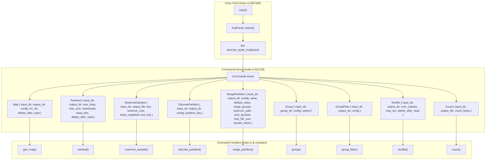
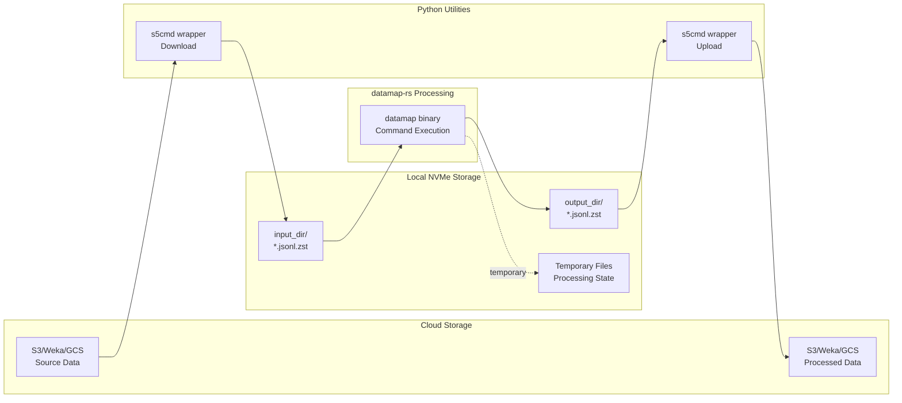
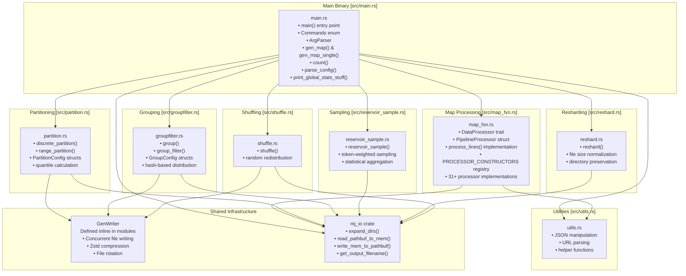
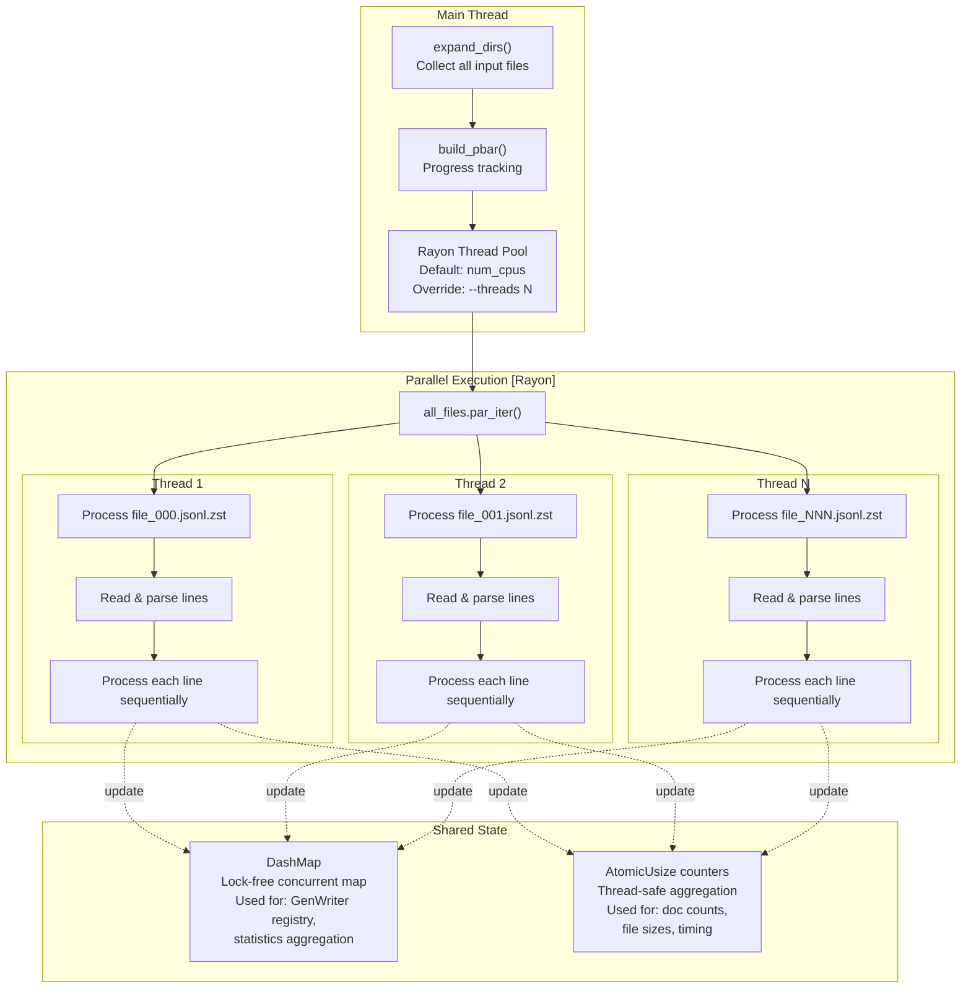

<!-- source: DeepWiki mcp.deepwiki.com · repo allenai/datamap-rs · page 2 System Architecture · fetched 2026-10-26 -->

# System Architecture

<details>
<summary>Relevant source files</summary>

The following files were used as context for generating this wiki page:

- [Cargo.toml](Cargo.toml)
- [README.md](README.md)
- [src/main.rs](src/main.rs)

</details>


## Purpose and Scope

This page explains the high-level architecture of datamap-rs, including its command-based design, local-first processing model, parallel execution strategy, and how the major components interact. It provides an overview of the system's structure without diving into the implementation details of specific commands or processors.

For detailed information about specific commands, see:
- Map command and pipeline processing: [#3](#3)
- Data organization commands (reshard, partition, group, shuffle): [#4](#4)
- Analysis commands (reservoir sample, count): [#5](#5)
- Shared infrastructure components: [#6](#6)

## High-Level Architecture Overview

datamap-rs is built as a **command-line binary** with a **command-based architecture**. Each command implements a specific data processing operation on JSONL files. The system is designed around three core principles:

1. **Local-first processing**: All data must reside on local NVMe storage before processing
2. **File-level parallelism**: Files are processed independently in parallel using Rayon
3. **Streaming I/O**: Documents are processed line-by-line to maintain memory efficiency

The architecture can be visualized in three layers:

| Layer | Components | Responsibility |
|-------|-----------|----------------|
| **CLI Layer** | `clap` argument parser, `Commands` enum | Parse user input and dispatch to appropriate handler |
| **Processing Layer** | Command implementations (`gen_map`, `reshard`, `group`, etc.) | Execute data transformations and operations |
| **Infrastructure Layer** | `GenWriter`, `mj_io`, utility functions | Provide shared I/O, compression, and helper functionality |

**Sources:** [README.md:1-151](), [src/main.rs:49-224]()

### Command Dispatch Architecture



The `main()` function uses `clap` to parse command-line arguments into the `Commands` enum. Each enum variant contains the specific arguments for that command. The match expression at [main.rs:513-582]() dispatches to the appropriate handler function.

**Sources:** [src/main.rs:49-584]()

## Local-First Architecture and Data Lifecycle

datamap-rs assumes a **local-first workflow** where all input and output data resides on fast local storage (typically AWS Nitro NVMe drives on i4i/i7i instances). This is not just a recommendation but an **architectural requirement** for achieving acceptable performance.

### Typical Data Lifecycle



The system **never streams from cloud storage**. All commands operate on the assumption that:
1. Input files are available locally before processing begins
2. Output files are written locally during processing
3. Upload to cloud storage happens after processing completes

This design decision provides:
- **Reliability**: No network timeouts or retries during processing
- **Performance**: NVMe drives provide ~10-100x better throughput than S3 streaming
- **Simplicity**: Commands don't need to handle network errors or partial downloads

**Sources:** [README.md:20-21](), [README.md:113-129]()

## Module Organization and Code Structure

The codebase is organized into focused modules, each responsible for specific functionality:

### Module Structure Diagram



**Key Design Patterns:**

1. **Module per Command**: Each major command has its own module (except Map and Count which live in `main.rs`)
2. **Shared Infrastructure**: `GenWriter` pattern is replicated across modules that need concurrent file writing
3. **External I/O Library**: `mj_io` crate handles all file operations, compression detection, and directory traversal
4. **Trait-based Extensibility**: Map command uses `DataProcessor` trait for pluggable processors

**Sources:** [src/main.rs:24-36](), [Cargo.toml:1-45]()

## Parallel Processing Model

datamap-rs achieves high performance through **file-level parallelism** using Rayon. This design has important implications:

### Parallelism Architecture



**Key Characteristics:**

| Aspect | Implementation | Rationale |
|--------|---------------|-----------|
| **Parallelism Level** | File-level only | Documents must be processed sequentially through pipelines |
| **Thread Pool** | Rayon with default or `--threads` override | Automatic work stealing, efficient CPU utilization |
| **Shared State** | `DashMap` for registries, `AtomicUsize` for counters | Lock-free concurrency, minimal contention |
| **Memory Usage** | Scales with thread count × file size | Each thread loads entire file into memory |
| **I/O Pattern** | Streaming line-by-line | Memory-efficient document processing |

The parallelism is **embarrassingly parallel** at the file level - each file is processed completely independently. This means:
- No inter-file coordination required during processing
- No locks on data structures (except `GenWriter` output streams)
- Linear scaling with CPU cores (up to I/O limits)

**Sources:** [src/main.rs:359-382](), [README.md:104-112](), [Cargo.toml:14-20]()

## Shared Infrastructure Components

Several infrastructure components are used across multiple commands:

### GenWriter Pattern

The `GenWriter` component provides concurrent, compressed file writing with automatic rotation. While not defined in a single shared location, the pattern is consistently implemented across modules:

**Core Capabilities:**
- **Concurrent writing**: Uses `DashMap<String, Arc<Mutex<BufWriter>>>` to maintain per-stream file handles
- **Zstd compression**: Automatic level-3 compression on all output
- **File rotation**: When files exceed `max_len`, creates new numbered chunks
- **Thread-safe**: Multiple threads can write to different streams simultaneously

**Usage Pattern:**
```rust
// From various modules
let writer_map: DashMap<String, Arc<Mutex<BufWriter<ZstdEncoder>>>> = DashMap::new();
// Each thread writes: writer_map.entry(key).or_insert_with(|| create_writer())
```

**Sources:** [src/partition.rs](), [src/groupfilter.rs](), [src/shuffle.rs]()

### mj_io Library Functions

All file I/O operations use the `mj_io` crate, which provides:

| Function | Purpose | Used By |
|----------|---------|---------|
| `expand_dirs()` | Recursively find all JSONL files in directories | All commands |
| `read_pathbuf_to_mem()` | Read file to memory, auto-detecting compression | All commands |
| `write_mem_to_pathbuf()` | Write bytes to file with Zstd compression | Map, Count commands |
| `get_output_filename()` | Compute output path preserving directory structure | All commands |
| `build_pbar()` | Create progress bar with consistent styling | All commands |

**Sources:** [src/main.rs:21-23](), [Cargo.toml:16]()

### Configuration Parsing

The `parse_config()` function handles both YAML and JSON configuration files:

```rust
// From src/main.rs:230-248
fn parse_config(config: &PathBuf) -> Result<serde_json::Value, Error>
```

This function:
1. Detects file extension (`.yaml`, `.yml`, or `.json`)
2. Parses using appropriate deserializer (`serde_yaml` or `serde_json`)
3. Converts YAML to JSON representation for uniform handling
4. Returns `serde_json::Value` for dynamic processing

**Sources:** [src/main.rs:230-248]()

## Design Principles and Trade-offs

The architecture embodies several key design decisions:

### 1. File-Level Parallelism Only

**Decision:** Process entire files in parallel, but documents sequentially within each file.

**Rationale:**
- Map pipelines require sequential document processing (filters can drop documents)
- File boundaries provide natural parallelization points
- Avoids complex synchronization between pipeline stages

**Trade-off:** Cannot parallelize processing of a single large file

**Sources:** [src/main.rs:359-382]()

### 2. Local Storage Requirement

**Decision:** All data must be on local NVMe before processing.

**Rationale:**
- Network streaming is unreliable (timeouts, partial reads)
- Local NVMe provides 10-100x better throughput
- Simplifies error handling (no network retries)

**Trade-off:** Requires downloading data upfront, storage capacity limits

**Sources:** [README.md:20-21]()

### 3. Memory-Mapped vs. Streaming I/O

**Decision:** Stream line-by-line rather than memory-mapping entire files.

**Rationale:**
- Documents can be arbitrarily large (some datasets have multi-MB documents)
- Memory usage is predictable and bounded
- Allows processing datasets larger than available RAM

**Trade-off:** Slightly slower than memory-mapping for small documents

**Sources:** [src/main.rs:405-411]()

### 4. 256MB Target File Size

**Decision:** Default target file size of ~256MB before compression (reshard command).

**Rationale:**
- Balances parallelism (more files = more parallel work) with overhead
- Fits comfortably in memory for line-by-line processing
- Optimizes S3 upload/download performance

**Trade-off:** May be suboptimal for extreme cases (very small or very large documents)

**Sources:** [README.md:32-33](), [src/main.rs:86-90]()

### 5. Duplicate Infrastructure (GenWriter)

**Decision:** Replicate `GenWriter` pattern in multiple modules rather than sharing.

**Rationale:**
- Each command has slightly different requirements (file naming, rotation logic)
- Avoids coupling between independent commands
- Simpler module structure (no complex shared dependencies)

**Trade-off:** Code duplication, inconsistency risk

**Sources:** Various module implementations

## Thread Control and Resource Management

The system provides explicit control over parallel execution:

**Thread Configuration:**
- **Default behavior**: Use all available CPU cores (`rayon` default)
- **Override with `--threads N`**: Limit parallelism to N threads
- **Implementation**: Sets `RAYON_NUM_THREADS` environment variable at startup

```rust
// From src/main.rs:508-511
let threads = args.threads;
if threads != 0 {
    std::env::set_var("RAYON_NUM_THREADS", threads.to_string());
}
```

**When to Limit Threads:**
- Memory-constrained environments (each thread holds a file in memory)
- Very large files (limit threads to avoid OOM)
- Shared compute resources (respect quotas)

**Sources:** [src/main.rs:49-57](), [src/main.rs:508-511](), [README.md:107]()

## Output Organization Patterns

Different commands organize output in different ways:

| Command | Output Pattern | Example |
|---------|---------------|---------|
| **Map** | `step_{XX}/` directories + `step_final/` | `output_dir/step_00/`, `output_dir/step_final/` |
| **Reshard** | Flat structure or preserved directories | `output_dir/shard_*.jsonl.zst` |
| **DiscretePartition** | Category subdirectories | `output_dir/lang_en/`, `output_dir/lang_es/` |
| **RangePartition** | Numbered bucket subdirectories | `output_dir/bucket_0000/`, `output_dir/bucket_0001/` |
| **Group** | Flat structure with numbered chunks | `group_dir/chunk_*.jsonl.zst` |
| **GroupFilter** | Flat structure | `output_dir/*.jsonl.zst` |
| **Shuffle** | Flat structure with numbered chunks | `output_dir/chunk_*.jsonl.zst` |
| **Count** | Single JSON file | `output_file.json` |
| **ReservoirSample** | Single JSONL file | `output_file.jsonl` |

**Sources:** [src/main.rs:414-422](), [README.md:22-69]()

## Statistics and Monitoring

The Map command provides detailed statistics through shared concurrent state:

**Statistics Collection:**
- **Timing information**: Per-step timing using `DashMap<usize, AtomicUsize>`
- **Filtering information**: Documents removed at each step using `DashMap<usize, usize>`
- **Error counting**: Total errors using `AtomicUsize`
- **Progress tracking**: File-level progress bar via `indicatif`

**Output Format:**
```
Finishing map in X seconds
Processed Y total documents
-------------------------------------------
Step 0 | ProcessorName
     Spent Z% of processing time in this step
     Removed N docs | A% of remaining | B% of pool
...
FINAL:
     M docs survived | P% of pool
```

**Sources:** [src/main.rs:264-321](), [src/main.rs:348-356]()

---

