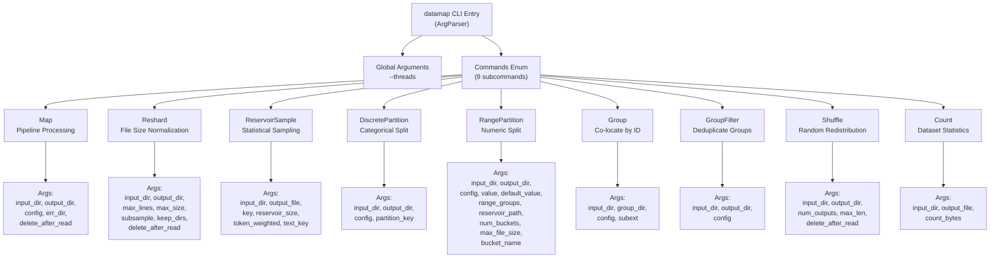
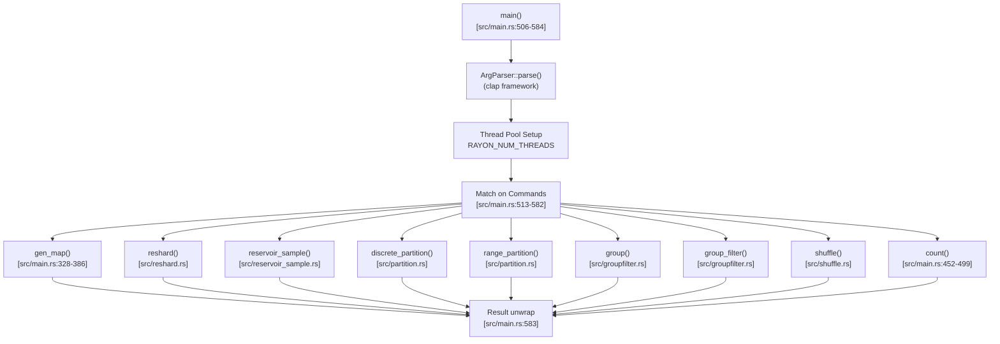
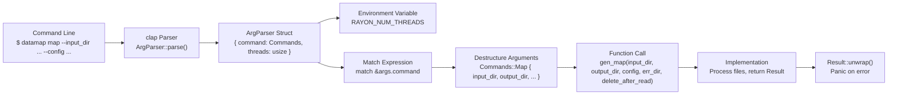

<!-- source: DeepWiki mcp.deepwiki.com · repo allenai/datamap-rs · page 2.1 Command Dispatcher and CLI Structure · fetched 2026-10-26 -->

# Command Dispatcher and CLI Structure

<details>
<summary>Relevant source files</summary>

The following files were used as context for generating this wiki page:

- [src/main.rs](src/main.rs)

</details>


## Purpose and Scope

This document describes the command-line interface (CLI) architecture of datamap-rs, focusing on how commands are defined, how arguments are parsed, and how execution is dispatched to the appropriate handlers. For details on what each command does and their data processing behavior, see [Data Organization Commands](#4) and [Map Command](#3). For the execution model and parallelism, see [Parallelism and Performance Model](#2.2).

---

## Overview

The datamap-rs CLI is built using the `clap` framework, implementing a subcommand-based architecture. The system defines nine distinct commands, each with its own set of required and optional arguments. All CLI parsing, validation, and dispatch logic is centralized in [src/main.rs]().

**Architecture Pattern**: The CLI follows a standard pattern:
1. **Definition Layer**: Rust structs with `clap` derive macros define the command structure
2. **Parsing Layer**: `clap` automatically parses command-line input and validates types
3. **Dispatch Layer**: A match expression routes parsed commands to implementation functions
4. **Implementation Layer**: Individual command functions in separate modules

Sources: [src/main.rs:1-584]()

---

## Command Structure Hierarchy



**Command Structure**: All commands are defined as variants in the `Commands` enum, each containing its own struct of arguments. The `ArgParser` struct at the top level wraps the `Commands` enum and adds global arguments that apply across all commands.

Sources: [src/main.rs:49-224]()

---

## Argument Parser Definition

The CLI parser is defined through two primary structures:

### ArgParser Struct

[src/main.rs:49-57]()

```
#[derive(Parser)]
#[clap(author, version, about, long_about = None)]
struct ArgParser {
    #[clap(subcommand)]
    command: Commands,

    #[arg(long, default_value_t = 0)]
    threads: usize,
}
```

**Global Arguments**:
- `--threads`: Controls the Rayon thread pool size. Default is 0 (auto-detect CPU cores).

### Commands Enum

[src/main.rs:59-224]()

The `Commands` enum defines all available subcommands. Each variant contains a named struct with that command's specific arguments.

**Key Attributes Used**:
- `#[clap(arg_required_else_help = true)]`: Shows help if no arguments provided
- `#[arg(required = true, long)]`: Marks argument as mandatory with `--name` syntax
- `#[arg(long)]`: Optional argument with `--name` syntax
- `#[arg(long, default_value_t = ...)]`: Optional with default value
- `#[arg(long, value_delimiter = ',')]`: Accepts comma-separated list

Sources: [src/main.rs:49-224]()

---

## Command Argument Patterns

### Common Argument Patterns

| Pattern | Arguments | Commands Using | Purpose |
|---------|-----------|----------------|---------|
| **Input/Output** | `input_dir`, `output_dir` | Reshard, DiscretePartition, RangePartition, GroupFilter, Shuffle | Standard directory-to-directory transformation |
| **Input/Config/Output** | `input_dir`, `output_dir`, `config` | Map, DiscretePartition, RangePartition, Group, GroupFilter | Transformation requiring configuration file |
| **Input/Output File** | `input_dir`, `output_file` | ReservoirSample, Count | Produces single output file |
| **Deletion Flag** | `delete_after_read` | Map, Reshard, Shuffle | Delete input files after processing |
| **Size Control** | `max_lines`, `max_size`, `max_len` | Reshard, Shuffle | Control output file sizes |

### Configuration File Arguments

Several commands accept configuration files that control their behavior:

- **Map**: `config` (required) - Defines the processing pipeline
- **DiscretePartition**: `config` (optional) - Defines partition categories
- **RangePartition**: `config` (optional) - Defines range boundaries
- **Group/GroupFilter**: `config` (required) - Defines grouping key and behavior

Configuration files can be either YAML or JSON format, automatically detected by extension.

Sources: [src/main.rs:59-224]()

---

## Dispatch Mechanism



**Dispatch Flow**:

1. **Parsing**: [src/main.rs:507]() - `ArgParser::parse()` consumes command-line arguments
2. **Thread Configuration**: [src/main.rs:508-511]() - If `--threads` is non-zero, set `RAYON_NUM_THREADS` environment variable
3. **Command Matching**: [src/main.rs:513-582]() - Match on `Commands` enum variant
4. **Argument Extraction**: Each match arm destructures the command's arguments
5. **Function Call**: Dispatch to implementation function with extracted arguments
6. **Result Handling**: [src/main.rs:583]() - Unwrap result, panic on error

**Thread Pool Configuration**:
```rust
let threads = args.threads;
if threads != 0 {
    std::env::set_var("RAYON_NUM_THREADS", threads.to_string());
}
```

The Rayon thread pool is configured via environment variable before any parallel operations. A value of 0 (default) lets Rayon auto-detect the number of CPU cores.

Sources: [src/main.rs:506-584]()

---

## Configuration File Parsing

### parse_config Function

[src/main.rs:230-248]()

The `parse_config` utility function handles both YAML and JSON configuration files:

**Implementation**:
1. Open the configuration file
2. Detect format by file extension (`.yaml` or `.json`)
3. Parse to `serde_json::Value` (unified representation)
4. Return parsed configuration

**Format Detection**:
- `.json` → `serde_json::from_reader()`
- `.yaml` → `serde_yaml::from_reader()` → `serde_json::to_value()`
- Other extensions → Error

**Unified Output**: All configurations are converted to `serde_json::Value`, providing a consistent interface regardless of input format. This allows command implementations to work with a single type.

Sources: [src/main.rs:230-248]()

---

## Command Implementation Pattern

### Standard Implementation Signature

Most commands follow this pattern:

```
fn command_name(
    input_dir: &PathBuf,
    output_dir: &PathBuf,
    // ... command-specific parameters
) -> Result<(), Error>
```

### Map Command Pattern (Most Complex)

[src/main.rs:328-386]()

The Map command demonstrates the full pattern:

1. **Setup**: Parse configuration, initialize processor, create tracking structures
2. **File Discovery**: Use `expand_dirs()` to find all input files
3. **Parallel Processing**: Iterate over files with `par_iter()` (Rayon)
4. **Per-File Processing**: Call single-file handler
5. **Statistics Aggregation**: Collect timing and filtering statistics
6. **Reporting**: Print global statistics

**Key Implementation Details**:
- Uses `DashMap` for thread-safe statistics collection
- Uses `AtomicUsize` for atomic counter operations
- Progress bar via `build_pbar()` from `mj_io` crate
- Optional file deletion after processing

### Count Command Pattern (Simple)

[src/main.rs:452-499]()

The Count command shows a simpler pattern:

1. **Setup**: Initialize atomic counters
2. **File Discovery**: Expand input directory
3. **Parallel Processing**: Process each file independently
4. **Atomic Aggregation**: Use `fetch_add()` for thread-safe counting
5. **Output**: Write statistics to JSON file

Sources: [src/main.rs:328-499]()

---

## Argument Passing Flow



**Key Points**:
- Arguments are owned by the parsed struct, borrowed in match arms
- `PathBuf` arguments are passed by reference (`&PathBuf`)
- Primitive types are copied (bool, usize)
- `Option` types are cloned when needed
- No validation beyond type checking happens at CLI level - implementation functions handle semantic validation

Sources: [src/main.rs:506-584]()

---

## Error Handling

The CLI layer uses a simple error handling strategy:

### Parse-Time Errors
- Handled automatically by `clap`
- Invalid arguments, missing required fields, type mismatches all produce helpful error messages
- Process exits with non-zero status

### Runtime Errors
[src/main.rs:583]()
```rust
result.unwrap();
```

- All command implementations return `Result<(), Error>`
- The top-level match produces a `Result`
- `.unwrap()` is called on the result - any error causes a panic with error message
- No graceful error recovery at the CLI level

This design prioritizes simplicity for batch processing workloads where failures should be obvious and halt processing.

Sources: [src/main.rs:506-584]()

---

## Module Imports and Dependencies

### External Crates Used for CLI

[src/main.rs:1-23]()

| Crate | Purpose | Usage |
|-------|---------|-------|
| `clap` | CLI parsing | `Parser` and `Subcommand` derive macros |
| `anyhow` | Error handling | `Error` and `Result` types |
| `std::path::PathBuf` | File paths | Command arguments |
| `rayon` | Parallelism | Controlled via `--threads` argument |
| `serde_json`, `serde_yaml` | Config parsing | Parse YAML/JSON configuration files |

### Internal Modules Imported

[src/main.rs:24-35]()

Each command implementation is typically in its own module:
- `map_fxn`: Pipeline processing (`gen_map` in main.rs)
- `partition`: Discrete and range partitioning
- `groupfilter`: Group and GroupFilter commands
- `reservoir_sample`: Statistical sampling
- `reshard`: File size normalization (separate module)
- `shuffle`: Random redistribution (separate module)

The `count` command is implemented directly in `main.rs`.

Sources: [src/main.rs:1-35]()

---

## Command Invocation Examples

### Example: Map Command
```bash
datamap map \
  --input_dir /data/input \
  --output_dir /data/output \
  --config pipeline.yaml \
  --err_dir /data/errors \
  --delete_after_read \
  --threads 32
```

### Example: Reshard Command
```bash
datamap reshard \
  --input_dir /data/raw \
  --output_dir /data/normalized \
  --max_size 268435456 \
  --keep_dirs \
  --threads 16
```

### Example: Range Partition with Automatic Quantiles
```bash
datamap range-partition \
  --input_dir /data/input \
  --output_dir /data/partitioned \
  --value "metadata.quality_score" \
  --reservoir_path /data/sample.jsonl \
  --num_buckets 10 \
  --threads 24
```

### Example: Count Statistics
```bash
datamap count \
  --input_dir /data/corpus \
  --output_file /data/stats.json \
  --count_bytes text
```

**Naming Convention**: Commands use kebab-case on the command line (`discrete-partition`) but are defined as PascalCase in the enum (`DiscretePartition`). The `clap` framework handles this conversion automatically.

Sources: [src/main.rs:59-224]()

---

## Summary Table: Command Signature Reference

| Command | Required Args | Optional Args | Configuration |
|---------|--------------|---------------|---------------|
| `map` | `input_dir`, `output_dir`, `config` | `err_dir`, `delete_after_read` | YAML/JSON pipeline |
| `reshard` | `input_dir`, `output_dir` | `max_lines`, `max_size`, `subsample`, `keep_dirs`, `delete_after_read` | None |
| `reservoir-sample` | `input_dir`, `output_file`, `key` | `reservoir_size`, `token_weighted`, `text_key` | None |
| `discrete-partition` | `input_dir`, `output_dir` | `config`, `partition_key` | Optional YAML/JSON |
| `range-partition` | `input_dir`, `output_dir` | `config`, `value`, `default_value`, `range_groups`, `reservoir_path`, `num_buckets`, `max_file_size`, `bucket_name` | Optional YAML/JSON |
| `group` | `input_dir`, `group_dir`, `config` | `subext` | YAML/JSON grouping rules |
| `group-filter` | `input_dir`, `output_dir`, `config` | None | YAML/JSON filter rules |
| `shuffle` | `input_dir`, `output_dir`, `num_outputs` | `max_len`, `delete_after_read` | None |
| `count` | `input_dir`, `output_file` | `count_bytes` | None |

**Global Arguments**: All commands accept `--threads` to control parallelism.

Sources: [src/main.rs:59-224]()

---

